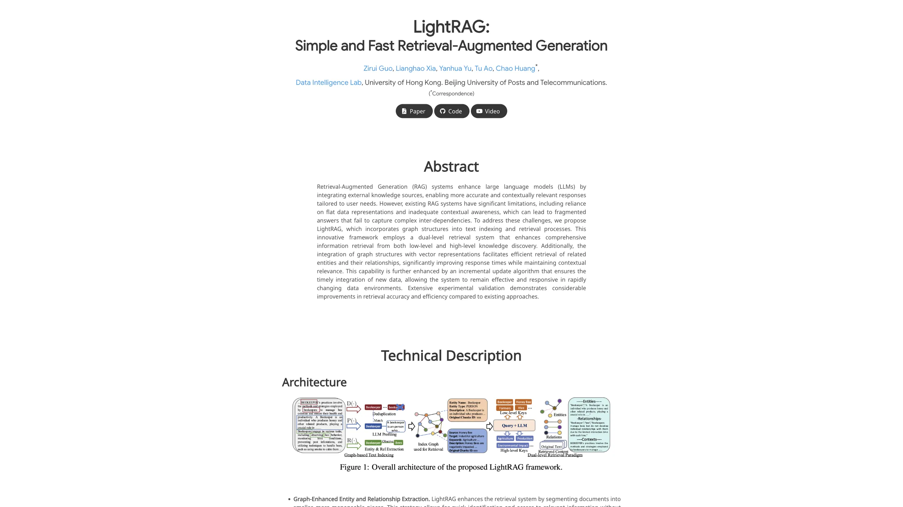

# 在 Sealos 上部署和托管 LightRAG

LightRAG 是香港大学开源的基于图谱的检索增强生成服务。它从文档中抽取实体和关系，与向量嵌入一起存储，并用图谱感知的检索方式回答问题。本 Sealos 模板运行 LightRAG 1.5.8，提供 JWT 登录、持久化文档存储，以及可配置的 OpenAI 兼容对话与向量接口。



## 托管说明

LightRAG 以单个 StatefulSet 运行官方镜像 `ghcr.io/hkuds/lightrag:v1.5.8`。服务监听 `9621` 端口，在 `/webui` 提供 Web UI，在 `/docs` 提供 OpenAPI 页面，并在根路径提供 REST API。两个 1Gi 卷分别保存 `/app/data/rag_storage` 和 `/app/data/inputs`，知识图谱、向量索引、文档元数据和上传文件在 Pod 重启后继续保留。

模板需要一个 OpenAI 兼容的对话接口和一个 OpenAI 兼容的向量接口。对话模型负责实体与关系抽取以及答案生成；向量模型负责把文本块、实体和关系转成向量。两个接口的地址、模型名称、向量维度以及一个 API Key 都是部署输入。默认值指向 OpenAI，修改基础地址即可接入其他兼容服务。

认证默认开启。Web UI 和 API 使用用户名 `admin` 和必填的 `admin_password` 输入，JWT 密钥由平台生成。另一个自动生成的 API Key 保护 Ollama 兼容路由。测试档位使用 `50m` CPU、`51Mi` 内存请求，`500m` CPU、`512Mi` 内存上限。

## 常见使用场景

- **私有知识库**：为企业内部文档、制度和研究笔记构建可搜索的图谱。
- **图谱感知 RAG**：检索平铺向量搜索容易遗漏的关联实体和关系。
- **文档问答**：上传报告和手册，提问时返回带来源的答案。
- **实体探索**：查看抽取出的知识图谱，核对名称、关系和覆盖范围。
- **多供应商实验**：在不改变部署拓扑的前提下比较不同的对话与向量供应商。
- **智能体记忆**：为需要长期文档上下文的智能体提供持久化检索服务。

## 部署依赖

- 至少 512Mi 内存和 2Gi 持久化存储的 Sealos 工作区。
- 一个 OpenAI 兼容的对话补全接口和 API Key。
- 一个 OpenAI 兼容的向量接口，其输出维度与 `embedding_dim` 一致。
- 集群到两个接口的出网访问能力。
- 用于 Web UI 的浏览器，或用于 REST API 的 `curl`。

### 部署相关链接

- [LightRAG 项目主页](https://lightrag.github.io/)：论文、架构与评测结果
- [LightRAG 仓库](https://github.com/HKUDS/LightRAG)：源码、示例与发布说明
- [API 服务指南](https://github.com/HKUDS/LightRAG/blob/main/docs/LightRAG-API-Server.md)：服务配置与认证
- [Docker 部署指南](https://github.com/HKUDS/LightRAG/blob/main/docs/DockerDeployment.md)：容器结构与环境变量
- [模型供应商选项](https://github.com/HKUDS/LightRAG/blob/main/docs/LLMProviderOptions.md)：支持的绑定与模型设置
- [环境变量参考](https://github.com/HKUDS/LightRAG/blob/main/env.example)：完整配置项
- [LightRAG 容器镜像](https://github.com/HKUDS/LightRAG/pkgs/container/lightrag)：模板使用的镜像
- [LightRAG 论文](https://arxiv.org/abs/2410.05779)：图谱增强 RAG 的设计与评估

## 实现细节

**架构组件：**

- **LightRAG StatefulSet**：单副本运行官方镜像，在 `9621` 端口同时提供 API 和 Web UI。
- **存储卷**：挂载到 `/app/data/rag_storage` 的 1Gi 卷，保存图谱、向量索引、缓存和文档状态。
- **输入卷**：挂载到 `/app/data/inputs` 的 1Gi 卷，保存上传的源文件。
- **Service**：ClusterIP 的 `80` 端口转发到 LightRAG HTTP 端口。
- **Ingress**：由 Sealos 管理的 HTTPS 域名，配置 32Mi 请求体上限和 300 秒代理超时。
- **应用入口**：打开 `/webui` 进入 Web UI。

**配置：**

- **镜像**：`ghcr.io/hkuds/lightrag:v1.5.8`
- **HTTP 端口**：`9621`
- **Web UI**：`/webui`
- **API 文档**：`/docs`
- **对话绑定**：OpenAI 兼容，由 `llm_base_url`、`llm_api_key` 和 `llm_model` 配置
- **向量绑定**：OpenAI 兼容，由 `embedding_base_url`、`embedding_model` 和 `embedding_dim` 配置
- **认证**：`AUTH_ACCOUNTS=admin:<admin_password>`，配合自动生成的 `TOKEN_SECRET`
- **API Key**：自动生成的 `LIGHTRAG_API_KEY` 保护 Ollama 兼容路由
- **默认对话模型**：`gpt-4.1-mini`
- **默认向量模型**：`text-embedding-3-small`，1536 维
- **健康检查**：`GET /health`
- **存储路径**：`/app/data/rag_storage` 和 `/app/data/inputs`
- **安全上下文**：以 UID `1000` 运行，移除全部 Linux capabilities，禁用提权并启用 `RuntimeDefault` seccomp 配置

**资源分配：**

| 组件 | CPU 请求 | CPU 上限 | 内存请求 | 内存上限 | 存储 |
| --- | ---: | ---: | ---: | ---: | ---: |
| LightRAG | 50m | 500m | 51Mi | 512Mi | 2Gi |

以上数值为线上实测档位。一篇 303 字符的文档产出了 16 个实体和 16 个关系，`mix` 模式查询返回了带来源的答案。查询期间服务占用约 269Mi 内存和 129m CPU，零重启。更大的文档和更高的检索深度需要更多内存与 CPU。

## 为什么在 Sealos 上部署 LightRAG？

Sealos 是基于 Kubernetes 的 AI 辅助云操作系统，用一个界面提供 LightRAG 所需的计算、存储、网络和运维能力：

- **一键部署**：通过一个模板创建 StatefulSet、两个数据卷、Service、Ingress 和应用入口。
- **自动 HTTPS**：获得由平台管理的公网域名和 TLS 证书，Web UI 与 API 共用该入口。
- **持久化知识图谱**：把文档、实体、关系和向量保存在独立卷上。
- **自带模型**：把对话和向量输入指向任何 OpenAI 兼容供应商。
- **资源可控**：在资源卡片上调整 CPU 和内存，由平台负责调度与健康检查。
- **运维可见**：在 Canvas 或 Sealos AI 对话中查看 Pod、日志、事件和资源使用。

## 部署指南

1. 打开 [LightRAG 模板](https://sealos.io/products/app-store/lightrag) 并点击 **Deploy Now**。
2. 设置管理员密码和 API Key，然后配置对话与向量接口的基础地址、模型名称和向量维度。
3. 确认自动生成的应用名和两个 1Gi 卷，提交部署。
4. 等待 2-3 分钟让 Pod 就绪并完成证书签发。
5. 打开应用卡片，使用 `admin` 和部署时设置的密码登录。
6. 上传文档，等待状态变为 **Completed**，然后在 **Retrieval** 标签页发起提问。

## 使用 Web UI

Web UI 位于 `https://<应用域名>/webui`，包含三个标签页：

- **Documents** 列出自上传文件、处理状态、分块数量和错误信息。用 **Upload** 上传新文件，用 **Scan/Retry** 重试失败的文档。
- **Knowledge Graph** 渲染抽取出的实体和关系，便于探索。
- **Retrieval** 把问题发送给配置的对话模型，并展示带来源引用的答案。

界面跟随浏览器语言，支持英文和中文。首篇文档会触发抽取流水线，产生多次模型调用，耗时从数秒到数分钟，取决于文档大小和供应商延迟。

## 使用 REST API

先用管理员凭据登录获取 JWT：

```bash
BASE=https://<应用域名>
curl -sS -X POST "$BASE/login" --data-urlencode 'username=admin' --data-urlencode "password=<管理员密码>" > login.json
TOKEN=$(python3 -c 'import json;print(json.load(open("login.json"))["access_token"])')
```

插入文本并轮询处理进度：

```bash
curl -sS -X POST "$BASE/documents/text" \
  -H "Authorization: Bearer $TOKEN" \
  -H 'Content-Type: application/json' \
  -d '{"text":"Sealos runs LightRAG with persistent storage and JWT login.","file_source":"intro.txt"}'

curl -sS "$BASE/documents/pipeline_status" -H "Authorization: Bearer $TOKEN"
```

查询知识库：

```bash
curl -sS -X POST "$BASE/query" \
  -H "Authorization: Bearer $TOKEN" \
  -H 'Content-Type: application/json' \
  -d '{"query":"What does Sealos provide?","mode":"mix","include_references":true}'
```

响应包含 `response`、`references` 和耗时字段。`GET /health` 无需认证，返回认证模式、版本和流水线状态。`/docs` 的 OpenAPI 页面列出全部路由，包括文档管理、图谱编辑和扫描操作。

## 存储与持久化

`/app/data/rag_storage` 保存 JSON 键值存储、NetworkX 图谱、向量数据库、文档状态存储和模型响应缓存。`/app/data/inputs` 保存上传的源文件。StatefulSet 通过 `volumeClaimTemplates` 为每个路径映射一个 1Gi 卷。

知识库存续期间保持两个卷绑定。空的 `rag_storage` 卷会启动一个空图谱，需要重新入库。向量模型名称和维度会记录为基准；入库后修改其中任一项都需要清空文档并重建索引。

## 扩缩容

本模板运行单副本，因为默认存储后端是本地 JSON、NetworkX 和 NanoVectorDB 文件，服务在进程内维护流水线。垂直扩容时，为更大的文档提高内存上限，为更快的抽取和向量化提高 CPU 上限。

水平扩展需要把键值、向量和图谱存储迁移到外部服务，例如带 pgvector 的 PostgreSQL、Neo4j 或 Milvus，然后用共享配置运行多个 LightRAG 副本。这些后端需要额外的环境变量，超出本单机档位的范围。

## 排障

### Pod 以 "EMBEDDING_MODEL is not set" 退出

向量模型名称为空时 LightRAG 会拒绝启动，因为该名称会随每个向量一起记录。把 `embedding_model` 设置为向量接口实际提供的模型，并把 `embedding_dim` 设置为对应维度。

### 文档一直停留在 "Processing" 或处理失败

检查 Pod 日志中的对话接口错误。401 或 404 通常表示 API Key、基础地址或模型名称有误。实体抽取对每个文本块发起多次模型调用，限流和超时都会表现为文档失败。修复接口后从 Documents 标签页重试。

### 查询没有返回上下文

确认文档状态为 **Completed** 且图谱中存在实体。检索路径使用入库时记录的向量模型；模型或维度不一致会导致匹配失败。修改向量配置后清空文档并重新入库。

### 登录返回 422

`/login` 接口要求表单编码的 `username` 和 `password` 字段。使用 `--data-urlencode` 或 HTML 表单提交，并保持 `application/x-www-form-urlencoded` 内容类型。

### Web UI 返回重定向

使用带尾部斜杠的 `/webui/`。裸路径 `/webui` 会重定向到带版本号的 UI 路由。

### 上传返回 413

Ingress 把请求体限制在 32Mi。拆分或压缩较大的 PDF，或者为你的部署调高 `nginx.ingress.kubernetes.io/proxy-body-size` 注解。LightRAG 自身还有请求体和上传大小限制，位于环境配置中。

### 公网入口可被任何人访问

JWT 登录保护 Web UI 和 API，自动生成的 API Key 保护 Ollama 兼容路由。使用强管理员密码、妥善保管生成的密钥，并在知识库不再使用时删除实例。

### 获取帮助

- [LightRAG 文档](https://github.com/HKUDS/LightRAG)
- [LightRAG GitHub 问题反馈](https://github.com/HKUDS/LightRAG/issues)
- [Sealos 文档](https://sealos.io/docs)

## 许可证

LightRAG 采用 [MIT License](https://github.com/HKUDS/LightRAG/blob/main/LICENSE)。本 Sealos 模板遵循 templates 仓库的许可证。
