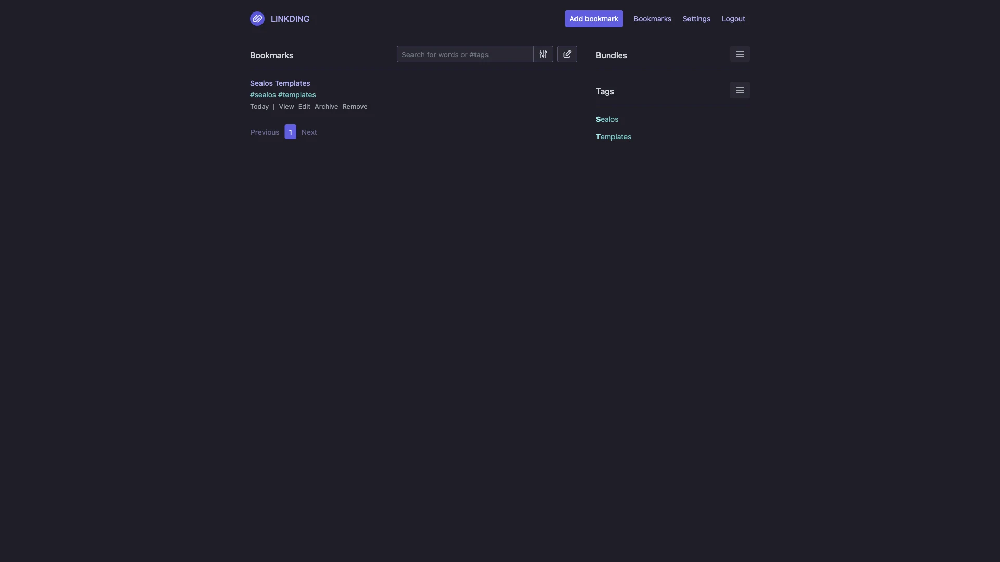

# Deploy and Host Linkding on Sealos

Linkding is a minimal, self-hosted bookmark manager with tags, full-text search, page snapshots, an admin UI, and a REST API. This template deploys Linkding 1.47.0 as a single StatefulSet with a 1Gi data volume and a generated administrator account.

## About Hosting Linkding

Linkding runs as one Django service on port `9090`. The template mounts a 1Gi volume at `/etc/linkding/data`, where SQLite stores users, bookmarks, tags, and settings. The superuser name and password come from deployment inputs, and Linkding creates the administrator on the first boot.

The deployment sets `LD_USE_X_FORWARDED_HOST=True` and a CSRF trusted origin for the generated HTTPS host, so the login form and admin actions work through the Sealos Ingress. Full-text search uses SQLite FTS5, and the optional snapshot feature stores a local copy of bookmarked pages.

Sealos provisions the StatefulSet, persistent volume, ClusterIP Service, Ingress, TLS certificate, and App card. The interface includes a bookmark list, tag filters, search, an admin area, and user settings for import, export, and API tokens.

## Common Use Cases

- **Personal bookmark library**: Save articles, documentation, and tools with tags and notes.
- **Research collection**: Group sources by topic and search across titles, descriptions, and tags.
- **Team link sharing**: Run one instance for a small team with separate user accounts.
- **Read-later archive**: Keep page snapshots for links that may change or disappear.
- **Browser workflow**: Connect the Linkding browser extension or REST API to save pages quickly.

## Dependencies for Linkding Hosting

- A Sealos workspace with at least 512Mi of available memory and 1Gi of persistent storage.
- A browser for the bookmark UI and admin pages.
- Outbound HTTPS access when you enable page snapshots or import remote metadata.
- Optional browser extension or API client for quick bookmark creation.

### Deployment Dependencies

- [Linkding website](https://linkding.link) - Product overview and feature list
- [Linkding documentation](https://linkding.link/installation/) - Installation and configuration guide
- [Linkding options reference](https://linkding.link/options/) - Environment variables and feature flags
- [Linkding GitHub repository](https://github.com/sissbruecker/linkding) - Source code and releases
- [Linkding container image](https://hub.docker.com/r/sissbruecker/linkding) - Image used by this template
- [Sealos documentation](https://sealos.io/docs) - Platform concepts and operations

## Implementation Details

**Architecture Components:**

- **Linkding StatefulSet**: One replica running `sissbruecker/linkding:1.47.0` on port `9090`.
- **Data volume**: A 1Gi volume mounted at `/etc/linkding/data` for SQLite, snapshots, and application data.
- **Service**: ClusterIP port `80` forwarding to the Linkding HTTP port.
- **Ingress**: Sealos-managed HTTPS host with a 32Mi request body limit and 300-second proxy timeouts.
- **App entry**: Opens the bookmark list at the generated public URL.

**Configuration:**

- **Image**: `sissbruecker/linkding:1.47.0`
- **HTTP port**: `9090`
- **Data path**: `/etc/linkding/data`
- **Database**: SQLite in the data volume
- **Administrator username**: Required input `admin_username`, default `admin`
- **Administrator password**: Required input `admin_password`, default generated value
- **Proxy behavior**: `LD_USE_X_FORWARDED_HOST=True`
- **CSRF trusted origin**: `https://${{ defaults.app_host }}.${{ SEALOS_CLOUD_DOMAIN }}`
- **Public URL**: `https://${{ defaults.app_host }}.${{ SEALOS_CLOUD_DOMAIN }}/`
- **Health probe**: `GET /health`
- **Runtime user**: UID `1000`, GID `1000`, with all Linux capabilities dropped and the `RuntimeDefault` seccomp profile
- **Timezone**: `Asia/Shanghai`

**Resource Allocation:**

| Component | CPU Request | CPU Limit | Memory Request | Memory Limit | Storage |
| --- | ---: | ---: | ---: | ---: | ---: |
| Linkding | 50m | 500m | 51Mi | 512Mi | 1Gi |

The live Sealos test signed in as `admin`, created the `Sealos Templates` bookmark with a tag, and recovered the bookmark, tag, and account after a Pod restart. The Pod stayed ready with this profile, and the tested values are recorded in the workload annotation.

## Why Deploy Linkding on Sealos?

Sealos is an AI-assisted cloud operating system built on Kubernetes. It supplies the compute, storage, networking, and operations layer for Linkding through one interface:

- **One-click deployment**: Create the StatefulSet, data volume, Service, Ingress, and App card from one template.
- **Persistent bookmarks**: Keep SQLite, tags, snapshots, and settings on a dedicated volume.
- **Managed HTTPS**: Receive a public domain and TLS certificate for the bookmark manager.
- **Generated credentials**: Start with an administrator username and password from the deployment form.
- **Resource control**: Adjust CPU and memory from the resource card as the library grows.
- **Operational visibility**: Inspect Pods, logs, events, and resource usage from Canvas or the Sealos AI dialog.

## Deployment Guide

1. Open the [Linkding template](https://sealos.io/products/app-store/linkding) and click **Deploy Now**.
2. Set the administrator username and password, save the password, and confirm the generated application name.
3. Submit the deployment and wait 2-3 minutes for the Pod to become ready and for the HTTPS certificate to be issued.
4. Open the App card and sign in with the configured administrator credentials.
5. Create a bookmark with a tag and confirm that it appears in the list and under the tag filter.
6. Open **Settings → Integrations** to create an API token for the REST API or browser extension.
7. Use **Settings → Import** to migrate bookmarks from a browser export or another Linkding instance.

## Login and Access

The public URL opens the shared bookmark list. Anonymous visitors can read public bookmarks when the instance settings allow it; sign in with the administrator account to create, edit, and delete entries.

The administrator account is created from `LD_SUPERUSER_NAME` and `LD_SUPERUSER_PASSWORD` when the user does not exist. Changing these environment variables later updates the environment, while the existing account keeps its password. Use the account settings page to rotate the password.

## Scaling

Linkding runs one replica because the template uses a single SQLite database. Scale vertically by raising the CPU and memory limits for large bookmark collections, full-text search, and snapshot processing.

The 1Gi volume holds the database and page snapshots. Expand the PVC when snapshots or attachments outgrow the volume, provided the storage class supports expansion. Horizontal scaling requires an external database and shared media storage, which this single-node template does not configure.

## Troubleshooting

### The configured password does not work

- Cause: The administrator account was created during an earlier deployment, and Linkding keeps the original password.
- Solution: Sign in with the current password and change it in account settings, or create a fresh deployment with the intended credentials.

### Page snapshots fail

- Cause: The Pod cannot reach the bookmarked site, or the page blocks automated capture.
- Solution: Confirm cluster egress to the target host, test the URL from a Pod, and disable snapshots for sites that reject automated requests.

### Login returns a CSRF or 403 error

- Cause: The public host differs from `LD_CSRF_TRUSTED_ORIGINS`, often after a custom domain change.
- Solution: Update `LD_CSRF_TRUSTED_ORIGINS` to the current HTTPS origin and restart the StatefulSet.

### The bookmark list is empty after a redeploy

- Cause: The new Pod uses a new PVC, or the volume is not writable by UID `1000`.
- Solution: Confirm that the PVC is `Bound`, check the `fsGroup` setting, and inspect the Pod log for database or permission errors.

### Search misses recently added bookmarks

- Cause: The full-text index is updating, or the query uses a filter that excludes the bookmark.
- Solution: Reload the list, clear tag or status filters, and confirm that the bookmark description contains the search term.

### Getting Help

- [Linkding documentation](https://linkding.link/installation/)
- [Linkding GitHub issues](https://github.com/sissbruecker/linkding/issues)
- [Linkding discussions](https://github.com/sissbruecker/linkding/discussions)
- [Sealos documentation](https://sealos.io/docs)

## License

Linkding is released under the [MIT License](https://github.com/sissbruecker/linkding/blob/master/LICENSE). This Sealos template is an independent deployment definition and is distributed under the templates repository license.
