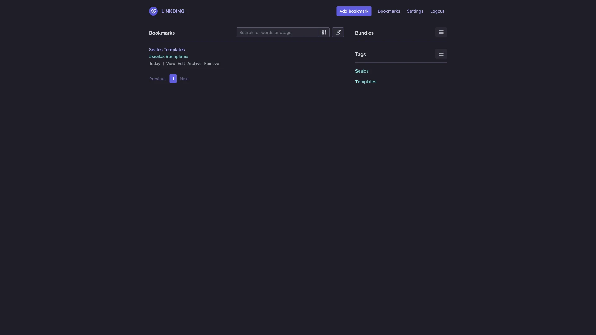

# 在 Sealos 上部署和托管 Linkding

Linkding 是一款极简自托管书签管理器，支持标签、全文搜索、网页快照、管理后台和 REST API。本模板将 Linkding 1.47.0 部署为单个 StatefulSet，配置 1Gi 数据卷和自动创建的管理员账号。

## 关于托管 Linkding

Linkding 以单个 Django 服务运行，监听 `9090` 端口。模板将 1Gi 卷挂载到 `/etc/linkding/data`，SQLite 在该目录保存用户、书签、标签和设置。管理员用户名和密码来自部署输入，Linkding 在首次启动时创建管理员。

部署设置 `LD_USE_X_FORWARDED_HOST=True`，并为生成的 HTTPS 主机配置 CSRF 信任来源，登录表单和管理操作可以通过 Sealos Ingress 正常工作。全文搜索使用 SQLite FTS5，可选的快照功能会在本地保存书签页面的副本。

Sealos 负责创建 StatefulSet、持久卷、ClusterIP Service、Ingress、TLS 证书和应用卡片。界面包含书签列表、标签筛选、搜索、管理区域，以及导入、导出和 API 令牌设置。

## 常见使用场景

- **个人书签库**：用标签和备注保存文章、文档和工具。
- **研究资料收集**：按主题组织来源，并搜索标题、描述和标签。
- **团队链接共享**：为小团队运行一个实例，并分配独立用户账号。
- **稍后阅读归档**：为可能变化或失效的链接保留页面快照。
- **浏览器工作流**：连接 Linkding 浏览器扩展或 REST API 快速保存页面。

## Linkding 托管依赖

- 一个 Sealos 工作空间，至少提供 512Mi 可用内存和 1Gi 持久存储。
- 用于书签界面和管理页面的浏览器。
- 启用页面快照或导入远程元数据时需要的出站 HTTPS 访问。
- 可选的浏览器扩展或 API 客户端，用于快速创建书签。

### 部署依赖

- [Linkding 官网](https://linkding.link) - 产品介绍和功能列表
- [Linkding 文档](https://linkding.link/installation/) - 安装和配置指南
- [Linkding 选项参考](https://linkding.link/options/) - 环境变量和功能开关
- [Linkding GitHub 仓库](https://github.com/sissbruecker/linkding) - 源码和版本发布
- [Linkding 容器镜像](https://hub.docker.com/r/sissbruecker/linkding) - 本模板使用的镜像
- [Sealos 文档](https://sealos.io/docs) - 平台概念和操作说明

## 实现细节

**架构组件：**

- **Linkding StatefulSet**：一个副本，运行 `sissbruecker/linkding:1.47.0`，监听 `9090` 端口。
- **数据卷**：1Gi，挂载到 `/etc/linkding/data`，保存 SQLite、快照和应用数据。
- **Service**：ClusterIP 端口 `80`，转发到 Linkding 的 HTTP 端口。
- **Ingress**：Sealos 托管的 HTTPS 域名，请求体上限 32Mi，代理超时 300 秒。
- **应用入口**：通过生成的公网地址打开书签列表。

**配置：**

- **镜像**：`sissbruecker/linkding:1.47.0`
- **HTTP 端口**：`9090`
- **数据路径**：`/etc/linkding/data`
- **数据库**：数据卷中的 SQLite
- **管理员用户名**：必填输入 `admin_username`，默认 `admin`
- **管理员密码**：必填输入 `admin_password`，默认自动生成
- **代理行为**：`LD_USE_X_FORWARDED_HOST=True`
- **CSRF 信任来源**：`https://${{ defaults.app_host }}.${{ SEALOS_CLOUD_DOMAIN }}`
- **公网地址**：`https://${{ defaults.app_host }}.${{ SEALOS_CLOUD_DOMAIN }}/`
- **健康检查**：`GET /health`
- **运行用户**：UID `1000`、GID `1000`，移除全部 Linux capabilities，启用 `RuntimeDefault` seccomp 配置
- **时区**：`Asia/Shanghai`

**资源分配：**

| 组件 | CPU 请求 | CPU 限制 | 内存请求 | 内存限制 | 存储 |
| --- | ---: | ---: | ---: | ---: | ---: |
| Linkding | 50m | 500m | 51Mi | 512Mi | 1Gi |

Sealos 实测使用 `admin` 登录，创建带标签的 `Sealos Templates` 书签，并在 Pod 重启后恢复书签、标签和账号。Pod 使用该配置保持就绪，实测数值已写入工作负载注解。

## 为什么在 Sealos 上部署 Linkding？

Sealos 是构建在 Kubernetes 上的 AI 辅助云操作系统，通过统一界面提供 Linkding 所需的计算、存储、网络和运维能力：

- **一键部署**：用一个模板创建 StatefulSet、数据卷、Service、Ingress 和应用卡片。
- **书签持久化**：将 SQLite、标签、快照和设置保存在独立持久卷中。
- **托管 HTTPS**：为书签管理器提供公网域名和 TLS 证书。
- **自动凭据**：通过部署表单创建管理员用户名和密码。
- **资源可控**：书签库增长时，通过资源卡片调整 CPU 和内存。
- **运维可见**：在 Canvas 或 Sealos AI 对话框中查看 Pod、日志、事件和资源使用情况。

## 部署指南

1. 打开 [Linkding 模板](https://sealos.io/products/app-store/linkding)，点击 **Deploy Now**。
2. 设置管理员用户名和密码并保存密码，确认自动生成的应用名称。
3. 提交部署，等待 2-3 分钟，Pod 进入就绪状态并完成 HTTPS 证书签发。
4. 打开应用卡片，使用配置的管理员凭据登录。
5. 创建一个带标签的书签，确认它出现在列表和标签筛选中。
6. 打开 **Settings → Integrations** 创建 API 令牌，用于 REST API 或浏览器扩展。
7. 使用 **Settings → Import** 从浏览器导出文件或其他 Linkding 实例迁移书签。

## 登录与访问

公网地址打开共享书签列表。实例设置允许时，匿名访客可以读取公开书签；登录管理员账号后可以创建、编辑和删除条目。

管理员账号在用户不存在时根据 `LD_SUPERUSER_NAME` 和 `LD_SUPERUSER_PASSWORD` 创建。之后修改这些环境变量会更新运行环境，现有账号仍保留原密码。需要更换密码时，在账号设置页面修改。

## 扩缩容

模板使用单个 SQLite 数据库，因此 Linkding 运行一个副本。书签数量较大、全文搜索繁忙或快照任务较多时，通过提高 CPU 和内存限制纵向扩容。

1Gi 卷保存数据库和页面快照。快照或附件增长后可以扩展 PVC，前提是存储类支持扩容。水平扩容需要外部数据库和共享媒体存储，本单节点模板未配置这些组件。

## 故障排查

### 配置的密码无法登录

- 原因：管理员账号在更早的部署中创建，Linkding 保留原密码。
- 处理：使用当前密码登录并在账号设置中修改，或者用目标凭据创建新的部署。

### 页面快照失败

- 原因：Pod 无法访问书签站点，或者页面阻止自动捕获。
- 处理：确认集群到目标主机的出站访问，在 Pod 中测试 URL，并对拒绝自动请求的站点关闭快照。

### 登录返回 CSRF 或 403 错误

- 原因：公网主机名与 `LD_CSRF_TRUSTED_ORIGINS` 不一致，常见于更换自定义域名之后。
- 处理：将 `LD_CSRF_TRUSTED_ORIGINS` 更新为当前 HTTPS 来源，然后重启 StatefulSet。

### 重新部署后书签列表为空

- 原因：新 Pod 使用了新的 PVC，或者 UID `1000` 无法写入卷。
- 处理：确认 PVC 处于 `Bound` 状态，检查 `fsGroup` 配置，并查看 Pod 日志中的数据库或权限错误。

### 搜索找不到刚添加的书签

- 原因：全文索引正在更新，或者查询条件排除了该书签。
- 处理：刷新列表，清除标签或状态筛选，并确认书签描述包含搜索词。

### 获取帮助

- [Linkding 文档](https://linkding.link/installation/)
- [Linkding GitHub Issues](https://github.com/sissbruecker/linkding/issues)
- [Linkding Discussions](https://github.com/sissbruecker/linkding/discussions)
- [Sealos 文档](https://sealos.io/docs)

## 许可证

Linkding 使用 [MIT License](https://github.com/sissbruecker/linkding/blob/master/LICENSE) 发布。本 Sealos 模板是独立部署定义，遵循 templates 仓库许可证。
