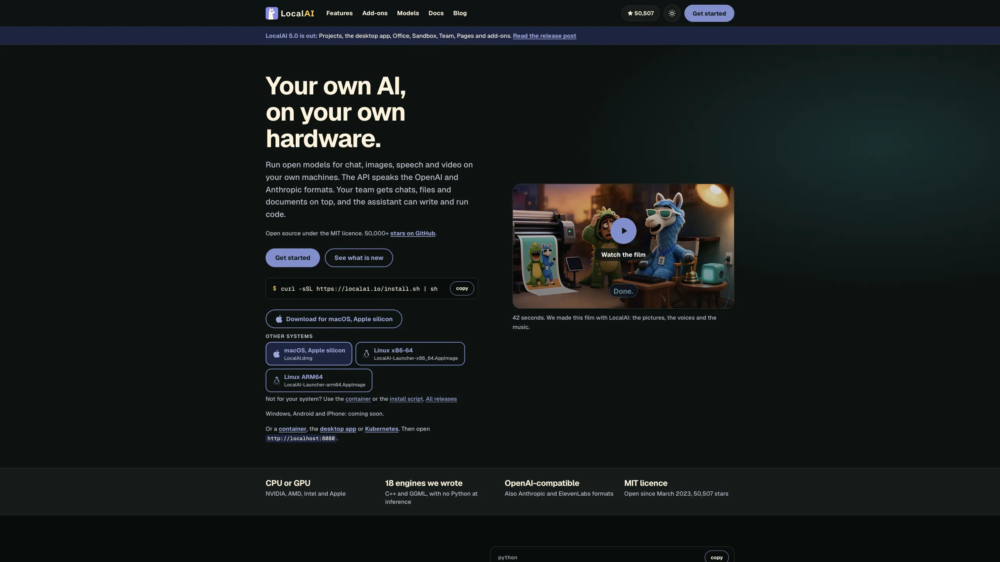

# Deploy and Host LocalAI on Sealos

LocalAI is a self-hosted AI engine that runs open models for chat, embeddings, speech, image generation, and document collections on CPU or GPU hardware. This Sealos template runs LocalAI 5.0.0 with API-key authentication, a persistent data volume, the built-in web workbench, and OpenAI- and Anthropic-compatible APIs.



## About Hosting LocalAI

LocalAI runs as one StatefulSet with the official `localai/localai:v5.0.0` CPU image. The server listens on port `8080`, serves the web workbench at `/app`, and exposes model and inference APIs under `/v1`. A 1Gi volume at `/data` holds downloaded models, backend binaries, runtime settings, and generated files, so the installation survives Pod restarts.

The API key entered at deployment protects the web workbench and every API route. The workbench asks for that key on first visit and stores it in the browser. The server keeps unauthenticated GET requests available for static UI assets, while API calls and model management require the key.

The tested profile uses `50m` CPU and `51Mi` memory as requests, with `500m` CPU and `512Mi` memory as limits. LocalAI starts without a model and presents the model library for installation. Model inference needs more CPU and memory in proportion to the selected model.

## Common Use Cases

- **Private AI API**: Serve OpenAI-compatible chat, embeddings, speech, and image endpoints inside your own network.
- **Model Evaluation**: Compare GGUF and other backends from one workbench before committing to a provider.
- **Document Collections**: Build retrieval collections over internal files with local embedding models.
- **Team Workspace**: Give a small team shared chats, files, projects, and model access behind one key.
- **Agent Backend**: Point coding agents and automation tools at a self-hosted OpenAI-compatible base URL.
- **Air-Gapped Experiments**: Keep prompts, documents, and model files on infrastructure you control.

## Dependencies for Hosting LocalAI

- A Sealos workspace with at least 512Mi of memory and 1Gi of persistent storage.
- An API key of at least 16 characters for the web UI and API.
- Outbound network access for downloading models and backend packages from the configured galleries.
- A browser for the workbench, or `curl` for the API.
- Additional CPU, memory, and storage sized to the models you plan to run.

### Deployment Dependencies

- [LocalAI website](https://localai.io/) - Product overview and release news
- [LocalAI documentation](https://localai.io/docs/) - Installation, models, and API guides
- [Container installation](https://localai.io/docs/start/install/containers/) - Image variants and volume layout
- [Quickstart](https://localai.io/docs/start/quickstart/) - First model and first chat
- [Model gallery](https://localai.io/models/) - Model catalog and compatibility notes
- [Runtime settings](https://localai.io/docs/administration/runtime-settings/) - API keys, galleries, and persisted settings
- [LocalAI repository](https://github.com/mudler/LocalAI) - Source code and release notes
- [LocalAI container image](https://hub.docker.com/r/localai/localai) - Image used by this template

## Implementation Details

**Architecture Components:**

- **LocalAI StatefulSet**: One replica running the CPU image with the web workbench and API on port `8080`.
- **Data volume**: A 1Gi volume at `/data` holding models, backends, runtime settings, and generated files.
- **Service**: ClusterIP port `80` forwarding to the LocalAI HTTP port.
- **Ingress**: Sealos-managed HTTPS host with a 32Mi request body limit and 300-second proxy timeouts.
- **App entry**: Opens the workbench at `/app`, which prompts for the deployment API key.

**Configuration:**

- **Image**: `localai/localai:v5.0.0`
- **HTTP port**: `8080`
- **Web workbench**: `/app`
- **OpenAI-compatible API**: `/v1`
- **Anthropic-compatible messages API**: `/v1/messages`
- **Models path**: `/data/models`
- **Backends path**: `/data/backends`
- **Runtime settings**: `/data/configuration`
- **Authentication**: Required `api_key` input mapped to `LOCALAI_API_KEY`
- **UI asset access**: `LOCALAI_DISABLE_API_KEY_REQUIREMENT_FOR_HTTP_GET=true` keeps static UI routes readable while API calls stay protected
- **Health check**: `GET /readyz`
- **Security context**: Runs as UID `10001`, drops all Linux capabilities, disables privilege escalation, and applies the `RuntimeDefault` seccomp profile

**Resource Allocation:**

| Component | CPU Request | CPU Limit | Memory Request | Memory Limit | Storage |
| --- | ---: | ---: | ---: | ---: | ---: |
| LocalAI | 50m | 500m | 51Mi | 512Mi | 1Gi |

The values above are the live-tested profile. The Pod reached Ready with zero restarts, the workbench login succeeded, `/v1/models` returned an empty model list with HTTP 200, and the model library rendered 1,641 entries. Idle memory settled around 64Mi after the resource change. Model loading, inference, and document indexing need additional memory and CPU.

## Why Deploy LocalAI on Sealos?

Sealos is an AI-assisted cloud operating system built on Kubernetes. It provides the compute, storage, networking, and operations layer for LocalAI in one interface:

- **One-Click Deployment**: Create the StatefulSet, data volume, Service, Ingress, and App entry from a single template.
- **Automatic HTTPS**: Receive a managed public domain and TLS certificate for the workbench and API.
- **Persistent Models**: Keep downloaded models and runtime settings on a dedicated volume.
- **Resource Control**: Adjust CPU and memory from the resource card as you move from small GGUF models to larger workloads.
- **Operational Visibility**: Inspect Pods, logs, events, and resource usage from Canvas or the Sealos AI dialog.
- **Pay-as-You-Go**: Start with a small CPU profile and raise limits when inference traffic grows.

## Deployment Guide

1. Open the [LocalAI template](https://sealos.io/products/app-store/localai) and click **Deploy Now**.
2. Enter an API key of at least 16 characters and confirm the generated application name.
3. Submit the deployment and wait 2-3 minutes for the Pod to become ready and the certificate to be issued.
4. Open the App card. The workbench prompts for the API key; enter the deployment value.
5. Open **Models** and install a model that fits the available memory and the 1Gi data volume.
6. Start a chat from the home page, or call `/v1/models` and `/v1/chat/completions` with the same key.

## Using the Web Workbench

The workbench at `https://<your-app-host>/app` includes:

- **Home**: Chat composer, model selector, tools, skills, and project shortcuts.
- **Models**: Model library, import, remote connections, installed models, and disk usage.
- **Collections**: Document collections backed by local embedding models.
- **Files and Projects**: Shared workspace material for chats and agents.
- **Add-ons**: Optional capabilities such as Office, Sandbox, Tables, and voice tools.

The interface follows the browser language and supports English and Chinese. Model installation downloads large files into `/data/models`; confirm the remaining disk shown on the Models page before starting.

## Using the API

List models and send a chat completion:

```bash
BASE=https://<your-app-host>
KEY=<your-api-key>

curl -sS "$BASE/v1/models" -H "Authorization: Bearer $KEY"

curl -sS "$BASE/v1/chat/completions" \
  -H "Authorization: Bearer $KEY" \
  -H 'Content-Type: application/json' \
  -d '{"model":"<installed-model>","messages":[{"role":"user","content":"Hello"}]}'
```

Embeddings and speech use the same OpenAI-compatible shape:

```bash
curl -sS "$BASE/v1/embeddings" \
  -H "Authorization: Bearer $KEY" \
  -H 'Content-Type: application/json' \
  -d '{"model":"<embedding-model>","input":"Sealos runs LocalAI"}'
```

The Anthropic-compatible endpoint is available at `/v1/messages`. `GET /readyz` is public and reports readiness. The workbench and API share the same key; rotate it by updating the deployment input and restarting the Pod.

## Storage and Persistence

The `vn-data` volume backs `/data`. LocalAI stores downloaded model files under `/data/models`, backend binaries under `/data/backends`, runtime settings under `/data/configuration`, and download staging under `/data/downloading`. The StatefulSet maps the volume through `volumeClaimTemplates`, so a restart keeps the installed models and settings.

The initial request is 1Gi. Large models exceed that space; expand the `vn-data` PVC from the Sealos storage page before installing them. Keep the volume bound for the lifetime of the deployment. A fresh volume starts an empty model library and requires reinstalling models.

## Scaling

This template runs one replica because LocalAI keeps model state, backends, and runtime settings in the local data volume. Scale vertically by raising the memory limit for larger models and the CPU limit for faster prompt processing.

Horizontal scaling requires a shared model store, a shared configuration directory, and a load balancer in front of stateless replicas. For most single-team deployments, a larger vertical profile is simpler and keeps the model cache warm.

## Troubleshooting

### The workbench rejects the API key

Use the exact `api_key` value entered at deployment. The key is stored in the browser after a successful login; clear the site data if an old key persists. Check the Pod environment with `kubectl exec` when the value is unclear.

### `/v1/models` returns 401

Every API request needs `Authorization: Bearer <api-key>`. The health endpoints `/readyz` and `/healthz` stay public; the model and inference routes do not.

### The model library is empty or cannot download

The library fetches metadata and model files from external galleries. Confirm outbound network access from the cluster, then retry from **Models**. Use **Import model** for a file you host yourself.

### Model installation fails with "no space left on device"

The data volume starts at 1Gi. Expand the `vn-data` PVC in Sealos, restart the Pod, and retry. Remove unused models from the Models page to reclaim space.

### The Pod is OOMKilled after loading a model

The tested limit is `512Mi`, which covers the server without a model. Raise the memory limit to match the model size and context window. A model that fits at 8K context can exceed the limit at a longer context.

### The workbench opens a blank page on a deep link

Open `/app` first and use the sidebar navigation. The single-page app keeps the API key in browser state; a direct deep link on a fresh browser can render before that state is restored.

### The public endpoint is reachable by anyone

The workbench and API require the deployment key, while `/readyz` stays public for health checks. Use a long random key, keep it out of shared links, and delete the instance when it is no longer needed.

### Getting Help

- [LocalAI documentation](https://localai.io/docs/)
- [LocalAI GitHub issues](https://github.com/mudler/LocalAI/issues)
- [Sealos documentation](https://sealos.io/docs)

## License

LocalAI is released under the [MIT License](https://github.com/mudler/LocalAI/blob/master/LICENSE). This Sealos template is distributed under the templates repository license.
