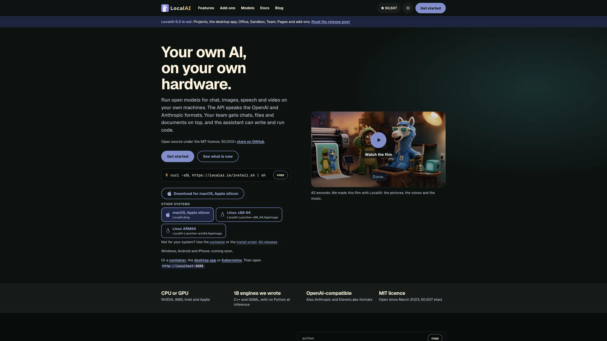

# 在 Sealos 上部署和托管 LocalAI

LocalAI 是自托管的 AI 引擎，可在 CPU 或 GPU 硬件上运行对话、向量、语音、图像生成和文档集合等开源模型。本 Sealos 模板运行 LocalAI 5.0.0，提供 API Key 认证、持久化数据卷、内置 Web 工作台，以及 OpenAI 和 Anthropic 兼容接口。



## 托管说明

LocalAI 以单个 StatefulSet 运行官方 CPU 镜像 `localai/localai:v5.0.0`。服务监听 `8080` 端口，在 `/app` 提供 Web 工作台，并在 `/v1` 下提供模型与推理接口。挂载到 `/data` 的 1Gi 卷保存下载的模型、后端二进制、运行时设置和生成文件，Pod 重启后继续使用。

部署时输入的 API Key 保护 Web 工作台和全部 API 路由。工作台首次访问要求输入该密钥，并把它保存在浏览器中。服务允许未认证的 GET 请求读取静态 UI 资源，API 调用和模型管理仍然需要密钥。

测试档位使用 `50m` CPU、`51Mi` 内存请求，`500m` CPU、`512Mi` 内存上限。LocalAI 可在未安装模型的情况下启动并展示模型库。模型推理需要按所选模型规模提高 CPU 和内存。

## 常见使用场景

- **私有 AI API**：在自有网络中提供 OpenAI 兼容的对话、向量、语音和图像接口。
- **模型评估**：在一个工作台里比较 GGUF 和其他后端，再决定采用哪个供应商。
- **文档集合**：使用本地向量模型，为内部文件构建检索集合。
- **团队工作区**：用一个密钥为小团队提供共享对话、文件、项目和模型访问。
- **智能体后端**：把编码智能体和自动化工具指向自托管的 OpenAI 兼容基础地址。
- **隔离环境实验**：让提示词、文档和模型文件保留在可控基础设施内。

## 部署依赖

- 至少 512Mi 内存和 1Gi 持久化存储的 Sealos 工作区。
- 至少 16 个字符的 API Key，用于 Web UI 和 API。
- 集群到所配置模型库的出网访问能力，用于下载模型和后端包。
- 用于工作台的浏览器，或用于 API 的 `curl`。
- 按计划运行的模型规模准备额外 CPU、内存和存储。

### 部署相关链接

- [LocalAI 官网](https://localai.io/)：产品概览与发布动态
- [LocalAI 文档](https://localai.io/docs/)：安装、模型和 API 指南
- [容器安装](https://localai.io/docs/start/install/containers/)：镜像变体与卷布局
- [快速开始](https://localai.io/docs/start/quickstart/)：首个模型与首次对话
- [模型库](https://localai.io/models/)：模型目录与兼容性说明
- [运行时设置](https://localai.io/docs/administration/runtime-settings/)：API Key、模型库与持久化设置
- [LocalAI 仓库](https://github.com/mudler/LocalAI)：源码与发布说明
- [LocalAI 容器镜像](https://hub.docker.com/r/localai/localai)：模板使用的镜像

## 实现细节

**架构组件：**

- **LocalAI StatefulSet**：单副本运行 CPU 镜像，在 `8080` 端口同时提供 Web 工作台和 API。
- **数据卷**：挂载到 `/data` 的 1Gi 卷，保存模型、后端、运行时设置和生成文件。
- **Service**：ClusterIP 的 `80` 端口转发到 LocalAI HTTP 端口。
- **Ingress**：由 Sealos 管理的 HTTPS 域名，配置 32Mi 请求体上限和 300 秒代理超时。
- **应用入口**：打开 `/app` 进入工作台，首次访问要求输入部署时的 API Key。

**配置：**

- **镜像**：`localai/localai:v5.0.0`
- **HTTP 端口**：`8080`
- **Web 工作台**：`/app`
- **OpenAI 兼容 API**：`/v1`
- **Anthropic 兼容消息接口**：`/v1/messages`
- **模型路径**：`/data/models`
- **后端路径**：`/data/backends`
- **运行时设置**：`/data/configuration`
- **认证**：必填的 `api_key` 输入映射到 `LOCALAI_API_KEY`
- **UI 资源访问**：`LOCALAI_DISABLE_API_KEY_REQUIREMENT_FOR_HTTP_GET=true` 允许静态 UI 路由读取，API 调用仍需认证
- **健康检查**：`GET /readyz`
- **安全上下文**：以 UID `10001` 运行，移除全部 Linux capabilities，禁用提权并启用 `RuntimeDefault` seccomp 配置

**资源分配：**

| 组件 | CPU 请求 | CPU 上限 | 内存请求 | 内存上限 | 存储 |
| --- | ---: | ---: | ---: | ---: | ---: |
| LocalAI | 50m | 500m | 51Mi | 512Mi | 1Gi |

以上数值为线上实测档位。Pod 达到 Ready 且零重启，工作台登录成功，`/v1/models` 返回 HTTP 200 和空模型列表，模型库渲染出 1,641 个条目。调整资源后空闲内存稳定在约 64Mi。模型加载、推理和文档索引需要更多内存与 CPU。

## 为什么在 Sealos 上部署 LocalAI？

Sealos 是基于 Kubernetes 的 AI 辅助云操作系统，用一个界面提供 LocalAI 所需的计算、存储、网络和运维能力：

- **一键部署**：通过一个模板创建 StatefulSet、数据卷、Service、Ingress 和应用入口。
- **自动 HTTPS**：获得由平台管理的公网域名和 TLS 证书，工作台与 API 共用该入口。
- **持久化模型**：把下载的模型和运行时设置保存在独立卷上。
- **资源可控**：在资源卡片上调整 CPU 和内存，从较小的 GGUF 模型平滑扩展到更大负载。
- **运维可见**：在 Canvas 或 Sealos AI 对话中查看 Pod、日志、事件和资源使用。
- **按量付费**：以小规模 CPU 档位起步，推理流量增长后再提高上限。

## 部署指南

1. 打开 [LocalAI 模板](https://sealos.io/products/app-store/localai) 并点击 **Deploy Now**。
2. 输入至少 16 个字符的 API Key，确认自动生成的应用名。
3. 提交部署，等待 2-3 分钟让 Pod 就绪并完成证书签发。
4. 打开应用卡片。工作台会要求输入 API Key，填写部署时设置的值。
5. 打开 **Models**，安装一个适合可用内存和 1Gi 数据卷的模型。
6. 从首页开始对话，或用同一个密钥调用 `/v1/models` 和 `/v1/chat/completions`。

## 使用 Web 工作台

工作台位于 `https://<应用域名>/app`，包含：

- **首页**：对话输入框、模型选择器、工具、技能和项目快捷入口。
- **Models**：模型库、导入、远程连接、已安装模型和磁盘占用。
- **知识库**：使用本地向量模型构建的文档集合。
- **文件与项目**：供对话和智能体共享的工作区资料。
- **附加组件**：Office、Sandbox、Tables、语音等可选能力。

界面跟随浏览器语言，支持英文和中文。安装模型会把大文件下载到 `/data/models`，开始前请确认 Models 页面显示的剩余空间。

## 使用 API

列出模型并发送对话请求：

```bash
BASE=https://<应用域名>
KEY=<你的 API Key>

curl -sS "$BASE/v1/models" -H "Authorization: Bearer $KEY"

curl -sS "$BASE/v1/chat/completions" \
  -H "Authorization: Bearer $KEY" \
  -H 'Content-Type: application/json' \
  -d '{"model":"<已安装模型>","messages":[{"role":"user","content":"Hello"}]}'
```

向量和语音接口使用相同的 OpenAI 兼容结构：

```bash
curl -sS "$BASE/v1/embeddings" \
  -H "Authorization: Bearer $KEY" \
  -H 'Content-Type: application/json' \
  -d '{"model":"<向量模型>","input":"Sealos runs LocalAI"}'
```

Anthropic 兼容接口位于 `/v1/messages`。`GET /readyz` 无需认证，用于报告就绪状态。工作台与 API 共用同一个密钥；轮换密钥时更新部署输入并重启 Pod。

## 存储与持久化

`vn-data` 卷挂载到 `/data`。LocalAI 把模型文件保存在 `/data/models`，后端二进制保存在 `/data/backends`，运行时设置保存在 `/data/configuration`，下载暂存目录位于 `/data/downloading`。StatefulSet 通过 `volumeClaimTemplates` 映射该卷，重启后已安装模型和设置继续保留。

初始请求为 1Gi。大模型会超出该空间；安装前在 Sealos 存储页面扩容 `vn-data` PVC。部署存续期间保持卷绑定。新卷会启动空模型库，需要重新安装模型。

## 扩缩容

本模板运行单副本，因为 LocalAI 把模型状态、后端和运行时设置保存在本地数据卷上。垂直扩容时，为更大的模型提高内存上限，为更快的提示词处理提高 CPU 上限。

水平扩展需要共享模型存储、共享配置目录，以及位于无状态副本前的负载均衡器。对多数单团队部署，扩大垂直档位更简单，也能保持模型缓存热度。

## 排障

### 工作台拒绝 API Key

使用部署时输入的 `api_key` 原值。登录成功后密钥保存在浏览器中；旧密钥残留时清除站点数据。数值不明确时可用 `kubectl exec` 查看 Pod 环境变量。

### `/v1/models` 返回 401

每个 API 请求都需要 `Authorization: Bearer <api-key>`。健康检查 `/readyz` 和 `/healthz` 保持公开；模型与推理路由需要认证。

### 模型库为空或无法下载

模型库需要从外部源获取元数据和模型文件。确认集群的出网访问能力，然后从 **Models** 重试。自建文件可通过 **Import model** 导入。

### 安装模型时提示 "no space left on device"

数据卷初始为 1Gi。在 Sealos 中扩容 `vn-data` PVC，重启 Pod 后重试。也可以在 Models 页面删除不再使用的模型释放空间。

### 加载模型后 Pod 被 OOMKilled

实测上限 `512Mi` 覆盖无模型的服务运行。按模型大小和上下文窗口提高内存上限。模型在 8K 上下文下可放入内存，在更长上下文下可能超出上限。

### 深链接打开工作台显示空白页

先打开 `/app`，再使用侧边栏导航。单页应用把 API Key 保存在浏览器状态中；全新浏览器直接打开深链接时，页面可能在状态恢复前完成渲染。

### 公网入口可被任何人访问

工作台和 API 需要部署密钥，`/readyz` 为健康检查保持公开。使用长随机密钥，避免把密钥放进共享链接，并在不再使用时删除实例。

### 获取帮助

- [LocalAI 文档](https://localai.io/docs/)
- [LocalAI GitHub 问题反馈](https://github.com/mudler/LocalAI/issues)
- [Sealos 文档](https://sealos.io/docs)

## 许可证

LocalAI 采用 [MIT License](https://github.com/mudler/LocalAI/blob/master/LICENSE)。本 Sealos 模板遵循 templates 仓库的许可证。
