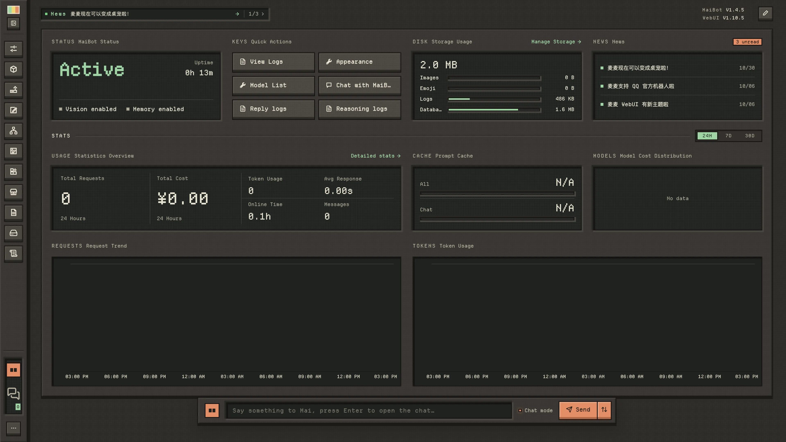

# Deploy and Host MaiBot on Sealos

MaiBot is an open-source, LLM-powered digital companion with a browser dashboard, persistent memory, plugins, and messaging-platform adapters. This Sealos template runs the MaiBot host and its embedded bot workers with persistent storage and a public HTTPS endpoint.

## About Hosting MaiBot

MaiBot gives one workspace to create and run multiple bots. Each bot keeps independent configuration, conversations, memory, logs, plugins, and SQLite data, while the host provides a shared model catalog, authentication, file delivery, and the WebUI.

The web dashboard covers chat, model and adapter configuration, long-term memory, plugin management, prompt management, data transfer, runtime logs, and resource usage. The host exposes port `8001` for HTTP and WebSocket traffic.

This template runs version `1.4.5` as one StatefulSet. Two `1Gi` persistent volumes store `/MaiMBot/host` and `/MaiMBot/bots`, so credentials, bot state, memory, logs, and plugin data survive Pod restarts.

## Common Use Cases

- **Personal AI companion**: Run a persistent digital companion with personality presets, long-term memory, and a browser chat interface.
- **Multi-bot workspace**: Create separate bots for different people, communities, or personas from one deployment.
- **Community chat automation**: Connect messaging-platform adapters and plugins for private or group conversations.
- **Prompt and behavior exploration**: Test personas, prompts, reply styles, and model routing from the dashboard.
- **Plugin development**: Install, configure, and monitor built-in or third-party extensions.

## Dependencies for MaiBot Hosting

The template includes the MaiBot container image, one StatefulSet, two persistent volumes, a Kubernetes Service, an HTTPS Ingress with WebSocket support, and a Sealos App entry.

An external LLM provider endpoint and API key are required for model-backed chat. Optional messaging adapters may require their own platform credentials. MaiBot stores application data in embedded SQLite databases under each bot directory; this release has no separate database dependency.

### Deployment Dependencies

- [MaiBot documentation](https://docs.maibot.chat/) - Official deployment, configuration, and usage documentation
- [MaiBot repository](https://github.com/Mai-with-u/MaiBot) - Source code, releases, and issue tracker
- [Multi-bot host guide](https://github.com/Mai-with-u/MaiBot/blob/v1.4.5/docs/multi-bot-host.md) - Host workspace, authentication, and bot lifecycle
- [MaiBot 1.4.5 release](https://github.com/Mai-with-u/MaiBot/releases/tag/v1.4.5) - Release notes and assets
- [Sealos documentation](https://sealos.io/docs) - Platform documentation

### Architecture Components

- **MaiBot host**: One `StatefulSet` running `sengokucola/maibot:v1.4.5` on port `8001`. The host manages embedded bot worker processes and serves the dashboard, API, and WebSocket routes.
- **WebUI bootstrap**: An init container creates `/MaiMBot/host/webui.json` with the deployment password and `/MaiMBot/host/config.toml` with the public base URL, secure-cookie mode, and listen address. Existing files are preserved on later restarts.
- **Host volume**: A `1Gi` volume at `/MaiMBot/host` stores WebUI credentials, session data, the bot registry, and shared model configuration.
- **Bot volume**: A `1Gi` volume at `/MaiMBot/bots` stores per-bot configuration, conversations, memory, SQLite databases, logs, plugins, and uploaded files.
- **Public access**: A Sealos-managed HTTPS Ingress routes HTTP and WebSocket traffic to the MaiBot Service.

### Resource Profile

| Component | Replicas | CPU limit | Memory limit | Persistent storage |
| --- | ---: | ---: | ---: | ---: |
| MaiBot host | 1 | `100m` | `512Mi` | `2Gi` |
| WebUI bootstrap | Per start | `100m` | `128Mi` | - |

The profile was validated with a cold deployment, password login, dashboard operations, runtime logs, and a 60-second stability window. Increase CPU when model and plugin workloads become CPU-bound, and increase memory when adding large plugins, extensive memory data, or concurrent usage.

## Why Deploy MaiBot on Sealos?

- **One-click runtime**: Deploy the MaiBot host, persistent volumes, networking, and dashboard entry from one template.
- **Persistent bot state**: Keep credentials, bot configurations, memory, chats, plugins, and logs across restarts.
- **Public HTTPS and WebSockets**: Reach the dashboard and live log stream through a managed domain and TLS certificate.
- **Kubernetes foundation**: Run on managed Kubernetes primitives with health probes, persistent volumes, and declarative resources.
- **Canvas operations**: Inspect resource health, logs, storage, domains, and configuration from the deployment view.
- **AI dialog and resource cards**: Adjust resources or configuration with Sealos AI assistance.
- **Pay-as-you-go resources**: Start from a compact personal low-load profile and increase resources with usage.

## Deployment Guide

1. Open the [MaiBot template](https://sealos.io/products/app-store/maibot) and click **Deploy Now**.
2. Enter a `webui_password`. Use at least 10 characters with an ASCII uppercase letter, a lowercase letter, and one character from `!@#$%^&*()_+-=[]{}|;:,.<>?/`. Whitespace is not allowed.
3. Start deployment and wait for the Pod to become healthy. The initial deployment typically takes 2-3 minutes; the embedded bot may continue starting for a few minutes at the default CPU limit.
4. After deployment, open the HTTPS URL shown in Canvas or the App entry.
5. Sign in with the deployment password, complete or skip the first-run wizard, and configure an LLM provider before chatting with a model.

## Login and First-Run Setup

MaiBot authenticates with the access password created from the deployment form. The initial administrator credential is the exact `webui_password` value entered during deployment.

1. Open the application URL. An unauthenticated browser is redirected to `/auth`.
2. Enter `webui_password` in the **Access Token** field and click **Verify & Enter**.
3. The first login opens `/setup`. Choose a bot name, personality, model provider, and model assignments, or use **Skip** and configure them later.
4. To chat with a model, open **Models** and add a provider endpoint, API key, and model assignments.
5. To change the access password later, open **WebUI Settings > Security**.

The password persists in `/MaiMBot/host/webui.json`. Keep `/MaiMBot/host` intact when updating or restarting the deployment.

## Configuration

- **Models**: Add OpenAI-compatible or supported provider endpoints, API keys, model identifiers, and task assignments from the dashboard.
- **Bots**: Create another bot from `/bots`. Each bot receives an independent directory under `/MaiMBot/bots`.
- **Adapters and plugins**: Install adapters or extensions from **Adapters**, **Plugins**, or **Plugin Market**.
- **Memory and prompts**: Manage persona, prompts, learned expressions, jargon, and long-term memory from the corresponding dashboard pages.
- **Runtime logs**: Open `/logs` for live application and bot logs over WebSocket.
- **Persistence**: Host data is stored in `/MaiMBot/host`; bot data is stored in `/MaiMBot/bots`.

## Scaling

Keep the template at one replica because the host owns local bot state and per-bot worker processes. Increase the StatefulSet CPU or memory when running more bots, larger plugins, or higher message concurrency. Expand the persistent volumes from the StatefulSet resource card when chat history, memories, logs, plugins, or uploaded files require more space.

## Troubleshooting

### The dashboard shows Starting

The host WebUI can become ready before every embedded bot finishes initialization. Open `/bots` and wait for the bot status to change to **Running**. The default `100m` CPU limit slows first startup; increase the limit if faster startup is required.

### The access password is rejected

Use the exact `webui_password` entered during deployment. The password is case-sensitive and must satisfy the deployment constraints. After a successful login, change it under **WebUI Settings > Security**.

### Chat produces no model response

Open **Models**, configure a provider endpoint, API key, and the model assignments used by the bot. Verify outbound model access from the Pod and inspect `/logs` for provider errors.

### A plugin or adapter fails to start

Check `/logs` for plugin dependency or credential errors. Confirm that any required platform account, token, network route, or external service is available from the Pod.

### The Pod exits with code 137

The `512Mi` memory limit is the validated minimum for the core host. Increase memory for heavier plugins, high concurrency, or large bot workspaces. Preserve the persistent volumes when changing resources.

### Getting Help

- [MaiBot documentation](https://docs.maibot.chat/)
- [MaiBot issues](https://github.com/Mai-with-u/MaiBot/issues)
- [Sealos documentation](https://sealos.io/docs)
- [Sealos Discord](https://discord.gg/wdUn538zVP)

## License

MaiBot is licensed under the GNU General Public License v3.0. This Sealos template is distributed under the templates repository license.
