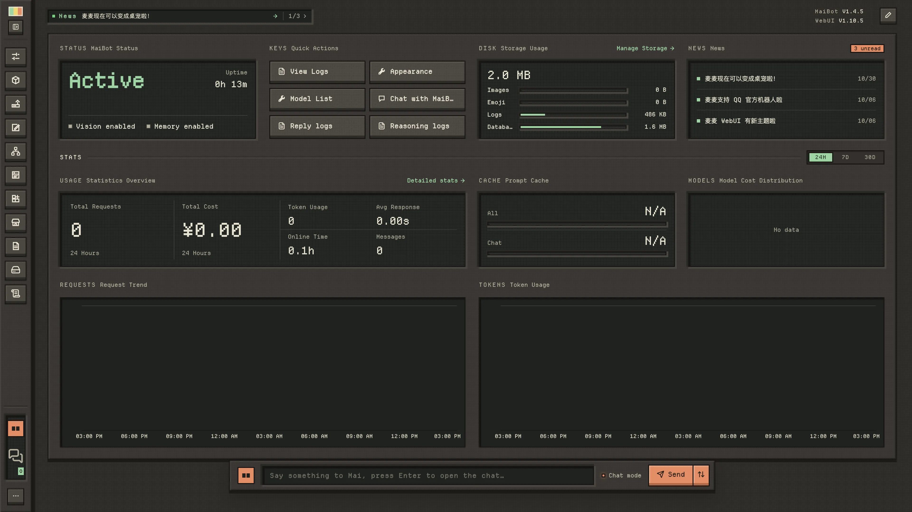

# 在 Sealos 上部署和托管 MaiBot

MaiBot 是开源的大语言模型数字伴侣，提供浏览器管理面板、持久记忆、插件和即时通讯平台适配能力。此 Sealos 模板会运行 MaiBot 宿主及其内嵌 Bot Worker，并配置持久化存储与公网 HTTPS 入口。

## 关于在 Sealos 上托管 MaiBot

MaiBot 在一个工作区中创建并运行多个 Bot。每个 Bot 独立保存配置、聊天、记忆、日志、插件和 SQLite 数据，宿主负责共享模型目录、身份认证、文件传输和 WebUI。

管理面板覆盖聊天、模型与适配器配置、长期记忆、插件管理、提示词管理、数据迁移、运行日志和资源用量。宿主通过 `8001` 端口提供 HTTP 与 WebSocket 服务。

此模板将 `1.4.5` 版本作为单个 StatefulSet 运行，并用两个 `1Gi` 持久卷分别保存 `/MaiMBot/host` 与 `/MaiMBot/bots`。凭据、Bot 状态、记忆、日志和插件数据都能在 Pod 重启后继续保留。

## 常见使用场景

- **个人 AI 伴侣**：运行具备人格预设、长期记忆和浏览器聊天界面的持久化数字伴侣。
- **多 Bot 工作区**：从一个部署创建面向不同用户、社群或人格的独立 Bot。
- **社群聊天自动化**：通过即时通讯适配器和插件接入私聊或群聊场景。
- **提示词与行为探索**：在管理面板中测试人格、提示词、回复风格和模型路由。
- **插件开发**：安装、配置并监控内置或第三方扩展。

## MaiBot 托管依赖

模板包含 MaiBot 容器镜像、一个 StatefulSet、两个持久卷、一个 Kubernetes Service、一个支持 WebSocket 的 HTTPS Ingress，以及一个 Sealos App 入口。

模型聊天需要外部大语言模型提供商端点与 API Key。可选的即时通讯适配器可能需要对应的平台凭据。MaiBot 使用每个 Bot 目录中的内嵌 SQLite 数据库保存应用数据，此版本无需独立数据库服务。

### 部署依赖与参考资料

- [MaiBot 文档](https://docs.maibot.chat/) - 官方部署、配置与使用文档
- [MaiBot 仓库](https://github.com/Mai-with-u/MaiBot) - 源代码、版本与问题跟踪
- [多 Bot 宿主指南](https://github.com/Mai-with-u/MaiBot/blob/v1.4.5/docs/multi-bot-host.md) - 宿主工作区、认证与 Bot 生命周期
- [MaiBot 1.4.5 版本](https://github.com/Mai-with-u/MaiBot/releases/tag/v1.4.5) - 版本说明与发布资源
- [Sealos 文档](https://sealos.io/docs) - 平台文档

### 架构组件

- **MaiBot 宿主**：1 个 `StatefulSet`，运行 `sengokucola/maibot:v1.4.5`，监听 `8001` 端口。宿主管理内嵌 Bot Worker 进程，并提供管理面板、API 与 WebSocket 路由。
- **WebUI 初始化**：init container 创建包含部署密码的 `/MaiMBot/host/webui.json`，以及包含公网基础地址、安全 Cookie 与监听地址的 `/MaiMBot/host/config.toml`。后续重启会保留已有文件。
- **宿主卷**：挂载到 `/MaiMBot/host` 的 `1Gi` 持久卷，保存 WebUI 凭据、会话数据、Bot 注册表和共享模型配置。
- **Bot 卷**：挂载到 `/MaiMBot/bots` 的 `1Gi` 持久卷，保存每个 Bot 的配置、聊天、记忆、SQLite 数据库、日志、插件和上传文件。
- **公网访问**：Sealos 托管的 HTTPS Ingress 将 HTTP 与 WebSocket 流量转发到 MaiBot Service。

### 资源规格

| 组件 | 副本数 | CPU 上限 | 内存上限 | 持久存储 |
| --- | ---: | ---: | ---: | ---: |
| MaiBot 宿主 | 1 | `100m` | `512Mi` | `2Gi` |
| WebUI 初始化 | 每次启动 | `100m` | `128Mi` | - |

该规格已通过冷启动、密码登录、管理面板操作、运行日志和 60 秒稳定性验证。模型与插件负载受 CPU 限制时提高 CPU；增加大型插件、记忆数据或并发用户时提高内存。

## 为什么在 Sealos 上部署 MaiBot？

- **一键运行完整应用**：通过一个模板部署 MaiBot 宿主、持久卷、网络与管理入口。
- **持久化 Bot 状态**：凭据、Bot 配置、记忆、聊天、插件和日志都能跨重启保留。
- **公网 HTTPS 与 WebSocket**：通过托管域名和 TLS 证书访问管理面板与实时日志。
- **Kubernetes 基础能力**：使用健康探针、持久卷和声明式资源运行在托管 Kubernetes 上。
- **Canvas 运维**：在部署视图中查看资源健康、日志、存储、域名与配置。
- **AI 对话与资源卡片**：借助 Sealos AI 调整资源或配置。
- **按量使用资源**：从适合个人低负载场景的紧凑规格起步，随使用量增加资源。

## 部署指南

1. 打开 [MaiBot 模板](https://sealos.io/products/app-store/maibot)，点击 **Deploy Now**。
2. 输入 `webui_password`。密码至少 10 位，包含 ASCII 大写字母、小写字母，以及 `!@#$%^&*()_+-=[]{}|;:,.<>?/` 中的一个字符，且不能包含空白字符。
3. 启动部署并等待 Pod 进入健康状态。首次部署通常需要 2-3 分钟；默认 CPU 上限下，内嵌 Bot 可能还会继续初始化数分钟。
4. 部署完成后，从 Canvas 或 App 入口打开 HTTPS 地址。
5. 使用部署密码登录，完成或跳过首次引导，并在聊天前配置大语言模型提供商。

## 登录与首次配置

MaiBot 使用部署表单创建的访问密码进行认证。部署时填写的 `webui_password` 就是初始管理员凭据。

1. 打开应用地址，未登录浏览器会跳转到 `/auth`。
2. 在 **Access Token** 输入框中填写 `webui_password`，点击 **Verify & Enter**。
3. 首次登录会打开 `/setup`。可设置 Bot 名称、人格、模型提供商与模型任务，也可点击 **Skip** 稍后配置。
4. 进行模型聊天前，打开 **Models**，添加提供商端点、API Key 和模型任务。
5. 后续如需修改访问密码，打开 **WebUI Settings > Security**。

密码保存在 `/MaiMBot/host/webui.json`。更新或重启部署时请保留 `/MaiMBot/host` 卷。

## 配置说明

- **模型**：在管理面板中添加上游提供商端点、API Key、模型标识与任务分配。
- **Bot**：从 `/bots` 创建新的 Bot，每个 Bot 都会在 `/MaiMBot/bots` 下获得独立目录。
- **适配器与插件**：从 **Adapters**、**Plugins** 或 **Plugin Market** 安装适配器与扩展。
- **记忆与提示词**：通过对应页面管理人设、提示词、表达习惯、黑话与长期记忆。
- **运行日志**：打开 `/logs`，通过 WebSocket 查看宿主与 Bot 的实时日志。
- **持久化**：宿主数据保存在 `/MaiMBot/host`，Bot 数据保存在 `/MaiMBot/bots`。

## 扩展

模板保持 1 个副本，因为宿主管理本地 Bot 状态与 Bot Worker 进程。运行更多 Bot、更大插件或更高消息并发时，提高 StatefulSet 的 CPU 或内存。聊天历史、记忆、日志、插件或上传文件需要更多空间时，从 StatefulSet 资源卡片扩容持久卷。

## 故障排查

### 管理面板显示 Starting

宿主 WebUI 会先于所有内嵌 Bot 完成初始化。打开 `/bots`，等待状态变为 **Running**。默认 `100m` CPU 上限会延长首次启动时间，需要更快启动时可提高上限。

### 访问密码被拒绝

请使用部署时填写的 `webui_password`。密码区分大小写，并需满足部署约束。登录成功后，可在 **WebUI Settings > Security** 中修改。

### 模型聊天没有响应

打开 **Models**，配置提供商端点、API Key 与 Bot 使用的模型任务。确认 Pod 可以访问模型服务，并在 `/logs` 中检查提供商错误。

### 插件或适配器无法启动

在 `/logs` 中查看插件依赖或凭据错误，并确认所需的平台账号、Token、网络路由或外部服务可以从 Pod 访问。

### Pod 以代码 137 退出

`512Mi` 是核心宿主已验证的最低内存档位。使用更大插件、更高并发或大型 Bot 工作区时，请提高内存。调整资源时请保留持久卷。

### 获取帮助

- [MaiBot 文档](https://docs.maibot.chat/)
- [MaiBot Issues](https://github.com/Mai-with-u/MaiBot/issues)
- [Sealos 文档](https://sealos.io/docs)
- [Sealos Discord](https://discord.gg/wdUn538zVP)

## 许可证

MaiBot 使用 GNU General Public License v3.0。此 Sealos 模板按 templates 仓库许可证分发。
