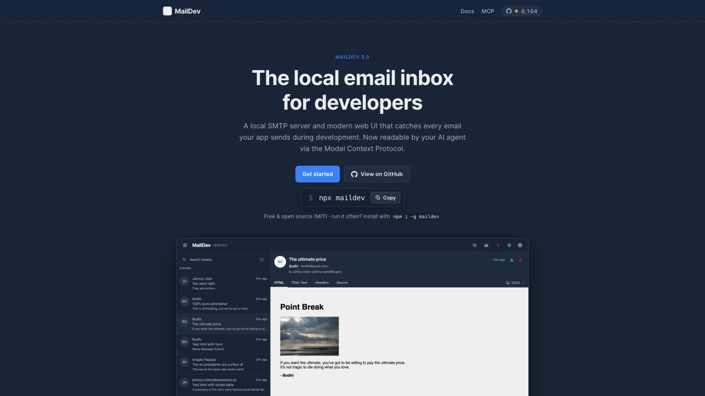

# Deploy and Host MailDev on Sealos

MailDev is a development SMTP server with a web inbox for inspecting every message an application sends. This Sealos template runs MailDev 3.0.0 with a persistent inbox, password-protected web access, and a public HTTPS endpoint.



## About Hosting MailDev

MailDev listens for SMTP traffic and stores each captured message for viewing in a browser. The web interface lists senders, recipients, subjects, timestamps, HTML bodies, plain-text bodies, headers, and raw sources. Messages can be searched, downloaded as `.eml` files, marked as read, or deleted.

This template runs one StatefulSet with the official `maildev/maildev:3.0.0` image. The container listens on port `1080` for the web interface and port `1025` for SMTP. A ClusterIP Service maps HTTP port `80` to `1080` and keeps SMTP available on `1025` inside the namespace. A Sealos Ingress publishes the web inbox over HTTPS.

The inbox lives on a 1Gi persistent volume mounted at `/data`. The template keeps at most 200 messages and accepts messages up to 25MiB, which bounds disk use during long-running development sessions. Web access uses HTTP Basic authentication with the username and password supplied at deployment time.

## Common Use Cases

- **Application Development**: Inspect registration, verification, password-reset, and notification emails without a production mail provider.
- **Template Review**: Check responsive HTML email layouts in the browser while iterating on transactional templates.
- **QA and Staging**: Capture messages from staging workloads and confirm recipients, headers, links, and attachments.
- **Automated Testing**: Assert on delivered messages from integration tests that run inside the same Kubernetes namespace.
- **Demo Environments**: Show the complete email flow during product demos without sending real mail.

## Dependencies for MailDev Hosting

The template includes the MailDev StatefulSet, persistent volume claim, Service, HTTPS Ingress, and Sealos App entry. A modern browser is required for the web inbox. Applications that send test mail connect to the SMTP Service from the same namespace.

### Deployment Dependencies

- [MailDev official site](https://maildev.github.io/maildev/) - Product overview and usage guide
- [MailDev repository](https://github.com/maildev/maildev) - Source code, releases, and configuration reference
- [MailDev container image](https://hub.docker.com/r/maildev/maildev) - Official image used by this template
- [MailDev on npm](https://www.npmjs.com/package/maildev) - CLI package and release history
- [MailDev API reference](https://github.com/maildev/maildev/blob/main/README.md#api) - REST endpoints for inbox automation

## Implementation Details

**Architecture Components:**

- **MailDev StatefulSet**: One replica running `maildev/maildev:3.0.0` with web port `1080` and SMTP port `1025`.
- **Persistent volume**: A 1Gi volume mounted at `/data` stores captured messages across Pod restarts.
- **Service**: ClusterIP with port `80` for the web UI and port `1025` for SMTP.
- **Ingress**: Sealos-managed HTTPS host with a 32Mi request-body limit and 300-second proxy timeouts.
- **App entry**: Opens the public inbox URL from the Sealos desktop.

**Configuration:**

- **Image**: `maildev/maildev:3.0.0`
- **Web port**: `1080`, exposed through Service port `80`
- **SMTP port**: `1025`, available inside the namespace
- **Replicas**: `1`
- **Authentication**: HTTP Basic with the `web_user` and `web_password` inputs
- **Inbox retention**: 200 messages, 25MiB per message
- **Persistence**: `/data` on a 1Gi volume
- **Health checks**: TCP startup, readiness, and liveness probes against the web port

**Resource Allocation:**

| Component | CPU Request | CPU Limit | Memory Request | Memory Limit | Storage |
| --- | ---: | ---: | ---: | ---: | ---: |
| MailDev | 10m | 100m | 12Mi | 128Mi | 1Gi |

The profile passed a cold start, public page load, authenticated inbox access, SMTP delivery, and a 12-message burst with attachments. Memory peaked at 73Mi and the Pod reported zero restarts.

## Why Deploy MailDev on Sealos?

Sealos is an AI-assisted cloud operating system built on Kubernetes that combines deployment, networking, storage, and operations in one interface. Deploying MailDev on Sealos gives you:

- **One-Click Deployment**: Launch a private mail inbox from the App Store without writing Kubernetes YAML.
- **Automatic HTTPS**: Receive a managed public domain and TLS certificate for the web inbox.
- **Persistent Messages**: Keep captured email on a dedicated volume across Pod restarts.
- **Password Protection**: Restrict inbox access with credentials chosen during deployment.
- **Lightweight Runtime**: Run the service with a validated 100m CPU and 128Mi memory limit.
- **Kubernetes Operations**: Inspect logs, resource usage, and Pod health from Canvas or the Sealos AI dialog.

## Deployment Guide

1. Open the [MailDev template](https://sealos.io/products/app-store/maildev) and click **Deploy Now**.
2. Set the web inbox username and password, review the generated application name and host, and confirm the resource plan.
3. Wait for deployment to complete, typically in 2-3 minutes. Sealos opens the Canvas after the resources are created.
4. Open the public URL from the Canvas or the App Store entry. The browser prompts for the credentials supplied in step 2.
5. Send a test message to the SMTP Service from a workload in the same namespace.
6. Refresh the inbox and confirm that the message, sender, recipient, headers, and body are visible.

## Using MailDev

- Open a message to switch between **HTML**, **Plain Text**, **Headers**, and **Source** views.
- Use the search field to filter messages by sender, recipient, subject, or body text.
- Download a message as `.eml` for offline inspection or bug reports.
- Mark messages as read or clear the inbox with the toolbar actions.
- Use the REST API at `/api/email` from automation that needs to inspect captured messages.

## Connecting Applications

Point test applications at the Service name and SMTP port:

```text
SMTP host: <app-name>
SMTP port: 1025
TLS: disabled
Authentication: none
```

The `<app-name>` value is the generated MailDev application name shown in Canvas. Any workload in the same namespace can resolve it. The SMTP port stays on the cluster network; the public HTTPS endpoint serves the web inbox.

For a Python workload:

```python
import smtplib

with smtplib.SMTP("<app-name>", 1025, timeout=10) as smtp:
    smtp.sendmail(
        "sender@example.com",
        ["receiver@example.com"],
        "Subject: Sealos test\n\nDelivered through MailDev.",
    )
```

## Scaling

Run MailDev as a single replica. The inbox is stored on one ReadWriteOnce volume, and multiple replicas would present separate inboxes behind one Service. For heavier development traffic, raise the CPU and memory limits, increase the volume size, or adjust `MAILDEV_MAX_EMAILS` and `MAILDEV_MAX_MESSAGE_SIZE` in the template.

## Troubleshooting

### The browser keeps asking for credentials

Confirm the username and password match the values supplied during deployment. The credentials are injected as `MAILDEV_WEB_USER` and `MAILDEV_WEB_PASS`; redeploy with the corrected inputs when they differ.

### The inbox stays empty

Confirm that the sending workload uses the MailDev Service name and port `1025` in the same namespace. Check the MailDev Pod logs for a `Received:` line after sending a message.

### The page shows a loading state

Open the root URL from the App entry so the frontend receives the server-injected base path. Reload the page after confirming that the Ingress and Pod are Ready.

### Emails stop appearing

The template retains 200 messages and rejects messages larger than 25MiB. Delete old messages, raise the retention values, or expand the persistent volume for larger test runs.

### The Pod stays Pending

Check that the namespace has 1Gi of available storage for the volume claim. Review the Pod events in Canvas for scheduling or volume-binding errors.

### Getting Help

- [MailDev documentation](https://maildev.github.io/maildev/)
- [MailDev issues](https://github.com/maildev/maildev/issues)
- [Sealos documentation](https://sealos.io/docs)

## License

MailDev is licensed under the [MIT License](https://github.com/maildev/maildev/blob/main/LICENSE). This Sealos template is distributed under the templates repository license.
