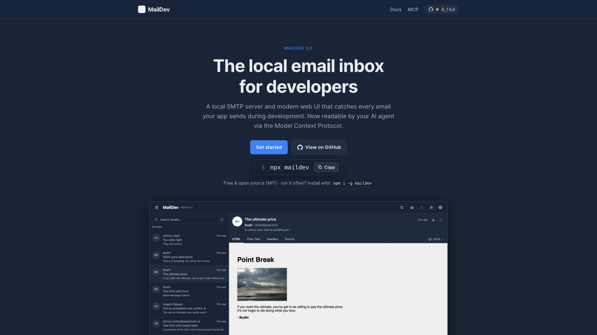

# 在 Sealos 上部署和托管 MailDev

MailDev 是面向开发调试的 SMTP 服务器，提供 Web 收件箱用于检查应用发出的每一封邮件。本 Sealos 模板运行 MailDev 3.0.0，提供持久化收件箱、密码保护的 Web 访问和公网 HTTPS 入口。



## 关于 MailDev 托管

MailDev 接收 SMTP 流量，并将每封邮件保存下来供浏览器查看。Web 界面会展示发件人、收件人、主题、时间、HTML 正文、纯文本正文、邮件头和原始源码。邮件支持搜索、下载为 `.eml`、标记已读和删除。

本模板运行一个 StatefulSet，使用官方 `maildev/maildev:3.0.0` 镜像。容器通过 `1080` 端口提供 Web 界面，通过 `1025` 端口接收 SMTP。ClusterIP Service 将 HTTP `80` 端口映射到 `1080`，并在命名空间内保留 `1025` 端口的 SMTP 服务。Sealos Ingress 通过 HTTPS 发布 Web 收件箱。

收件箱数据保存在挂载到 `/data` 的 1Gi 持久卷上。模板最多保留 200 封邮件，单封邮件上限为 25MiB，用于约束长期调试期间的磁盘占用。Web 访问使用 HTTP Basic 认证，用户名和密码在部署时填写。

## 常见使用场景

- **应用开发**：在不接入生产邮件服务的前提下检查注册、验证、重置密码和通知邮件。
- **模板评审**：在浏览器中检查响应式 HTML 邮件布局，快速迭代事务邮件模板。
- **QA 与预发布**：捕获预发布工作负载发出的邮件，核对收件人、邮件头、链接和附件。
- **自动化测试**：在同命名空间的集成测试中读取邮件并断言内容。
- **演示环境**：在产品演示中展示完整的邮件收发流程，无需发送真实邮件。

## MailDev 托管依赖

模板包含 MailDev StatefulSet、持久卷声明、Service、HTTPS Ingress 和 Sealos App 入口。Web 收件箱需要现代浏览器。发送测试邮件的应用从同命名空间连接 SMTP Service。

### 部署依赖

- [MailDev 官网](https://maildev.github.io/maildev/) - 产品介绍与使用指南
- [MailDev 仓库](https://github.com/maildev/maildev) - 源代码、发布版本与配置参考
- [MailDev 容器镜像](https://hub.docker.com/r/maildev/maildev) - 本模板使用的官方镜像
- [MailDev npm 包](https://www.npmjs.com/package/maildev) - CLI 包与版本历史
- [MailDev API 参考](https://github.com/maildev/maildev/blob/main/README.md#api) - 用于收件箱自动化的 REST 接口

## 实现细节

**架构组件：**

- **MailDev StatefulSet**：单副本运行 `maildev/maildev:3.0.0`，Web 端口 `1080`，SMTP 端口 `1025`。
- **持久卷**：1Gi 卷挂载到 `/data`，保存的邮件在 Pod 重启后继续保留。
- **Service**：ClusterIP 提供 Web UI 的 `80` 端口和 SMTP 的 `1025` 端口。
- **Ingress**：Sealos 管理的 HTTPS 域名，请求体上限 32Mi，代理超时 300 秒。
- **App 入口**：从 Sealos 桌面直接打开公网收件箱。

**配置：**

- **镜像**：`maildev/maildev:3.0.0`
- **Web 端口**：`1080`，通过 Service 的 `80` 端口暴露
- **SMTP 端口**：`1025`，在命名空间内可用
- **副本数**：`1`
- **认证**：HTTP Basic，使用 `web_user` 与 `web_password` 输入
- **收件箱保留**：200 封邮件，单封上限 25MiB
- **持久化**：`/data` 挂载 1Gi 卷
- **健康检查**：针对 Web 端口的 TCP 启动、就绪和存活探针

**资源分配：**

| 组件 | CPU 请求 | CPU 限制 | 内存请求 | 内存限制 | 存储 |
| --- | ---: | ---: | ---: | ---: | ---: |
| MailDev | 10m | 100m | 12Mi | 128Mi | 1Gi |

该规格通过了冷启动、公网页面加载、认证收件箱访问、SMTP 投递，以及 12 封带附件邮件的突发写入。内存峰值为 73Mi，Pod 重启次数为 0。

## 为什么在 Sealos 上部署 MailDev？

Sealos 是构建在 Kubernetes 之上的 AI 辅助云操作系统，将部署、网络、存储和运维统一在一个界面中。在 Sealos 上部署 MailDev 可以带来：

- **一键部署**：从应用商店启动私有邮件收件箱，无需编写 Kubernetes YAML。
- **自动 HTTPS**：自动获得 Web 收件箱的公网域名和 TLS 证书。
- **邮件持久化**：使用独立卷保存捕获的邮件，Pod 重启后继续保留。
- **密码保护**：使用部署时设置的凭据限制收件箱访问。
- **轻量运行**：以经验证的 100m CPU 和 128Mi 内存限制运行服务。
- **Kubernetes 运维**：在 Canvas 或 Sealos AI 对话中查看日志、资源用量和 Pod 状态。

## 部署指南

1. 打开 [MailDev 模板](https://sealos.io/products/app-store/maildev)，点击 **Deploy Now**。
2. 设置 Web 收件箱用户名和密码，检查自动生成的应用名称和域名，确认资源规格。
3. 等待部署完成，通常需要 2-3 分钟。资源创建完成后 Sealos 会打开 Canvas。
4. 从 Canvas 或应用商店入口打开公网地址，浏览器会要求输入第 2 步设置的凭据。
5. 从同命名空间的工作负载向 SMTP Service 发送一封测试邮件。
6. 刷新收件箱，确认邮件、发件人、收件人、邮件头和正文均可见。

## 使用 MailDev

- 打开邮件后可在 **HTML**、**Plain Text**、**Headers** 和 **Source** 视图之间切换。
- 使用搜索框按发件人、收件人、主题或正文过滤邮件。
- 将邮件下载为 `.eml`，用于离线检查或缺陷报告。
- 通过工具栏将邮件标记为已读，或清空收件箱。
- 自动化流程可通过 `/api/email` REST 接口读取捕获的邮件。

## 连接应用

将测试应用指向 Service 名称和 SMTP 端口：

```text
SMTP 主机：<app-name>
SMTP 端口：1025
TLS：关闭
认证：无
```

`<app-name>` 是 Canvas 中显示的 MailDev 应用名称，同命名空间的任意工作负载均可解析该地址。SMTP 端口保留在集群网络内，公网 HTTPS 地址提供 Web 收件箱。

Python 工作负载示例：

```python
import smtplib

with smtplib.SMTP("<app-name>", 1025, timeout=10) as smtp:
    smtp.sendmail(
        "sender@example.com",
        ["receiver@example.com"],
        "Subject: Sealos test\n\nDelivered through MailDev.",
    )
```

## 扩缩容

MailDev 以单副本运行。收件箱保存在一个 ReadWriteOnce 卷上，多副本会在同一个 Service 后面呈现彼此独立的收件箱。开发流量增加时，可提高 CPU 和内存限制、扩大卷容量，或调整模板中的 `MAILDEV_MAX_EMAILS` 与 `MAILDEV_MAX_MESSAGE_SIZE`。

## 故障排查

### 浏览器持续要求输入凭据

确认用户名和密码与部署时填写的一致。凭据通过 `MAILDEV_WEB_USER` 和 `MAILDEV_WEB_PASS` 注入；不一致时使用正确输入重新部署。

### 收件箱一直为空

确认发送方使用同命名空间的 MailDev Service 名称和 `1025` 端口。发送后检查 MailDev Pod 日志中的 `Received:` 记录。

### 页面一直显示加载状态

从 App 入口打开根地址，让前端获得服务端注入的基础路径。确认 Ingress 与 Pod 处于 Ready 状态后重新加载页面。

### 邮件不再出现

模板保留 200 封邮件，并拒绝大于 25MiB 的邮件。删除旧邮件、提高保留上限，或扩大持久卷以支持更大的测试批次。

### Pod 一直处于 Pending

确认命名空间有 1Gi 可用存储供卷声明使用，并在 Canvas 中查看 Pod 事件中的调度或卷绑定错误。

### 获取帮助

- [MailDev 文档](https://maildev.github.io/maildev/)
- [MailDev Issues](https://github.com/maildev/maildev/issues)
- [Sealos 文档](https://sealos.io/docs)

## 许可证

MailDev 使用 [MIT License](https://github.com/maildev/maildev/blob/main/LICENSE) 许可证。本 Sealos 模板遵循 templates 仓库许可证。
