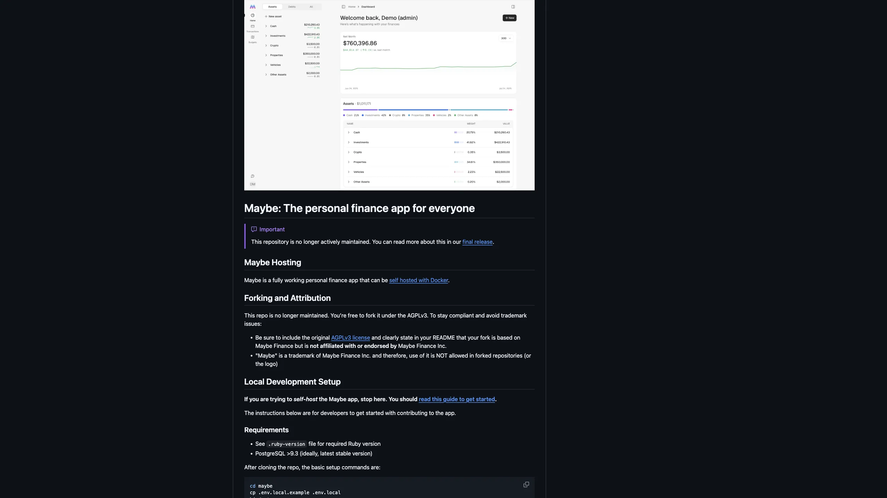

# Deploy and Host Maybe on Sealos

Maybe is a self-hosted personal finance app for tracking accounts, transactions, budgets, investments, and net worth. This Sealos template runs Maybe 0.6.0 with PostgreSQL, Redis, a web process, and a Sidekiq worker, with a persistent storage volume and first-user registration.

## About Hosting Maybe

Maybe runs as one StatefulSet with two containers: the Rails web server on port `3000` and a Sidekiq worker. A 1Gi volume at `/rails/storage` keeps uploaded files and generated exports, while PostgreSQL stores users, accounts, transactions, and budgets, and Redis backs the job queue and cache.

The template provisions a single-node PostgreSQL 16 cluster and a Redis 7 cluster with a sentinel through KubeBlocks. Both database services are private to the namespace; only the Maybe web UI is published through the HTTPS Ingress. Connection credentials come from the KubeBlocks-managed Secrets, so no database password is part of the deployment inputs.

The first visitor creates the administrator account through `/registration/new`. Later visitors can sign in from `/sessions/new`; the template seeds no default credentials. The tested profile uses `50m` CPU and `102Mi` memory as web requests, `500m` CPU and `1024Mi` as web limits, `20m` CPU and `51Mi` as worker requests, and `200m` CPU and `512Mi` as worker limits.

## Common Use Cases

- **Personal Finance Dashboard**: Consolidate cash, investments, crypto, property, vehicles, loans, and credit cards in one net-worth view.
- **Household Budgeting**: Track spending by category and compare actual expenses with monthly budgets.
- **Investment Tracking**: Record holdings and valuations without sending portfolio data to a third-party SaaS.
- **Transaction Review**: Import and categorize transactions, then search the activity feed per account.
- **Privacy-First Planning**: Keep account names, balances, and goals inside infrastructure you control.
- **Self-Hosted Evaluation**: Test Maybe before deciding whether to fork or extend it for a team.

## Dependencies for Hosting Maybe

- A Sealos workspace with at least 2Gi of memory and 4Gi of persistent storage.
- A PostgreSQL 16-compatible database; the template provisions KubeBlocks PostgreSQL.
- A Redis 7-compatible service; the template provisions KubeBlocks Redis with sentinel.
- Outbound network access only for optional market-data syncs and the AI assistant.
- A browser for registration, onboarding, and the finance dashboard.

### Deployment Dependencies

- [Maybe project page](https://github.com/maybe-finance/maybe) - Source code, releases, and project status
- [Docker hosting guide](https://github.com/maybe-finance/maybe/blob/main/docs/hosting/docker.md) - Official self-hosting steps
- [Example compose file](https://github.com/maybe-finance/maybe/blob/main/compose.example.yml) - Web, worker, PostgreSQL, and Redis topology
- [Final release](https://github.com/maybe-finance/maybe/releases/tag/v0.6.0) - Version used by this template
- [Container image](https://github.com/maybe-finance/maybe/pkgs/container/maybe) - Image used by this template
- [KubeBlocks PostgreSQL](https://kubeblocks.io/docs/preview/user_docs/kubeblocks-for-postgresql/cluster-management/create-and-connect-a-postgresql-cluster) - Database cluster reference
- [KubeBlocks Redis](https://kubeblocks.io/docs/preview/user_docs/kubeblocks-for-redis/cluster-management/create-and-connect-a-redis-cluster) - Redis cluster reference
- [Sealos documentation](https://sealos.io/docs) - Platform concepts and operations

## Implementation Details

**Architecture Components:**

- **Maybe StatefulSet**: One replica with a Rails web container on port `3000` and a Sidekiq worker container.
- **PostgreSQL cluster**: A single-node KubeBlocks PostgreSQL 16.4 cluster with a 1Gi data volume.
- **Redis cluster**: A KubeBlocks Redis 7.2.7 cluster with one Redis replica and one sentinel, each with a 1Gi volume.
- **Application volume**: A 1Gi volume at `/rails/storage` shared by the web and worker containers.
- **Service**: ClusterIP port `80` forwarding to the Maybe HTTP port.
- **Ingress**: Sealos-managed HTTPS host with a 32Mi request body limit for CSV imports.
- **App entry**: Opens the Maybe dashboard; unauthenticated visitors are redirected to registration.

**Configuration:**

- **Image**: `ghcr.io/maybe-finance/maybe:0.6.0`
- **HTTP port**: `3000`
- **Registration**: `/registration/new`
- **Sign-in**: `/sessions/new`
- **Health check**: `GET /up`
- **Database host**: `${{ defaults.app_name }}-pg-conn-credential` secret, `host` key
- **Database name**: `postgres`
- **Redis URL**: `redis://:<password>@<redis-service>:6379/1`
- **Rails environment**: `production`
- **Self-hosting flag**: `SELF_HOSTED=true`
- **Secret key base**: Generated 64-character default
- **SSL handling**: `RAILS_FORCE_SSL=false` and `RAILS_ASSUME_SSL=false` because the Ingress terminates TLS
- **Worker command**: `bundle exec sidekiq`
- **Security context**: Runs as UID `1000`, drops all Linux capabilities, disables privilege escalation, and applies the `RuntimeDefault` seccomp profile

**Resource Allocation:**

| Component | CPU Request | CPU Limit | Memory Request | Memory Limit | Storage |
| --- | ---: | ---: | ---: | ---: | ---: |
| Maybe web | 50m | 500m | 102Mi | 1024Mi | 1Gi |
| Maybe worker | 20m | 200m | 51Mi | 512Mi | Shared |
| PostgreSQL | 50m | 500m | 51Mi | 512Mi | 1Gi |
| Redis | 50m | 500m | 51Mi | 512Mi | 1Gi |
| Redis sentinel | 50m | 500m | 51Mi | 512Mi | 1Gi |

The values above are the live-tested profile. All Pods reached Ready with zero restarts. Registration, the three-step onboarding flow, the dashboard, and the creation of a manual cash account with a `$1,234.56` balance all succeeded. The Sidekiq worker completed the account sync job. Observed memory was about 310Mi for the web container and 244Mi for the worker.

## Why Deploy Maybe on Sealos?

Sealos is an AI-assisted cloud operating system built on Kubernetes. It provides the compute, storage, networking, and operations layer for Maybe in one interface:

- **One-Click Deployment**: Create the StatefulSet, PostgreSQL and Redis clusters, volumes, Service, Ingress, and App entry from a single template.
- **Managed Databases**: Run PostgreSQL and Redis as KubeBlocks clusters with generated credentials.
- **Automatic HTTPS**: Receive a managed public domain and TLS certificate for the web UI.
- **Persistent Finance Data**: Keep the database, Redis state, and uploaded files on dedicated volumes.
- **Resource Control**: Adjust web and worker resources from the resource card as your history and imports grow.
- **Operational Visibility**: Inspect Pods, logs, events, and resource usage from Canvas or the Sealos AI dialog.

## Deployment Guide

1. Open the [Maybe template](https://sealos.io/products/app-store/maybe) and click **Deploy Now**.
2. Confirm the generated application name and submit the deployment.
3. Wait 2-3 minutes for PostgreSQL, Redis, and the Maybe Pod to become ready and for the certificate to be issued.
4. Open the App card. The dashboard redirects to **Create your account**.
5. Enter an email and a password with upper and lower case letters, a number, and a special character, then click **Create account**.
6. Complete onboarding: profile and household, preferences, and at least one goal.
7. Add a cash, investment, crypto, property, vehicle, loan, credit card, or other account from the dashboard.

## Using Maybe

The main navigation exposes **Home**, **Transactions**, and **Budgets**. The home dashboard groups assets and debts, shows net worth, and lists account balances. Each account page contains an activity feed, an opening balance entry, and controls for new transactions.

The account creation dialog offers manual entry and CSV import. Manual entry supports cash, investment, crypto, property, vehicle, credit card, loan, and other asset or liability types. The first registered user owns the household; additional household members can be invited from the settings area.

The optional AI assistant needs an `OPENAI_ACCESS_TOKEN`; the template leaves it unset. Core account, transaction, budget, and net-worth features work without the assistant.

## Database and Persistence

PostgreSQL stores all application records. The KubeBlocks cluster exposes a `${{ defaults.app_name }}-pg-conn-credential` Secret with `host`, `port`, `username`, and `password` keys, and the template uses the default `postgres` database. The database data volume is 1Gi and uses the `openebs-backup` storage class.

Redis stores the Sidekiq queue, cache, and background job metadata. The Redis cluster exposes its password through the `${{ defaults.app_name }}-redis-redis-account-default` Secret. The application volume at `/rails/storage` holds uploaded files and generated exports.

Keep all four volumes bound for the lifetime of the deployment. Delete the Instance only when you also intend to remove the financial data; deleting the Instance removes the managed clusters and their PVCs.

## Scaling

The web and worker containers run in one Pod because they share the application volume and the single-household deployment profile. Scale vertically by raising the web memory limit for larger transaction histories and the worker limit for heavier imports.

For horizontal web scaling, move session storage to Redis, run multiple web replicas behind the Service, and use a ReadWriteMany volume or object storage for uploads. Keep a single Sidekiq worker deployment unless job concurrency requires more processes; Sidekiq scales by process count against the same Redis queue.

## Troubleshooting

### The root URL keeps redirecting to registration

Maybe has no seeded user. Register the first account at `/registration/new`. After registration, sign in at `/sessions/new`. If registration fails, check the web container log for database connection errors.

### The Pod stays in Init because PostgreSQL or Redis is not ready

The init container waits for both services with `nc`. Check the KubeBlocks cluster status and the `*-pg-conn-credential` and `*-redis-redis-account-default` Secrets. A cluster that is still provisioning keeps the app in `Init`.

### Registration returns 500

Check the web log for `PG::ConnectionBad`, missing migrations, or a `SECRET_KEY_BASE` error. The entrypoint runs `db:prepare`; a failed migration leaves the app unable to write users. Restart the Pod after the database is healthy.

### Browser shows a redirect loop or insecure cookie warning

The template sets `RAILS_FORCE_SSL=false` and `RAILS_ASSUME_SSL=false` because TLS terminates at the Ingress. Keep those values unless you terminate TLS inside the Pod.

### Sidekiq jobs stay queued

Check the worker container log for Redis authentication errors. The worker uses the same Redis URL as the web container. If the worker is running but the queue is stalled, confirm the Redis password Secret and the `REDIS_URL` value.

### The page is slow or the Pod is OOMKilled

The web container settles around 310Mi in the tested profile. Large transaction histories, CSV imports, and concurrent users need more than the `1024Mi` limit. Raise the web limit first, then the worker limit for import-heavy workloads.

### Market data or AI features fail

Market-data syncs and the AI assistant call external services. The template does not set `OPENAI_ACCESS_TOKEN`, and the test cluster has no guarantee of access to market-data providers. Core manual account and transaction features remain available.

### The public endpoint is reachable by anyone

The web UI requires an account, and registration is open to the first visitor. Register immediately after deployment, use a strong password, and keep the URL private. Delete the Instance when the deployment is no longer needed.

### Getting Help

- [Maybe hosting guide](https://github.com/maybe-finance/maybe/blob/main/docs/hosting/docker.md)
- [Maybe GitHub issues](https://github.com/maybe-finance/maybe/issues)
- [Sealos documentation](https://sealos.io/docs)

## License

Maybe is released under the [GNU Affero General Public License v3.0](https://github.com/maybe-finance/maybe/blob/main/LICENSE). Maybe is a trademark of Maybe Finance, Inc.; this template is an independent deployment definition and is not affiliated with or endorsed by Maybe Finance. This Sealos template is distributed under the templates repository license.
