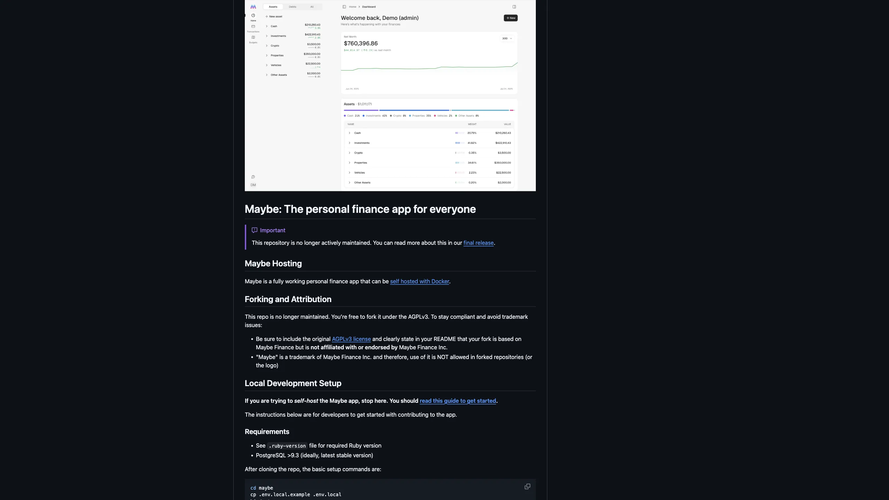

# 在 Sealos 上部署和托管 Maybe

Maybe 是自托管的个人财务应用，用于管理账户、交易、预算、投资和净资产。本 Sealos 模板运行 Maybe 0.6.0，包含 PostgreSQL、Redis、Web 进程和 Sidekiq Worker，并提供持久化存储卷和首个用户注册流程。

## 托管说明

Maybe 以单个 StatefulSet 运行两个容器：监听 `3000` 端口的 Rails Web 服务和 Sidekiq Worker。挂载到 `/rails/storage` 的 1Gi 卷保存上传文件和生成的导出文件，PostgreSQL 保存用户、账户、交易和预算，Redis 承载任务队列和缓存。

模板通过 KubeBlocks 创建单节点 PostgreSQL 16 集群，以及带 sentinel 的 Redis 7 集群。两个数据库服务只在命名空间内可见，公网仅发布 Maybe Web UI。连接凭据来自 KubeBlocks 管理的 Secret，部署输入中不包含数据库密码。

首位访问者通过 `/registration/new` 创建管理员账户。后续访问者在 `/sessions/new` 登录，模板不预置默认凭据。测试档位使用 `50m` CPU、`102Mi` 内存作为 Web 请求，`500m` CPU、`1024Mi` 作为 Web 上限，`20m` CPU、`51Mi` 作为 Worker 请求，`200m` CPU、`512Mi` 作为 Worker 上限。

## 常见使用场景

- **个人财务面板**：把现金、投资、加密货币、房产、车辆、贷款和信用卡汇总到一个净资产视图。
- **家庭预算**：按类别跟踪支出，对比实际开销与月度预算。
- **投资跟踪**：记录持仓和估值，投资组合数据保留在自有基础设施内。
- **交易复核**：导入并分类交易，在账户流水中搜索和核对。
- **隐私优先规划**：让账户名称、余额和财务目标保留在可控环境中。
- **自托管评估**：在决定是否分支或扩展 Maybe 之前先验证完整流程。

## 部署依赖

- 至少 2Gi 内存和 4Gi 持久化存储的 Sealos 工作区。
- PostgreSQL 16 兼容数据库；模板会创建 KubeBlocks PostgreSQL。
- Redis 7 兼容服务；模板会创建带 sentinel 的 KubeBlocks Redis。
- 仅在可选行情同步和 AI 助手功能中需要出网访问。
- 用于注册、引导流程和财务面板的浏览器。

### 部署相关链接

- [Maybe 项目页](https://github.com/maybe-finance/maybe)：源码、发布与项目状态
- [Docker 托管指南](https://github.com/maybe-finance/maybe/blob/main/docs/hosting/docker.md)：官方自托管步骤
- [Compose 示例](https://github.com/maybe-finance/maybe/blob/main/compose.example.yml)：Web、Worker、PostgreSQL 和 Redis 拓扑
- [最终版本](https://github.com/maybe-finance/maybe/releases/tag/v0.6.0)：模板使用的版本
- [容器镜像](https://github.com/maybe-finance/maybe/pkgs/container/maybe)：模板使用的镜像
- [KubeBlocks PostgreSQL](https://kubeblocks.io/docs/preview/user_docs/kubeblocks-for-postgresql/cluster-management/create-and-connect-a-postgresql-cluster)：数据库集群参考
- [KubeBlocks Redis](https://kubeblocks.io/docs/preview/user_docs/kubeblocks-for-redis/cluster-management/create-and-connect-a-redis-cluster)：Redis 集群参考
- [Sealos 文档](https://sealos.io/docs)：平台概念与操作

## 实现细节

**架构组件：**

- **Maybe StatefulSet**：单副本，包含监听 `3000` 端口的 Rails Web 容器和 Sidekiq Worker 容器。
- **PostgreSQL 集群**：单节点 KubeBlocks PostgreSQL 16.4 集群，带 1Gi 数据卷。
- **Redis 集群**：KubeBlocks Redis 7.2.7 集群，包含一个 Redis 副本和一个 sentinel，各带 1Gi 卷。
- **应用卷**：挂载到 `/rails/storage` 的 1Gi 卷，由 Web 和 Worker 共享。
- **Service**：ClusterIP 的 `80` 端口转发到 Maybe HTTP 端口。
- **Ingress**：由 Sealos 管理的 HTTPS 域名，配置 32Mi 请求体上限以支持 CSV 导入。
- **应用入口**：打开 Maybe 面板；未登录访问会重定向到注册页。

**配置：**

- **镜像**：`ghcr.io/maybe-finance/maybe:0.6.0`
- **HTTP 端口**：`3000`
- **注册页**：`/registration/new`
- **登录页**：`/sessions/new`
- **健康检查**：`GET /up`
- **数据库主机**：来自 `${{ defaults.app_name }}-pg-conn-credential` Secret 的 `host` 键
- **数据库名称**：`postgres`
- **Redis URL**：`redis://:<password>@<redis-service>:6379/1`
- **Rails 环境**：`production`
- **自托管开关**：`SELF_HOSTED=true`
- **Secret Key Base**：自动生成的 64 字符默认值
- **SSL 处理**：`RAILS_FORCE_SSL=false` 与 `RAILS_ASSUME_SSL=false`，TLS 在 Ingress 终止
- **Worker 命令**：`bundle exec sidekiq`
- **安全上下文**：以 UID `1000` 运行，移除全部 Linux capabilities，禁用提权并启用 `RuntimeDefault` seccomp 配置

**资源分配：**

| 组件 | CPU 请求 | CPU 上限 | 内存请求 | 内存上限 | 存储 |
| --- | ---: | ---: | ---: | ---: | ---: |
| Maybe Web | 50m | 500m | 102Mi | 1024Mi | 1Gi |
| Maybe Worker | 20m | 200m | 51Mi | 512Mi | 共享 |
| PostgreSQL | 50m | 500m | 51Mi | 512Mi | 1Gi |
| Redis | 50m | 500m | 51Mi | 512Mi | 1Gi |
| Redis Sentinel | 50m | 500m | 51Mi | 512Mi | 1Gi |

以上数值为线上实测档位。所有 Pod 达到 Ready 且零重启。注册、三步引导、面板，以及创建余额为 `$1,234.56` 的手动现金账户均成功，Sidekiq Worker 完成了账户同步任务。实测内存约为 Web 310Mi、Worker 244Mi。

## 为什么在 Sealos 上部署 Maybe？

Sealos 是基于 Kubernetes 的 AI 辅助云操作系统，用一个界面提供 Maybe 所需的计算、存储、网络和运维能力：

- **一键部署**：通过一个模板创建 StatefulSet、PostgreSQL 与 Redis 集群、数据卷、Service、Ingress 和应用入口。
- **托管数据库**：以 KubeBlocks 集群运行 PostgreSQL 和 Redis，自动生成连接凭据。
- **自动 HTTPS**：获得由平台管理的公网域名和 TLS 证书。
- **持久化财务数据**：把数据库、Redis 状态和上传文件保存在独立卷上。
- **资源可控**：在资源卡片上调整 Web 与 Worker 资源，适应历史数据和导入量增长。
- **运维可见**：在 Canvas 或 Sealos AI 对话中查看 Pod、日志、事件和资源使用。

## 部署指南

1. 打开 [Maybe 模板](https://sealos.io/products/app-store/maybe) 并点击 **Deploy Now**。
2. 确认自动生成的应用名并提交部署。
3. 等待 2-3 分钟让 PostgreSQL、Redis 和 Maybe Pod 就绪并完成证书签发。
4. 打开应用卡片，面板会重定向到 **Create your account**。
5. 输入邮箱和密码（需包含大小写字母、数字和特殊字符），点击 **Create account**。
6. 完成引导：填写姓名和家庭信息、偏好设置，并至少选择一个目标。
7. 从面板添加现金、投资、加密货币、房产、车辆、贷款、信用卡或其他账户。

## 使用 Maybe

主导航包含 **Home**、**Transactions** 和 **Budgets**。首页按资产和负债分组，展示净资产和账户余额。每个账户页面包含活动流水、期初余额记录和新交易入口。

账户创建对话框提供手动录入和 CSV 导入。手动录入支持现金、投资、加密货币、房产、车辆、信用卡、贷款和其他资产或负债类型。首个注册用户拥有家庭数据；其他家庭成员可在设置区域邀请。

可选的 AI 助手需要 `OPENAI_ACCESS_TOKEN`，模板未设置该变量。核心账户、交易、预算和净资产功能无需助手即可使用。

## 数据库与持久化

PostgreSQL 保存全部应用记录。KubeBlocks 集群生成 `${{ defaults.app_name }}-pg-conn-credential` Secret，包含 `host`、`port`、`username` 和 `password` 键，模板使用默认的 `postgres` 数据库。数据库数据卷为 1Gi，使用 `openebs-backup` 存储类。

Redis 保存 Sidekiq 队列、缓存和后台任务元数据。Redis 集群的密码位于 `${{ defaults.app_name }}-redis-redis-account-default` Secret。应用卷 `/rails/storage` 保存上传文件和生成的导出文件。

部署存续期间保持四个卷绑定。只有在同时删除财务数据时才删除 Instance；删除 Instance 会移除托管集群及其 PVC。

## 扩缩容

Web 与 Worker 运行在同一个 Pod 中，共享应用卷并采用单家庭部署档位。垂直扩容时，为更大的交易历史提高 Web 内存上限，为更重的导入任务提高 Worker 上限。

水平扩展 Web 时，把会话存储迁移到 Redis，在 Service 后运行多个 Web 副本，并使用 ReadWriteMany 卷或对象存储承载上传文件。Sidekiq 通过增加进程数扩展，多个进程共享同一个 Redis 队列。

## 排障

### 根路径持续重定向到注册页

Maybe 不预置用户。先在 `/registration/new` 注册首个账户，之后从 `/sessions/new` 登录。注册失败时检查 Web 容器日志中的数据库连接错误。

### Pod 停留在 Init，PostgreSQL 或 Redis 未就绪

初始化容器使用 `nc` 等待两个服务。检查 KubeBlocks 集群状态，以及 `*-pg-conn-credential` 和 `*-redis-redis-account-default` Secret。集群仍在创建时，应用会保持 `Init`。

### 注册返回 500

检查 Web 日志中的 `PG::ConnectionBad`、迁移缺失或 `SECRET_KEY_BASE` 错误。入口脚本会执行 `db:prepare`；迁移失败会导致应用无法写入用户。数据库健康后重启 Pod。

### 浏览器出现重定向循环或不安全 Cookie 警告

模板设置 `RAILS_FORCE_SSL=false` 和 `RAILS_ASSUME_SSL=false`，因为 TLS 在 Ingress 终止。除非在 Pod 内终止 TLS，否则保持这些值。

### Sidekiq 任务一直排队

检查 Worker 容器日志中的 Redis 认证错误。Worker 与 Web 使用相同的 Redis URL。Worker 运行但队列停滞时，核对 Redis 密码 Secret 和 `REDIS_URL`。

### 页面变慢或 Pod 被 OOMKilled

测试档位下 Web 容器稳定在约 310Mi。大交易历史、CSV 导入和并发用户需要超过 `1024Mi` 的上限。先提高 Web 上限，再为导入密集型任务提高 Worker 上限。

### 行情数据或 AI 功能失败

行情同步和 AI 助手会调用外部服务。模板未设置 `OPENAI_ACCESS_TOKEN`，测试集群也不保证能访问行情供应商。手动账户和交易功能保持可用。

### 公网入口可被任何人访问

Web UI 需要账户，注册对首位访问者开放。部署后立即注册，使用强密码，并保持 URL 私密。不再需要时删除 Instance。

### 获取帮助

- [Maybe 托管指南](https://github.com/maybe-finance/maybe/blob/main/docs/hosting/docker.md)
- [Maybe GitHub 问题反馈](https://github.com/maybe-finance/maybe/issues)
- [Sealos 文档](https://sealos.io/docs)

## 许可证

Maybe 采用 [GNU Affero General Public License v3.0](https://github.com/maybe-finance/maybe/blob/main/LICENSE)。Maybe 是 Maybe Finance, Inc. 的商标；本模板是独立部署定义，与 Maybe Finance 无隶属或背书关系。本 Sealos 模板遵循 templates 仓库的许可证。
