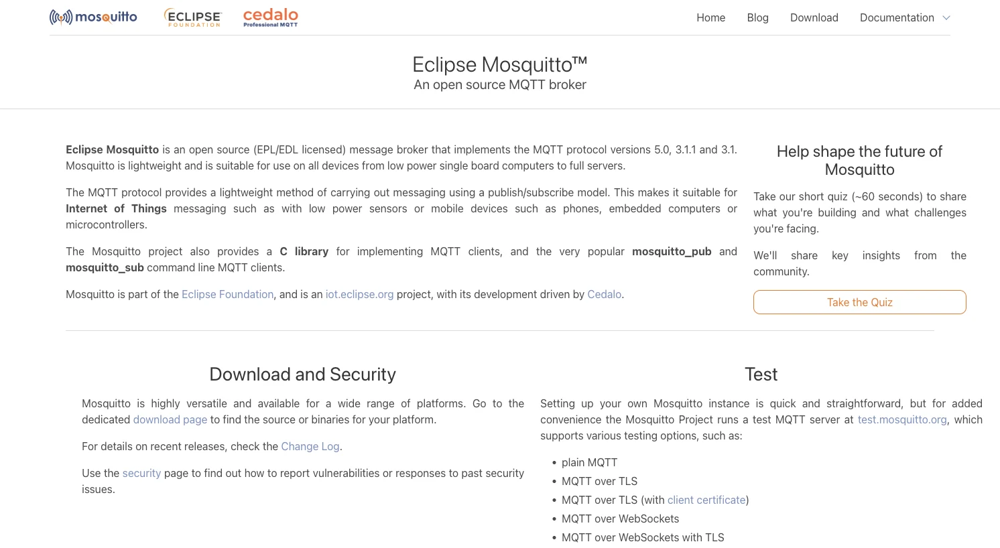

# Deploy and Host Eclipse Mosquitto on Sealos

Eclipse Mosquitto is a lightweight open-source MQTT broker for IoT messaging, telemetry, and event-driven applications. This template deploys Mosquitto 2.0.23 as a single StatefulSet with persistent message storage and a cluster-internal MQTT Service on port `1883`.



## About Hosting Eclipse Mosquitto

Mosquitto runs as one broker process that accepts MQTT 5.0, 3.1.1, and 3.1 connections on port `1883`. The template enables persistence at `/mosquitto/data`, writes logs to stdout, and mounts a ConfigMap as `/mosquitto/config/mosquitto.conf`. Retained messages and persistent session state survive a Pod restart because they live on a 1Gi volume.

The broker is exposed through a ClusterIP Service named after the deployment. It has no Ingress and no public HTTP URL; workloads in the same namespace connect to `<app-name>:1883`, and workloads in other namespaces use `<app-name>.<namespace>.svc.cluster.local:1883`.

The default configuration allows anonymous connections inside the cluster. Add password authentication, TLS, and network restrictions in `mosquitto.conf` before exposing the broker outside the namespace.

## Common Use Cases

- **IoT telemetry**: Collect sensor readings from devices and forward them to dashboards or databases.
- **Home automation**: Connect Zigbee2MQTT, Tasmota, Home Assistant, and other MQTT-speaking tools.
- **Event-driven backends**: Decouple services with publish/subscribe topics and retained state.
- **Device testing**: Validate firmware and client behavior against a local MQTT broker.
- **Edge gateways**: Buffer messages close to devices and bridge them to a central broker when needed.

## Dependencies for Eclipse Mosquitto Hosting

- A Sealos workspace with at least 128Mi of available memory and 1Gi of persistent storage.
- An MQTT client such as `mosquitto_pub` and `mosquitto_sub`.
- A workload in the same namespace, or a TCP exposure layer that can reach the ClusterIP Service.
- Optional credentials and TLS certificates when you enable authenticated or encrypted access.

### Deployment Dependencies

- [Eclipse Mosquitto website](https://mosquitto.org) - Product overview and downloads
- [Mosquitto documentation](https://mosquitto.org/documentation/) - Configuration, authentication, and TLS guides
- [Mosquitto man pages](https://mosquitto.org/man/mosquitto-conf-5.html) - Complete `mosquitto.conf` reference
- [Mosquitto GitHub repository](https://github.com/eclipse-mosquitto/mosquitto) - Source code and releases
- [Mosquitto Docker image](https://hub.docker.com/_/eclipse-mosquitto) - Image used by this template
- [Sealos documentation](https://sealos.io/docs) - Platform concepts and operations

## Implementation Details

**Architecture Components:**

- **Mosquitto StatefulSet**: One replica running `eclipse-mosquitto:2.0.23` on port `1883`.
- **Configuration ConfigMap**: `mosquitto.conf` mounted at `/mosquitto/config/mosquitto.conf`.
- **Data volume**: A 1Gi volume mounted at `/mosquitto/data` for retained messages and persistent session state.
- **Service**: ClusterIP port `1883` for MQTT clients.
- **Network exposure**: Cluster-internal only; the template creates no Ingress and no App URL.

**Configuration:**

- **Image**: `eclipse-mosquitto:2.0.23`
- **MQTT port**: `1883`
- **Listener**: `1883 0.0.0.0`
- **Authentication**: `allow_anonymous true`
- **Persistence**: Enabled with `persistence_location /mosquitto/data/`
- **Logging**: `log_dest stdout`
- **Service endpoint**: `<app-name>:1883` in the same namespace
- **Cluster FQDN**: `<app-name>.<namespace>.svc.cluster.local:1883`
- **Health probes**: TCP checks on port `mqtt`
- **Runtime user**: UID `1883`, GID `1883`, with all Linux capabilities dropped and the `RuntimeDefault` seccomp profile
- **Storage**: 1Gi at `/mosquitto/data`

**Resource Allocation:**

| Component | CPU Request | CPU Limit | Memory Request | Memory Limit | Storage |
| --- | ---: | ---: | ---: | ---: | ---: |
| Eclipse Mosquitto | 50m | 500m | 12Mi | 128Mi | 1Gi |

The live Sealos test published the retained message `retained-persist-ok`, subscribed to it successfully, restarted the Pod, and read the same retained message from the broker. The Pod stayed ready with this profile, and the tested values are recorded in the workload annotation.

## Why Deploy Eclipse Mosquitto on Sealos?

Sealos is an AI-assisted cloud operating system built on Kubernetes. It supplies the compute, storage, networking, and operations layer for Mosquitto through one interface:

- **One-click deployment**: Create the StatefulSet, ConfigMap, persistent volume, and Service from one template.
- **Persistent broker state**: Keep retained messages and session state on a dedicated volume.
- **Kubernetes networking**: Reach the broker through a stable ClusterIP Service and DNS name.
- **Configuration as code**: Manage `mosquitto.conf` through the ConfigMap and restart the Pod to apply changes.
- **Resource control**: Adjust CPU and memory from the resource card as topics and clients grow.
- **Operational visibility**: Inspect Pods, logs, events, and resource usage from Canvas or the Sealos AI dialog.

## Deployment Guide

1. Open the [Eclipse Mosquitto template](https://sealos.io/products/app-store/mosquitto) and click **Deploy Now**.
2. Confirm the generated application name and submit the deployment.
3. Wait 2-3 minutes for the Pod to become ready. The broker has no public URL; access uses the cluster Service.
4. Read the generated name from the App card or the Service resource, then open a Sealos Terminal or a temporary Pod in the same namespace.
5. Subscribe to a topic with `mosquitto_sub -h <app-name> -p 1883 -t 'test/#' -v`.
6. Publish a message from a second client with `mosquitto_pub -h <app-name> -p 1883 -t 'test/hello' -m 'hello'`.
7. Publish a retained message with `-r` and confirm that a new subscriber receives it.

## Using Mosquitto

Clients connect to `<app-name>:1883` from the same namespace. A minimal publish and subscribe test looks like this:

```bash
mosquitto_sub -h my-mosquitto -p 1883 -t 'sensors/#' -v
mosquitto_pub -h my-mosquitto -p 1883 -t 'sensors/room1' -m '{"temperature":22.4}'
```

Retained messages deliver the latest value to every new subscriber:

```bash
mosquitto_pub -h my-mosquitto -p 1883 -t 'devices/status' -m 'online' -r
mosquitto_sub -h my-mosquitto -p 1883 -t 'devices/status' -v -C 1
```

Edit the `mosquitto.conf` ConfigMap to add listeners, password files, ACLs, bridges, or TLS settings. Restart the StatefulSet after saving the ConfigMap so the broker loads the new configuration.

## Scaling

Mosquitto runs one replica because the broker keeps retained messages and session state on a ReadWriteOnce volume. Raise the CPU and memory limits when you add many concurrent clients, large retained payloads, or bridge connections.

The 1Gi volume stores retained messages and persistent sessions. Expand the PVC when message state outgrows the volume, provided the storage class supports expansion. Horizontal scaling needs a broker cluster or bridge topology with shared topic design, which this single-broker template does not configure.

## Troubleshooting

### Connection refused on port 1883

- Cause: The client uses the wrong host or namespace, or the Service has no ready endpoint.
- Solution: Confirm the generated Service name and namespace, verify that the Pod is ready, and test the ClusterIP from another Pod in the same namespace.

### Retained messages disappear after a restart

- Cause: The configuration disables persistence, or the Pod writes to a different data path.
- Solution: Keep `persistence true` and `persistence_location /mosquitto/data/`, confirm that the PVC is mounted at `/mosquitto/data`, and republish the retained message.

### Clients disconnect repeatedly

- Cause: Two clients share one MQTT client ID, or the keepalive interval is shorter than the network path allows.
- Solution: Assign a unique client ID to each connection and raise the keepalive value for high-latency links.

### Connections are rejected with a not-authorized error

- Cause: `allow_anonymous false` is active and the client has no valid credentials, or an ACL blocks the topic.
- Solution: Create a password file, configure the client credentials, and review `acl_file` rules before restarting the broker.

### The broker restarts with an out-of-memory error

- Cause: Large retained payloads or many queued messages consume the 128Mi memory limit.
- Solution: Prune stale retained topics, reduce payload size, and raise the memory limit from the resource card.

### Getting Help

- [Mosquitto documentation](https://mosquitto.org/documentation/)
- [mosquitto.conf reference](https://mosquitto.org/man/mosquitto-conf-5.html)
- [Mosquitto GitHub issues](https://github.com/eclipse-mosquitto/mosquitto/issues)
- [Sealos documentation](https://sealos.io/docs)

## License

Eclipse Mosquitto is released under the [Eclipse Public License 2.0](https://www.eclipse.org/legal/epl-2.0/) and the [Eclipse Distribution License 1.0](https://www.eclipse.org/org/documents/edl-v10.php). This Sealos template is an independent deployment definition and is distributed under the templates repository license.
