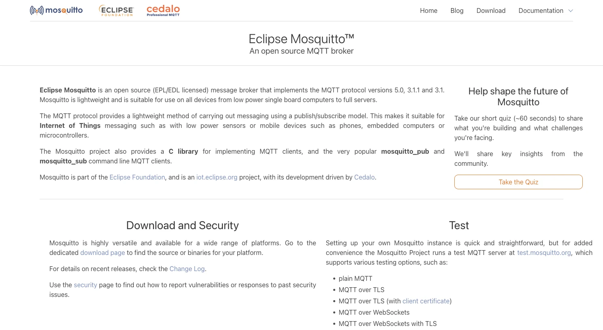

# 在 Sealos 上部署和托管 Eclipse Mosquitto

Eclipse Mosquitto 是一款轻量级开源 MQTT Broker，适用于物联网消息、遥测和事件驱动应用。本模板将 Mosquitto 2.0.23 部署为单个 StatefulSet，提供持久化消息存储和集群内 `1883` 端口的 MQTT Service。



## 关于托管 Eclipse Mosquitto

Mosquitto 以单个 Broker 进程运行，在 `1883` 端口接受 MQTT 5.0、3.1.1 和 3.1 连接。模板启用 `/mosquitto/data` 持久化，将日志写入标准输出，并把 ConfigMap 挂载为 `/mosquitto/config/mosquitto.conf`。保留消息和持久会话保存在 1Gi 卷中，Pod 重启后仍然可用。

Broker 通过以部署名称命名的 ClusterIP Service 暴露。模板未创建 Ingress 和公网 HTTP 地址；同一命名空间中的工作负载连接 `<app-name>:1883`，其他命名空间使用 `<app-name>.<namespace>.svc.cluster.local:1883`。

默认配置允许集群内匿名连接。将 Broker 暴露到命名空间之外前，在 `mosquitto.conf` 中增加密码认证、TLS 和网络限制。

## 常见使用场景

- **物联网遥测**：采集设备传感器数据，并转发到仪表盘或数据库。
- **家庭自动化**：连接 Zigbee2MQTT、Tasmota、Home Assistant 等支持 MQTT 的工具。
- **事件驱动后端**：通过发布订阅主题和保留状态解耦服务。
- **设备测试**：在本地 MQTT Broker 上验证固件和客户端行为。
- **边缘网关**：在设备附近缓存消息，并按需桥接到中心 Broker。

## Eclipse Mosquitto 托管依赖

- 一个 Sealos 工作空间，至少提供 128Mi 可用内存和 1Gi 持久存储。
- `mosquitto_pub`、`mosquitto_sub` 等 MQTT 客户端。
- 同一命名空间中的工作负载，或者能够访问 ClusterIP Service 的 TCP 暴露层。
- 启用认证或加密访问时需要的凭据和 TLS 证书。

### 部署依赖

- [Eclipse Mosquitto 官网](https://mosquitto.org) - 产品介绍和下载
- [Mosquitto 文档](https://mosquitto.org/documentation/) - 配置、认证和 TLS 指南
- [Mosquitto 手册页](https://mosquitto.org/man/mosquitto-conf-5.html) - 完整 `mosquitto.conf` 参考
- [Mosquitto GitHub 仓库](https://github.com/eclipse-mosquitto/mosquitto) - 源码和版本发布
- [Mosquitto Docker 镜像](https://hub.docker.com/_/eclipse-mosquitto) - 本模板使用的镜像
- [Sealos 文档](https://sealos.io/docs) - 平台概念和操作说明

## 实现细节

**架构组件：**

- **Mosquitto StatefulSet**：一个副本，运行 `eclipse-mosquitto:2.0.23`，监听 `1883` 端口。
- **配置 ConfigMap**：将 `mosquitto.conf` 挂载到 `/mosquitto/config/mosquitto.conf`。
- **数据卷**：1Gi，挂载到 `/mosquitto/data`，保存保留消息和持久会话状态。
- **Service**：ClusterIP 端口 `1883`，供 MQTT 客户端连接。
- **网络暴露**：仅集群内访问，模板未创建 Ingress 和 App 地址。

**配置：**

- **镜像**：`eclipse-mosquitto:2.0.23`
- **MQTT 端口**：`1883`
- **监听地址**：`1883 0.0.0.0`
- **身份认证**：`allow_anonymous true`
- **持久化**：启用，`persistence_location /mosquitto/data/`
- **日志**：`log_dest stdout`
- **Service 地址**：同一命名空间使用 `<app-name>:1883`
- **集群 FQDN**：`<app-name>.<namespace>.svc.cluster.local:1883`
- **健康检查**：针对 `mqtt` 端口的 TCP 检查
- **运行用户**：UID `1883`、GID `1883`，移除全部 Linux capabilities，启用 `RuntimeDefault` seccomp 配置
- **存储**：1Gi，挂载到 `/mosquitto/data`

**资源分配：**

| 组件 | CPU 请求 | CPU 限制 | 内存请求 | 内存限制 | 存储 |
| --- | ---: | ---: | ---: | ---: | ---: |
| Eclipse Mosquitto | 50m | 500m | 12Mi | 128Mi | 1Gi |

Sealos 实测发布了保留消息 `retained-persist-ok`，订阅成功，Pod 重启后仍能从 Broker 读取同一条保留消息。Pod 使用该配置保持就绪，实测数值已写入工作负载注解。

## 为什么在 Sealos 上部署 Eclipse Mosquitto？

Sealos 是构建在 Kubernetes 上的 AI 辅助云操作系统，通过统一界面提供 Mosquitto 所需的计算、存储、网络和运维能力：

- **一键部署**：用一个模板创建 StatefulSet、ConfigMap、持久卷和 Service。
- **Broker 状态持久化**：将保留消息和会话状态保存在独立持久卷中。
- **Kubernetes 网络**：通过稳定的 ClusterIP Service 和 DNS 名称访问 Broker。
- **配置即代码**：通过 ConfigMap 管理 `mosquitto.conf`，重启 Pod 应用修改。
- **资源可控**：主题和客户端增长时，通过资源卡片调整 CPU 和内存。
- **运维可见**：在 Canvas 或 Sealos AI 对话框中查看 Pod、日志、事件和资源使用情况。

## 部署指南

1. 打开 [Eclipse Mosquitto 模板](https://sealos.io/products/app-store/mosquitto)，点击 **Deploy Now**。
2. 确认自动生成的应用名称并提交部署。
3. 等待 2-3 分钟，Pod 进入就绪状态。Broker 没有公网地址，访问通过集群 Service 完成。
4. 从应用卡片或 Service 资源读取生成的名称，然后打开 Sealos Terminal 或同一命名空间中的临时 Pod。
5. 使用 `mosquitto_sub -h <app-name> -p 1883 -t 'test/#' -v` 订阅主题。
6. 从第二个客户端使用 `mosquitto_pub -h <app-name> -p 1883 -t 'test/hello' -m 'hello'` 发布消息。
7. 使用 `-r` 发布保留消息，确认新的订阅者可以收到。

## 使用 Mosquitto

同一命名空间中的客户端连接 `<app-name>:1883`。最小发布订阅测试如下：

```bash
mosquitto_sub -h my-mosquitto -p 1883 -t 'sensors/#' -v
mosquitto_pub -h my-mosquitto -p 1883 -t 'sensors/room1' -m '{"temperature":22.4}'
```

保留消息会把最新值发送给每个新订阅者：

```bash
mosquitto_pub -h my-mosquitto -p 1883 -t 'devices/status' -m 'online' -r
mosquitto_sub -h my-mosquitto -p 1883 -t 'devices/status' -v -C 1
```

编辑 `mosquitto.conf` ConfigMap 可以增加监听器、密码文件、ACL、桥接或 TLS 设置。保存 ConfigMap 后重启 StatefulSet，让 Broker 加载新配置。

## 扩缩容

Broker 将保留消息和会话状态保存在 ReadWriteOnce 卷中，因此 Mosquitto 运行一个副本。并发客户端、较大保留负载或桥接连接增加时，提高 CPU 和内存限制。

1Gi 卷保存保留消息和持久会话。消息状态增长后可以扩展 PVC，前提是存储类支持扩容。水平扩展需要 Broker 集群或桥接拓扑和共享主题设计，本单 Broker 模板未配置这些组件。

## 故障排查

### 1883 端口连接被拒绝

- 原因：客户端使用的主机或命名空间错误，或者 Service 没有就绪端点。
- 处理：确认生成的 Service 名称和命名空间，检查 Pod 是否就绪，并从同一命名空间的其他 Pod 测试 ClusterIP。

### 重启后保留消息消失

- 原因：配置关闭了持久化，或者 Pod 写入了不同的数据路径。
- 处理：保持 `persistence true` 和 `persistence_location /mosquitto/data/`，确认 PVC 挂载到 `/mosquitto/data`，然后重新发布保留消息。

### 客户端反复断开

- 原因：两个客户端使用相同的 MQTT Client ID，或者 keepalive 间隔短于网络路径允许的时间。
- 处理：为每个连接分配唯一 Client ID，并为高延迟链路提高 keepalive 值。

### 连接被拒绝并提示 not-authorized

- 原因：`allow_anonymous false` 已启用且客户端没有有效凭据，或者 ACL 阻止了主题。
- 处理：创建密码文件、配置客户端凭据，并在重启 Broker 前检查 `acl_file` 规则。

### Broker 因内存不足重启

- 原因：较大的保留负载或大量排队消息用尽了 128Mi 内存限制。
- 处理：清理过期保留主题、降低负载大小，并通过资源卡片提高内存限制。

### 获取帮助

- [Mosquitto 文档](https://mosquitto.org/documentation/)
- [mosquitto.conf 参考](https://mosquitto.org/man/mosquitto-conf-5.html)
- [Mosquitto GitHub Issues](https://github.com/eclipse-mosquitto/mosquitto/issues)
- [Sealos 文档](https://sealos.io/docs)

## 许可证

Eclipse Mosquitto 使用 [Eclipse Public License 2.0](https://www.eclipse.org/legal/epl-2.0/) 和 [Eclipse Distribution License 1.0](https://www.eclipse.org/org/documents/edl-v10.php) 发布。本 Sealos 模板是独立部署定义，遵循 templates 仓库许可证。
