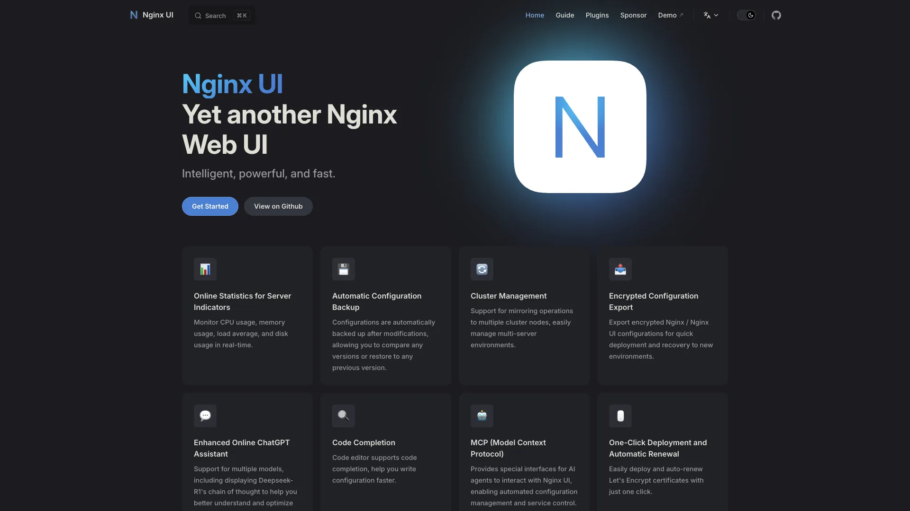

# Deploy and Host Nginx UI on Sealos

Nginx UI is a self-hosted web administration interface for Nginx. It provides configuration editing, site management, certificate handling, log inspection, configuration history, and a bundled Nginx runtime. This Sealos template runs Nginx UI 3.0.8 with a pre-seeded administrator account and two 1Gi persistent volumes.

## About Hosting Nginx UI

The template runs one StatefulSet from the official `uozi/nginx-ui:v3.0.8` image. The image uses s6-overlay to run two services in the same Pod: Nginx listens on port `80`, and Nginx UI listens on port `9000`. The bundled `conf.d/nginx-ui.conf` sends public requests to the Nginx UI process, so the App card opens the management interface directly.

Two volumes preserve the complete runtime state. The `/etc/nginx` volume stores `nginx.conf`, the bundled UI proxy configuration, site and stream definitions, enabled symlinks, and other Nginx configuration files. The `/etc/nginx-ui` volume stores `app.ini`, the SQLite database, installed plugins, and application state.

Sealos provisions the PostgreSQL-free, single-process layout as one stateful workload with a ClusterIP Service, an HTTPS Ingress, and an App entry. The template seeds the administrator from required deployment inputs and generates a dedicated JWT signing secret.

## Common Use Cases

- **Nginx administration**: Edit configuration files, inspect syntax, reload Nginx, and review configuration history from a browser.
- **Reverse proxy management**: Create virtual hosts and upstreams for internal applications and APIs.
- **Certificate operations**: Keep imported certificates and private keys organized with the sites that use them.
- **Log inspection**: Search access and error logs without opening a shell on every Nginx node.
- **Small website hosting**: Serve a landing page, documentation mirror, or private site from the bundled Nginx instance.
- **Operations lab**: Experiment with Nginx configuration, reload workflows, and self-checks in an isolated deployment.

## Dependencies for Nginx UI Hosting

- A Sealos workspace with at least `500m` CPU, `256Mi` memory, and 2Gi of persistent storage for the two volumes.
- A browser with access to the generated HTTPS endpoint.
- A source for Nginx site files, proxy targets, or certificates that you plan to manage through the UI.
- Outbound network access to package, plugin, and DNS services used by optional Nginx UI features.
- A public validation route or a DNS-01 provider when automatic certificate issuance is required.

### Deployment Dependencies

- [Nginx UI project](https://github.com/0xJacky/nginx-ui) - Source code, releases, and issue tracker
- [Getting started guide](https://nginxui.com/guide/getting-started) - Docker layout, ports, volumes, and first-run behavior
- [Environment variable reference](https://nginxui.com/guide/env) - Application, server, authentication, Nginx, and plugin settings
- [Nginx control configuration](https://nginxui.com/guide/config-nginx) - Configuration paths, reload commands, and log controls
- [Kubernetes installation guide](https://nginxui.com/guide/install-kubernetes) - Upstream Kubernetes and volume guidance
- [Container image](https://hub.docker.com/r/uozi/nginx-ui) - Official image used by this template
- [Release 3.0.8](https://github.com/0xJacky/nginx-ui/releases/tag/v3.0.8) - Version used by this template
- [Sealos documentation](https://sealos.io/docs) - Platform concepts and operations

## Implementation Details

**Architecture Components:**

- **Nginx UI StatefulSet**: One replica running the Nginx UI backend and the bundled Nginx service from the official image.
- **Nginx service**: Listens on container port `80` and serves the public entry point.
- **Nginx UI service**: Listens on `127.0.0.1:9000`; the bundled `conf.d/nginx-ui.conf` proxies requests from port `80`.
- **Nginx configuration volume**: A 1Gi volume at `/etc/nginx` for the main configuration, sites, streams, snippets, and enabled links.
- **Nginx UI data volume**: A 1Gi volume at `/etc/nginx-ui` for `app.ini`, `database.db`, plugins, and application state.
- **Configuration seed initializer**: An init container copies the image's built-in Nginx configuration only when `/etc/nginx/nginx.conf` is absent.
- **Service**: ClusterIP port `80` forwarding to the bundled Nginx port.
- **Ingress**: Sealos-managed HTTPS host with a 32Mi request body limit and 300-second proxy timeouts.
- **App entry**: Opens the public HTTPS URL at the Nginx UI login page.

**Configuration:**

- **Image**: `uozi/nginx-ui:v3.0.8`
- **HTTP entry port**: `80`
- **Nginx UI port**: `9000`
- **Health check**: `GET /healthz` on port `9000`
- **Initial administrator**: `admin_username` and `admin_password` deployment inputs
- **JWT secret**: A random 64-character value exposed as `NGINX_UI_APP_JWT_SECRET`
- **Timezone**: `Asia/Shanghai`
- **Run mode**: `release`
- **Node installation**: Skipped with `NGINX_UI_NODE_SKIP_INSTALLATION=true`
- **Docker socket self-check**: Suppressed with `NGINX_UI_IGNORE_DOCKER_SOCKET=true`
- **Public URL**: `https://${{ defaults.app_host }}.${{ SEALOS_CLOUD_DOMAIN }}/`
- **Pod security**: Service account token mounting is disabled, privilege escalation is blocked for the init container, and the `RuntimeDefault` seccomp profile is applied.

**Resource Allocation:**

| Component | CPU Request | CPU Limit | Memory Request | Memory Limit | Storage |
| --- | ---: | ---: | ---: | ---: | ---: |
| Nginx UI and bundled Nginx | 50m | 500m | 25Mi | 256Mi | 2Gi across two volumes |
| Configuration seed initializer | 50m | 500m | 12Mi | 128Mi | Shared |

The resource profile was verified on Sealos. The Pod reached Ready with zero restarts, the predefined administrator signed in, the dashboard and self-check loaded, a test site was created and enabled, `nginx -t` succeeded, and a public request returned the test site. A Pod restart preserved the administrator session and site configuration. Runtime memory settled around `130Mi` during validation, leaving headroom under the 256Mi limit.

## Why Deploy Nginx UI on Sealos?

Sealos is an AI-assisted cloud operating system built on Kubernetes. It supplies the compute, storage, networking, and lifecycle management that Nginx UI needs:

- **One-Click Deployment**: Create the StatefulSet, two volumes, Service, Ingress, and App entry from one template.
- **Built-In Nginx Runtime**: Manage configuration and serve traffic from the same Pod.
- **Automatic HTTPS**: Receive a managed public domain and edge TLS certificate.
- **Persistent Configuration**: Keep Nginx files, account data, and plugins across Pod restarts.
- **Resource Control**: Raise CPU and memory from the resource card as configuration and traffic grow.
- **Operational Visibility**: Inspect logs, events, and resource usage from Canvas or the Sealos AI dialog.

## Deployment Guide

1. Open the [Nginx UI template](https://sealos.io/products/app-store/nginx-ui) and click **Deploy Now**.
2. Enter an administrator username and a password with at least eight characters.
3. Confirm the application name and submit the deployment.
4. Wait 2-3 minutes for the two volumes to bind, the Pod to become ready, and the HTTPS certificate to be issued.
5. Open the App card and sign in with the administrator credentials from step 2.
6. Review **Dashboard** and **Preferences > Self-Check** before changing any Nginx configuration.
7. Create a site, test the configuration, and enable it from the site list.

### First Login

The `admin_username` and `admin_password` inputs seed the initial account when the Nginx UI database is first created. Change the password in the UI after the first login and store the new value securely. The deployment inputs remain part of the template configuration, while the SQLite account record becomes the source of truth after initialization.

### Opening the Interface

The App card points to the root of the public HTTPS host. The bundled Nginx configuration proxies that path to `127.0.0.1:9000`. Keep `conf.d/nginx-ui.conf` in the `/etc/nginx` volume when you customize Nginx, because it provides the management interface entry point.

## Using Nginx UI

The dashboard summarizes Nginx status, resource use, configuration health, and recent activity. Site management writes configuration into `sites-available` and creates an enabled link under `sites-enabled`, matching the Debian-style layout used by the image. Nginx UI tests configuration changes before asking Nginx to reload, so a syntax error stays visible without taking down the current configuration.

The configuration editor exposes `nginx.conf`, `conf.d`, site files, stream definitions, and snippets stored under `/etc/nginx`. Configuration history records changes and supports comparison and rollback. The log views read `/var/log/nginx/access.log` and `/var/log/nginx/error.log` from the same Pod.

Certificate management stores imported certificates for use in site configuration. Sealos terminates the public TLS connection at its Ingress, so the App URL uses the platform certificate. Certificates managed inside Nginx UI apply to additional listeners, upstream connections, or deployment-specific trust chains. For ACME HTTP-01 issuance, provide a public validation path that reaches the container. DNS-01 through a supported plugin is the portable option for the default Sealos ingress.

## Data and Persistence

The StatefulSet keeps all durable data on two volumes:

- `/etc/nginx` contains `nginx.conf`, `conf.d/nginx-ui.conf`, `sites-available`, `sites-enabled`, `streams-available`, `streams-enabled`, snippets, and site-level configuration.
- `/etc/nginx-ui` contains `app.ini`, `database.db`, installed plugins, generated secrets, and UI state.

Pod restarts, rescheduling, and image updates preserve both directories. Template redeployment also preserves them when the same volumes remain bound. Deleting the Instance and its volumes removes the account database, site files, and plugin state.

For a backup, pause configuration changes and archive both directories from the running container or a maintenance Pod. Restore them to the same paths with writable ownership. A consistent backup captures `/etc/nginx` and `/etc/nginx-ui` together because the site definitions and the UI database reference each other.

The template allocates 1Gi to each volume. Standard Nginx configuration and SQLite data fit comfortably in that space. Add a separate volume for `/var/www` before hosting large static file trees.

## Scaling

Nginx UI uses a local SQLite database and a local Nginx process, so this template runs one replica with a fixed single writer. Scale vertically by increasing the CPU limit for higher request throughput and the memory limit for large configurations, extensive log indexing, many concurrent management sessions, or large configuration history.

The bundled Nginx uses `worker_processes auto` and can use the available CPU limit without additional deployment changes. For high traffic, place static assets behind a cache or CDN and keep configuration writes on the single Nginx UI instance. Multi-node Nginx fleets can be managed from separate Nginx UI deployments when each node has its own accessible configuration and control path.

## Troubleshooting

### The Pod is Pending because volumes cannot bind

The template requests two 1Gi ReadWriteOnce volumes. Confirm that the namespace has an available storage class and enough capacity, then inspect the PVC events. A volume that stays Pending prevents the init container from starting.

### The Nginx configuration directory appears initialized but is empty

Sealos block storage creates a `lost+found` directory at the volume root. The upstream initializer checks whether `/etc/nginx` is empty and can skip its first-boot copy when only `lost+found` exists. This template runs `seed-nginx-config`, which checks for `/etc/nginx/nginx.conf` directly and copies the built-in configuration when the file is missing.

### The public URL returns a bad gateway

Confirm that the `nginx-ui` process is listening on port `9000` and that `GET /healthz` returns HTTP 200. Check `/etc/nginx/conf.d/nginx-ui.conf` for the `proxy_pass http://127.0.0.1:9000/` rule. Review the container log for Nginx UI startup errors and the Nginx error log for upstream failures.

### The login page rejects the deployment password

The predefined account is created when `/etc/nginx-ui/database.db` is first initialized. A later change to the deployment inputs updates the environment, while the existing database account remains. Use the current password, recover access with the upstream password-reset procedure, or restore a known database backup.

### A new site returns the default response

Open the site list and confirm that the site is enabled. Nginx reads files from `sites-enabled`, and the enabled entry normally links to a file in `sites-available`. Run the configuration test from Nginx UI, then reload Nginx and inspect `/var/log/nginx/error.log`.

### `nginx -t` reports a syntax or duplicate-listen error

Use the configuration editor or configuration history to locate the change that introduced the error. Common causes include duplicate `server_name` blocks, duplicate `listen` declarations, a missing included file, or a stale enabled symlink. Nginx UI keeps the last good configuration running until a successful reload.

### Self-check reports that the Docker socket is unavailable

The template has no Docker socket because Nginx and Nginx UI run in the same Pod. `NGINX_UI_IGNORE_DOCKER_SOCKET=true` marks that condition as expected. Docker-specific container-control features remain unavailable in this deployment.

### Automatic certificate validation fails

The Sealos Ingress owns ports `80` and `443` at the public edge. Automatic HTTP-01 validation works when the challenge route reaches this container. Use a DNS-01 plugin when the ingress redirects or intercepts the validation path, or import an existing certificate and reference it from the site configuration.

### The Pod restarts with an OOM kill

Raise the memory limit from the resource card. Log indexing, very large configuration histories, and many concurrent sessions increase memory use. The validated profile stayed near 130Mi, and the next Sealos memory tier provides additional headroom.

### The plugin marketplace logs a 404 warning

A marketplace request can fail while the bundled plugin remains usable. Confirm outbound network access and inspect the plugin page. A warning about an unavailable marketplace source does not block the Nginx UI process or an existing configuration.

### Getting Help

- [Nginx UI documentation](https://nginxui.com/guide/getting-started)
- [Nginx UI GitHub issues](https://github.com/0xJacky/nginx-ui/issues)
- [Nginx UI password reset guide](https://nginxui.com/guide/reset-password)
- [Sealos documentation](https://sealos.io/docs)

## License

Nginx UI is released under the [GNU Affero General Public License v3.0](https://github.com/0xJacky/nginx-ui/blob/v3.0.8/LICENSE). This template is an independent deployment definition and is not affiliated with or endorsed by the Nginx UI project. This Sealos template is distributed under the templates repository license.
