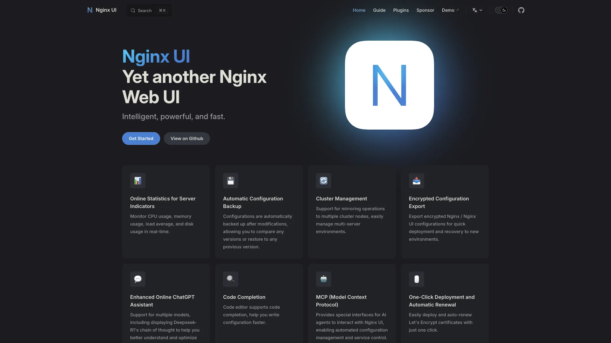

# 在 Sealos 上部署和托管 Nginx UI

Nginx UI 是自托管的 Nginx Web 管理界面，提供配置编辑、站点管理、证书处理、日志查看、配置历史和内置 Nginx 运行环境。本 Sealos 模板运行 Nginx UI 3.0.8，预置管理员账号，并使用两个 1Gi 持久化卷。

## 托管说明

模板使用官方 `uozi/nginx-ui:v3.0.8` 镜像运行一个 StatefulSet。镜像通过 s6-overlay 在同一 Pod 内启动两个服务：Nginx 监听 `80` 端口，Nginx UI 监听 `9000` 端口。内置的 `conf.d/nginx-ui.conf` 把公网请求转发到 Nginx UI，因此 App 卡片会直接打开管理界面。

两个数据卷保存完整运行状态。`/etc/nginx` 卷保存 `nginx.conf`、内置管理界面代理配置、站点与 Stream 定义、启用链接及其他 Nginx 配置；`/etc/nginx-ui` 卷保存 `app.ini`、SQLite 数据库、已安装插件和应用状态。

Sealos 将单进程架构交付为一个有状态工作负载，并创建 ClusterIP Service、HTTPS Ingress 和 App 入口。模板从部署输入中生成初始管理员账号，同时生成独立的 JWT 签名密钥。

## 常见使用场景

- **Nginx 管理**：在浏览器中编辑配置、检查语法、重载 Nginx 并查看配置历史。
- **反向代理管理**：为内部应用和 API 创建虚拟主机与上游。
- **证书管理**：把导入的证书和私钥与对应站点集中维护。
- **日志查看**：集中检索访问日志和错误日志。
- **小型站点托管**：使用内置 Nginx 提供落地页、文档镜像或私有站点。
- **运维实验环境**：在隔离部署中验证 Nginx 配置、重载流程和自检机制。

## 部署依赖

- 至少 `500m` CPU、`256Mi` 内存和 2Gi 持久化存储的 Sealos 工作区，用于两个数据卷。
- 可访问 HTTPS 入口的浏览器。
- 计划通过界面管理的站点文件、代理目标或证书来源。
- 可选功能所需的软件包、插件和 DNS 服务出网访问。
- 需要自动签发证书时，可用的公网验证路径或 DNS-01 提供商。

### 部署相关链接

- [Nginx UI 项目页](https://github.com/0xJacky/nginx-ui)：源码、发布和问题跟踪
- [快速开始](https://nginxui.com/guide/getting-started)：Docker 结构、端口、数据卷和首次运行说明
- [环境变量参考](https://nginxui.com/guide/env)：应用、服务、认证、Nginx 和插件设置
- [Nginx 控制配置](https://nginxui.com/guide/config-nginx)：配置路径、重载命令和日志控制
- [Kubernetes 安装指南](https://nginxui.com/guide/install-kubernetes)：上游 Kubernetes 与数据卷建议
- [容器镜像](https://hub.docker.com/r/uozi/nginx-ui)：本模板使用的官方镜像
- [3.0.8 发布](https://github.com/0xJacky/nginx-ui/releases/tag/v3.0.8)：本模板使用的版本
- [Sealos 文档](https://sealos.io/docs)：平台概念与操作

## 实现细节

**架构组件：**

- **Nginx UI StatefulSet**：单副本运行官方镜像中的 Nginx UI 后端和内置 Nginx 服务。
- **Nginx 服务**：监听容器 `80` 端口，提供公网入口。
- **Nginx UI 服务**：监听 `127.0.0.1:9000`，由内置的 `conf.d/nginx-ui.conf` 从 `80` 端口转发访问。
- **Nginx 配置卷**：挂载到 `/etc/nginx` 的 1Gi 卷，保存主配置、站点、Stream、片段和启用链接。
- **Nginx UI 数据卷**：挂载到 `/etc/nginx-ui` 的 1Gi 卷，保存 `app.ini`、`database.db`、插件和应用状态。
- **配置初始化容器**：仅在 `/etc/nginx/nginx.conf` 缺失时，把镜像内置的 Nginx 配置复制到数据卷。
- **Service**：ClusterIP 端口 `80`，转发到内置 Nginx 端口。
- **Ingress**：Sealos 管理的 HTTPS 域名，请求体上限 32Mi，代理超时 300 秒。
- **App 入口**：打开公网 HTTPS 地址上的 Nginx UI 登录页。

**配置：**

- **镜像**：`uozi/nginx-ui:v3.0.8`
- **HTTP 入口端口**：`80`
- **Nginx UI 端口**：`9000`
- **健康检查**：`GET /healthz`，端口 `9000`
- **初始管理员**：`admin_username` 与 `admin_password` 部署输入
- **JWT 密钥**：随机 64 字符值，通过 `NGINX_UI_APP_JWT_SECRET` 注入
- **时区**：`Asia/Shanghai`
- **运行模式**：`release`
- **节点安装**：通过 `NGINX_UI_NODE_SKIP_INSTALLATION=true` 跳过
- **Docker Socket 自检**：通过 `NGINX_UI_IGNORE_DOCKER_SOCKET=true` 标记为预期条件
- **公网地址**：`https://${{ defaults.app_host }}.${{ SEALOS_CLOUD_DOMAIN }}/`
- **Pod 安全**：禁用 Service Account Token 自动挂载，初始化容器禁止权限提升，并应用 `RuntimeDefault` seccomp 配置

**资源分配：**

| 组件 | CPU 请求 | CPU 上限 | 内存请求 | 内存上限 | 存储 |
| --- | ---: | ---: | ---: | ---: | ---: |
| Nginx UI 与内置 Nginx | 50m | 500m | 25Mi | 256Mi | 两个数据卷共 2Gi |
| 配置初始化容器 | 50m | 500m | 12Mi | 128Mi | 共享 |

以上配置已在 Sealos 实测。Pod 达到 Ready 且零重启，预置管理员成功登录，仪表盘与自检正常加载，测试站点创建并启用成功，`nginx -t` 检查通过，公网请求返回测试站点。Pod 重启后管理员会话与站点配置仍然保留。验证期间运行内存稳定在约 `130Mi`，256Mi 上限留有余量。

## 为什么在 Sealos 上部署 Nginx UI？

Sealos 是基于 Kubernetes 的 AI 辅助云操作系统，为 Nginx UI 提供所需的计算、存储、网络和生命周期管理：

- **一键部署**：通过单个模板创建 StatefulSet、两个数据卷、Service、Ingress 和 App 入口。
- **内置 Nginx 运行时**：在同一 Pod 内完成配置管理和流量服务。
- **自动 HTTPS**：获得托管的公网域名和边缘 TLS 证书。
- **持久化配置**：Nginx 文件、账号数据和插件在 Pod 重启后继续保留。
- **资源控制**：在资源卡片中提升 CPU 和内存，适配配置规模与流量增长。
- **运维可视性**：通过 Canvas 或 Sealos AI 对话框查看日志、事件和资源使用情况。

## 部署指南

1. 打开 [Nginx UI 模板](https://sealos.io/products/app-store/nginx-ui) 并点击 **Deploy Now**。
2. 输入管理员用户名和至少八个字符的密码。
3. 确认应用名称并提交部署。
4. 等待 2-3 分钟，直到两个数据卷完成绑定、Pod 就绪并完成 HTTPS 证书签发。
5. 打开 App 卡片，使用第 2 步输入的管理员凭据登录。
6. 在修改 Nginx 配置前查看 **Dashboard** 与 **Preferences > Self-Check**。
7. 创建站点，测试配置，并在站点列表中启用。

### 首次登录

`admin_username` 与 `admin_password` 会在 Nginx UI 数据库首次创建时生成初始账号。首次登录后请在界面中修改密码，并把新密码保存到密码管理器。部署输入属于模板配置；账号初始化完成后，SQLite 账号记录成为实际凭据来源。

### 打开管理界面

App 卡片指向公网 HTTPS 域名根路径。内置 Nginx 把该路径转发到 `127.0.0.1:9000`。自定义 Nginx 配置时请保留 `/etc/nginx` 卷中的 `conf.d/nginx-ui.conf`，它负责管理界面入口。

## 使用 Nginx UI

仪表盘汇总 Nginx 状态、资源使用、配置健康度和近期活动。站点管理会把配置写入 `sites-available`，并在 `sites-enabled` 中创建启用链接，与镜像采用的 Debian 配置布局一致。Nginx UI 会先测试配置，再通知 Nginx 重载；语法错误会留在编辑器中，当前配置继续提供服务。

配置编辑器可访问 `/etc/nginx` 下的 `nginx.conf`、`conf.d`、站点文件、Stream 定义和片段。配置历史记录每次变更，并支持比较与回滚。日志页面读取同一 Pod 内的 `/var/log/nginx/access.log` 和 `/var/log/nginx/error.log`。

证书管理可保存导入的证书与私钥，并在站点配置中引用。Sealos 在 Ingress 层终止公网 TLS，因此 App 地址使用平台证书。Nginx UI 中的证书适用于额外监听端口、上游连接或部署内的信任链。使用 ACME HTTP-01 时，需要提供可达容器的公网验证路径；默认 Sealos Ingress 环境下，可通过支持的 DNS-01 插件完成验证。

## 数据与持久化

StatefulSet 使用两个数据卷保存全部持久数据：

- `/etc/nginx` 保存 `nginx.conf`、`conf.d/nginx-ui.conf`、`sites-available`、`sites-enabled`、`streams-available`、`streams-enabled`、片段和站点级配置。
- `/etc/nginx-ui` 保存 `app.ini`、`database.db`、已安装插件、生成密钥和界面状态。

Pod 重启、重新调度和镜像更新都会保留两个目录。模板重新部署时，只要数据卷继续绑定，数据也会保留。删除 Instance 及其数据卷会清除账号数据库、站点文件和插件状态。

备份时请暂停配置变更，并从运行中的容器或维护 Pod 归档两个目录。恢复时写回相同路径并保持可写属主。站点定义和界面数据库相互引用，因此 `/etc/nginx` 与 `/etc/nginx-ui` 应放在同一份一致性备份中。

模板为每个卷分配 1Gi。标准 Nginx 配置和 SQLite 数据可以充分容纳。准备托管大型静态文件时，请为 `/var/www` 增加独立数据卷。

## 扩展

Nginx UI 使用本地 SQLite 数据库和本地 Nginx 进程，因此模板运行单副本和固定单写入者。配置规模、日志索引、并发管理会话或配置历史增长时，可提升内存上限；请求吞吐增长时，可提升 CPU 上限。

内置 Nginx 使用 `worker_processes auto`，会利用可用 CPU 上限。高流量场景可把静态资源放到缓存或 CDN，并把配置写入集中在单个 Nginx UI 实例。多节点 Nginx 集群可由各自具备配置与控制路径的 Nginx UI 部署分别管理。

## 故障排查

### Pod 因数据卷无法绑定而处于 Pending

模板申请两个 1Gi ReadWriteOnce 数据卷。请确认命名空间中存在可用的存储类且容量充足，然后查看 PVC 事件。数据卷持续处于 Pending 时，初始化容器无法启动。

### Nginx 配置目录看似已初始化但内容为空

Sealos 块存储会在数据卷根目录创建 `lost+found`。上游初始化脚本通过判断 `/etc/nginx` 是否为空来执行首次复制，目录中只有 `lost+found` 时会跳过复制。本模板运行 `seed-nginx-config`，直接检查 `/etc/nginx/nginx.conf`，文件缺失时从镜像内置目录复制配置。

### 公网地址返回 Bad Gateway

请确认 `nginx-ui` 进程正在监听 `9000` 端口，并确认 `GET /healthz` 返回 HTTP 200。检查 `/etc/nginx/conf.d/nginx-ui.conf` 中的 `proxy_pass http://127.0.0.1:9000/` 规则。容器日志可用于定位 Nginx UI 启动错误，Nginx 错误日志可用于定位上游故障。

### 登录页拒绝部署密码

预置账号在 `/etc/nginx-ui/database.db` 首次初始化时创建。之后修改部署输入会更新环境变量，现有数据库账号继续使用原凭据。请使用当前密码，按照上游密码重置流程恢复访问，或恢复已知的数据库备份。

### 新站点返回默认响应

请打开站点列表并确认站点已启用。Nginx 从 `sites-enabled` 读取配置，启用项通常链接到 `sites-available` 中的文件。请在 Nginx UI 中执行配置测试，然后重载 Nginx，并查看 `/var/log/nginx/error.log`。

### `nginx -t` 报语法错误或重复监听

可通过配置编辑器或配置历史定位引入错误的变化。常见原因包括重复的 `server_name`、重复的 `listen`、缺失的包含文件或失效的启用链接。Nginx UI 保留上一份有效配置继续运行，直到新配置测试通过并完成重载。

### 自检提示 Docker Socket 不可用

模板不挂载 Docker Socket，因为 Nginx 与 Nginx UI 运行在同一 Pod 内。`NGINX_UI_IGNORE_DOCKER_SOCKET=true` 会把该条件标记为预期结果。当前部署可使用内置 Nginx 管理功能，Docker 容器控制功能保持关闭。

### 自动证书验证失败

Sealos Ingress 在公网边缘占用 `80` 和 `443` 端口。验证请求能够到达本容器时，HTTP-01 可以完成；Ingress 重定向或拦截验证路径时，可使用 DNS-01 插件，或导入现有证书并在站点配置中引用。

### Pod 因 OOM 重启

请在资源卡片中提升内存上限。日志索引、较大的配置历史和大量并发会话都会增加内存使用。实测配置稳定在约 130Mi，Sealos 的下一档内存可提供更多余量。

### 插件市场日志出现 404 警告

市场请求失败时，镜像内置插件仍可继续使用。请确认出网访问并查看插件页面。市场来源不可用会形成警告，Nginx UI 进程和现有配置仍会继续工作。

### 获取帮助

- [Nginx UI 文档](https://nginxui.com/guide/getting-started)
- [Nginx UI GitHub Issues](https://github.com/0xJacky/nginx-ui/issues)
- [Nginx UI 密码重置指南](https://nginxui.com/guide/reset-password)
- [Sealos 文档](https://sealos.io/docs)

## 许可证

Nginx UI 采用 [GNU Affero General Public License v3.0](https://github.com/0xJacky/nginx-ui/blob/v3.0.8/LICENSE)。本模板是独立部署定义，与 Nginx UI 项目无隶属或背书关系。本 Sealos 模板遵循 templates 仓库许可证。
