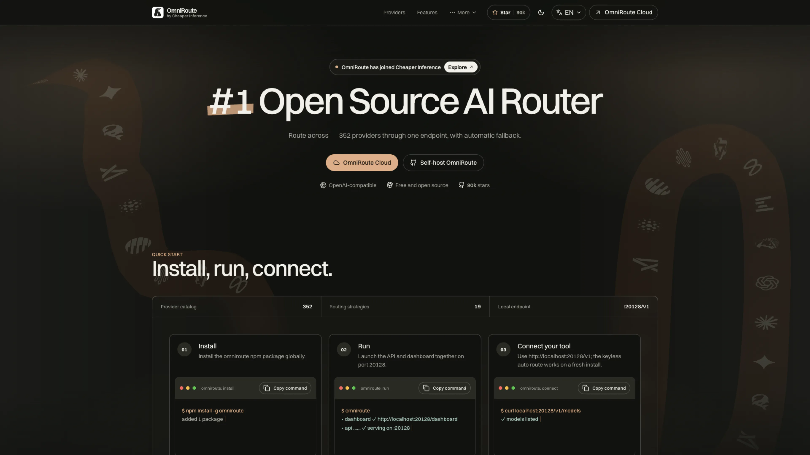

# Deploy and Host OmniRoute on Sealos

OmniRoute is a self-hosted OpenAI-compatible AI gateway with model routing, provider fallback, API keys, and an administration dashboard. This Sealos template runs OmniRoute with a KubeBlocks Redis Cluster, persistent data storage, and a public HTTPS endpoint.

## About Hosting OmniRoute

OmniRoute sits between applications and model providers. Clients call one OpenAI-compatible endpoint, while OmniRoute selects a provider or model route, applies fallback rules, tracks usage, and enforces API keys.

This template runs one StatefulSet with the pinned `cheaperinference/omniroute` image on ports `20128` for the UI, `20129` for the API, and `20132` for live WebSocket traffic. A 1Gi volume at `/app/data` stores configuration, provider metadata, and API keys. The `fsGroup: 1000` security context makes the volume writable for the application user.

The Service exposes port `80`, `20129`, and `20132`; the Sealos Ingress publishes the main HTTPS host. The container sets `REQUIRE_API_KEY=true`, connects to the KubeBlocks Redis Cluster, and seeds the dashboard administrator with the required `initial_password` input.

## Common Use Cases

- **Unified AI Endpoint**: Give applications one OpenAI-compatible base URL for multiple providers.
- **Model Routing**: Route requests by model, cost, latency, or availability.
- **Provider Fallback**: Continue serving when a primary provider fails or rate-limits.
- **Key Management**: Centralize provider credentials and issue scoped API keys to clients.
- **Usage Visibility**: Track request volume and model usage from the dashboard.

## Dependencies for OmniRoute Hosting

The template includes the OmniRoute StatefulSet, KubeBlocks Redis Cluster, persistent data storage, Services, an HTTPS Ingress, and the Sealos App entry. Redis is provisioned by the template.

At least one upstream AI provider account and API key are required for model traffic. The Pod needs outbound HTTPS access to configured providers, and clients need an OmniRoute API key.

### Deployment Dependencies

- [OmniRoute website](https://omniroute.online/) - Product overview and documentation
- [OmniRoute repository](https://github.com/cheaper-inference/OmniRoute) - Source code and issue tracker
- [OmniRoute container image](https://hub.docker.com/r/cheaperinference/omniroute) - Image used by this template
- [OpenAI API reference](https://platform.openai.com/docs/api-reference) - Compatible request and response shapes
- [KubeBlocks Redis](https://kubeblocks.io/docs/) - Redis Cluster behavior and operations

## Implementation Details

**Architecture Components:**

- **OmniRoute StatefulSet**: Runs the dashboard, routing engine, API, and live WebSocket service.
- **KubeBlocks Redis Cluster**: One Redis replica and one sentinel for runtime state and caching.
- **Persistent volume**: A 1Gi volume at `/app/data` for provider settings, routes, and API keys.
- **Service**: Exposes ports `80`, `20129`, and `20132` inside the cluster.
- **Ingress**: Publishes the dashboard and OpenAI-compatible API over HTTPS.

The Redis components each use `50m/51Mi` requests and `500m/512Mi` limits, with 1Gi storage per component.

**Configuration:**

- **Image**: `cheaperinference/omniroute@sha256:2c4c755a...` pinned digest
- **UI port**: `20128`
- **API port**: `20129`
- **Live WebSocket port**: `20132`
- **Service ports**: `80`, `20129`, `20132`
- **Data directory**: `/app/data`
- **Initial password**: Required `initial_password` input
- **API key enforcement**: `REQUIRE_API_KEY=true`
- **Redis**: Generated password from a Secret, service FQDN, database `0`
- **Memory hint**: `OMNIROUTE_MEMORY_MB=1024`
- **Security context**: `fsGroup: 1000`, `fsGroupChangePolicy: OnRootMismatch`
- **Replicas**: `1`

**Resource Allocation:**

| Component | CPU Request | CPU Limit | Memory Request | Memory Limit | Storage |
| --- | ---: | ---: | ---: | ---: | ---: |
| OmniRoute | 50m | 500m | 102Mi | 1024Mi | 1Gi |
| Redis | 50m | 500m | 51Mi | 512Mi | 1Gi |
| Redis sentinel | 50m | 500m | 51Mi | 512Mi | 1Gi |

The profile passed a cold start, dashboard password login, API key creation, and a stability window with zero restarts. Memory limits of 128Mi, 256Mi, and 512Mi failed; 1024Mi is the validated minimum.

## Why Deploy OmniRoute on Sealos?

Sealos is an AI-assisted cloud operating system built on Kubernetes that unifies deployment, networking, storage, and operations. Deploying OmniRoute on Sealos gives you:

- **One-Click Gateway**: Provision OmniRoute and its Redis dependency from one template.
- **Persistent Routing State**: Keep provider settings, routes, and API keys across Pod restarts.
- **Canvas and AI Dialog**: Inspect the StatefulSet, Redis Cluster, Services, Ingress, PVC, and logs, and adjust the deployment through the Sealos AI dialog.
- **Pay-as-You-Go Resources**: Start with the validated 500m CPU and 1024Mi memory profile.
- **Managed HTTPS**: Reach the dashboard and API through one public host and TLS certificate.
- **Kubernetes Reliability**: Use health probes, automated recovery, and declarative resource management.

## Deployment Guide

1. Open the [OmniRoute template](https://sealos.io/products/app-store/omniroute) and click **Deploy Now**.
2. Enter the initial dashboard password, review the generated application name, and confirm the resource plan.
3. Wait for deployment to complete, typically in 2-3 minutes. Sealos opens the Canvas after the resources are created.
4. Open the public URL, sign in with the password from step 2, and confirm the dashboard loads.
5. Add a provider credential, define a model route, and create an API key for a client.
6. Send a test chat completion to the OpenAI-compatible endpoint with that key, then review usage in the dashboard.

## Login and Account Setup

OmniRoute seeds the dashboard administrator with the `initial_password` input. Open the public URL and use that exact password on the login screen. The template has no separate registration flow.

After login, add provider credentials and create API keys under the dashboard. Gateway requests require a valid OmniRoute key because `REQUIRE_API_KEY=true`. Treat both the dashboard password and generated keys as secrets.

## Configuration

- **Providers**: Add provider endpoints and API keys from the dashboard.
- **Routes**: Define model routes and fallback order for each client use case.
- **API keys**: Create scoped keys for applications and revoke them from the dashboard.
- **Base URL**: Use the public HTTPS host as the OpenAI-compatible base URL.
- **Persistence**: Provider metadata, routes, and keys stay on `/app/data`.
- **Redis**: Runtime state uses the generated Redis password and service FQDN.
- **Memory**: `OMNIROUTE_MEMORY_MB=1024` matches the container memory limit.

## Scaling

Keep the template at one replica because application data is stored on a ReadWriteOnce volume and Redis runs as a single-writer cluster in this topology. Increase CPU and memory limits for higher request concurrency, larger routing tables, or more provider connections. Expand the 1Gi data volume from the StatefulSet resource card as history and configuration grow.

## Troubleshooting

### The dashboard password is rejected

Use the exact `initial_password` value from the deployment form. The seed applies on first initialization; changing the input afterwards does not reset an existing password.

### API requests return 401

The gateway requires an OmniRoute API key. Create a key in the dashboard and send it as `Authorization: Bearer <key>` to the OpenAI-compatible endpoint.

### The Pod fails with a data-volume permission error

The template sets `fsGroup: 1000` with `OnRootMismatch` so the application can write `/app/data`. Confirm that the security context remains on the StatefulSet after edits.

### The Pod is OOMKilled

The validated memory limit is 1024Mi. Raise the limit or reduce concurrent requests and provider connections. Lower limits failed during validation.

### Redis connection errors appear

Confirm that the KubeBlocks Redis Cluster and sentinel are Ready and that the generated Secret exists. Restart OmniRoute after Redis recovers.

### Getting Help

- [OmniRoute repository](https://github.com/cheaper-inference/OmniRoute)
- [OmniRoute issues](https://github.com/cheaper-inference/OmniRoute/issues)
- [Sealos documentation](https://sealos.io/docs)

## License

OmniRoute is licensed under the [MIT License](https://github.com/cheaper-inference/OmniRoute/blob/main/LICENSE). This Sealos template is distributed under the templates repository license.
