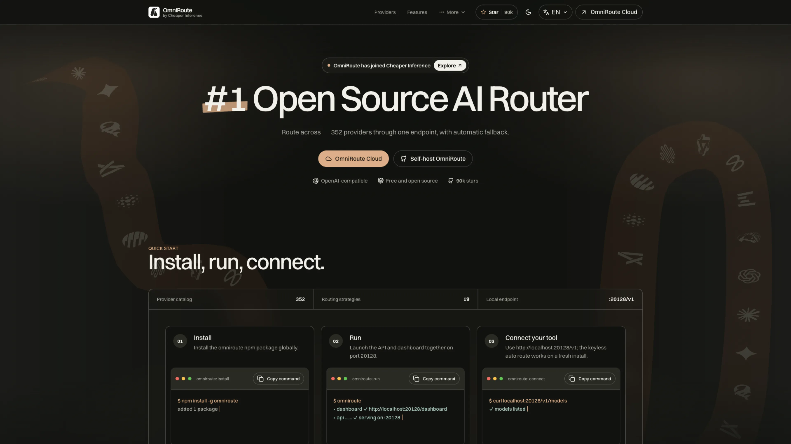

# 在 Sealos 上部署和托管 OmniRoute

OmniRoute 是自托管的 OpenAI 兼容 AI 网关，提供模型路由、供应商故障回退、API Key 和管理面板。本 Sealos 模板运行 OmniRoute，配套 KubeBlocks Redis Cluster、持久化数据存储和公网 HTTPS 入口。

## 关于 OmniRoute 托管

OmniRoute 位于应用与模型供应商之间。客户端调用一个 OpenAI 兼容端点，OmniRoute 负责选择供应商或模型路由、应用故障回退规则、统计用量并校验 API Key。

本模板运行一个 StatefulSet，使用固定摘要的 `cheaperinference/omniroute` 镜像，分别监听 `20128` 的 UI、`20129` 的 API 和 `20132` 的实时 WebSocket。1Gi 卷挂载到 `/app/data`，保存配置、供应商元数据和 API Key。`fsGroup: 1000` 安全上下文让应用用户可以写入该卷。

Service 暴露 `80`、`20129` 和 `20132` 端口，Sealos Ingress 发布主 HTTPS 域名。容器设置 `REQUIRE_API_KEY=true`，连接 KubeBlocks Redis Cluster，并通过必填的 `initial_password` 输入创建管理面板管理员。

## 常见使用场景

- **统一 AI 端点**：为应用提供一个访问多家供应商的 OpenAI 兼容基础 URL。
- **模型路由**：按模型、成本、延迟或可用性路由请求。
- **供应商回退**：主供应商故障或限流时继续提供服务。
- **密钥管理**：集中管理供应商凭据，并向客户端签发限定范围的 API Key。
- **用量可视化**：在管理面板查看请求量和模型使用情况。

## OmniRoute 托管依赖

模板包含 OmniRoute StatefulSet、KubeBlocks Redis Cluster、持久化数据存储、Service、HTTPS Ingress 和 Sealos App 入口。Redis 由模板自动创建。

模型流量至少需要一个上游 AI 供应商账号和 API Key。Pod 需要到已配置供应商的出站 HTTPS 访问，客户端需要 OmniRoute API Key。

### 部署依赖

- [OmniRoute 官网](https://omniroute.online/) - 产品介绍与文档
- [OmniRoute 仓库](https://github.com/cheaper-inference/OmniRoute) - 源代码与 Issue
- [OmniRoute 容器镜像](https://hub.docker.com/r/cheaperinference/omniroute) - 本模板使用的镜像
- [OpenAI API 参考](https://platform.openai.com/docs/api-reference) - 兼容请求与响应格式
- [KubeBlocks Redis](https://kubeblocks.io/docs/) - Redis Cluster 行为与运维

## 实现细节

**架构组件：**

- **OmniRoute StatefulSet**：运行管理面板、路由引擎、API 和实时 WebSocket 服务。
- **KubeBlocks Redis Cluster**：一个 Redis 副本和一个 Sentinel，用于运行状态和缓存。
- **持久卷**：1Gi 卷挂载到 `/app/data`，保存供应商设置、路由和 API Key。
- **Service**：在集群内暴露 `80`、`20129` 和 `20132` 端口。
- **Ingress**：通过 HTTPS 发布管理面板和 OpenAI 兼容 API。

Redis 组件各自使用 `50m/51Mi` 请求和 `500m/512Mi` 限制，每个组件 1Gi 存储。

**配置：**

- **镜像**：`cheaperinference/omniroute@sha256:2c4c755a...` 固定摘要
- **UI 端口**：`20128`
- **API 端口**：`20129`
- **实时 WebSocket 端口**：`20132`
- **Service 端口**：`80`、`20129`、`20132`
- **数据目录**：`/app/data`
- **初始密码**：必填输入 `initial_password`
- **API Key 强制**：`REQUIRE_API_KEY=true`
- **Redis**：使用 Secret 中的自动生成密码、服务 FQDN 和数据库 `0`
- **内存提示**：`OMNIROUTE_MEMORY_MB=1024`
- **安全上下文**：`fsGroup: 1000`，`fsGroupChangePolicy: OnRootMismatch`
- **副本数**：`1`

**资源分配：**

| 组件 | CPU 请求 | CPU 限制 | 内存请求 | 内存限制 | 存储 |
| --- | ---: | ---: | ---: | ---: | ---: |
| OmniRoute | 50m | 500m | 102Mi | 1024Mi | 1Gi |
| Redis | 50m | 500m | 51Mi | 512Mi | 1Gi |
| Redis Sentinel | 50m | 500m | 51Mi | 512Mi | 1Gi |

该规格通过了冷启动、管理面板密码登录、API Key 创建和稳定性验证，Pod 重启次数为 0。128Mi、256Mi 和 512Mi 内存限制均失败，1024Mi 为经验证的最小值。

## 为什么在 Sealos 上部署 OmniRoute？

Sealos 是构建在 Kubernetes 之上的 AI 辅助云操作系统，将部署、网络、存储和运维统一在一个界面中。在 Sealos 上部署 OmniRoute 可以带来：

- **一键网关**：通过一个模板创建 OmniRoute 及其 Redis 依赖。
- **路由状态持久化**：在 Pod 重启后保留供应商设置、路由和 API Key。
- **Canvas 与 AI 对话**：在一个视图中查看 StatefulSet、Redis Cluster、Service、Ingress、PVC 和日志，并通过 Sealos AI 对话调整部署。
- **按量计费**：从经验证的 500m CPU 和 1024Mi 内存规格起步。
- **托管 HTTPS**：通过一个公网域名和 TLS 证书访问管理面板与 API。
- **Kubernetes 可靠性**：使用健康探针、自动恢复和声明式资源管理。

## 部署指南

1. 打开 [OmniRoute 模板](https://sealos.io/products/app-store/omniroute)，点击 **Deploy Now**。
2. 输入管理面板初始密码，检查自动生成的应用名称，确认资源规格。
3. 等待部署完成，通常需要 2-3 分钟。资源创建完成后 Sealos 会打开 Canvas。
4. 打开公网地址，使用第 2 步的密码登录，确认管理面板加载。
5. 添加供应商凭据、定义模型路由，并为客户端创建 API Key。
6. 使用该 Key 向 OpenAI 兼容端点发送测试聊天请求，再在管理面板查看用量。

## 登录与账号设置

OmniRoute 使用 `initial_password` 输入创建管理面板管理员。打开公网地址，在登录页输入该原始密码。模板没有单独的注册流程。

登录后可在管理面板添加供应商凭据并创建 API Key。由于 `REQUIRE_API_KEY=true`，网关请求需要有效的 OmniRoute Key。管理面板密码和生成的 Key 都应作为密钥保管。

## 配置

- **供应商**：在管理面板添加供应商端点和 API Key。
- **路由**：为每个客户端场景定义模型路由和回退顺序。
- **API Key**：为应用创建限定范围的 Key，并可从管理面板撤销。
- **基础 URL**：使用公网 HTTPS 域名作为 OpenAI 兼容基础 URL。
- **持久化**：供应商元数据、路由和 Key 保存在 `/app/data`。
- **Redis**：运行状态使用自动生成的 Redis 密码和服务 FQDN。
- **内存**：`OMNIROUTE_MEMORY_MB=1024` 与容器内存限制一致。

## 扩缩容

模板保持单副本，因为应用数据保存在 ReadWriteOnce 卷上，且当前拓扑使用单写入 Redis 集群。请求并发、路由表规模或供应商连接数增加时，提高 CPU 和内存限制。历史记录和配置增长时，从 StatefulSet 资源卡扩展 1Gi 数据卷。

## 故障排查

### 管理面板密码被拒

使用部署表单中的原始 `initial_password`。种子任务只在首次初始化时生效，后续修改输入不会重置已有密码。

### API 请求返回 401

网关要求 OmniRoute API Key。在管理面板创建 Key，并在请求 OpenAI 兼容端点时通过 `Authorization: Bearer <key>` 传入。

### Pod 报数据卷权限错误

模板通过 `fsGroup: 1000` 和 `OnRootMismatch` 让应用写入 `/app/data`。修改 StatefulSet 后需确认安全上下文仍然保留。

### Pod 被 OOMKilled

经验证的内存限制为 1024Mi。可提高限制，或减少并发请求和供应商连接；更低限制在验证中失败。

### 日志出现 Redis 连接错误

确认 KubeBlocks Redis Cluster 与 Sentinel 已 Ready、生成的 Secret 存在。Redis 恢复后重启 OmniRoute。

### 获取帮助

- [OmniRoute 仓库](https://github.com/cheaper-inference/OmniRoute)
- [OmniRoute Issues](https://github.com/cheaper-inference/OmniRoute/issues)
- [Sealos 文档](https://sealos.io/docs)

## 许可证

OmniRoute 使用 [MIT License](https://github.com/cheaper-inference/OmniRoute/blob/main/LICENSE) 许可证。本 Sealos 模板遵循 templates 仓库许可证。
