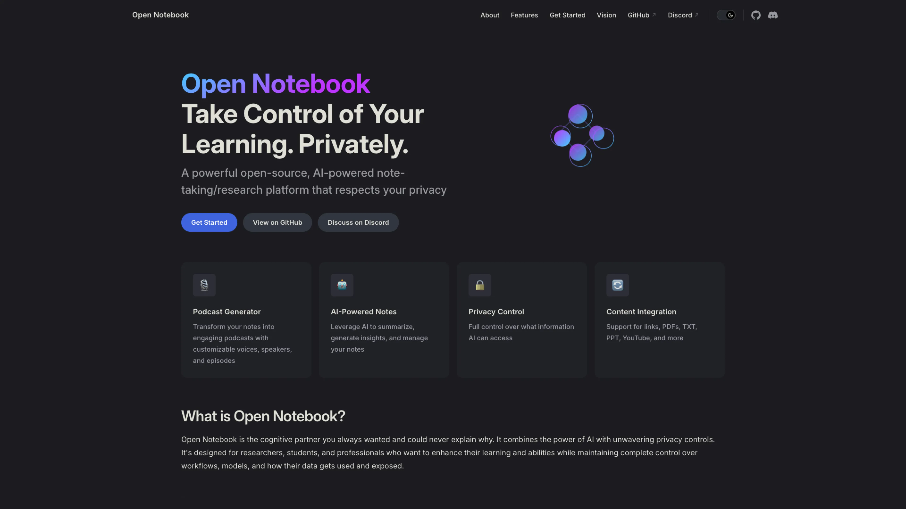

# Deploy and Host Open Notebook on Sealos

Open Notebook is a private AI research workspace for collecting sources, writing notes, chatting with content, and generating podcasts. This Sealos template runs Open Notebook 1.15.1 with a dedicated SurrealDB 2.7.0 database, persistent volumes for both services, and a public HTTPS interface protected by a password.

## About Hosting Open Notebook

Open Notebook organizes research into notebooks that combine sources, notes, and AI conversations. Sources can include web pages, PDFs, text files, presentations, YouTube videos, and audio or video uploads. The workspace supports retrieval-augmented chat with citations, saved transformations, semantic search, and podcast generation from selected notebook content.

The application runs as a single container with three processes: a Next.js frontend on port `8502`, a FastAPI backend on port `5055`, and a background worker that processes sources and long-running jobs. A separate SurrealDB StatefulSet stores application data in RocksDB. The Next.js server forwards browser requests under `/api/*` to the internal API, so the public interface needs only one HTTP port.

This template publishes the frontend through a Sealos Ingress with HTTPS. The deployment sets `API_URL` to the public domain so the browser reaches the API through the same origin, while `INTERNAL_API_URL` keeps container-to-container traffic on localhost. A generated encryption key protects saved AI provider credentials, and the password input enables authentication for the web UI and REST API.

## Common Use Cases

- **Research Workspace**: Collect papers, articles, and notes, then ask questions with source citations.
- **Private Knowledge Base**: Keep sensitive material and AI conversations inside your own deployment.
- **Study Companion**: Turn long-form content into summaries, explanations, and study notes.
- **Content Production**: Generate podcast episodes from selected sources and notes.
- **Multi-Provider AI Lab**: Compare models from OpenAI, Anthropic, Google, Ollama, and other providers.

## Dependencies for Open Notebook Hosting

The template includes the Open Notebook StatefulSet, a SurrealDB StatefulSet, two persistent volumes, Services, an HTTPS Ingress, and a Sealos App entry. A password is required at deployment time, and AI provider credentials are configured after login.

### Deployment Dependencies

- [Open Notebook official site](https://www.open-notebook.ai/) - Product overview and feature documentation
- [Open Notebook documentation](https://github.com/lfnovo/open-notebook/tree/main/docs) - Installation, configuration, and troubleshooting
- [Open Notebook repository](https://github.com/lfnovo/open-notebook) - Source code and release notes
- [Open Notebook container image](https://hub.docker.com/r/lfnovo/open_notebook) - Official image used by this template
- [SurrealDB documentation](https://surrealdb.com/docs) - Database concepts and operations
- [SurrealDB container image](https://hub.docker.com/r/surrealdb/surrealdb) - Database image used by this template

## Implementation Details

**Architecture Components:**

- **Open Notebook StatefulSet**: One replica running `lfnovo/open_notebook:1.15.1` with the Next.js frontend on port `8502`, the API on port `5055`, and the background worker in the same container.
- **SurrealDB StatefulSet**: One replica running `surrealdb/surrealdb:v2.7.0` with RocksDB storage on port `8000`.
- **Database wait init container**: A BusyBox container waits for SurrealDB to accept connections before the application starts.
- **Application volume**: A 1Gi volume at `/app/data` for uploads, generated media, caches, and application state.
- **Database volume**: A 1Gi volume at `/mydata` for the SurrealDB RocksDB store.
- **Service**: ClusterIP port `80` forwarding to the frontend on port `8502`; the API is reached through the Next.js `/api/*` proxy.
- **Ingress**: Sealos-managed HTTPS host with 32Mi request bodies, 300-second proxy timeouts, and static asset caching.
- **App entry**: Opens the research workspace from the Sealos desktop.

**Configuration:**

- **Open Notebook image**: `lfnovo/open_notebook:1.15.1`
- **SurrealDB image**: `surrealdb/surrealdb:v2.7.0`
- **Application port**: `8502`
- **API port**: `5055`, proxied by the frontend
- **Public API URL**: `API_URL=https://<generated-host>`
- **Internal API URL**: `INTERNAL_API_URL=http://localhost:5055`
- **Authentication**: Deployment input `notebook_password`
- **Encryption key**: Generated at deployment and stored as `OPEN_NOTEBOOK_ENCRYPTION_KEY`
- **Database credentials**: Generated at deployment and shared by both StatefulSets
- **Database namespace and name**: `open_notebook`
- **Upload limit**: 30MB in the application, enforced by the 32Mi ingress body limit
- **Persistence**: `/app/data` and `/mydata`, each on a 1Gi volume
- **Health checks**: API startup and readiness probes on `/health`; frontend liveness probe on `/`

**Resource Allocation:**

| Component | CPU Request | CPU Limit | Memory Request | Memory Limit | Storage |
| --- | ---: | ---: | ---: | ---: | ---: |
| Open Notebook | 50m | 500m | 102Mi | 1024Mi | 1Gi |
| SurrealDB | 20m | 200m | 51Mi | 512Mi | 1Gi |
| Database wait init | 10m | 100m | 12Mi | 128Mi | None |

The profile passed a cold start, password login, notebook creation, a Pod restart, and a data reload with zero container restarts. Memory measured approximately 306Mi for the application and 64Mi for SurrealDB during validation.

## Why Deploy Open Notebook on Sealos?

Sealos is an AI-assisted cloud operating system built on Kubernetes that combines deployment, networking, storage, and operations in one interface. Deploying Open Notebook on Sealos gives you:

- **One-Click Deployment**: Launch the application and database without assembling StatefulSets, Services, and Ingress resources.
- **Automatic HTTPS**: Receive a managed public domain and TLS certificate for the workspace.
- **Persistent Research Data**: Keep uploads, notes, embeddings, and the SurrealDB store on dedicated volumes.
- **Password Protection**: Set an application password before the first request reaches the public URL.
- **Sealos Operations**: Inspect Pods, logs, storage, and resource usage from Canvas or the Sealos AI dialog.
- **Predictable Footprint**: Run the full stack with a tested 500m CPU and 1024Mi memory limit for the application.

## Deployment Guide

1. Open the [Open Notebook template](https://sealos.io/products/app-store/open-notebook) and click **Deploy Now**.
2. Enter a password for the web UI and REST API, review the generated application name and host, and confirm the resource plan.
3. Wait for deployment to complete, typically in 2-3 minutes. Use Canvas to follow both StatefulSets, the Pods, and the two volumes.
4. Open the public URL and sign in with the password entered during deployment.
5. Configure an AI provider from **Models** or **Settings → API Keys**, then set a default chat and embedding model.
6. Create a notebook, add a source, and confirm that the worker finishes processing and chat returns citations.

## Using Open Notebook

- **Sources**: Add links, PDFs, text files, presentations, YouTube videos, and audio or video uploads.
- **Notebooks**: Group related sources and notes, then open a notebook to summarize, transform, or discuss its content.
- **Ask and Search**: Run semantic search across sources and ask questions with citations.
- **Models**: Register OpenAI, Anthropic, Google, Ollama, OpenRouter, or other compatible providers and choose defaults.
- **Transformations**: Save reusable prompts for summaries, outlines, critiques, and other recurring tasks.
- **Podcasts**: Generate podcast episodes from selected notebook content and speaker profiles.
- **Advanced**: Review API keys, database status, and application diagnostics from the advanced settings.

## Connecting AI Providers

1. Open **Models** and select a provider.
2. Enter the provider API key or base URL, then save the credential. Keys are encrypted with `OPEN_NOTEBOOK_ENCRYPTION_KEY`.
3. Choose the default chat model, embedding model, and text-to-speech model.
4. For a local model server, use a URL reachable from the cluster. Services in the same namespace can use `http://<service>.<namespace>.svc.cluster.local:<port>`.
5. Test the provider from a notebook chat before relying on it for batch transformations.

## Data and Backups

Two volumes hold persistent state: `/app/data` for uploads, generated media, and caches, and `/mydata` for the SurrealDB RocksDB store. Back up both volumes together to keep the database consistent with its referenced files. Stop both StatefulSets, copy the volumes, and restart them. The encryption key and database password are part of the deployment configuration; store them with the backup so saved provider keys remain readable.

## Scaling

Run both StatefulSets with one replica. SurrealDB uses a ReadWriteOnce volume and a single RocksDB writer, and Open Notebook runs the worker in the same container as the frontend and API. For heavier workloads, raise the application CPU and memory limits first, then expand storage. Separate deployments can isolate research domains or teams with their own passwords and provider credentials.

## Troubleshooting

### The UI loads but API calls fail

Confirm that `API_URL` matches the public HTTPS origin exactly. A mismatch sends browser requests to the wrong host or port. Check the Pod logs for `[runtime-config]` output and the `/api/config` response, which should report `dbStatus: online`.

### The application Pod stays in Init

The init container waits for SurrealDB on port `8000`. Inspect the SurrealDB Pod logs for RocksDB startup or volume permission errors. The database must be ready before the application container starts.

### Uploads fail above a few megabytes

The ingress limits request bodies to 32Mi and the application limit is 30MB. Raise both limits together when larger files are required, and confirm that the volume has enough free space.

### Saved provider keys stop working after a redeploy

`OPEN_NOTEBOOK_ENCRYPTION_KEY` must remain unchanged across deployments. Restore the original value from the deployment configuration or from your secret backup. A new key cannot decrypt existing credentials.

### The database volume fills up

Check `/mydata` usage from Canvas and remove unused notebooks or sources. Expand the volume if the storage class supports it. Keep the application volume and database volume backed up together.

### The worker leaves sources queued

Review the application logs for worker errors, provider authentication failures, or rate limits. Confirm that the selected embedding model is available and that outbound network access to the provider works.

### Getting Help

- [Open Notebook documentation](https://github.com/lfnovo/open-notebook/tree/main/docs)
- [Open Notebook GitHub discussions](https://github.com/lfnovo/open-notebook/discussions)
- [SurrealDB documentation](https://surrealdb.com/docs)
- [Sealos documentation](https://sealos.io/docs)

## License

Open Notebook is released under the [MIT License](https://github.com/lfnovo/open-notebook/blob/main/LICENSE). SurrealDB is released under the [Business Source License 1.1](https://github.com/surrealdb/surrealdb/blob/main/LICENSE). This Sealos template is distributed under the templates repository license.
