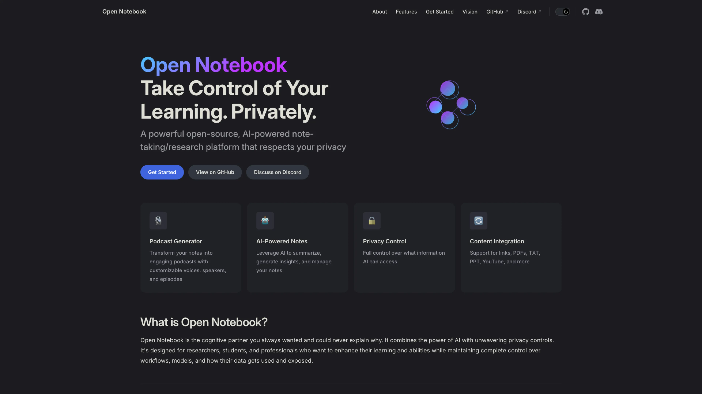

# 在 Sealos 上部署和托管 Open Notebook

Open Notebook 是一个私有 AI 研究工作台，用于收集资料、撰写笔记、与内容对话并生成播客。本 Sealos 模板运行 Open Notebook 1.15.1 和独立的 SurrealDB 2.7.0，为两个服务提供持久化存储，并通过密码保护公网 HTTPS 界面。

## 关于 Open Notebook 托管

Open Notebook 把研究内容组织到笔记本中，将来源、笔记和 AI 对话放在一起。来源支持网页、PDF、文本文件、演示文稿、YouTube 视频以及音频和视频上传。工作台提供带引用的检索增强对话、可保存的转换模板、语义搜索，以及基于选定笔记本内容生成播客。

应用以单个容器运行三个进程：端口 `8502` 的 Next.js 前端、端口 `5055` 的 FastAPI 后端，以及处理来源和长任务的后台 Worker。独立的 SurrealDB StatefulSet 使用 RocksDB 保存应用数据。Next.js 服务把 `/api/*` 请求转发到内部 API，因此公网只需要一个 HTTP 端口。

本模板通过 Sealos Ingress 发布前端并启用 HTTPS。部署时把 `API_URL` 设置为公网域名，使浏览器通过同一来源访问 API；`INTERNAL_API_URL` 让容器内部流量走 localhost。自动生成的加密密钥保护已保存的 AI 提供商凭据，密码输入项为 Web 界面和 REST API 启用认证。

## 常见使用场景

- **研究工作台**：收集论文、文章和笔记，然后带引用地提问。
- **私有知识库**：把敏感资料和 AI 对话保存在自己的部署中。
- **学习助手**：把长内容转换为摘要、解释和学习笔记。
- **内容生产**：从选定的来源和笔记生成播客节目。
- **多模型 AI 实验**：对比 OpenAI、Anthropic、Google、Ollama 等提供商的模型。

## Open Notebook 托管依赖

模板包含 Open Notebook StatefulSet、SurrealDB StatefulSet、两个持久卷、Service、HTTPS Ingress 和 Sealos 应用入口。部署时需要设置密码，登录后再配置 AI 提供商凭据。

### 部署依赖

- [Open Notebook 官网](https://www.open-notebook.ai/) - 产品概览和功能文档
- [Open Notebook 文档](https://github.com/lfnovo/open-notebook/tree/main/docs) - 安装、配置和故障排查
- [Open Notebook 仓库](https://github.com/lfnovo/open-notebook) - 源码和发布说明
- [Open Notebook 容器镜像](https://hub.docker.com/r/lfnovo/open_notebook) - 本模板使用的官方镜像
- [SurrealDB 文档](https://surrealdb.com/docs) - 数据库概念和运维
- [SurrealDB 容器镜像](https://hub.docker.com/r/surrealdb/surrealdb) - 本模板使用的数据库镜像

## 实现细节

**架构组件：**

- **Open Notebook StatefulSet**：单副本运行 `lfnovo/open_notebook:1.15.1`，在同一容器内运行端口 `8502` 的 Next.js 前端、端口 `5055` 的 API 和后台 Worker。
- **SurrealDB StatefulSet**：单副本运行 `surrealdb/surrealdb:v2.7.0`，在端口 `8000` 提供数据库服务，数据保存在 RocksDB。
- **数据库等待初始化容器**：BusyBox 容器等待 SurrealDB 接受连接后再启动应用。
- **应用数据卷**：1Gi 持久卷挂载到 `/app/data`，保存上传文件、生成媒体、缓存和应用状态。
- **数据库数据卷**：1Gi 持久卷挂载到 `/mydata`，保存 SurrealDB RocksDB 数据。
- **Service**：ClusterIP 端口 `80` 转发到前端 `8502`；API 通过 Next.js 的 `/api/*` 代理访问。
- **Ingress**：Sealos 托管 HTTPS 域名，支持 32Mi 请求体、300 秒代理超时和静态资源缓存。
- **应用入口**：从 Sealos 桌面打开研究工作台。

**配置：**

- **Open Notebook 镜像**：`lfnovo/open_notebook:1.15.1`
- **SurrealDB 镜像**：`surrealdb/surrealdb:v2.7.0`
- **应用端口**：`8502`
- **API 端口**：`5055`，由前端代理
- **公网 API 地址**：`API_URL=https://<生成的域名>`
- **内部 API 地址**：`INTERNAL_API_URL=http://localhost:5055`
- **认证**：部署输入 `notebook_password`
- **加密密钥**：部署时生成，保存为 `OPEN_NOTEBOOK_ENCRYPTION_KEY`
- **数据库凭据**：部署时生成，两个 StatefulSet 共用
- **数据库命名空间和名称**：`open_notebook`
- **上传限制**：应用限制 30MB，由 Ingress 的 32Mi 请求体上限兜底
- **持久化**：`/app/data` 和 `/mydata` 各使用 1Gi 卷
- **健康检查**：API 在 `/health` 上执行启动和就绪探针；前端在 `/` 上执行存活探针

**资源分配：**

| 组件 | CPU 请求 | CPU 上限 | 内存请求 | 内存上限 | 存储 |
| --- | ---: | ---: | ---: | ---: | ---: |
| Open Notebook | 50m | 500m | 102Mi | 1024Mi | 1Gi |
| SurrealDB | 20m | 200m | 51Mi | 512Mi | 1Gi |
| 数据库等待初始化 | 10m | 100m | 12Mi | 128Mi | 无 |

该配置通过冷启动、密码登录、创建笔记本、Pod 重启和数据重新加载验证，容器重启次数为零。验证期间应用内存约为 306Mi，SurrealDB 内存约为 64Mi。

## 为什么在 Sealos 上部署 Open Notebook？

Sealos 是基于 Kubernetes 的 AI 辅助云操作系统，把部署、网络、存储和运维集中在一个界面。在 Sealos 上部署 Open Notebook 可以获得：

- **一键部署**：无需手动拼装 StatefulSet、Service 和 Ingress。
- **自动 HTTPS**：为工作台提供托管公网域名和 TLS 证书。
- **持久化研究数据**：上传文件、笔记、向量和 SurrealDB 数据保存在独立数据卷。
- **密码保护**：在公网地址接收请求前设置应用密码。
- **Sealos 运维能力**：从 Canvas 或 Sealos AI 对话查看 Pod、日志、存储和资源用量。
- **可预测资源占用**：以经过验证的 500m CPU 和 1024Mi 内存上限运行完整应用栈。

## 部署指南

1. 打开 [Open Notebook 模板](https://sealos.io/products/app-store/open-notebook) 并点击 **Deploy Now**。
2. 输入 Web 界面和 REST API 的密码，确认生成的应用名称、域名和资源方案。
3. 等待部署完成，通常需要 2-3 分钟。使用 Canvas 跟踪两个 StatefulSet、Pod 和两个数据卷。
4. 打开公网地址，使用部署时输入的密码登录。
5. 在 **模型** 或 **设置 → API 密钥** 中配置 AI 提供商，并设置默认对话模型和嵌入模型。
6. 创建笔记本、添加来源，确认 Worker 完成处理且对话返回引用。

## 使用 Open Notebook

- **来源**：添加链接、PDF、文本文件、演示文稿、YouTube 视频以及音频和视频上传。
- **笔记本**：把相关来源和笔记分组，打开笔记本进行摘要、转换或讨论。
- **询问与搜索**：在来源中执行语义搜索，并带引用地提问。
- **模型**：注册 OpenAI、Anthropic、Google、Ollama、OpenRouter 等兼容提供商并选择默认模型。
- **转换**：保存可复用的提示词，用于摘要、提纲、评审等重复任务。
- **播客**：基于选定的笔记本内容和说话人配置生成播客节目。
- **高级**：在高级设置中查看 API 密钥、数据库状态和应用诊断信息。

## 接入 AI 提供商

1. 打开 **模型** 并选择提供商。
2. 输入提供商 API 密钥或 Base URL 后保存。密钥使用 `OPEN_NOTEBOOK_ENCRYPTION_KEY` 加密。
3. 选择默认对话模型、嵌入模型和文本转语音模型。
4. 本地模型服务需要使用集群内可达的地址。同命名空间的 Service 可以使用 `http://<service>.<namespace>.svc.cluster.local:<port>`。
5. 在笔记本对话中测试提供商，再用于批量转换任务。

## 数据与备份

两个数据卷保存持久状态：`/app/data` 保存上传文件、生成媒体和缓存，`/mydata` 保存 SurrealDB RocksDB 数据。备份时同时复制两个数据卷，保持数据库与其引用的文件一致。停止两个 StatefulSet，复制数据卷后再启动。加密密钥和数据库密码属于部署配置，应与备份一起保存，确保已保存的提供商密钥可以继续解密。

## 扩缩容

两个 StatefulSet 均以单副本运行。SurrealDB 使用 ReadWriteOnce 卷和单 RocksDB 写入者，Open Notebook 的 Worker 与前端、API 运行在同一容器。面对更高负载，优先提高应用的 CPU 和内存上限，再扩大存储。不同研究领域或团队可以使用独立部署，各自维护密码和提供商凭据。

## 故障排查

### 界面可以打开但 API 调用失败

确认 `API_URL` 与公网 HTTPS 来源完全一致。地址不匹配会把浏览器请求发送到错误的主机或端口。检查 Pod 日志中的 `[runtime-config]` 输出和 `/api/config` 响应，后者应报告 `dbStatus: online`。

### 应用 Pod 一直停留在 Init

初始化容器等待 SurrealDB 的 `8000` 端口。检查 SurrealDB Pod 日志中的 RocksDB 启动或卷权限错误。数据库就绪后应用容器才会启动。

### 上传几 MB 以上的文件失败

Ingress 请求体上限为 32Mi，应用限制为 30MB。需要更大文件时同时提高两处限制，并确认数据卷有足够空间。

### 重新部署后已保存的提供商密钥失效

`OPEN_NOTEBOOK_ENCRYPTION_KEY` 必须在多次部署之间保持一致。从部署配置或密钥备份中恢复原值。新密钥无法解密已有凭据。

### 数据库卷被写满

在 Canvas 中检查 `/mydata` 用量，删除不再使用的笔记本或来源。存储类支持扩容时扩大数据卷。应用卷和数据库卷需要一起备份。

### 来源一直停留在队列中

检查应用日志中的 Worker 错误、提供商认证失败或限流信息。确认所选嵌入模型可用，且集群可以出站访问提供商。

### 获取帮助

- [Open Notebook 文档](https://github.com/lfnovo/open-notebook/tree/main/docs)
- [Open Notebook GitHub 讨论区](https://github.com/lfnovo/open-notebook/discussions)
- [SurrealDB 文档](https://surrealdb.com/docs)
- [Sealos 文档](https://sealos.io/docs)

## 许可证

Open Notebook 基于 [MIT License](https://github.com/lfnovo/open-notebook/blob/main/LICENSE) 发布。SurrealDB 基于 [Business Source License 1.1](https://github.com/surrealdb/surrealdb/blob/main/LICENSE) 发布。本 Sealos 模板遵循 templates 仓库许可证。
