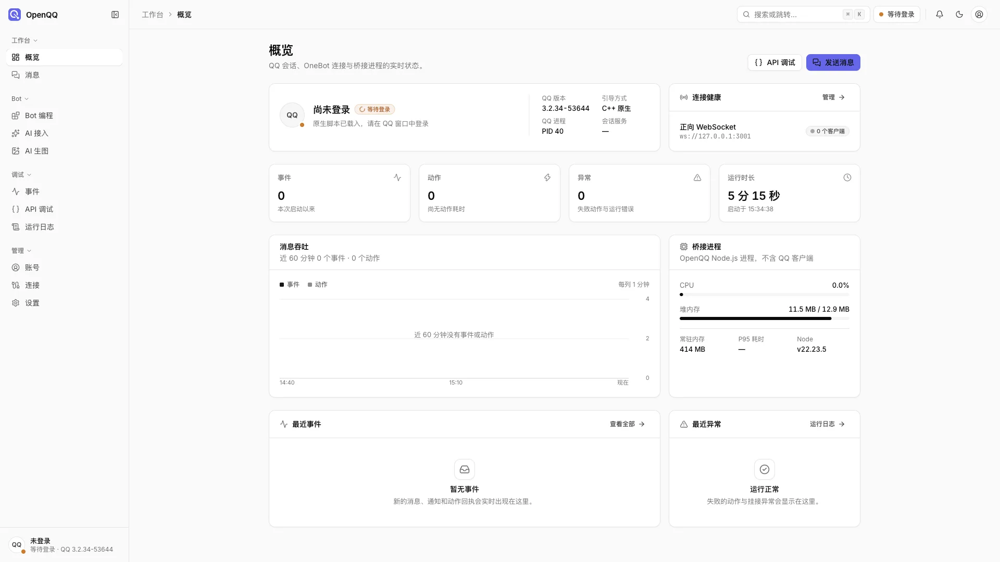

# Deploy and Host OpenQQ on Sealos

OpenQQ is a OneBot v11 bridge for QQ NT that connects the Linux QQ client to bots and automation tools. This template deploys OpenQQ 0.5.0 with the QQ desktop client, a browser console, a noVNC login screen, persistent storage, and public HTTPS access on Sealos Cloud.

## About Hosting OpenQQ

OpenQQ runs the official Linux QQ desktop client under Xvfb and attaches to it through a native launcher. The browser console manages the QQ session, OneBot connections, event history, API debugging, bot programs, AI provider settings, and runtime logs. A noVNC desktop on a separate public address displays the QQ login window so you can scan a QR code or use password login from any browser.

The template runs one StatefulSet with two containers. The main container provides the OpenQQ console, the OneBot v11 WebSocket service, and the noVNC desktop. An nginx sidecar forwards browser traffic to the console and noVNC while preserving the host headers that OpenQQ validates. Two 1Gi persistent volumes keep the QQ login state at `/root/.config/QQ` and the OpenQQ configuration and bot data at `/app/data`.

Sealos provisions the public domains, TLS certificates, services, and persistent storage. The console, noVNC, and OneBot WebSocket each receive their own HTTPS address.

## Common Use Cases

- **QQ Bot Development**: Connect OneBot v11 clients and SDKs to a real QQ account for private and group message automation.
- **Personal Assistant**: Bridge an AI provider and QQ conversations through OpenQQ's bot programs and AI settings.
- **Multi-Framework Integration**: Use the forward WebSocket endpoint with AstrBot, NoneBot, Koishi, or a custom OneBot client.
- **Remote QQ Session**: Sign in to QQ and handle captchas from a browser through the noVNC desktop.
- **Message and Media Bridge**: Receive events, inspect recent messages, serve received media, and test OneBot actions from the console.

## Dependencies for OpenQQ Hosting

The Sealos template includes the OpenQQ application, the Linux QQ client, Xvfb, fluxbox, x11vnc, noVNC, an nginx reverse proxy, and two persistent volumes. No external database, Redis, or object storage service is required.

### Deployment Dependencies

- [OpenQQ repository](https://github.com/feijx3/OpenQQ)
- [Docker deployment guide](https://github.com/feijx3/OpenQQ/blob/v0.5.0/docs/docker.md)
- [Connection guide](https://github.com/feijx3/OpenQQ/blob/v0.5.0/docs/connect.md)
- [OneBot v11 actions](https://github.com/feijx3/OpenQQ/blob/v0.5.0/docs/actions.md)
- [OneBot v11 specification](https://github.com/botuniverse/onebot-11)

## Implementation Details

**Architecture Components:**

- **OpenQQ application**: A single-replica StatefulSet serving the WebUI on port `17860`, the OneBot v11 forward WebSocket on port `3001`, and noVNC on port `6080`.
- **Linux QQ client**: Runs inside the same container under Xvfb and attaches through the OpenQQ native launcher.
- **Web proxy sidecar**: An unprivileged nginx container listens on `18080` for the WebUI and `18081` for noVNC, forwarding requests with the public host header OpenQQ expects.
- **Persistent QQ volume**: A 1Gi volume mounted at `/root/.config/QQ` stores the QQ login session and client state.
- **Persistent OpenQQ volume**: A 1Gi volume mounted at `/app/data` stores `openqq.json`, bot programs, memories, and AI settings.
- **Public routes**: Three Ingress resources publish the console, the noVNC desktop, and the OneBot WebSocket endpoint.

**Configuration:**

- **VNC password**: Set the required `vnc_password` input during deployment. Use 8 to 64 ASCII characters without spaces.
- **OneBot access token**: Generated automatically and used by the WebSocket endpoint.
- **WebUI access key**: Generated at every container start and printed in the main container log.
- **Timezone**: `Asia/Shanghai`.
- **Resource limits**: `200m` CPU and `1024Mi` memory for the main container; `100m` CPU and `128Mi` memory for the proxy.
- **QQ version**: The container image bundles Linux QQ `3.2.34-53644`. OpenQQ marks `9.9.33-52230` and `9.9.37-54395` as fully validated upstream versions.

**License Information:**

OpenQQ is licensed under the MIT License. Review the upstream license before production use. QQ is a Tencent product and remains subject to Tencent's terms of service.

## Why Deploy OpenQQ on Sealos?

Sealos is an AI-assisted cloud operating system built on Kubernetes that unifies deployment, networking, storage, and operations. Deploying OpenQQ on Sealos gives you:

- **One-Click Deployment**: Provision the application, three public HTTPS routes, and persistent storage from one template.
- **Desktop Runtime Included**: Run the Linux QQ client, Xvfb, noVNC, and the OneBot bridge without managing a remote desktop host.
- **Persistent QQ Session**: Keep the QQ login and bot data across Pod restarts through dedicated volumes.
- **Separate Public Endpoints**: Reach the console, noVNC login screen, and OneBot WebSocket through distinct managed domains.
- **Pay-as-You-Go Resources**: Start with a validated `200m` CPU and `1024Mi` memory profile and adjust resources through Canvas.
- **Canvas Operations**: Inspect logs, storage, and network resources, then modify the deployment through the AI dialog or resource cards.
- **Kubernetes Reliability**: Use health probes, automated recovery, service discovery, and declarative resource management.

## Deployment Guide

1. Open the [OpenQQ template](https://sealos.io/products/app-store/openqq) and click **Deploy Now**.
2. Enter a **VNC Password** with 8 to 64 ASCII characters and no spaces.
3. Wait for deployment to complete, typically in 2-3 minutes. After deployment, Sealos opens the Canvas. For later changes, use the AI dialog or click the relevant resource cards.
4. Open the main OpenQQ application URL from the Canvas or the App Store entry.
5. Open the main container log and copy the full `WebUI=http://127.0.0.1:17860/#token=...` URL. Replace the local address with your public OpenQQ URL while keeping the `#token=` fragment.
6. Load the resulting `https://<openqq-domain>/#token=<access-key>` address. The console opens on the **Overview** page.
7. Open the noVNC application URL with `/vnc.html?autoconnect=true` appended, enter the VNC password from step 2, and scan the QR code with the mobile QQ app.
8. Return to the console. The account status changes from **Waiting for login** to the signed-in QQ account.
9. Open **Connections** to review the OneBot WebSocket address and access token, then connect your bot client to `wss://<onebot-domain>/`.

## Sign-In and Account Setup

OpenQQ uses two independent access layers.

**Console access**: The WebUI generates a fresh 32-byte access key each time the main container starts. The complete keyed URL appears in the main container log on the line beginning with `[OpenQQ] OpenQQ 0.5.0`. Copy the `#token=` value and append it to your public console URL. A missing or incorrect key returns HTTP 401. After a Pod restart, fetch the new key from the log and replace the old fragment.

**QQ sign-in**: The QQ desktop client requires a QQ account. Open the noVNC address, enter the VNC password configured during deployment, then scan the QR code with mobile QQ or use QQ password login in the virtual desktop. The login session is stored in the `/root/.config/QQ` volume, so later restarts retain the session while QQ keeps it valid.

**OneBot client authentication**: Use the OneBot access token from **Connections** or `/api/config`. Send it as an `Authorization: Bearer <token>` header or as the `?access_token=<token>` query parameter when connecting to the forward WebSocket. Requests without a valid token are rejected.

## Configuration

After deployment, use the OpenQQ console to:

- Review QQ account status, bridge process metrics, event counts, and recent errors on **Overview**.
- Inspect recent messages and event payloads under **Messages** and **Events**.
- Enable or disable forward WebSocket, HTTP API, reverse WebSocket, and HTTP reporting under **Connections**.
- Test OneBot actions from **API Debug** and review request results.
- Build or edit bot programs under **Bot Programming**.
- Configure an OpenAI-compatible provider, model, persona, and memory under **AI Access**.
- Adjust ports and runtime settings under **Settings**.

The OneBot access token and WebUI key are sensitive credentials. Share the console URL only with operators who need full control of the QQ session.

## Scaling

OpenQQ attaches to one QQ desktop session and uses a single-replica StatefulSet with ReadWriteOnce volumes. Keep `replicas` at `1`. For a larger workload, raise the CPU or memory limits through the StatefulSet resource card in Canvas. The template starts with `200m` CPU and `1024Mi` memory limits, which passed a cold start, console login, console navigation, noVNC login, OneBot handshake, and a 60-second stability window.

## Troubleshooting

### The console returns "访问密钥无效"

Copy the current keyed URL from the main container log. The key changes after every container restart. Keep the `#token=` fragment intact when replacing the local host with the public domain.

### The console shows "no healthy upstream"

Wait for both containers to become Ready. The proxy becomes ready after the OpenQQ WebUI starts. If the state persists, open the main container log and check for the OpenQQ startup banner.

### noVNC asks for a password

Enter the `vnc_password` value supplied during deployment. The password is case-sensitive and accepts 8 to 64 ASCII characters without spaces.

### QQ shows an expired QR code

Click **Refresh** in the QQ login window to generate a new QR code, then scan it again with mobile QQ.

### OneBot rejects the connection

Copy the access token from **Connections** and pass it as a Bearer header or an `access_token` query parameter. Confirm the client uses `wss://<onebot-domain>/` and that the QQ account is signed in before sending account actions.

### Getting Help

- [OpenQQ documentation](https://github.com/feijx3/OpenQQ/tree/v0.5.0/docs)
- [OpenQQ issues](https://github.com/feijx3/OpenQQ/issues)
- [Sealos Discord](https://discord.gg/wdUn538zVP)

## Additional Resources

- [OpenQQ Docker guide](https://github.com/feijx3/OpenQQ/blob/v0.5.0/docs/docker.md)
- [OpenQQ connection guide](https://github.com/feijx3/OpenQQ/blob/v0.5.0/docs/connect.md)
- [OpenQQ action reference](https://github.com/feijx3/OpenQQ/blob/v0.5.0/docs/actions.md)
- [OneBot v11 specification](https://github.com/botuniverse/onebot-11)

## License

This Sealos template is provided under the repository's template license. OpenQQ is licensed under the MIT License.
