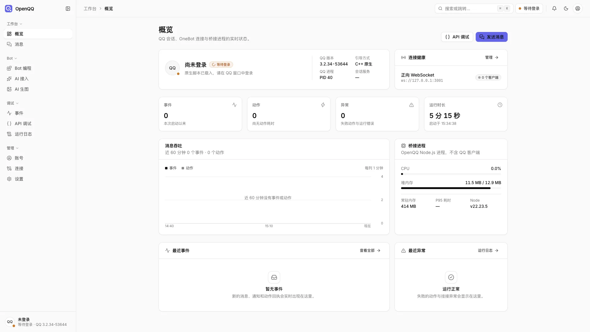

# 在 Sealos 上部署和托管 OpenQQ

OpenQQ 是面向 QQ NT 的 OneBot v11 桥接服务，把 Linux QQ 客户端接入机器人框架和自动化工具。本模板在 Sealos Cloud 上部署 OpenQQ 0.5.0，同时提供 QQ 桌面客户端、浏览器控制台、noVNC 登录界面、持久化存储和公网 HTTPS 访问。

## 关于托管 OpenQQ

OpenQQ 在 Xvfb 虚拟显示环境中运行官方 Linux QQ 桌面客户端，并通过原生启动器挂接到 QQ 进程。浏览器控制台负责管理 QQ 会话、OneBot 连接、事件历史、API 调试、Bot 程序、AI 服务配置和运行日志。独立公网地址上的 noVNC 桌面展示 QQ 登录窗口，你可以直接用浏览器扫码或输入账号密码登录。

模板运行一个单副本 StatefulSet 承载 OpenQQ，并用一个轻量 nginx Deployment 代理控制台和 noVNC。代理会把请求改写为 OpenQQ 允许的内部 Host 和 Origin，OneBot WebSocket 则直接连接应用 Service。三个 1Gi 持久卷分别保存 `/root/.config/QQ` 下的 QQ 登录态、`/app/data` 下的 OpenQQ 配置和 Bot 数据，以及 `/dev/shm` 下的 Chromium 共享内存。

Sealos 自动提供公网域名、TLS 证书、服务和持久化存储。控制台、noVNC 和 OneBot WebSocket 各自拥有独立的 HTTPS 地址。

## 常见使用场景

- **QQ 机器人开发**：把 OneBot v11 客户端和 SDK 接入真实 QQ 账号，处理私聊和群聊消息自动化。
- **个人助理**：通过 OpenQQ 的 Bot 程序和 AI 配置，把 AI 服务与 QQ 对话连接起来。
- **多框架集成**：使用正向 WebSocket 接口接入 AstrBot、NoneBot、Koishi 或自研 OneBot 客户端。
- **远程 QQ 会话**：在浏览器里通过 noVNC 登录 QQ，并处理滑块验证等登录步骤。
- **消息与媒体桥接**：接收事件、查看最近消息、提供收到的媒体文件，并在控制台调试 OneBot 动作。

## OpenQQ 托管依赖

Sealos 模板包含 OpenQQ 应用、Linux QQ 客户端、Xvfb、fluxbox、x11vnc、noVNC、轻量 nginx 代理 Deployment 和三个持久卷。该应用无需外部数据库、Redis 或对象存储服务。

### 部署依赖

- [OpenQQ 代码仓库](https://github.com/feijx3/OpenQQ)
- [Docker 部署指南](https://github.com/feijx3/OpenQQ/blob/v0.5.0/docs/docker.md)
- [连接指南](https://github.com/feijx3/OpenQQ/blob/v0.5.0/docs/connect.md)
- [OneBot v11 动作文档](https://github.com/feijx3/OpenQQ/blob/v0.5.0/docs/actions.md)
- [OneBot v11 规范](https://github.com/botuniverse/onebot-11)

## 实现细节

**架构组件：**

- **OpenQQ 应用**：单副本 StatefulSet，在 `17860` 提供 WebUI，在 `3001` 提供 OneBot v11 正向 WebSocket，在 `6080` 提供 noVNC。
- **Linux QQ 客户端**：在 OpenQQ 容器内的 Xvfb 上运行，通过原生启动器挂接。
- **Web 代理 Deployment**：非特权 nginx Deployment 监听 `18080` 的控制台流量和 `18081` 的 noVNC 流量，把 `Host` 和 `Origin` 改写为 OpenQQ 接受的内部值。
- **QQ 持久卷**：1Gi 卷挂载到 `/root/.config/QQ`，保存 QQ 登录态和客户端状态。
- **OpenQQ 持久卷**：1Gi 卷挂载到 `/app/data`，保存 `openqq.json`、Bot 程序、记忆和 AI 配置。
- **共享内存卷**：1Gi 卷挂载到 `/dev/shm`，为镜像内置的 Chromium 运行时提供共享内存。
- **公网路由**：三个 Ingress 分别发布控制台、noVNC 桌面和 OneBot WebSocket 接口。

**配置说明：**

- **VNC 密码**：部署时填写必填项 `vnc_password`，使用 8 至 64 个 ASCII 字符，且不含空格。
- **OneBot 访问令牌**：自动生成，供 WebSocket 接口鉴权。
- **WebUI 访问密钥**：每次主容器启动时重新生成，并打印在主容器日志中。
- **时区**：`Asia/Shanghai`。
- **资源限制**：主容器为 `500m` CPU 和 `1024Mi` 内存；代理为 `100m` CPU 和 `128Mi` 内存。`200m` 在冷启动阶段会反复触发就绪探针失败，`100m` 会让原生 IPC 握手失败。
- **QQ 版本**：容器镜像内置 Linux QQ `3.2.34-53644`。OpenQQ 将 `9.9.33-52230` 和 `9.9.37-54395` 标记为上游完整验证版本。

**许可信息：**

OpenQQ 使用 MIT 许可证。生产环境使用前请阅读上游许可证。QQ 是腾讯产品，仍受腾讯服务条款约束。

## 为什么在 Sealos 上部署 OpenQQ？

Sealos 是构建在 Kubernetes 上的 AI 云操作系统，把应用部署、网络、存储和运维统一到一个平台。在 Sealos 上部署 OpenQQ 可以获得：

- **一键部署**：通过一个模板创建应用、三条公网 HTTPS 路由和持久化存储。
- **内置桌面运行环境**：直接运行 Linux QQ 客户端、Xvfb、noVNC 和 OneBot 桥接，无需自行维护远程桌面主机。
- **持久化 QQ 会话**：Pod 重启后，专属卷继续保留 QQ 登录态和 Bot 数据。
- **独立公网入口**：控制台、noVNC 登录界面和 OneBot WebSocket 分别使用托管域名。
- **按量付费资源**：从经过验证的 `500m` CPU 和 `1024Mi` 内存起步，并在 Canvas 中按需调整。
- **Canvas 运维**：查看日志、存储和网络资源，通过 AI 对话或资源卡片修改部署。
- **Kubernetes 可靠性**：使用健康探针、自动恢复、服务发现和声明式资源管理。

## 部署指南

1. 打开 [OpenQQ 模板](https://sealos.io/products/app-store/openqq)，点击 **立即部署**。
2. 填写 **VNC 密码**，使用 8 至 64 个 ASCII 字符，且不含空格。
3. 等待部署完成，通常需要 2-3 分钟。部署完成后，Sealos 会打开 Canvas。后续修改可以通过 AI 对话或点击对应的资源卡片完成。
4. 从 Canvas 或应用商店入口打开 OpenQQ 主应用地址。
5. 打开主容器日志，复制完整的 `WebUI=http://127.0.0.1:17860/#token=...` 地址。把本地地址替换成你的 OpenQQ 公网地址，保留 `#token=` 片段。
6. 打开 `https://<openqq-domain>/#token=<access-key>`，控制台会进入 **概览** 页面。
7. 在 noVNC 应用地址后追加 `/vnc.html?autoconnect=true`，输入第 2 步设置的 VNC 密码，再用手机 QQ 扫描二维码。
8. 回到控制台，账号状态会从 **等待登录** 变成已登录的 QQ 账号。
9. 打开 **连接** 页面，查看 OneBot WebSocket 地址和访问令牌，然后让机器人客户端连接 `wss://<onebot-domain>/`。

## 登录与账号配置

OpenQQ 没有独立的注册页面。首次使用时，打开带访问密钥的控制台地址即可进入管理界面，然后在 noVNC 桌面里用已有 QQ 账号登录。

OpenQQ 提供三层相互独立的访问控制。

**控制台登录**：WebUI 会在每次主容器启动时生成新的 32 字节访问密钥。以 `[OpenQQ] OpenQQ 0.5.0` 开头的主容器日志会给出完整带密钥地址。复制 `#token=` 后面的值，追加到 OpenQQ 公网控制台地址。密钥缺失或错误时返回 HTTP 401。Pod 重启后，从日志获取新密钥并替换旧片段。

**QQ 登录**：QQ 桌面客户端需要 QQ 账号。打开 noVNC 地址，输入部署时设置的 VNC 密码，再用手机 QQ 扫码，或在虚拟桌面里使用 QQ 账号密码登录。登录态保存在 `/root/.config/QQ` 卷中，后续重启会继续沿用 QQ 仍认可的有效会话。

**OneBot 客户端鉴权**：在 **连接** 页面或 `/api/config` 获取 OneBot 访问令牌。连接正向 WebSocket 时，可以把令牌放在 `Authorization: Bearer <token>` 请求头，或使用 `?access_token=<token>` 查询参数。缺少有效令牌的连接会被拒绝。

OneBot 令牌只在 `/app/data/openqq.json` 不存在时写入。全新存储卷上，`OPENQQ_AUTO_INIT=1` 会用模板输入生成配置文件。文件生成后，修改模板里自动生成的令牌输入不会覆盖已保存的令牌；已有部署请直接在 **连接** 页面修改令牌。

## 配置

部署完成后，可以在 OpenQQ 控制台中完成以下操作：

- 在 **概览** 查看 QQ 账号状态、桥接进程指标、事件计数和最近异常。
- 在 **消息** 和 **事件** 查看最近消息与事件载荷。
- 在 **连接** 启用或关闭正向 WebSocket、HTTP API、反向 WebSocket 和 HTTP 上报。
- 在 **API 调试** 发起 OneBot 动作请求并查看结果。
- 在 **Bot 编程** 创建或编辑 Bot 程序。
- 在 **AI 接入** 配置兼容 OpenAI 的服务、模型、人设和记忆。
- 在 **设置** 调整端口和运行时参数。

OneBot 访问令牌和 WebUI 密钥都属于敏感凭据。控制台地址仅应分享给需要完整管理 QQ 会话的运维人员。

## 扩缩容

OpenQQ 只挂接一个 QQ 桌面会话，并使用带 ReadWriteOnce 卷的单副本 StatefulSet。请保持 `replicas` 为 `1`。负载增长时，可以在 Canvas 中打开 StatefulSet 资源卡片，提高 CPU 或内存上限。模板默认使用 `500m` CPU 和 `1024Mi` 内存。`200m` 会在冷启动阶段反复触发就绪探针失败；`500m` 可以完成冷启动、控制台登录、页面切换、noVNC 密码登录和 OneBot 握手，并在稳定性验证中没有重启。容器 cgroup 内存峰值接近 `590Mi`，`1024Mi` 留有余量。

## 故障排查

### 控制台提示“访问密钥无效”

从主容器日志复制当前带密钥地址。容器每次重启后密钥都会变化。把本地 Host 替换为公网域名时，请保留完整 `#token=` 片段。

### 控制台返回 HTTP 403

请求带着 OpenQQ 不允许的 Host 或 Origin 到达应用。请使用 Canvas 里的控制台地址和 noVNC 地址。模板通过代理 Deployment 和 `openqq.internal` 允许值处理这一层；不要从公网域名直接连接 `17860` 端口。

### 控制台或 OneBot 接口返回 HTTP 401

请求缺少有效凭据。控制台请从主容器日志复制最新的 `#token=` 片段，并完整保留在地址中。OneBot WebSocket 请从 **连接** 页面复制当前令牌，通过 Bearer 请求头或 `access_token` 查询参数传入。主容器每次重启后 WebUI 密钥都会变化，需要重新获取控制台地址。

### OneBot 地址返回 HTTP 426

OneBot 端口收到普通 HTTP GET 时会返回 `426 Upgrade Required`，这是正常行为。请使用 WebSocket 客户端连接 `wss://<onebot-domain>/`，并带上 OneBot 令牌。

### noVNC 要求输入密码

输入部署时填写的 `vnc_password`。密码区分大小写，使用 8 至 64 个 ASCII 字符，且不含空格。

### QQ 显示二维码已过期

在 QQ 登录窗口中点击 **刷新** 生成新二维码，再用手机 QQ 扫描。

### OneBot 拒绝连接

在 **连接** 页面复制访问令牌，通过 Bearer 请求头或 `access_token` 查询参数传入。确认客户端使用 `wss://<onebot-domain>/`，并在执行账号相关动作前已经登录 QQ。

### 获取帮助

- [OpenQQ 文档](https://github.com/feijx3/OpenQQ/tree/v0.5.0/docs)
- [OpenQQ 问题反馈](https://github.com/feijx3/OpenQQ/issues)
- [Sealos Discord](https://discord.gg/wdUn538zVP)

## 其他资源

- [OpenQQ Docker 指南](https://github.com/feijx3/OpenQQ/blob/v0.5.0/docs/docker.md)
- [OpenQQ 连接指南](https://github.com/feijx3/OpenQQ/blob/v0.5.0/docs/connect.md)
- [OpenQQ 动作参考](https://github.com/feijx3/OpenQQ/blob/v0.5.0/docs/actions.md)
- [OneBot v11 规范](https://github.com/botuniverse/onebot-11)

## 许可证

本 Sealos 模板使用仓库的模板许可证。OpenQQ 使用 MIT 许可证。
