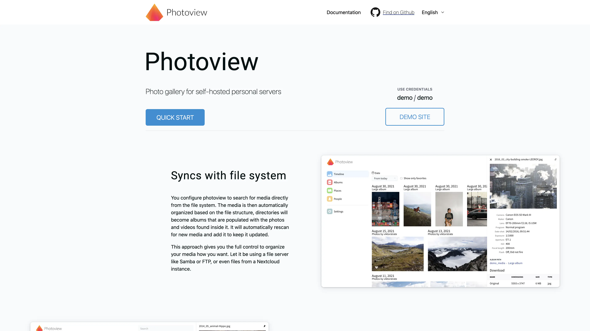

# Deploy and Host Photoview on Sealos

Photoview is a self-hosted photo and video gallery built for personal servers and photographers. It scans a directory tree, turns folders into albums, and generates thumbnails for fast browsing of large high-resolution libraries. This Sealos template runs Photoview 2.4.0 with SQLite, persistent media storage, and a first-run setup wizard.



## About Hosting Photoview

Photoview is a Go server with a React gallery UI. It reads media from a directory on disk, extracts EXIF metadata, generates thumbnails and optimized videos, and organizes folders as albums. The interface provides a timeline, album browsing, people and face grouping, search, favorites, and share links.

This template runs one StatefulSet with the official `photoview/photoview:2.4.0` image on port `4001`. Three persistent volumes hold the SQLite database, the generated media cache, and the photo library at `/photos`. The container runs as UID and GID `999` with `fsGroup` applied to all volumes.

The first visit opens the setup wizard at `/initialSetup`. You choose the administrator username and password, then enter `/photos` as the photo path. After setup, the scanner runs on demand from **Settings → Scanner → Scan all users**, or on a schedule you configure in the same panel.

## Common Use Cases

- **Personal Photo Library**: Browse years of photos and videos from any browser with a timeline organized by capture date.
- **Photographer Portfolio**: Publish curated albums, share links, and let clients review high-resolution images.
- **Family Archive**: Keep a private, searchable library on your own infrastructure with face grouping.
- **Media Server Companion**: Point Photoview at a mounted Samba, NFS, or Nextcloud directory and browse it as albums.
- **RAW and Video Workflow**: Use the bundled Darktable and FFmpeg workers for RAW previews and browser-compatible video encoding.

## Dependencies for Hosting Photoview

The template includes the Photoview StatefulSet, three 1Gi persistent volumes, a Service, an HTTPS Ingress, and a Sealos App entry. A browser is the only client-side requirement, and the administrator account is created during the first-run wizard.

### Deployment Dependencies

- [Photoview official site](https://photoview.github.io/) - Product overview and project links
- [Photoview documentation](https://photoview.github.io/en/docs/) - Setup and usage guides
- [Photoview Docker guide](https://photoview.github.io/en/docs/installation-docker/) - Container deployment and volume layout
- [Photoview environment variables](https://photoview.github.io/en/docs/installation-environment-variables/) - Database, server, and general settings
- [Photoview repository](https://github.com/photoview/photoview) - Source code and release notes
- [Photoview container image](https://hub.docker.com/r/photoview/photoview) - Official image used by this template

## Implementation Details

**Architecture Components:**

- **Photoview StatefulSet**: One replica running `photoview/photoview:2.4.0` with the API and UI on port `4001`.
- **Database volume**: A 1Gi volume at `/home/photoview/database` holding `photoview.db`, the SQLite database for users, albums, media records, EXIF, and face data.
- **Media cache volume**: A 1Gi volume at `/home/photoview/media-cache` for thumbnails, optimized images, and encoded videos.
- **Photo volume**: A 1Gi volume at `/photos` mounted read-write for the media library.
- **Service**: ClusterIP port `80` forwarding to the Photoview HTTP port.
- **Ingress**: Sealos-managed HTTPS host with a 32Mi request body limit, 300-second proxy timeouts, and 30-day static asset caching.
- **App entry**: Opens the Photoview gallery from the Sealos desktop.

**Configuration:**

- **Image**: `photoview/photoview:2.4.0`
- **Web port**: `4001`
- **Database driver**: SQLite through `PHOTOVIEW_DATABASE_DRIVER=sqlite`
- **Database path**: `/home/photoview/database/photoview.db`
- **Listen address**: `PHOTOVIEW_LISTEN_IP=0.0.0.0`
- **UI serving**: Enabled with `PHOTOVIEW_SERVE_UI=1`
- **Media cache**: `/home/photoview/media-cache`
- **Photo root**: `/photos`
- **Runtime user**: UID `999`, GID `999`, `fsGroup: 999`
- **Timezone**: `Asia/Shanghai`
- **Health checks**: Startup, readiness, and liveness probes run the image's official `CheckInitialSetup` GraphQL request against `/api/graphql`

**Resource Allocation:**

| Component | CPU Request | CPU Limit | Memory Request | Memory Limit | Storage |
| --- | ---: | ---: | ---: | ---: | ---: |
| Photoview | 50m | 500m | 102Mi | 1024Mi | 1Gi database + 1Gi cache + 1Gi photos |

The profile passed a cold start, first-run setup, administrator login, media scan of `/photos`, thumbnail rendering in the timeline, a Pod restart with data retained, and a fresh logout and login with zero restarts. Memory settled near 67Mi after login and reached about 105Mi during the initial scan.

## Why Deploy Photoview on Sealos?

Sealos is an AI-assisted cloud operating system built on Kubernetes that combines deployment, networking, storage, and operations in one interface. Deploying Photoview on Sealos gives you:

- **One-Click Deployment**: Launch the gallery without assembling StatefulSet, Service, Ingress, and persistent volumes.
- **Automatic HTTPS**: Receive a managed public domain and TLS certificate for the gallery and share links.
- **Persistent Library**: Keep the database, thumbnails, and original photos on dedicated volumes.
- **Complete Media Toolchain**: Use the bundled FFmpeg, Darktable, and ExifTool workers for photos, RAW files, and video.
- **Managed Runtime**: Run the Go server on a Kubernetes foundation with health probes and restart handling.
- **Sealos Operations**: Inspect Pods, logs, storage, and resource usage from Canvas or the Sealos AI dialog.

## Deployment Guide

1. Open the [Photoview template](https://sealos.io/products/app-store/photoview) and click **Deploy Now**.
2. Review the generated application name and host, then confirm the three volumes and resource plan.
3. Wait for deployment to complete, typically in 2-3 minutes. The first start initializes the SQLite database.
4. Open the public URL. The page redirects to **Initial Setup**.
5. Enter an administrator username and password, set the photo path to `/photos`, and click **Setup Photoview**.
6. Open **Settings → Scanner**, click **Scan all users**, and wait for the **Scanner complete** message.
7. Return to **Timeline** and **Albums** to browse the scanned media.

## Using Photoview

- **Timeline**: Browse media by capture date with filters for favorites and date ranges.
- **Albums**: Folders under `/photos` become albums, including nested albums for subdirectories.
- **People**: Group faces detected during scanning and label people for filtering.
- **Search**: Find media by filename, album, tags, and metadata.
- **Sharing**: Create share links for albums or individual media with optional password protection and expiration.
- **Settings**: Manage users, scanner concurrency, periodic scans, language, and theme preferences.
- **Admin**: The first account created by the wizard is the site administrator.

## Photos, Scanning, and Storage

Add media to the photos volume through the Sealos file browser, a temporary upload Pod, or `kubectl cp`:

```bash
kubectl cp ./my-photos <namespace>/<pod-name>:/photos
```

Run **Settings → Scanner → Scan all users** after adding files. Directories become albums, so a layout such as `/photos/2026/Iceland` produces nested albums. The scanner also picks up renamed, moved, and deleted files on later runs.

The template starts each volume at 1Gi. Expand the photo volume before importing a large library:

1. Increase the `vn-photos` PVC request from the Sealos resource view.
2. Restart the Photoview Pod so the filesystem resize completes.
3. Confirm the new capacity inside the Pod with `df -h /photos`.

The media cache volume can be cleared when thumbnails need to be regenerated; Photoview rebuilds them on the next scan.

## Scaling

Run Photoview as a single replica. SQLite and the ReadWriteOnce volumes serve one writer, and multiple replicas would create independent databases and caches. For larger libraries, raise the CPU and memory limits so FFmpeg and Darktable can process media in parallel. Deploy separate instances for independent libraries or teams.

## Troubleshooting

### The Pod crashes with `bind: permission denied`

The Photoview process runs as UID `999`, and Linux restricts ports below `1024` to privileged users. This template listens on `4001`; keep `PHOTOVIEW_LISTEN_PORT` and the probe URLs aligned when you change the port.

### The setup page appears again after a restart

The setup state lives in the SQLite database on the database volume. Confirm that `vn-homevn-photoviewvn-database` is mounted at `/home/photoview/database` and that the volume is bound and writable by `fsGroup 999`.

### The timeline stays empty after setup

Open **Settings → Scanner** and click **Scan all users**. Confirm that the photo path is `/photos`, that files exist in the volume, and that the scanner reports **Scanner complete**.

### Thumbnails fail to load

Check the Pod logs for FFmpeg or Darktable errors and confirm that the media cache volume is writable. Increase the memory limit for large RAW files or high-resolution videos.

### New files are missing from albums

Run a scan after adding files. Enable the periodic scanner in **Settings → Scanner** when the library changes frequently.

### The photo volume fills up

Expand the `vn-photos` PVC from the Sealos resource view and restart the Pod. Remove unused media from `/photos` before expanding when the volume is already full.

### Getting Help

- [Photoview documentation](https://photoview.github.io/en/docs/)
- [Photoview GitHub discussions](https://github.com/photoview/photoview/discussions)
- [Sealos documentation](https://sealos.io/docs)

## License

Photoview is released under the [GNU Affero General Public License v3.0](https://github.com/photoview/photoview/blob/master/LICENSE.txt). This Sealos template is distributed under the templates repository license.
