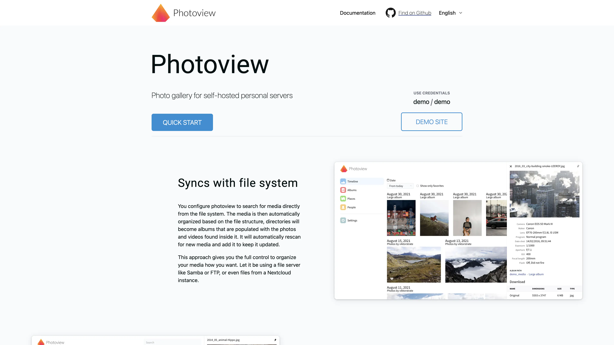

# 在 Sealos 上部署和托管 Photoview

Photoview 是面向个人服务器和摄影师的自信任照片与视频图库。它扫描目录树，将文件夹转换为相册，并为大量高分辨率照片生成缩略图以加快浏览。本 Sealos 模板运行 Photoview 2.4.0，使用 SQLite、持久化媒体存储和首次访问设置向导。



## 托管 Photoview 简介

Photoview 由 Go 服务端和 React 图库界面组成。它从磁盘目录读取媒体，提取 EXIF 元数据，生成缩略图和优化视频，并将文件夹组织为相册。界面提供时间线、相册浏览、人物与人脸分组、搜索、收藏和分享链接。

本模板运行一个 StatefulSet，使用官方 `photoview/photoview:2.4.0` 镜像并监听 `4001` 端口。三个持久卷分别保存 SQLite 数据库、生成的媒体缓存和 `/photos` 照片库。容器以 UID 和 GID `999` 运行，所有卷通过 `fsGroup` 授予访问权限。

首次访问会打开 `/initialSetup` 设置向导。你需要设置管理员用户名和密码，并将照片路径填写为 `/photos`。设置完成后，可在 **Settings → Scanner → Scan all users** 手动触发扫描，也可以在同一面板配置周期扫描。

## 常见使用场景

- **个人照片库**：通过浏览器浏览多年照片和视频，时间线按拍摄日期组织。
- **摄影师作品集**：发布精选相册、生成分享链接，让客户查看高分辨率图片。
- **家庭影像归档**：在自有基础设施上保存私有、可搜索的图库，并按人脸分组。
- **媒体服务器搭档**：将 Photoview 指向挂载的 Samba、NFS 或 Nextcloud 目录，以相册形式浏览。
- **RAW 与视频工作流**：使用镜像内置的 Darktable 和 FFmpeg 生成 RAW 预览和浏览器兼容视频。

## 托管 Photoview 的依赖

模板包含 Photoview StatefulSet、三个 1Gi 持久卷、Service、HTTPS Ingress 和 Sealos 应用入口。客户端只需要浏览器，管理员账户在首次设置向导中创建。

### 部署依赖

- [Photoview 官网](https://photoview.github.io/) - 产品介绍和项目链接
- [Photoview 文档](https://photoview.github.io/en/docs/) - 设置和使用指南
- [Photoview Docker 指南](https://photoview.github.io/en/docs/installation-docker/) - 容器部署和卷布局
- [Photoview 环境变量](https://photoview.github.io/en/docs/installation-environment-variables/) - 数据库、服务端和通用配置
- [Photoview 代码仓库](https://github.com/photoview/photoview) - 源代码和版本说明
- [Photoview 容器镜像](https://hub.docker.com/r/photoview/photoview) - 模板使用的官方镜像

## 实现细节

**架构组件：**

- **Photoview StatefulSet**：单副本运行 `photoview/photoview:2.4.0`，API 和 UI 监听 `4001` 端口。
- **数据库卷**：1Gi 持久卷挂载到 `/home/photoview/database`，保存 `photoview.db`，包含用户、相册、媒体记录、EXIF 和人脸数据。
- **媒体缓存卷**：1Gi 持久卷挂载到 `/home/photoview/media-cache`，保存缩略图、优化图片和转码视频。
- **照片卷**：1Gi 持久卷以读写方式挂载到 `/photos`，保存原始媒体库。
- **Service**：ClusterIP `80` 端口转发到 Photoview HTTP 端口。
- **Ingress**：Sealos 管理的 HTTPS 域名，配置 32Mi 请求体上限、300 秒代理超时和 30 天静态资源缓存。
- **应用入口**：从 Sealos 桌面打开 Photoview 图库。

**配置：**

- **镜像**：`photoview/photoview:2.4.0`
- **Web 端口**：`4001`
- **数据库驱动**：通过 `PHOTOVIEW_DATABASE_DRIVER=sqlite` 使用 SQLite
- **数据库路径**：`/home/photoview/database/photoview.db`
- **监听地址**：`PHOTOVIEW_LISTEN_IP=0.0.0.0`
- **UI 服务**：通过 `PHOTOVIEW_SERVE_UI=1` 启用
- **媒体缓存**：`/home/photoview/media-cache`
- **照片根目录**：`/photos`
- **运行用户**：UID `999`、GID `999`、`fsGroup: 999`
- **时区**：`Asia/Shanghai`
- **健康检查**：启动、就绪和存活探针调用镜像官方的 `CheckInitialSetup` GraphQL 请求，访问 `/api/graphql`

**资源分配：**

| 组件 | CPU 请求 | CPU 上限 | 内存请求 | 内存上限 | 存储 |
| --- | ---: | ---: | ---: | ---: | ---: |
| Photoview | 50m | 500m | 102Mi | 1024Mi | 1Gi 数据库 + 1Gi 缓存 + 1Gi 照片 |

该配置通过冷启动、首次设置、管理员登录、扫描 `/photos`、时间线缩略图渲染、Pod 重启后数据保留、登出并重新登录验证，重启次数为零。登录后内存占用约 67Mi，首次扫描期间约 105Mi。

## 为什么在 Sealos 上部署 Photoview

Sealos 是构建在 Kubernetes 之上的 AI 辅助云操作系统，将部署、网络、存储和运维整合在一个界面中。在 Sealos 上部署 Photoview 可以获得：

- **一键部署**：无需手工组装 StatefulSet、Service、Ingress 和持久卷。
- **自动 HTTPS**：为图库和分享链接提供托管域名和 TLS 证书。
- **持久化图库**：数据库、缩略图和原始照片分别保存在独立数据卷中。
- **完整媒体工具链**：使用镜像内置的 FFmpeg、Darktable 和 ExifTool 处理照片、RAW 文件和视频。
- **托管运行时**：Go 服务运行在具备健康探针和重启处理的 Kubernetes 基础上。
- **Sealos 运维能力**：通过 Canvas 或 Sealos AI 对话查看 Pod、日志、存储和资源使用情况。

## 部署指南

1. 打开 [Photoview 模板](https://sealos.io/products/app-store/photoview)，点击 **Deploy Now**。
2. 确认生成的应用名称和域名，核对三个数据卷与资源配置。
3. 等待部署完成，通常需要 2-3 分钟。首次启动会初始化 SQLite 数据库。
4. 打开公网地址，页面会跳转到 **Initial Setup**。
5. 设置管理员用户名和密码，将照片路径填写为 `/photos`，点击 **Setup Photoview**。
6. 打开 **Settings → Scanner**，点击 **Scan all users**，等待出现 **Scanner complete**。
7. 返回 **Timeline** 和 **Albums** 浏览扫描到的媒体。

## 使用 Photoview

- **时间线**：按拍摄日期浏览媒体，并按收藏状态和日期范围筛选。
- **相册**：`/photos` 下的文件夹会成为相册，子目录形成嵌套相册。
- **人物**：对扫描到的人脸分组并命名，用于筛选照片。
- **搜索**：按文件名、相册、标签和元数据查找媒体。
- **分享**：为相册或单张媒体创建分享链接，可设置密码和有效期。
- **设置**：管理用户、扫描并发数、周期扫描、语言和主题偏好。
- **管理员**：设置向导创建的第一个账户即站点管理员。

## 照片、扫描与存储

通过 Sealos 文件浏览器、临时上传 Pod 或 `kubectl cp` 将媒体放入照片卷：

```bash
kubectl cp ./my-photos <namespace>/<pod-name>:/photos
```

添加文件后运行 **Settings → Scanner → Scan all users**。目录会成为相册，例如 `/photos/2026/Iceland` 会形成嵌套相册。后续扫描也会识别重命名、移动和删除的文件。

模板将每个卷的起始容量设为 1Gi。导入大型图库前先扩容照片卷：

1. 在 Sealos 资源视图中提高 `vn-photos` PVC 的请求容量。
2. 重启 Photoview Pod，完成文件系统扩容。
3. 在 Pod 内执行 `df -h /photos` 确认新容量。

媒体缓存卷可以在需要重新生成缩略图时清空，Photoview 会在下一次扫描时重建。

## 扩缩容

Photoview 以单副本运行。SQLite 和 ReadWriteOnce 数据卷对应单一写入者，多副本会产生彼此独立的数据库和缓存。图库规模扩大时，提升 CPU 和内存上限，让 FFmpeg 和 Darktable 并行处理更多媒体。独立图库和独立团队可以部署各自实例。

## 故障排查

### Pod 崩溃并提示 `bind: permission denied`

Photoview 进程以 UID `999` 运行，Linux 将低于 `1024` 的端口保留给特权用户。本模板监听 `4001`；修改端口时，需要同步更新 `PHOTOVIEW_LISTEN_PORT` 和探针地址。

### 重启后再次出现设置页

设置状态保存在数据库卷中的 SQLite 数据库。确认 `vn-homevn-photoviewvn-database` 挂载到 `/home/photoview/database`，且卷已绑定并可由 `fsGroup 999` 写入。

### 设置完成后时间线为空

打开 **Settings → Scanner**，点击 **Scan all users**。确认照片路径为 `/photos`，卷中存在文件，并等待出现 **Scanner complete**。

### 缩略图加载失败

查看 Pod 日志中的 FFmpeg 或 Darktable 错误，确认媒体缓存卷可写。处理大型 RAW 文件或高分辨率视频时，提高内存上限。

### 新文件未出现在相册中

添加文件后执行扫描。图库频繁变化时，在 **Settings → Scanner** 中启用周期扫描。

### 照片卷被写满

在 Sealos 资源视图中扩容 `vn-photos` PVC 并重启 Pod。数据卷已满时，先删除 `/photos` 中不再使用的媒体。

### 获取帮助

- [Photoview 文档](https://photoview.github.io/en/docs/)
- [Photoview GitHub 讨论区](https://github.com/photoview/photoview/discussions)
- [Sealos 文档](https://sealos.io/docs)

## 许可证

Photoview 基于 [GNU Affero 通用公共许可证 v3.0](https://github.com/photoview/photoview/blob/master/LICENSE.txt)发布。本 Sealos 模板遵循 templates 仓库的许可证。
