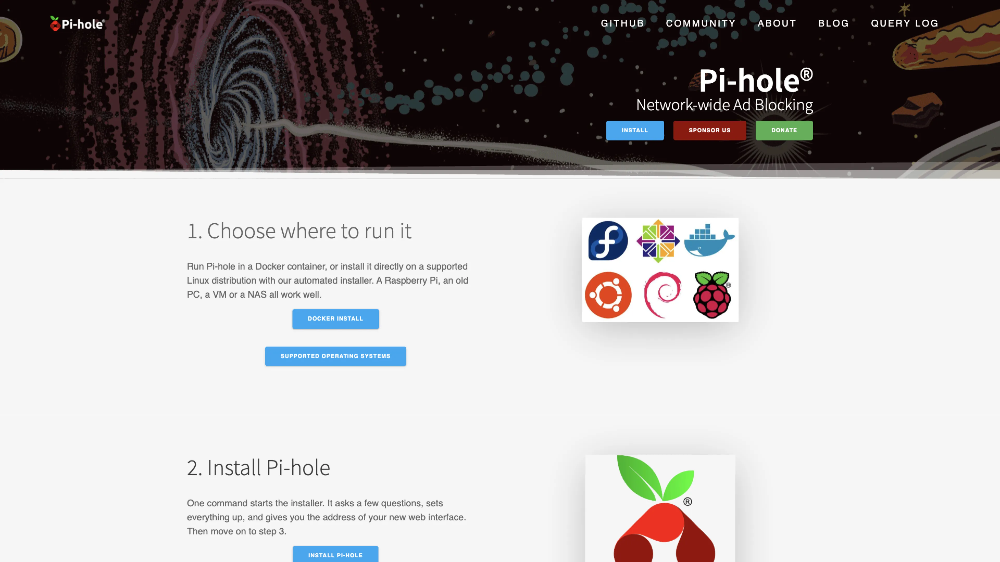

# Deploy and Host Pi-hole on Sealos

Pi-hole is a self-hosted DNS sinkhole that blocks advertising and tracking domains for an entire network and reports query activity through a web dashboard. This Sealos template runs Pi-hole 2026.11.0 as a single-replica StatefulSet with persistent configuration storage and a public HTTPS console.

## About Hosting Pi-hole

Pi-hole receives DNS queries, matches them against blocklists, forwards allowed queries to upstream resolvers, and records the results. The web console covers query logs, blocklists, allowlists, local DNS records, upstream DNS settings, clients, and diagnostic tools.

This template runs one StatefulSet with `pihole/pihole:2026.11.0` on port `80`. The `admin_password` input becomes the initial web administrator password through `FTLCONF_webserver_api_password`, and `FTLCONF_dns_listeningMode=ALL` lets the resolver accept queries from the cluster network. A 1Gi volume mounted at `/etc/pihole` stores configuration, blocklists, and query history.

The Service and Ingress publish the web console at `/admin` over HTTPS. DNS traffic uses UDP and TCP port 53, which this template leaves to an explicit DNS Service so the console deployment remains independent from network-level DNS exposure.

## Common Use Cases

- **Network-Wide Ad Blocking**: Protect every device on a home or office network through one DNS resolver.
- **Query Visibility**: Review top domains, clients, query types, and blocked requests from the dashboard.
- **Local DNS**: Add records for lab servers, internal tools, and development hostnames.
- **Blocklist Testing**: Validate new lists and allowlist entries before rolling them out.
- **Small-Team DNS**: Provide a private management console for a team or community network.

## Dependencies for Pi-hole Hosting

The template includes the Pi-hole StatefulSet, a 1Gi persistent volume, a Service, an HTTPS Ingress, and the Sealos App entry. Pi-hole needs at least one reachable upstream DNS resolver. Client devices need a UDP/TCP port 53 Service pointing at this deployment.

### Deployment Dependencies

- [Pi-hole website](https://pi-hole.net/) - Product overview and release information
- [Pi-hole documentation](https://docs.pi-hole.net/) - Installation, DNS, DHCP, and API guides
- [Pi-hole repository](https://github.com/pi-hole/pi-hole) - Source code and issue tracker
- [Pi-hole Docker image](https://hub.docker.com/r/pihole/pihole) - Official container image used by this template
- [Pi-hole v6 configuration](https://docs.pi-hole.net/docker/configuration/) - `FTLCONF_` environment variables and persistent paths

## Implementation Details

**Architecture Components:**

- **Pi-hole StatefulSet**: One replica running `pihole/pihole:2026.11.0` on port `80`.
- **Persistent volume**: A 1Gi volume at `/etc/pihole` for configuration, blocklists, and query history.
- **Service**: ClusterIP port `80` for the web console.
- **Ingress**: Sealos-managed HTTPS host; the App entry opens `/admin`.
- **DNS exposure**: Add a separate UDP/TCP port 53 Service when clients use this instance.

**Configuration:**

- **Image**: `pihole/pihole:2026.11.0`
- **Web port**: `80`
- **Timezone**: `Asia/Shanghai`
- **Administrator password**: Required `admin_password` input
- **DNS listening mode**: `ALL`
- **Persistence**: 1Gi ReadWriteOnce volume at `/etc/pihole`
- **Replicas**: `1`

**Resource Allocation:**

| Component | CPU Request | CPU Limit | Memory Request | Memory Limit | Storage |
| --- | ---: | ---: | ---: | ---: | ---: |
| Pi-hole | 10m | 100m | 12Mi | 128Mi | 1Gi |

The profile passed a cold start, administrator login, Query Log navigation, and a stability window with zero restarts.

## Why Deploy Pi-hole on Sealos?

Sealos is an AI-assisted cloud operating system built on Kubernetes that unifies deployment, networking, storage, and operations. Deploying Pi-hole on Sealos gives you:

- **One-Click Deployment**: Provision the console, storage, and HTTPS endpoint from one template.
- **Persistent DNS State**: Keep configuration, blocklists, and query history across Pod restarts.
- **Canvas and AI Dialog**: Inspect the StatefulSet, Service, Ingress, PVC, logs, and resource cards, and adjust the deployment through the Sealos AI dialog.
- **Pay-as-You-Go Resources**: Run a compact DNS service with a validated 100m CPU and 128Mi memory limit.
- **Automatic HTTPS**: Reach the console through a managed domain and TLS certificate.
- **Kubernetes Reliability**: Use health probes, automated recovery, and declarative resource management.

## Deployment Guide

1. Open the [Pi-hole template](https://sealos.io/products/app-store/pi-hole) and click **Deploy Now**.
2. Enter an administrator password, review the generated application name, and confirm the 1Gi storage plan.
3. Wait for deployment to complete, typically in 2-3 minutes. Sealos opens the Canvas after the resources are created.
4. Open the public URL from the Canvas or the App Store entry; it points to `/admin`.
5. Sign in with the password from step 2 and open **Query Log** to confirm the dashboard reads live data.
6. Add a Service that exposes UDP and TCP port 53 when client devices need to query this Pi-hole instance.

## Login and Account Setup

Pi-hole uses one web administrator account. The `admin_password` input sets the password at deployment time, and the login page is available at `/admin`. There is no separate registration flow.

Use the exact password entered in the deployment form. After login, open **Settings → DNS** to choose upstream resolvers and **Settings → All settings** for advanced resolver behavior. Keep the password with the deployment owner because the template does not configure email-based recovery.

## Configuration

- **Upstream DNS**: Configure one or more resolvers under **Settings → DNS**.
- **Blocklists**: Add or replace lists under **Lists**; Pi-hole downloads them on its update schedule.
- **Local DNS records**: Add hostnames under **Local DNS → DNS Records**.
- **Clients**: Group devices under **Clients** and apply per-client rules when needed.
- **Query history**: Stored in the `/etc/pihole` volume and retained according to the Pi-hole database settings.
- **DNS port**: Create a dedicated UDP/TCP 53 Service before pointing devices at the resolver.

## Scaling

Keep the template at one replica because Pi-hole owns local SQLite data and resolver state on a ReadWriteOnce volume. Increase CPU and memory limits when query volume, large blocklists, or long retention windows require more resources. Expand the 1Gi volume from the StatefulSet resource card when query history or lists need more space.

## Troubleshooting

### The login page rejects the password

Use the exact `admin_password` value from the deployment form. If the input changed after the first boot, update the password from the Pi-hole console or redeploy with a fresh volume.

### Devices cannot resolve DNS through Pi-hole

The template publishes the web console and leaves port 53 to a separate Service. Create a UDP/TCP 53 Service for the StatefulSet, then configure clients with its address.

### Queries are not blocked

Open **Lists** and confirm that blocklists are enabled and have been downloaded. Check **Query Log** for the domain status and verify that the client uses this Pi-hole instance as its resolver.

### The dashboard is slow with large query history

Reduce query retention in the Pi-hole settings or expand the persistent volume. A smaller history keeps the dashboard responsive on the compact resource profile.

### Getting Help

- [Pi-hole documentation](https://docs.pi-hole.net/)
- [Pi-hole discourse](https://discourse.pi-hole.net/)
- [Sealos documentation](https://sealos.io/docs)

## License

Pi-hole uses its own upstream license. Review the [Pi-hole license](https://github.com/pi-hole/pi-hole/blob/master/LICENSE) for the full terms. This Sealos template is distributed under the templates repository license.
