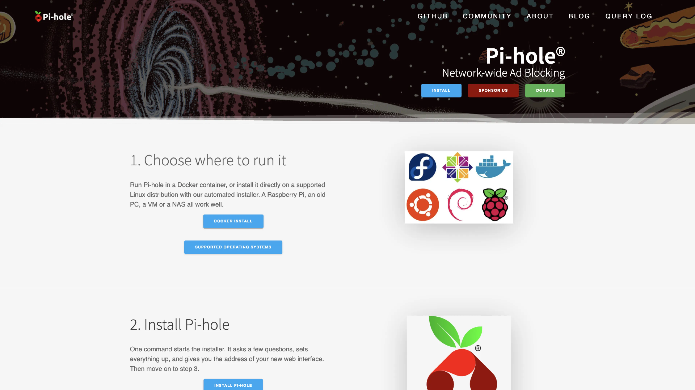

# 在 Sealos 上部署和托管 Pi-hole

Pi-hole 是自托管 DNS 黑洞服务，可为网络中的全部设备拦截广告与追踪域名，并通过 Web 仪表盘展示查询情况。

## 关于 Pi-hole 托管

本模板以单副本 StatefulSet 运行 Pi-hole 官方镜像，为 `/etc/pihole` 挂载 1 GiB 持久卷。Web 控制台通过 HTTPS 发布，管理员密码在部署时由模板输入提供。

访问 `/admin` 并使用部署时填写的密码登录。查询日志、拦截列表、本地 DNS 记录和上游解析器都可在仪表盘中管理，并在 Pod 重启后保留。

## 常见使用场景

- 为家庭或办公网络拦截广告与追踪域名。
- 在一个仪表盘中查看 DNS 查询量和热门拦截域名。
- 为实验环境服务与内部主机名添加本地 DNS 记录。
- 在全网推广前测试拦截列表和允许列表。
- 为小团队提供私有 DNS 管理控制台。

## Pi-hole 托管依赖

- 具备 CPU、内存和存储配额的 Sealos 工作空间。
- 用于 Pi-hole 配置和查询历史的 1 GiB 持久卷。
- 通过模板 input 提供的管理员密码。
- 客户端需要使用该实例解析 DNS 时，需提供暴露 UDP/TCP 53 端口的 Service。

## 为什么在 Sealos 上部署 Pi-hole？

- 一键部署即可通过公网 HTTPS 使用 Web 控制台。
- 由 Kubernetes 提供健康探针、调度和 Pod 自动恢复。
- 持久化存储保留拦截列表、设置和查询历史。
- 按量计费的资源卡适合小型 DNS 部署。
- 通过 Canvas 查看 StatefulSet、Service、Ingress 和 PVC。
- 在 Sealos 桌面中通过 AI 对话获取部署指导。

## 部署指南

1. 打开 [Pi-hole 模板](https://sealos.io/products/app-store/pi-hole)，点击 **Deploy Now**。
2. 输入管理员密码，保留自动生成的应用名称，并确认 1 GiB 存储规格。
3. 等待 2-3 分钟让 StatefulSet 就绪，然后打开公网地址并追加 `/admin`。
4. 使用第 2 步的密码登录，打开 **Query Log** 确认仪表盘正常响应。
5. 需要为客户端提供 DNS 时，新增暴露 UDP 和 TCP 53 端口的 Service，并将设备指向其地址。

## 许可证

Pi-hole 使用上游自定义许可证，完整条款见 [Pi-hole license](https://github.com/pi-hole/pi-hole/blob/master/LICENSE)。
