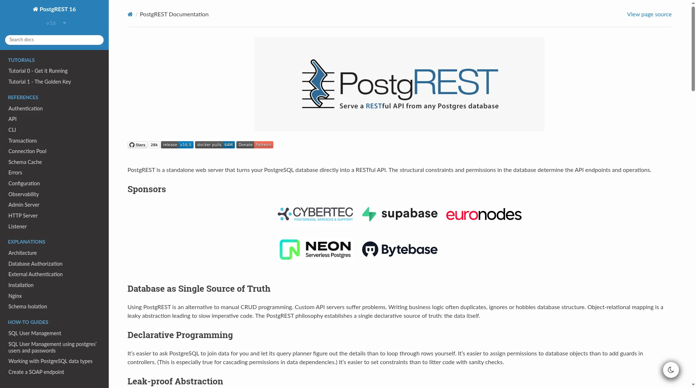

# Deploy and Host PostgREST on Sealos

PostgREST turns a PostgreSQL database directly into a RESTful API. This template deploys PostgREST with a managed PostgreSQL database, an `api` schema bootstrap with a sample `todos` table, JWT authentication, and a public HTTPS endpoint on Sealos Cloud.



## About Hosting PostgREST

PostgREST is a standalone web server that reads your PostgreSQL schema and serves tables, views, and functions as HTTP endpoints. Filtering, ordering, pagination, inserts, updates, and RPC calls are all expressed through URLs and JSON bodies, while authorization is delegated to PostgreSQL roles and grants.

This Sealos template runs PostgREST as a single stateless API service and provisions a Kubeblocks PostgreSQL database for data. A one-shot init job creates the `postgrest` database, the `api` schema, the `anon` and `authenticated` roles, and a sample `api.todos` table so the API responds immediately after deployment.

Sealos configures the public HTTPS route, service discovery, persistent database storage, and resource limits automatically. The OpenAPI document served at the root path uses the generated Sealos domain as its server URL.

## Common Use Cases

- **Instant backend for frontends**: Give web or mobile apps a CRUD API without writing backend code.
- **Internal tools and dashboards**: Expose curated views and tables to admin panels, low-code tools, or BI clients.
- **Database-first APIs**: Model business logic in SQL functions and call them through `/rpc/<function>` endpoints.
- **Prototyping**: Iterate on a schema and immediately test the resulting REST API.
- **Row-level secured APIs**: Combine JWT claims with PostgreSQL Row Level Security for per-user data access.

## Dependencies for PostgREST Hosting

The Sealos template includes all required runtime components: the PostgREST container image (v16.5), a PostgreSQL `postgresql-16.4.0` database, a database initialization job, a Kubernetes Service, an Ingress, and a Sealos App entry.

### Deployment Dependencies

- [PostgREST Website](https://postgrest.org/) - Project overview
- [PostgREST Documentation](https://docs.postgrest.org/en/stable/) - Configuration, API, and authentication reference
- [PostgREST GitHub Repository](https://github.com/PostgREST/postgrest) - Source code and releases
- [PostgREST Docker Image](https://hub.docker.com/r/postgrest/postgrest) - Official container image

### Implementation Details

**Architecture Components:**

This template deploys the following services:

- **PostgREST API Service**: Runs `postgrest/postgrest` v16.5 (digest-pinned) on port `3000` and serves the REST API and OpenAPI document.
- **PostgreSQL**: Kubeblocks-managed PostgreSQL `postgresql-16.4.0` stores your data and defines API permissions through roles and grants.
- **PostgreSQL Init Job**: Idempotently creates the `postgrest` database, the `api` schema, the `anon` and `authenticated` roles, the sample `api.todos` table, and default privileges.
- **Schema readiness gate**: An init container holds PostgREST until the `api` schema and `anon` role exist, preventing cold-start restart loops.
- **Ingress and App Entry**: Sealos exposes the API through an HTTPS domain and creates a dashboard entry.

**Configuration:**

The template automatically configures:

- `PGRST_DB_URI` from the Kubeblocks PostgreSQL connection Secret, pointing at the `postgrest` database.
- `PGRST_DB_SCHEMAS=api` so only the `api` schema is exposed.
- `PGRST_DB_ANON_ROLE=anon` for unauthenticated requests.
- `PGRST_JWT_SECRET` as a generated 48-character secret.
- `PGRST_OPENAPI_SERVER_PROXY_URI` as `https://${{ defaults.app_host }}.${{ SEALOS_CLOUD_DOMAIN }}`.

No user inputs are required during deployment.

**License Information:**

PostgREST is released under the MIT License. This Sealos template does not change the upstream license.

## Why Deploy PostgREST on Sealos?

Sealos is an AI-assisted Cloud Operating System built on Kubernetes that unifies the entire application lifecycle, from development in cloud IDEs to production deployment and management. By deploying PostgREST on Sealos, you get:

- **One-Click Deployment**: Deploy PostgREST, PostgreSQL, networking, and the dashboard entry from one template.
- **Zero Kubernetes Expertise Required**: Use Kubernetes-backed reliability without writing manifests.
- **Persistent Storage Included**: Database data survives restarts and updates.
- **Instant Public Access**: Each deployment receives an HTTPS URL for your API clients.
- **Easy Customization**: Adjust environment variables and resources through the Sealos Canvas and AI dialog.
- **Pay-As-You-Go Resources**: PostgREST is lightweight; start small and scale only when traffic grows.

Deploy PostgREST on Sealos and focus on your data model instead of managing infrastructure.

## Deployment Guide

1. Open the [PostgREST template](https://sealos.io/products/app-store/postgrest) and click **Deploy Now**.
2. Keep the default parameters. No inputs are required.
3. Wait for deployment to complete, typically 2-3 minutes. After deployment, you will be redirected to the Canvas. For later changes, describe your requirements in the AI dialog or click the relevant resource cards to modify settings.
4. Open the generated PostgREST URL from the App entry. The root path returns the OpenAPI (Swagger 2.0) JSON description of your API.
5. Try the sample table: `curl https://<your-app-url>/todos`.

## Authentication and Access

PostgREST has no web UI, login page, or user registration. Access is controlled by PostgreSQL roles, selected through JSON Web Tokens (JWT):

- **Anonymous access**: Requests without an `Authorization` header run as the `anon` role. The template grants `anon` read and write access to tables in the `api` schema so you can test immediately. Revoke these grants before storing real data, for example `REVOKE INSERT, UPDATE, DELETE ON ALL TABLES IN SCHEMA api FROM anon;`.
- **JWT access**: Send `Authorization: Bearer <token>` where the token is signed with HS256 using the `PGRST_JWT_SECRET` value. The `role` claim selects the database role, for example `authenticated`.

Find the secret in the Canvas: open the PostgREST Deployment resource card and read the `PGRST_JWT_SECRET` environment variable. Create a test token, for example with Python:

```bash
python3 - <<'PY'
import base64, hashlib, hmac, json, time
secret = "<PGRST_JWT_SECRET>"
enc = lambda b: base64.urlsafe_b64encode(b).rstrip(b"=").decode()
header = enc(json.dumps({"alg": "HS256", "typ": "JWT"}).encode())
payload = enc(json.dumps({"role": "authenticated", "exp": int(time.time()) + 3600}).encode())
sig = enc(hmac.new(secret.encode(), f"{header}.{payload}".encode(), hashlib.sha256).digest())
print(f"{header}.{payload}.{sig}")
PY
```

Then call the API:

```bash
# Anonymous read
curl https://<your-app-url>/todos

# Authenticated insert
curl -X POST https://<your-app-url>/todos \
  -H "Authorization: Bearer <token>" \
  -H "Content-Type: application/json" \
  -H "Prefer: return=representation" \
  -d '{"task": "learn PostgREST"}'
```

An invalid or expired token returns HTTP `401`. In production, issue tokens from your own auth service using the same secret.

## Configuration

After deployment, you can configure PostgREST through:

- **SQL in PostgreSQL**: Create tables, views, and functions in the `api` schema and grant privileges to `anon` or `authenticated`. Run `NOTIFY pgrst, 'reload schema';` to refresh the schema cache.
- **Environment variables**: Adjust `PGRST_*` settings on the Deployment resource card; see the [configuration reference](https://docs.postgrest.org/en/stable/references/configuration.html).
- **Sealos AI Dialog**: Describe changes and let AI apply them.
- **Resource Cards**: Inspect and adjust the Deployment, PostgreSQL, and Ingress in Canvas.

## Scaling

PostgREST is stateless. To scale it, open the Deployment resource card in Canvas and increase CPU, memory, or replicas. For heavier query load, increase the PostgreSQL cluster resources as well.

## Troubleshooting

### New tables do not appear in the API

Make sure the table is in the `api` schema, privileges are granted to the role you use, and reload the schema cache with `NOTIFY pgrst, 'reload schema';`.

### Requests return 401 JWT errors

Check that the token is signed with HS256 using the exact `PGRST_JWT_SECRET` value, that it has not expired, and that the `role` claim names an existing database role.

### Requests return 404 PGRST205

The requested table or view is not in the exposed `api` schema or is not visible to the current role.

### Getting Help

- [PostgREST Documentation](https://docs.postgrest.org/en/stable/)
- [PostgREST GitHub Issues](https://github.com/PostgREST/postgrest/issues)
- [Sealos Discord](https://discord.gg/wdUn538zVP)

## Additional Resources

- [PostgREST Tutorial: The Golden Key (JWT)](https://docs.postgrest.org/en/stable/tutorials/tut1.html)
- [PostgREST API Reference](https://docs.postgrest.org/en/stable/references/api.html)
- [PostgREST Releases](https://github.com/PostgREST/postgrest/releases)

## License

This Sealos template is provided under the repository's template license. PostgREST itself is licensed under the MIT License.
