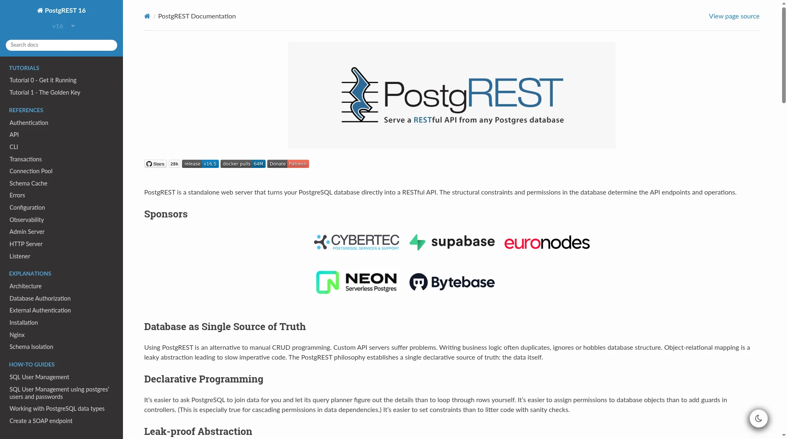

# 在 Sealos 上部署和托管 PostgREST

PostgREST 可以把 PostgreSQL 数据库直接变成 RESTful API。此模板会在 Sealos Cloud 上部署 PostgREST，并配套托管的 PostgreSQL 数据库、带示例 `todos` 表的 `api` schema 初始化、JWT 鉴权和公开 HTTPS 访问入口。



## 关于托管 PostgREST

PostgREST 是一个独立的 Web 服务器，它读取 PostgreSQL 的 schema，并将表、视图和函数作为 HTTP 接口提供。过滤、排序、分页、新增、更新以及 RPC 调用都通过 URL 和 JSON 请求体表达，权限控制则交给 PostgreSQL 的角色与授权。

此 Sealos 模板将 PostgREST 作为单个无状态 API 服务运行，并创建一个 Kubeblocks PostgreSQL 数据库存储数据。一次性初始化任务会创建 `postgrest` 数据库、`api` schema、`anon` 与 `authenticated` 角色，以及示例表 `api.todos`，部署完成后即可直接调用 API。

Sealos 会自动配置公开 HTTPS 路由、服务发现、数据库持久化存储和资源限制。根路径返回的 OpenAPI 文档会使用生成的 Sealos 域名作为服务地址。

## 常见使用场景

- **前端即时后端**：无需编写后端代码，即可为 Web 或移动应用提供 CRUD API。
- **内部工具与看板**：把精选的视图和表开放给管理后台、低代码工具或 BI 客户端。
- **数据库优先的 API**：在 SQL 函数中实现业务逻辑，并通过 `/rpc/<function>` 调用。
- **快速原型**：修改 schema 后立即测试对应的 REST API。
- **行级安全 API**：结合 JWT 声明与 PostgreSQL 行级安全（RLS）实现按用户的数据访问控制。

## PostgREST 托管依赖

Sealos 模板包含全部运行组件：PostgREST 容器镜像（v16.5）、PostgreSQL `postgresql-16.4.0` 数据库、数据库初始化任务、Kubernetes Service、Ingress 和 Sealos 应用入口。

### 部署依赖

- [PostgREST 官网](https://postgrest.org/) - 项目介绍
- [PostgREST 文档](https://docs.postgrest.org/en/stable/) - 配置、API 与鉴权参考
- [PostgREST GitHub 仓库](https://github.com/PostgREST/postgrest) - 源码与发布记录
- [PostgREST Docker 镜像](https://hub.docker.com/r/postgrest/postgrest) - 官方容器镜像

### 实现细节

**架构组件：**

此模板会部署以下服务：

- **PostgREST API 服务**：运行 `postgrest/postgrest` v16.5（digest 固定），监听 `3000` 端口，提供 REST API 与 OpenAPI 文档。
- **PostgreSQL**：Kubeblocks 托管的 PostgreSQL `postgresql-16.4.0`，存储数据，并通过角色与授权定义 API 权限。
- **PostgreSQL 初始化任务**：幂等创建 `postgrest` 数据库、`api` schema、`anon` 与 `authenticated` 角色、示例表 `api.todos` 及默认权限。
- **Schema 就绪检查**：初始化容器会等待 `api` schema 和 `anon` 角色就绪后再启动 PostgREST，避免冷启动反复重启。
- **Ingress 与应用入口**：Sealos 通过 HTTPS 域名暴露 API，并创建控制台入口。

**配置：**

模板会自动配置：

- `PGRST_DB_URI`：来自 Kubeblocks PostgreSQL 连接 Secret，指向 `postgrest` 数据库。
- `PGRST_DB_SCHEMAS=api`：只暴露 `api` schema。
- `PGRST_DB_ANON_ROLE=anon`：未认证请求使用的角色。
- `PGRST_JWT_SECRET`：自动生成的 48 位密钥。
- `PGRST_OPENAPI_SERVER_PROXY_URI`：`https://${{ defaults.app_host }}.${{ SEALOS_CLOUD_DOMAIN }}`。

部署时无需填写任何参数。

**许可证信息：**

PostgREST 基于 MIT 许可证发布。此 Sealos 模板不会改变上游许可证。

## 为什么在 Sealos 上部署 PostgREST？

Sealos 是一个基于 Kubernetes 的 AI 辅助云操作系统，覆盖从云端 IDE 开发到生产部署与管理的完整应用生命周期。在 Sealos 上部署 PostgREST，你可以获得：

- **一键部署**：通过一个模板部署 PostgREST、PostgreSQL、网络和控制台入口。
- **无需 Kubernetes 专业知识**：无需手写清单即可获得 Kubernetes 级别的可靠性。
- **内置持久化存储**：数据库数据在重启和更新后仍会保留。
- **即时公网访问**：每个部署都会获得可供 API 客户端使用的 HTTPS 地址。
- **轻松自定义**：通过 Sealos Canvas 和 AI 对话调整环境变量与资源。
- **按量付费**：PostgREST 非常轻量，可从小规格起步，流量增长后再扩容。

在 Sealos 上部署 PostgREST，把精力放在数据模型上，而不是基础设施运维。

## 部署指南

1. 打开 [PostgREST 模板](https://sealos.io/products/app-store/postgrest)，点击 **Deploy Now**。
2. 保持默认参数即可，无需填写任何输入。
3. 等待部署完成，通常需要 2-3 分钟。部署完成后会跳转到 Canvas。后续如需修改，可在 AI 对话中描述需求，或点击相应资源卡片修改设置。
4. 从应用入口打开生成的 PostgREST 地址。根路径返回 API 的 OpenAPI（Swagger 2.0）JSON 描述。
5. 试用示例表：`curl https://<your-app-url>/todos`。

## 鉴权与访问

PostgREST 没有 Web 界面、登录页或用户注册功能。访问权限由 PostgreSQL 角色控制，并通过 JSON Web Token（JWT）选择角色：

- **匿名访问**：不带 `Authorization` 请求头的请求以 `anon` 角色执行。模板默认授予 `anon` 对 `api` schema 中表的读写权限，方便立即测试。存放真实数据前请收回这些权限，例如 `REVOKE INSERT, UPDATE, DELETE ON ALL TABLES IN SCHEMA api FROM anon;`。
- **JWT 访问**：发送 `Authorization: Bearer <token>`，token 需使用 `PGRST_JWT_SECRET` 以 HS256 签名。`role` 声明决定数据库角色，例如 `authenticated`。

在 Canvas 中打开 PostgREST Deployment 资源卡片，查看环境变量 `PGRST_JWT_SECRET` 即可获取密钥。可以用 Python 生成测试 token：

```bash
python3 - <<'PY'
import base64, hashlib, hmac, json, time
secret = "<PGRST_JWT_SECRET>"
enc = lambda b: base64.urlsafe_b64encode(b).rstrip(b"=").decode()
header = enc(json.dumps({"alg": "HS256", "typ": "JWT"}).encode())
payload = enc(json.dumps({"role": "authenticated", "exp": int(time.time()) + 3600}).encode())
sig = enc(hmac.new(secret.encode(), f"{header}.{payload}".encode(), hashlib.sha256).digest())
print(f"{header}.{payload}.{sig}")
PY
```

然后调用 API：

```bash
# 匿名读取
curl https://<your-app-url>/todos

# 认证后新增
curl -X POST https://<your-app-url>/todos \
  -H "Authorization: Bearer <token>" \
  -H "Content-Type: application/json" \
  -H "Prefer: return=representation" \
  -d '{"task": "learn PostgREST"}'
```

无效或过期的 token 会返回 HTTP `401`。生产环境中请由你自己的认证服务使用同一密钥签发 token。

## 配置

部署完成后，可以通过以下方式配置 PostgREST：

- **在 PostgreSQL 中执行 SQL**：在 `api` schema 中创建表、视图和函数，并授权给 `anon` 或 `authenticated`。执行 `NOTIFY pgrst, 'reload schema';` 刷新 schema 缓存。
- **环境变量**：在 Deployment 资源卡片中调整 `PGRST_*` 配置，详见[配置参考](https://docs.postgrest.org/en/stable/references/configuration.html)。
- **Sealos AI 对话**：描述修改需求，由 AI 完成变更。
- **资源卡片**：在 Canvas 中查看并调整 Deployment、PostgreSQL 和 Ingress。

## 扩展

PostgREST 是无状态服务。在 Canvas 中打开 Deployment 资源卡片，即可提高 CPU、内存或副本数。查询负载较高时，也请同步提升 PostgreSQL 集群资源。

## 故障排查

### 新建的表没有出现在 API 中

确认表位于 `api` schema 中、已向所用角色授权，并执行 `NOTIFY pgrst, 'reload schema';` 重新加载 schema 缓存。

### 请求返回 401 JWT 错误

检查 token 是否使用准确的 `PGRST_JWT_SECRET` 以 HS256 签名、是否已过期，以及 `role` 声明是否为已存在的数据库角色。

### 请求返回 404 PGRST205

请求的表或视图不在暴露的 `api` schema 中，或当前角色不可见。

### 获取帮助

- [PostgREST 文档](https://docs.postgrest.org/en/stable/)
- [PostgREST GitHub Issues](https://github.com/PostgREST/postgrest/issues)
- [Sealos Discord](https://discord.gg/wdUn538zVP)

## 其他资源

- [PostgREST 教程：JWT 鉴权](https://docs.postgrest.org/en/stable/tutorials/tut1.html)
- [PostgREST API 参考](https://docs.postgrest.org/en/stable/references/api.html)
- [PostgREST 发布记录](https://github.com/PostgREST/postgrest/releases)

## 许可证

此 Sealos 模板遵循本仓库的模板许可证。PostgREST 本身基于 MIT 许可证发布。
