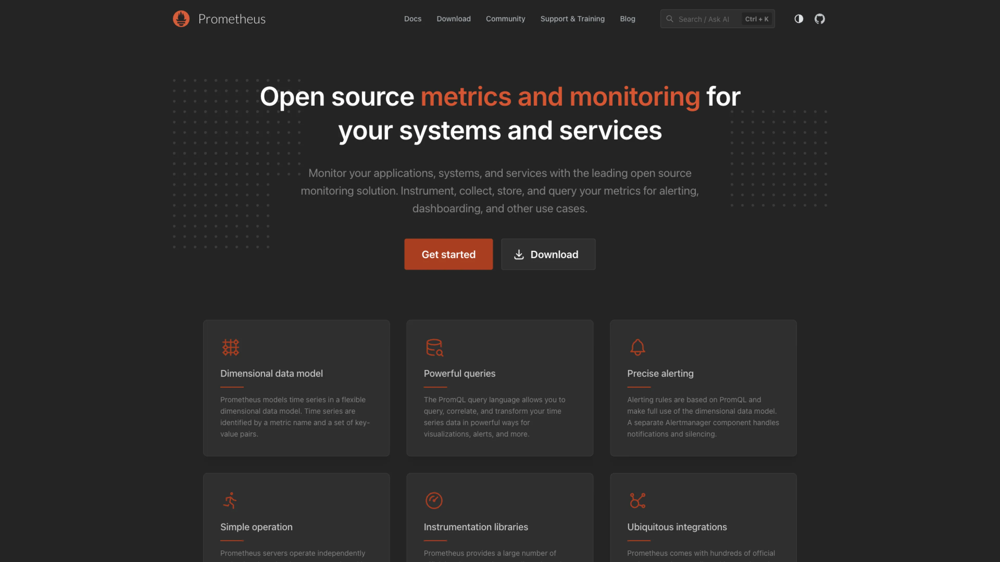

# Deploy and Host Prometheus on Sealos

Prometheus is an open-source monitoring system and time-series database that collects metrics, evaluates PromQL queries, and powers alerting for cloud-native workloads.

## About Hosting Prometheus

This template runs the official Prometheus image as a single StatefulSet on Sealos with a 1 GiB persistent volume. The server uses its bundled configuration, stores samples under `/prometheus`, and keeps the newest 24 hours or 800 MB of data.

The public URL opens the Prometheus web UI, where you can run PromQL queries, inspect targets, and review alert rules. Edit the ConfigMap or mount a custom `prometheus.yml` when you need scrape targets that match your own services.

## Common Use Cases

- Collect metrics from Kubernetes workloads, nodes, and exporters.
- Explore time-series data with PromQL and the built-in graphing console.
- Define recording and alerting rules for service health.
- Validate dashboards before connecting them to Grafana.
- Keep a short-retention metrics store for development and staging environments.

## Dependencies for Prometheus Hosting

- A Sealos workspace with CPU, memory, and storage quota.
- A 1 GiB persistent volume for the time-series database.
- Network reachability from Prometheus to every configured scrape target.
- Optional exporters such as node-exporter or application `/metrics` endpoints.

## Why Deploy Prometheus on Sealos?

- One-click deployment with a ready-to-use Prometheus server and public HTTPS endpoint.
- Kubernetes-native scheduling, health probes, and automatic pod recovery.
- Persistent storage that survives pod restarts and rescheduling.
- Pay-as-you-go resource cards sized for small and medium monitoring workloads.
- Canvas view for inspecting the StatefulSet, Service, Ingress, and PVC.
- AI dialog for deployment questions directly from the Sealos desktop.

## Deployment Guide

1. Open the [Prometheus template](https://sealos.io/products/app-store/prometheus) and click **Deploy Now**.
2. Keep the generated name or set your own, confirm the 1 GiB storage plan, and submit the deployment.
3. Wait 2-3 minutes for the StatefulSet to become ready, then open the public URL from the App card.
4. Run `up` in the query console and switch to the Graph tab to confirm the server is collecting data.
5. Add your scrape targets to the Prometheus configuration and restart the pod to apply them.

## License

Prometheus is released under the [Apache License 2.0](https://github.com/prometheus/prometheus/blob/main/LICENSE).
