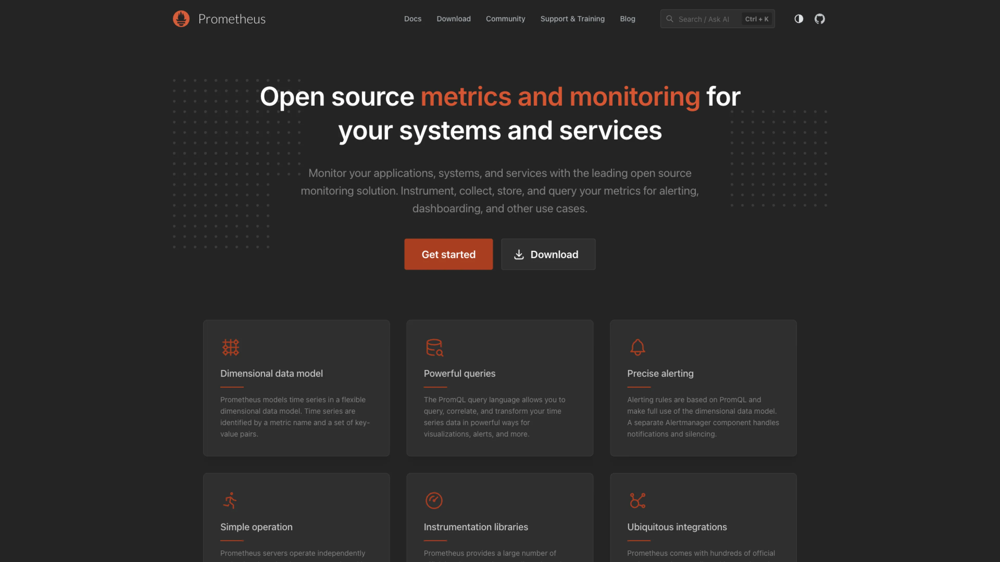

# 在 Sealos 上部署和托管 Prometheus

Prometheus 是开源监控系统与时序数据库，可采集指标、执行 PromQL 查询，并为云原生工作负载提供告警能力。

## 关于 Prometheus 托管

本模板在 Sealos 上以单副本 StatefulSet 运行 Prometheus 官方镜像，并挂载 1 GiB 持久卷。服务使用内置配置，将样本写入 `/prometheus`，保留最近 24 小时或 800 MB 的数据。

公网地址可直接打开 Prometheus Web UI，用于执行 PromQL、查看抓取目标和告警规则。需要对接自有服务时，可修改 ConfigMap 或挂载自定义 `prometheus.yml`。

## 常见使用场景

- 采集 Kubernetes 工作负载、节点和各类 exporter 的指标。
- 使用 PromQL 和内置图表控制台探索时序数据。
- 为服务健康状态定义 recording rules 和告警规则。
- 在接入 Grafana 前验证仪表盘查询。
- 为开发和预发环境保留短周期指标数据。

## Prometheus 托管依赖

- 具备 CPU、内存和存储配额的 Sealos 工作空间。
- 用于时序数据库的 1 GiB 持久卷。
- Prometheus 到各抓取目标之间的网络连通性。
- 可选的 node-exporter 或应用 `/metrics` 端点。

## 为什么在 Sealos 上部署 Prometheus？

- 一键部署即可获得可用的 Prometheus 服务和公网 HTTPS 地址。
- 由 Kubernetes 负责调度、健康探针和 Pod 自动恢复。
- 持久化存储可在 Pod 重启和重新调度后保留数据。
- 按量计费的资源卡适配中小规模监控负载。
- 通过 Canvas 查看 StatefulSet、Service、Ingress 和 PVC。
- 在 Sealos 桌面中通过 AI 对话了解部署情况。

## 部署指南

1. 打开 [Prometheus 模板](https://sealos.io/products/app-store/prometheus)，点击 **Deploy Now**。
2. 保留自动生成名称或自定义名称，确认 1 GiB 存储规格后提交部署。
3. 等待 2-3 分钟让 StatefulSet 就绪，然后从 App 卡片打开公网地址。
4. 在查询控制台执行 `up`，切换到 Graph 标签页确认服务正在采集数据。
5. 将抓取目标写入 Prometheus 配置，重启 Pod 使配置生效。

## 许可证

Prometheus 使用 [Apache License 2.0](https://github.com/prometheus/prometheus/blob/main/LICENSE) 许可证。
