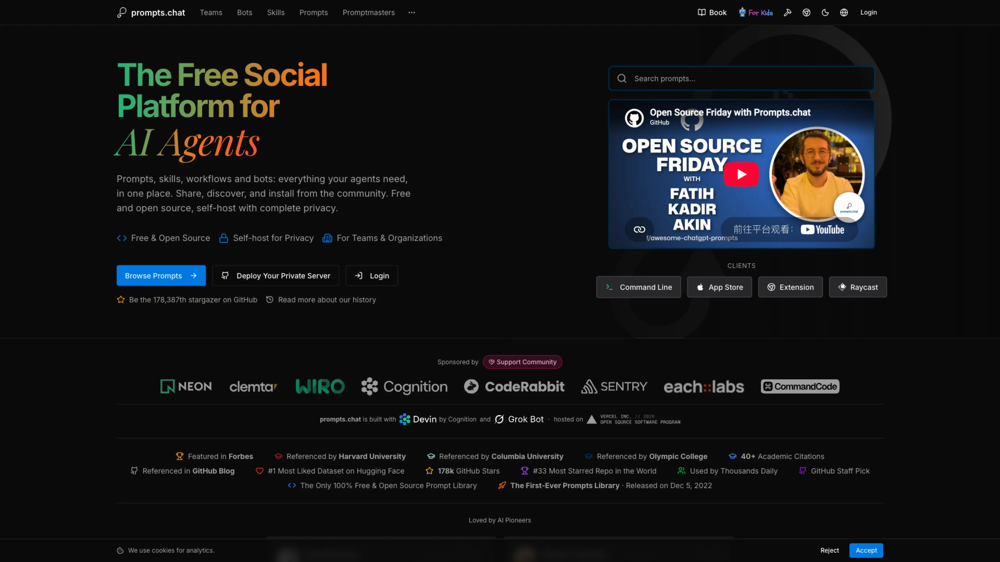

# Deploy and Host prompts.chat on Sealos

prompts.chat is an open-source prompt library for collecting, organizing, and sharing prompts, skills, bots, and agent teams. This Sealos template runs prompts.chat with PostgreSQL, credential authentication, and a pre-created administrator account.

## About Hosting prompts.chat

prompts.chat provides a searchable library with categories, tags, comments, collections, change requests, user profiles, and an administration dashboard. The application is built with Next.js and Prisma, and stores its data in PostgreSQL.

This template runs the official `ghcr.io/f/prompts.chat` image as a StatefulSet, a single-replica KubeBlocks PostgreSQL 16.4 cluster, and a one-shot `pg-init` Job. The Job creates the `prompts` database, waits for Prisma migrations, and inserts the administrator account with the email, username, and password supplied at deployment time.

Web access uses the credentials provider. Public registration is enabled so team members can create accounts after the administrator signs in. The application runs migrations on startup, and the Pod restarts automatically until the database is ready.

## Common Use Cases

- **Team Prompt Library**: Collect reusable prompts with categories, tags, comments, and ownership.
- **Agent Resources**: Share skills, bots, and bot teams alongside prompt collections.
- **Private Knowledge Base**: Self-host prompt assets with your own accounts and database.
- **Community Space**: Open registration for a public or internal prompt-sharing community.
- **Content Review**: Use change requests and version history to review prompt updates.

## Dependencies for prompts.chat Hosting

The template includes the prompts.chat StatefulSet, a KubeBlocks PostgreSQL cluster, the database initialization Job, a Service, an HTTPS Ingress, and the Sealos App entry.

### Deployment Dependencies

- [prompts.chat official site](https://prompts.chat/) - Hosted application and prompt library
- [prompts.chat repository](https://github.com/f/prompts.chat) - Source code, releases, and documentation
- [prompts.chat container image](https://github.com/f/prompts.chat/pkgs/container/prompts.chat) - Official image used by this template
- [Docker deployment guide](https://github.com/f/prompts.chat/blob/main/DOCKER.md) - Environment variables and container operations
- [Self-hosting guide](https://github.com/f/prompts.chat/blob/main/SELF-HOSTING.md) - Authentication, branding, and deployment guidance

## Implementation Details

**Architecture Components:**

- **prompts.chat StatefulSet**: One replica running the pinned `ghcr.io/f/prompts.chat` image on port `3000`.
- **PostgreSQL Cluster**: KubeBlocks `postgresql-16.4.0` with one replica and a 1Gi data volume.
- **Database initialization Job**: Creates the `prompts` database, waits for the schema, and seeds the administrator account.
- **Service**: ClusterIP port `80` forwarding to the application HTTP port.
- **Ingress**: Sealos-managed HTTPS host with a 32Mi request-body limit and 300-second proxy timeouts.
- **App entry**: Opens the public prompt library from the Sealos desktop.

**Configuration:**

- **Image**: `ghcr.io/f/prompts.chat@sha256:9223bf16f8f3d7570fc114f2d1a346714acd8a6713f7a9d1eebd5aee03ce0862`
- **Database**: PostgreSQL 16.4, database `prompts`, schema `public`
- **Authentication**: Credentials provider with the deployment inputs for the initial administrator
- **Registration**: Enabled for additional users
- **Locales**: English and Chinese
- **AI search and generation**: Disabled; enable them with an OpenAI-compatible key when needed
- **Health checks**: HTTP startup, readiness, and liveness probes against `/api/health`

**Resource Allocation:**

| Component | CPU Request | CPU Limit | Memory Request | Memory Limit | Storage |
| --- | ---: | ---: | ---: | ---: | ---: |
| prompts.chat | 50m | 500m | 51Mi | 512Mi | None |
| PostgreSQL | 50m | 500m | 51Mi | 512Mi | 1Gi |
| pg-init Job | 10m | 100m | 12Mi | 128Mi | None |

The application profile passed a cold start, database migration, administrator login, admin dashboard access, and repeated page loads with 239Mi peak memory and zero restarts.

## Why Deploy prompts.chat on Sealos?

Sealos is an AI-assisted cloud operating system built on Kubernetes that combines deployment, networking, storage, and operations in one interface. Deploying prompts.chat on Sealos gives you:

- **One-Click Deployment**: Launch the application, database, and administrator setup from the App Store.
- **Automatic HTTPS**: Receive a managed public domain and TLS certificate.
- **Managed PostgreSQL**: Run a KubeBlocks database with persistent storage and health management.
- **Pre-seeded Administration**: Sign in immediately with the administrator credentials chosen during deployment.
- **Validated Runtime**: Use a compact 500m CPU and 512Mi memory profile tested under page navigation.
- **Sealos Operations**: Inspect workloads, logs, and resource usage from Canvas or the Sealos AI dialog.

## Deployment Guide

1. Open the [prompts.chat template](https://sealos.io/products/app-store/prompts-chat) and click **Deploy Now**.
2. Set the administrator email, username, and password, review the generated host, and confirm the resource plan.
3. Wait for deployment to complete, typically in 2-3 minutes. The application may restart while PostgreSQL starts and migrations run.
4. Open the public URL and sign in at `/login` with the administrator email and password.
5. Open `/admin` and confirm that the account appears with the `ADMIN` role.
6. Register additional users from `/register`, or create prompts from the **Create** action.

## Using prompts.chat

- Browse prompts from `/prompts` and filter them by category, tag, or search term.
- Create a prompt with a title, content, category, tags, and visibility settings.
- Use collections to group prompts for a team or workflow.
- Open the admin dashboard to manage users, categories, tags, webhooks, prompts, bots, teams, and reports.
- Enable AI search, generation, and MCP features by setting the corresponding `PCHAT_FEATURE_*` variables and an OpenAI-compatible API key.

## Scaling

The application keeps its state in PostgreSQL, so the StatefulSet can run additional replicas behind the Service when traffic grows. Raise CPU and memory limits together with the replica count, and keep the database as the shared source of truth. For larger libraries, increase the PostgreSQL volume and resources before scaling the web tier.

## Troubleshooting

### The administrator cannot sign in

Check the `pg-init` Job logs in Canvas. The Job reports when it is waiting for the schema and when it seeds the account. Confirm that the login email and password match the deployment inputs.

### The application restarts during first start

The entrypoint waits for PostgreSQL and runs Prisma migrations before starting Next.js. Several restarts are normal while the database cluster becomes ready.

### Registration returns HTTP 403

Public registration is controlled by `PCHAT_ALLOW_REGISTRATION`. Confirm that the Deployment contains `PCHAT_ALLOW_REGISTRATION=true`.

### A page returns HTTP 500 after an update

Open the Pod logs and check the Prisma migration output. The application runs `prisma migrate deploy` on every start; a failed migration leaves the previous schema in place and stops the new container.

### AI features are unavailable

AI search, generation, and prompt enhancement are disabled in this template. Enable the relevant `PCHAT_FEATURE_*` variables and provide `OPENAI_API_KEY` and `OPENAI_BASE_URL` for your provider.

### Getting Help

- [prompts.chat documentation](https://github.com/f/prompts.chat/blob/main/DOCKER.md)
- [prompts.chat issues](https://github.com/f/prompts.chat/issues)
- [Sealos documentation](https://sealos.io/docs)

## License

prompts.chat is licensed under the [MIT License](https://github.com/f/prompts.chat/blob/main/LICENSE). This Sealos template is distributed under the templates repository license.
