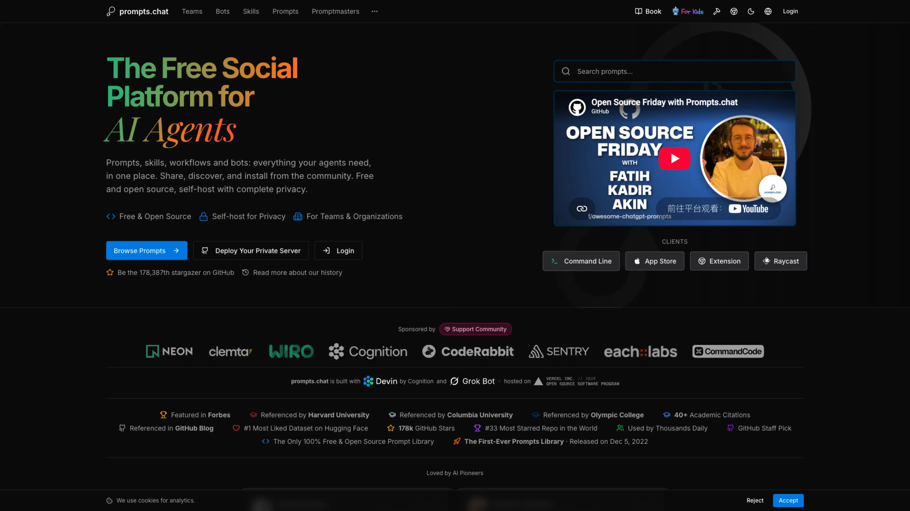

# 在 Sealos 上部署和托管 prompts.chat

prompts.chat 是开源提示词库，用于收集、整理和分享提示词、技能、机器人与智能体团队。本 Sealos 模板运行 prompts.chat，内置 PostgreSQL、凭据登录和预置管理员账号。

## 关于 prompts.chat 托管

prompts.chat 提供可搜索的提示词库，支持分类、标签、评论、收藏、变更请求、用户资料和管理面板。应用基于 Next.js 与 Prisma 构建，数据保存在 PostgreSQL。

本模板运行官方 `ghcr.io/f/prompts.chat` 镜像的 StatefulSet、单副本 KubeBlocks PostgreSQL 16.4 集群，以及一次性 `pg-init` Job。Job 创建 `prompts` 数据库，等待 Prisma 迁移完成，然后使用部署时填写的邮箱、用户名和密码写入管理员账号。

Web 访问使用凭据登录。公共注册默认开启，团队成员可以在管理员登录后自行创建账号。应用启动时自动执行数据库迁移；数据库未就绪时 Pod 会自动重启并重试。

## 常见使用场景

- **团队提示词库**：按分类、标签、评论和归属关系收集可复用提示词。
- **智能体资源中心**：在同一站点分享技能、机器人及机器人团队。
- **私有知识库**：使用自有账号和数据库托管提示词资产。
- **社区空间**：开放注册，构建公开或内部的提示词分享社区。
- **内容评审**：通过变更请求和版本历史审核提示词更新。

## prompts.chat 托管依赖

模板包含 prompts.chat StatefulSet、KubeBlocks PostgreSQL 集群、数据库初始化 Job、Service、HTTPS Ingress 和 Sealos App 入口。

### 部署依赖

- [prompts.chat 官网](https://prompts.chat/) - 在线应用与提示词库
- [prompts.chat 仓库](https://github.com/f/prompts.chat) - 源代码、发布版本与文档
- [prompts.chat 容器镜像](https://github.com/f/prompts.chat/pkgs/container/prompts.chat) - 本模板使用的官方镜像
- [Docker 部署指南](https://github.com/f/prompts.chat/blob/main/DOCKER.md) - 环境变量与容器运维
- [自托管指南](https://github.com/f/prompts.chat/blob/main/SELF-HOSTING.md) - 认证、品牌和部署说明

## 实现细节

**架构组件：**

- **prompts.chat StatefulSet**：单副本运行固定版本的 `ghcr.io/f/prompts.chat` 镜像，监听 `3000` 端口。
- **PostgreSQL 集群**：KubeBlocks `postgresql-16.4.0`，单副本，1Gi 数据卷。
- **数据库初始化 Job**：创建 `prompts` 数据库，等待表结构就绪，并写入管理员账号。
- **Service**：ClusterIP 的 `80` 端口转发到应用 HTTP 端口。
- **Ingress**：Sealos 管理的 HTTPS 域名，请求体上限 32Mi，代理超时 300 秒。
- **App 入口**：从 Sealos 桌面直接打开公网提示词库。

**配置：**

- **镜像**：`ghcr.io/f/prompts.chat@sha256:9223bf16f8f3d7570fc114f2d1a346714acd8a6713f7a9d1eebd5aee03ce0862`
- **数据库**：PostgreSQL 16.4，数据库 `prompts`，Schema `public`
- **认证**：凭据登录，初始管理员来自部署输入
- **注册**：开放，供其他用户创建账号
- **语言**：英文与中文
- **AI 搜索与生成**：默认关闭；需要时配置 OpenAI 兼容密钥后开启
- **健康检查**：对 `/api/health` 执行 HTTP 启动、就绪和存活探针

**资源分配：**

| 组件 | CPU 请求 | CPU 限制 | 内存请求 | 内存限制 | 存储 |
| --- | ---: | ---: | ---: | ---: | ---: |
| prompts.chat | 50m | 500m | 51Mi | 512Mi | 无 |
| PostgreSQL | 50m | 500m | 51Mi | 512Mi | 1Gi |
| pg-init Job | 10m | 100m | 12Mi | 128Mi | 无 |

应用规格通过了冷启动、数据库迁移、管理员登录、管理面板访问和连续页面加载。内存峰值为 239Mi，Pod 重启次数为 0。

## 为什么在 Sealos 上部署 prompts.chat？

Sealos 是构建在 Kubernetes 之上的 AI 辅助云操作系统，将部署、网络、存储和运维统一在一个界面中。在 Sealos 上部署 prompts.chat 可以带来：

- **一键部署**：从应用商店同时创建应用、数据库和管理员账号。
- **自动 HTTPS**：自动获得公网域名和 TLS 证书。
- **托管 PostgreSQL**：使用具备持久化存储与健康管理的 KubeBlocks 数据库。
- **预置管理权限**：使用部署时填写的管理员凭据直接登录。
- **经验证的运行规格**：在页面导航压力下验证了 500m CPU 与 512Mi 内存配置。
- **Sealos 运维**：在 Canvas 或 Sealos AI 对话中查看工作负载、日志和资源用量。

## 部署指南

1. 打开 [prompts.chat 模板](https://sealos.io/products/app-store/prompts-chat)，点击 **Deploy Now**。
2. 设置管理员邮箱、用户名和密码，检查自动生成的域名，确认资源规格。
3. 等待部署完成，通常需要 2-3 分钟。PostgreSQL 启动和迁移期间应用可能重启。
4. 打开公网地址，在 `/login` 使用管理员邮箱和密码登录。
5. 打开 `/admin`，确认账号显示 `ADMIN` 角色。
6. 通过 `/register` 注册其他用户，或使用 **Create** 操作创建提示词。

## 使用 prompts.chat

- 在 `/prompts` 浏览提示词，并按分类、标签或搜索词筛选。
- 创建提示词时填写标题、正文、分类、标签和可见性。
- 使用收藏夹按团队或工作流组织提示词。
- 在管理面板中管理用户、分类、标签、Webhook、提示词、机器人、团队和举报。
- 需要 AI 搜索、生成或 MCP 功能时，设置对应的 `PCHAT_FEATURE_*` 变量并配置 OpenAI 兼容 API 密钥。

## 扩缩容

应用状态保存在 PostgreSQL，流量增长时可以在 Service 后运行多个 StatefulSet 副本。扩副本时同步提高 CPU 和内存限制，并保持数据库作为共享数据源。提示词库规模增长时，优先扩容 PostgreSQL 存储和资源，再扩容 Web 层。

## 故障排查

### 管理员无法登录

在 Canvas 中查看 `pg-init` Job 日志。Job 会输出等待表结构和写入管理员账号的记录。确认登录邮箱和密码与部署输入一致。

### 首次启动时应用反复重启

入口脚本会等待 PostgreSQL 并执行 Prisma 迁移，然后启动 Next.js。数据库集群就绪前出现多次重启属于正常现象。

### 注册返回 HTTP 403

公共注册由 `PCHAT_ALLOW_REGISTRATION` 控制。确认 Deployment 中包含 `PCHAT_ALLOW_REGISTRATION=true`。

### 更新后页面返回 HTTP 500

查看 Pod 日志中的 Prisma 迁移输出。应用每次启动都会执行 `prisma migrate deploy`，迁移失败时旧容器停止，新容器不会继续启动。

### AI 功能不可用

本模板默认关闭 AI 搜索、生成和提示词增强。开启对应的 `PCHAT_FEATURE_*` 变量，并配置服务商提供的 `OPENAI_API_KEY` 与 `OPENAI_BASE_URL`。

### 获取帮助

- [prompts.chat 文档](https://github.com/f/prompts.chat/blob/main/DOCKER.md)
- [prompts.chat Issues](https://github.com/f/prompts.chat/issues)
- [Sealos 文档](https://sealos.io/docs)

## 许可证

prompts.chat 使用 [MIT License](https://github.com/f/prompts.chat/blob/main/LICENSE) 许可证。本 Sealos 模板遵循 templates 仓库许可证。
