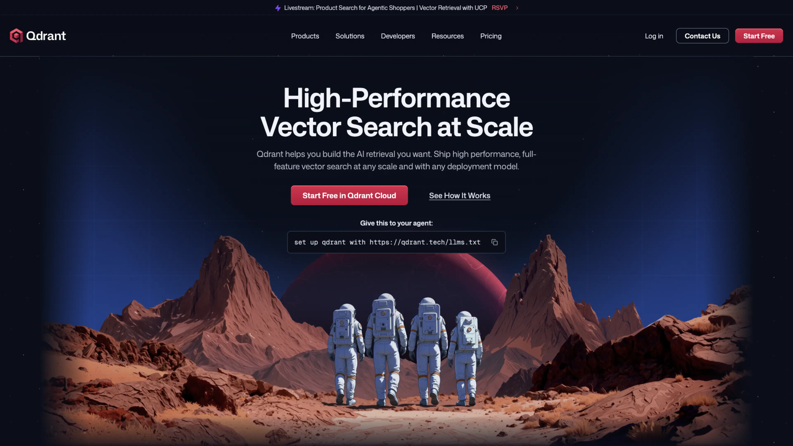

# Deploy and Host Qdrant on Sealos

Qdrant is a high-performance vector database and similarity search engine for embeddings, recommendation systems, and retrieval-augmented AI applications.

## About Hosting Qdrant

This template runs the official Qdrant image as a single StatefulSet with a 1 GiB persistent volume mounted at `/qdrant/storage`. It exposes the REST API on the public HTTPS endpoint and the gRPC API on port 6334 inside the cluster.

The dashboard is available at `/dashboard`, where you can create collections, inspect points, and run similarity queries. The REST API is available at `/collections` and related endpoints for client libraries.

## Common Use Cases

- Store and search embeddings for RAG and semantic search applications.
- Build recommendation and similarity matching services.
- Prototype vector search with the Qdrant dashboard and REST API.
- Keep a dedicated vector store for AI agents and chatbots.
- Benchmark collection layouts before scaling to production traffic.

## Dependencies for Qdrant Hosting

- A Sealos workspace with CPU, memory, and storage quota.
- A 1 GiB persistent volume for collections and indexes.
- An embedding model or service that produces vectors for ingestion.
- An API key configuration when the deployment is exposed to untrusted clients.

## Why Deploy Qdrant on Sealos?

- One-click deployment with a public HTTPS REST endpoint.
- Kubernetes health probes, scheduling, and automatic pod recovery.
- Persistent storage for collections, payloads, and indexes.
- Pay-as-you-go resource cards that fit development and small production datasets.
- Canvas view for inspecting the StatefulSet, Service, Ingress, and PVC.
- AI dialog for deployment questions in the Sealos desktop.

## Deployment Guide

1. Open the [Qdrant template](https://sealos.io/products/app-store/qdrant) and click **Deploy Now**.
2. Keep the generated application name, confirm the 1 GiB storage plan, and submit the deployment.
3. Wait 2-3 minutes for the StatefulSet to become ready, then open the public URL and append `/dashboard`.
4. Create a collection, insert a few test vectors, and run a similarity query from the dashboard.
5. Enable an API key in the Qdrant configuration before exposing the service to production clients.

## License

Qdrant is released under the [Apache License 2.0](https://github.com/qdrant/qdrant/blob/master/LICENSE).
