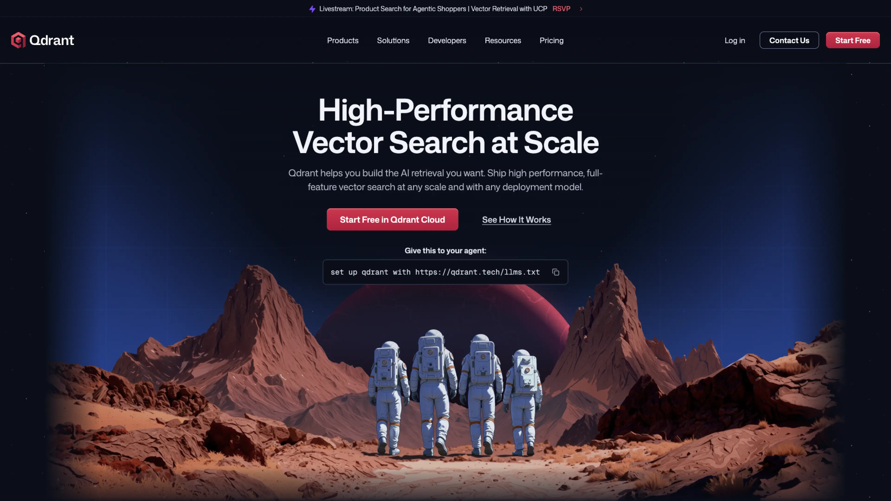

# 在 Sealos 上部署和托管 Qdrant

Qdrant 是高性能向量数据库与相似度搜索引擎，适用于嵌入向量、推荐系统和检索增强 AI 应用。本 Sealos 模板以单副本 StatefulSet 运行 Qdrant 1.20.2，提供 1Gi 存储卷和公网 HTTPS REST 端点。

## 关于 Qdrant 托管

Qdrant 保存向量与 JSON 负载，构建相似度索引，并通过 REST 和 gRPC API 提供搜索与推荐查询。Web 仪表盘支持集合管理、数据点查看和查询测试。

本模板运行一个 StatefulSet，使用 `qdrant/qdrant:v1.20.2` 镜像。REST API 监听 `6333`，gRPC 监听 `6334`。1Gi 卷挂载到 `/qdrant/storage`，保存集合、负载、索引和 WAL 数据。Service 将公网 HTTP 端口 `80` 映射到 `6333`，并在集群内暴露 gRPC 端口 `6334`。

Sealos Ingress 通过 HTTPS 发布 REST API 和仪表盘，App 入口打开 `/dashboard`。模板默认不配置 API Key，在启用认证前公网端点接受未认证请求。

## 常见使用场景

- **RAG 与语义搜索**：保存文档嵌入并为 AI 应用检索相关上下文。
- **推荐系统**：根据用户、商品或内容向量查找相似条目。
- **向量搜索验证**：在仪表盘创建集合并测试查询。
- **AI Agent 记忆**：将长期语义记忆保存在独立向量库。
- **性能评估**：在生产推广前评估集合结构和索引设置。

## Qdrant 托管依赖

模板包含 Qdrant StatefulSet、1Gi 卷、Service、HTTPS Ingress 和 Sealos App 入口。Qdrant 不需要外部数据库或缓存。

应用需要嵌入模型或服务来生成向量。面向不可信客户端前，应配置 API Key。gRPC 客户端可通过集群内 Service 的 `6334` 端口连接。

### 部署依赖

- [Qdrant 文档](https://qdrant.tech/documentation/) - 快速开始、概念与 API 指南
- [Qdrant 仓库](https://github.com/qdrant/qdrant) - 源代码与 Issue
- [Qdrant 容器镜像](https://hub.docker.com/r/qdrant/qdrant) - 本模板使用的官方镜像
- [Qdrant REST API](https://qdrant.tech/documentation/interfaces/#rest) - REST 端点参考
- [Qdrant gRPC API](https://qdrant.tech/documentation/interfaces/#grpc) - gRPC 接口参考

## 实现细节

**架构组件：**

- **Qdrant StatefulSet**：单副本运行 `qdrant/qdrant:v1.20.2`。
- **REST API**：容器端口 `6333`，通过 Service 的 `80` 端口和 HTTPS Ingress 发布。
- **gRPC API**：容器与 Service 端口 `6334`，供集群内客户端使用。
- **持久卷**：1Gi 卷挂载到 `/qdrant/storage`，保存集合与索引。
- **仪表盘**：通过公网域名的 `/dashboard` 访问。

**配置：**

- **镜像**：`qdrant/qdrant:v1.20.2`
- **REST 端口**：`6333`
- **gRPC 端口**：`6334`
- **公网 HTTP 端口**：`80`
- **持久化**：1Gi ReadWriteOnce 卷，挂载到 `/qdrant/storage`
- **认证**：默认模板未配置 API Key
- **副本数**：`1`
- **健康检查**：`/readyz` 用于启动和就绪，`/healthz` 用于存活

**资源分配：**

| 组件 | CPU 请求 | CPU 限制 | 内存请求 | 内存限制 | 存储 |
| --- | ---: | ---: | ---: | ---: | ---: |
| Qdrant | 10m | 100m | 12Mi | 128Mi | 1Gi |

该规格通过了冷启动、`/readyz` 检查、仪表盘加载、REST API 请求和稳定性验证，Pod 重启次数为 0。

## 为什么在 Sealos 上部署 Qdrant？

Sealos 是构建在 Kubernetes 之上的 AI 辅助云操作系统，将部署、网络、存储和运维统一在一个界面中。在 Sealos 上部署 Qdrant 可以带来：

- **一键向量数据库**：通过一个模板创建 Qdrant、存储和公网 HTTPS 端点。
- **集合持久化**：在 Pod 重启后保留向量、负载和索引。
- **紧凑起步**：以经验证的 100m CPU 和 128Mi 内存限制运行开发或小型生产数据集。
- **Canvas 与 AI 对话**：在一个视图中查看 StatefulSet、Service、Ingress、PVC、日志和资源卡，并通过 Sealos AI 对话调整部署。
- **REST 与 gRPC 访问**：使用公网 REST API，或在集群内连接 gRPC 客户端。
- **Kubernetes 可靠性**：使用健康探针、自动恢复和声明式资源管理。

## 部署指南

1. 打开 [Qdrant 模板](https://sealos.io/products/app-store/qdrant)，点击 **Deploy Now**。
2. 检查自动生成的应用名称，确认 1Gi 存储规格后开始部署。
3. 等待部署完成，通常需要 2-3 分钟。资源创建完成后 Sealos 会打开 Canvas。
4. 打开公网地址；App 入口未直达时，在地址后追加 `/dashboard`。
5. 从仪表盘或 REST API 创建集合，写入几条测试向量并执行相似度查询。
6. 打开 Canvas 查看 StatefulSet、Service、Ingress、PVC 和实时日志。

## 访问与安全

默认模板未配置 API Key。评估期间可保持公网地址私密；面向生产客户端前，在挂载的 Qdrant 配置中设置 `service.api_key`。REST 客户端随后通过 `api-key` 请求头传入密钥，gRPC 客户端通过请求元数据传入。

Ingress 在 `80` 端口发布 REST API 和仪表盘。gRPC 端口 `6334` 通过 ClusterIP Service 供同一集群内的工作负载访问。

## 扩缩容

模板保持单副本，因为本地存储卷是 ReadWriteOnce 磁盘。集合规模、查询率或并发搜索增加时，提高 CPU 和内存限制。向量与索引增长时，从 StatefulSet 资源卡扩展 1Gi 卷。需要高可用时，使用 Qdrant 分布式模式与共享存储，并同步调整拓扑和副本数。

## 故障排查

### REST API 返回 401

已配置 API Key。通过 `api-key` 请求头传入密钥；密钥未知时，更新挂载的 Qdrant 配置并重启 Pod。

### 创建集合时报磁盘错误

检查 PVC 使用量和 Pod 日志。模板初始卷为 1Gi，加载大型数据集前从 StatefulSet 资源卡扩展。

### gRPC 客户端无法连接

在集群内使用 `qdrant-service.namespace.svc.cluster.local:6334`。公网 Ingress 发布 HTTP `80` 端口，gRPC 保留为集群内 Service 端口。

### 搜索结果与预期不符

确认集合距离度量与嵌入模型匹配、向量维度正确，并且负载过滤使用已索引字段。

### 获取帮助

- [Qdrant 文档](https://qdrant.tech/documentation/)
- [Qdrant Issues](https://github.com/qdrant/qdrant/issues)
- [Sealos 文档](https://sealos.io/docs)

## 许可证

Qdrant 使用 [Apache License 2.0](https://github.com/qdrant/qdrant/blob/master/LICENSE) 许可证。本 Sealos 模板遵循 templates 仓库许可证。
