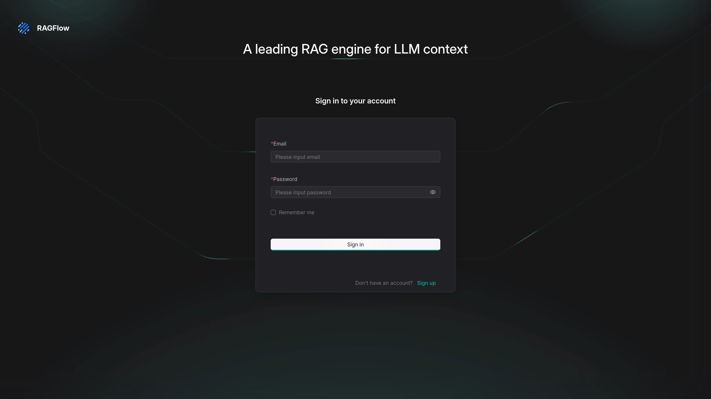

# Deploy and Host RAGFlow on Sealos

RAGFlow is an open-source retrieval-augmented generation engine for document understanding, knowledge bases, and AI agents. This template deploys RAGFlow v1.0.0 (Go rewrite) with managed MySQL, Kvrocks, NATS JetStream, Infinity, and private S3-compatible object storage on Sealos.

## About Hosting RAGFlow

RAGFlow combines document ingestion, parsing, retrieval, agent workflows, and an interactive web interface. Users can organize files into knowledge bases, connect language and embedding models, and build applications that retrieve grounded context from uploaded content.

Version 1.0.0 replaces the previous Redis-backed stack with Kvrocks and NATS JetStream, and keeps Infinity as the document engine. Sealos provisions MySQL through KubeBlocks, runs Kvrocks/NATS/Infinity as StatefulSets, creates a private Object Storage bucket for uploaded files, and publishes the RAGFlow interface through an HTTPS Ingress.

## Common Use Cases

- **Document question answering**: Build knowledge bases from manuals, reports, policies, and research material.
- **Agent context layers**: Give AI agents searchable, source-grounded context.
- **Knowledge management**: Centralize team files and retrieval workflows in a self-hosted interface.
- **RAG prototyping**: Compare parsing, chunking, retrieval, and model configurations.
- **Private AI applications**: Keep application data inside a dedicated Sealos deployment.

## Dependencies for RAGFlow Hosting

The Sealos template includes the complete storage and service topology required by RAGFlow v1.0.0.

### Deployment Dependencies

- [RAGFlow documentation](https://ragflow.io/docs/dev/) - Product and administration documentation
- [RAGFlow source repository](https://github.com/infiniflow/ragflow) - Source code and releases
- [Infinity source repository](https://github.com/infiniflow/infinity) - Document engine source and documentation
- [Model provider setup](https://ragflow.io/docs/dev/configurations#model-providers) - Language and embedding model configuration

### Implementation Details

**Architecture Components:**

- **RAGFlow**: Runs `infiniflow/ragflow:v1.0.0`, serves the web UI and API, and executes ingestion tasks.
- **Infinity**: Runs `infiniflow/infinity:v0.7.5-x64-v3` with a Sealos-sized `infinity_conf.toml` and a persistent `1Gi` data volume.
- **MySQL**: Uses a Sealos-managed KubeBlocks MySQL 8.0 cluster for application metadata.
- **Kvrocks**: Runs `apache/kvrocks:2.16.0` as the Redis-protocol key-value store used by v1.0.0.
- **NATS**: Runs `nats:2.14.2` with JetStream on a `10Gi` volume so RAGFlow’s 1Gi stream limits can be created.
- **Object Storage**: Uses a private Sealos S3-compatible bucket for uploaded file content.

**Validated resource profile (Sealos Cloud, 2026-11-09):**

- RAGFlow: `500m` CPU / `4096Mi` memory
- Infinity: `500m` CPU / `1024Mi` memory
- NATS: `500m` CPU / `512Mi` memory / `10Gi` storage
- Kvrocks: `200m` CPU / `512Mi` memory
- MySQL: `500m` CPU / `512Mi` memory

## Why Deploy RAGFlow on Sealos?

- **One-click deployment**: Open the App Store template and deploy without assembling MySQL, Kvrocks, NATS, Infinity, and object storage by hand.
- **Kubernetes foundation**: Sealos runs the stack on managed Kubernetes with health checks, HTTPS Ingress, and persistent volumes.
- **Pay-as-you-go resources**: Start from the validated CPU and memory profile and scale components independently.
- **Persistent storage**: Application metadata, Infinity indexes, Kvrocks data, NATS JetStream, and object storage remain available across restarts.
- **Public HTTPS endpoint**: Sealos publishes the RAGFlow UI with a managed certificate.
- **Canvas and AI dialog**: Use Sealos Canvas and AI dialog after deployment for day-2 operations.
- **Resource cards**: Monitor CPU, memory, and storage from the Sealos desktop resource cards.

## Deployment Guide

1. Open the [RAGFlow App Store template](https://sealos.io/products/app-store/ragflow) and click **Deploy Now**.
2. Review the generated application name and host, then confirm the deployment.
3. Wait 2-3 minutes for MySQL, Kvrocks, NATS, Infinity, and RAGFlow to become ready. After deployment, open Canvas if you want an operations workspace beside the running app.
4. Open the public HTTPS URL from the application detail page.
5. Create the first account with **Sign up** (registration is enabled by default via `REGISTER_ENABLED=1`), then sign in.
6. Configure model providers under user settings before uploading documents or creating knowledge bases.

### First login

1. Open the published HTTPS URL.
2. Choose **Sign up** and create an account with email, nickname, and password.
3. Sign in with the same credentials.
4. Add at least one chat model and one embedding model before running retrieval workflows.

## License

RAGFlow is licensed under the Apache License 2.0. See the [upstream repository](https://github.com/infiniflow/ragflow) for details.
