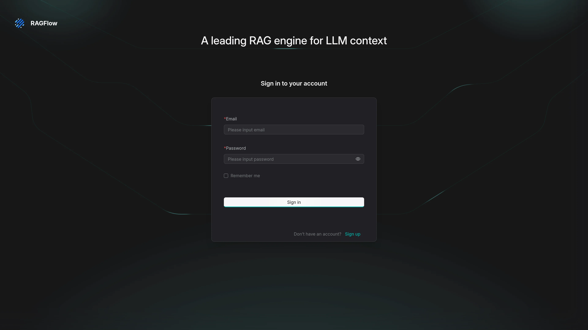

# 在 Sealos 上部署和托管 RAGFlow

RAGFlow 是一个开源 RAG 引擎，提供文档理解、知识库、智能体工作流和检索能力。本模板在 Sealos 上部署 RAGFlow v1.0.0（Go 重写版），并包含托管 MySQL、Kvrocks、NATS JetStream、Infinity 以及私有 S3 兼容对象存储。

## 关于在 Sealos 上托管 RAGFlow

RAGFlow 将文档导入、解析、检索、智能体工作流和 Web 界面组合在一起。用户可以把文件整理到知识库，接入语言模型与嵌入模型，并构建基于上传内容的检索应用。

v1.0.0 用 Kvrocks 与 NATS JetStream 替换了原先的 Redis 方案，并继续使用 Infinity 作为文档引擎。Sealos 通过 KubeBlocks 提供 MySQL，以 StatefulSet 运行 Kvrocks/NATS/Infinity，创建私有对象存储桶，并通过 HTTPS Ingress 发布 RAGFlow 界面。

## 常见使用场景

- **文档问答**：基于手册、报告、制度和研究材料构建知识库。
- **智能体上下文层**：为 AI 智能体提供可检索、有来源的上下文。
- **知识管理**：在自托管界面中集中团队文件与检索流程。
- **RAG 原型验证**：对比解析、切分、检索和模型配置。
- **私有 AI 应用**：把应用数据保留在独立的 Sealos 部署中。

## RAGFlow 托管依赖

Sealos 模板已包含 RAGFlow v1.0.0 所需的完整存储与服务拓扑。

### 部署依赖

- [RAGFlow 文档](https://ragflow.io/docs/dev/) - 产品与管理文档
- [RAGFlow 源码仓库](https://github.com/infiniflow/ragflow) - 源码与发行版
- [Infinity 源码仓库](https://github.com/infiniflow/infinity) - 文档引擎源码与文档
- [模型提供商配置](https://ragflow.io/docs/dev/configurations#model-providers) - 语言与嵌入模型配置

### 实现细节

**架构组件：**

- **RAGFlow**：运行 `infiniflow/ragflow:v1.0.0`，提供 Web UI、API 与导入任务。
- **Infinity**：运行 `infiniflow/infinity:v0.7.5-x64-v3`，挂载 Sealos 规格的 `infinity_conf.toml`，并使用 `1Gi` 持久卷。
- **MySQL**：使用 Sealos 托管的 KubeBlocks MySQL 8.0 集群保存应用元数据。
- **Kvrocks**：运行 `apache/kvrocks:2.16.0`，作为 v1.0.0 使用的 Redis 协议键值存储。
- **NATS**：运行 `nats:2.14.2`，启用 JetStream，并使用 `10Gi` 卷以满足 RAGFlow 各 1Gi 的 stream 上限。
- **对象存储**：使用私有 Sealos S3 兼容桶保存上传文件。

**已验证资源规格（Sealos Cloud，2026-11-09）：**

- RAGFlow：`500m` CPU / `4096Mi` 内存
- Infinity：`500m` CPU / `1024Mi` 内存
- NATS：`500m` CPU / `512Mi` 内存 / `10Gi` 存储
- Kvrocks：`200m` CPU / `512Mi` 内存
- MySQL：`500m` CPU / `512Mi` 内存

## 为什么在 Sealos 上部署 RAGFlow？

- **一键部署**：打开应用商店模板即可部署，无需手工拼装 MySQL、Kvrocks、NATS、Infinity 和对象存储。
- **Kubernetes 底座**：在托管 Kubernetes 上运行，具备健康检查、HTTPS Ingress 与持久卷。
- **按量计费资源**：从已验证的 CPU/内存规格起步，并按组件独立扩缩。
- **持久化存储**：应用元数据、Infinity 索引、Kvrocks 数据、NATS JetStream 与对象存储在重启后仍可保留。
- **公网 HTTPS**：Sealos 为 RAGFlow UI 签发并托管证书。
- **Canvas 与 AI 对话**：部署后可使用 Sealos Canvas 与 AI 对话做日常运维。
- **资源卡片**：在 Sealos 桌面资源卡片中查看 CPU、内存和存储。

## 部署指南

1. 打开 [RAGFlow 应用商店模板](https://sealos.io/products/app-store/ragflow) 并点击 **Deploy Now / 立即部署**。
2. 确认自动生成的应用名和域名，然后提交部署。
3. 等待 2-3 分钟，让 MySQL、Kvrocks、NATS、Infinity 和 RAGFlow 就绪。部署完成后如需运维工作区，可打开 Canvas。
4. 在应用详情页打开公网 HTTPS 地址。
5. 通过 **Sign up / 注册** 创建首个账号（默认 `REGISTER_ENABLED=1`），然后登录。
6. 上传文档或创建知识库前，先在用户设置中配置模型提供商。

### 首次登录

1. 打开发布的 HTTPS 地址。
2. 选择 **Sign up / 注册**，填写邮箱、昵称和密码创建账号。
3. 使用同一组凭据登录。
4. 开始检索流程前，至少配置一个对话模型和一个嵌入模型。

## 许可证

RAGFlow 采用 Apache License 2.0。详情见 [上游仓库](https://github.com/infiniflow/ragflow)。
