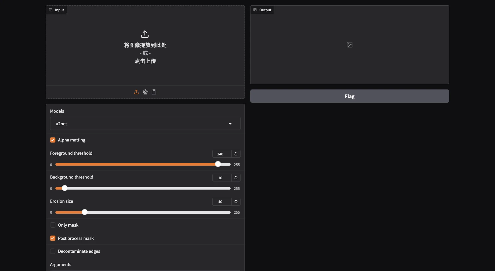

# Deploy and Host rembg on Sealos

rembg is a self-hosted background removal service powered by ONNX models, with a Gradio web interface and an HTTP API. This template deploys rembg 2.0.79 as a single StatefulSet with a 1Gi model volume and a managed HTTPS endpoint.



## About Hosting rembg

rembg runs as one Python service on port `7000` in server mode. The Gradio interface accepts an uploaded image, lets you choose a model and matting options, and returns a transparent PNG. The HTTP API exposes the same processing pipeline for scripts and backend services.

The template sets `HOME`, `U2NET_HOME`, and `XDG_CACHE_HOME` to `/data`, so downloaded ONNX models and caches live on a 1Gi volume. The first inference downloads the selected model, and later restarts load it directly from the volume. The default `u2net` model is about 176Mi and works well for general foreground removal.

Sealos provisions the StatefulSet, persistent volume, ClusterIP Service, Ingress, TLS certificate, and App card. The public URL opens the web interface; the API is available under `/api/remove` on the same host.

## Common Use Cases

- **Product photo cleanup**: Remove backgrounds from catalog images before compositing or upload.
- **Profile and avatar processing**: Generate transparent portraits for internal tools and directories.
- **Design asset preparation**: Produce cutouts for presentations, thumbnails, and marketing material.
- **Batch image pipelines**: Call the HTTP API from scripts that process uploaded images.
- **Privacy-sensitive workflows**: Keep source images and model inference on infrastructure you control.

## Dependencies for rembg Hosting

- A Sealos workspace with at least 2Gi of available memory and 1Gi of persistent storage.
- A browser for the Gradio interface.
- Outbound HTTPS access to the model source on the first inference of each model.
- A client that can send multipart form data for API calls.

### Deployment Dependencies

- [rembg GitHub repository](https://github.com/danielgatis/rembg) - Source code, models, and release notes
- [rembg usage guide](https://github.com/danielgatis/rembg#usage) - CLI, server, and Python API examples
- [rembg container image](https://hub.docker.com/r/danielgatis/rembg) - Image used by this template
- [U2-Net model](https://github.com/xuebinqin/U-2-Net) - Architecture behind the default model
- [Gradio documentation](https://www.gradio.app/docs) - Web interface framework used by rembg
- [Sealos documentation](https://sealos.io/docs) - Platform concepts and operations

## Implementation Details

**Architecture Components:**

- **rembg StatefulSet**: One replica running the pinned `danielgatis/rembg` 2.0.79 image on port `7000`.
- **Model volume**: A 1Gi volume mounted at `/data` for ONNX models, caches, and temporary files.
- **Service**: ClusterIP port `80` forwarding to the rembg HTTP port.
- **Ingress**: Sealos-managed HTTPS host with a 32Mi request body limit and 300-second proxy timeouts.
- **App entry**: Opens the Gradio interface at the generated public URL.

**Configuration:**

- **Image**: `danielgatis/rembg@sha256:bf9d6318a2fd2ede2b852ab70d3409777ed83b76bc3c6b33e506abcea0872f7e`, rembg 2.0.79
- **HTTP port**: `7000`
- **Server command**: `rembg s --host 0.0.0.0 --port 7000 --log_level info`
- **Model directory**: `/data` through `U2NET_HOME`
- **Cache directory**: `/data/.cache` through `XDG_CACHE_HOME`
- **Default model**: `u2net`
- **API route**: `POST /api/remove` with a multipart `file` field
- **Public URL**: `https://${{ defaults.app_host }}.${{ SEALOS_CLOUD_DOMAIN }}/`
- **Health probe**: `GET /`
- **Runtime user**: UID `1000`, GID `1000`, with all Linux capabilities dropped and the `RuntimeDefault` seccomp profile
- **Storage**: 1Gi at `/data`

**Resource Allocation:**

| Component | CPU Request | CPU Limit | Memory Request | Memory Limit | Storage |
| --- | ---: | ---: | ---: | ---: | ---: |
| rembg | 100m | 1 | 512Mi | 2048Mi | 1Gi |

The live Sealos test returned HTTP `200` with a PNG from `POST /api/remove`, then restarted the Pod and loaded the cached model from the volume in about eight seconds. The Pod stayed ready with this profile, used about 1Gi of resident memory after inference, and the tested values are recorded in the workload annotation.

## Why Deploy rembg on Sealos?

Sealos is an AI-assisted cloud operating system built on Kubernetes. It supplies the compute, storage, networking, and operations layer for rembg through one interface:

- **One-click deployment**: Create the StatefulSet, model volume, Service, Ingress, and App card from one template.
- **Cached models**: Keep ONNX models on a dedicated volume so restarts skip the download.
- **Managed HTTPS**: Receive a public domain and TLS certificate for the UI and API.
- **Web and API access**: Use the Gradio interface for manual work and `/api/remove` for automation.
- **Resource control**: Adjust CPU and memory from the resource card for larger images and concurrent requests.
- **Operational visibility**: Inspect Pods, logs, events, and resource usage from Canvas or the Sealos AI dialog.

## Deployment Guide

1. Open the [rembg template](https://sealos.io/products/app-store/rembg) and click **Deploy Now**.
2. Confirm the generated application name and submit the deployment.
3. Wait 2-3 minutes for the Pod to become ready and for the HTTPS certificate to be issued.
4. Open the App card. The Gradio interface shows an input image panel, a model selector, and matting controls.
5. Upload a test image, keep the default `u2net` model, and click **Flag** or the submit action.
6. Confirm that the output panel shows a transparent PNG, then test the API with `curl -F file=@image.png`.
7. Keep the model volume bound so later restarts reuse the downloaded model.

## Using rembg

The web interface processes one image at a time. Choose a model from the **Models** list, adjust **Alpha matting**, foreground and background thresholds, erosion size, and mask options, then submit the image. The output panel returns a PNG with an alpha channel.

The HTTP API accepts multipart form data:

```bash
curl -o cutout.png \
  -F file=@photo.jpg \
  https://YOUR_REMBG_HOST/api/remove
```

The `file` field is required; a request without it returns an empty response. For batch jobs, send one request per image and reuse the same host so the model stays cached in the Pod.

## Access and Security

The template exposes the web interface and API without authentication. Share the public URL only with trusted users, and add ingress authentication when the service is internal. Source images are processed in memory; the persistent volume stores models and caches.

The first request for a model downloads it from the upstream model source. Allow outbound HTTPS access from the Pod, and keep the volume bound so the download happens once per model.

## Scaling

rembg runs one replica by default because the model cache lives on a ReadWriteOnce volume and inference is CPU-bound. Scale vertically by raising CPU and memory limits for larger images, alpha matting, and concurrent requests.

The 1Gi volume holds the default model and caches. Larger models or many cached variants can outgrow the volume; expand the PVC when the storage class supports expansion. Horizontal scaling works when every replica downloads its own model or mounts shared storage, and each Pod needs enough memory for the selected model.

## Troubleshooting

### The first request takes a long time or times out

- Cause: The Pod downloads the selected ONNX model on first use.
- Solution: Wait for the download to finish, confirm outbound HTTPS access, and keep the volume bound so later requests use the cached model.

### The API returns an empty response

- Cause: The request omits the multipart `file` field or uses a JSON body.
- Solution: Send `-F file=@image.png` with `curl`, and confirm that the endpoint is `/api/remove`.

### The Pod is killed during processing

- Cause: A large image or alpha matting exceeds the 2048Mi memory limit.
- Solution: Reduce the input dimensions, disable alpha matting for large batches, and raise the memory limit from the resource card.

### Uploads fail with 413 Request Entity Too Large

- Cause: The image exceeds the 32Mi Ingress body limit.
- Solution: Resize the image before upload, or raise the Ingress body limit for the deployment.

### A model download fails

- Cause: The Pod cannot reach the model source, or `/data` is not writable by UID `1000`.
- Solution: Test the model URL from a Pod, confirm cluster egress, and inspect the Pod log for permission errors on `/data`.

### The output has rough edges

- Cause: The default matting thresholds do not fit the subject.
- Solution: Enable alpha matting, adjust the foreground and background thresholds, and try a different model for the image type.

### Getting Help

- [rembg GitHub repository](https://github.com/danielgatis/rembg)
- [rembg usage guide](https://github.com/danielgatis/rembg#usage)
- [rembg GitHub issues](https://github.com/danielgatis/rembg/issues)
- [Sealos documentation](https://sealos.io/docs)

## License

rembg is released under the [MIT License](https://github.com/danielgatis/rembg/blob/main/LICENSE). This Sealos template is an independent deployment definition and is distributed under the templates repository license.
