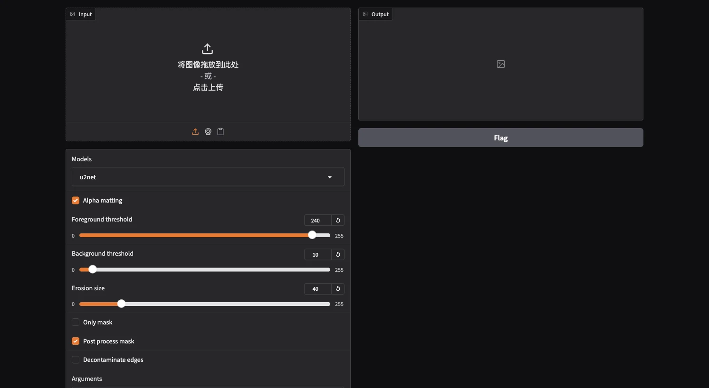

# 在 Sealos 上部署和托管 rembg

rembg 是一款基于 ONNX 模型的自托管图片背景移除服务，提供 Gradio Web 界面和 HTTP API。本模板将 rembg 2.0.79 部署为单个 StatefulSet，配置 1Gi 模型卷和托管 HTTPS 地址。



## 关于托管 rembg

rembg 以单个 Python 服务运行，在 `7000` 端口提供 Server 模式。Gradio 界面接收上传图片，允许选择模型和抠图选项，并返回透明 PNG。HTTP API 为脚本和后端服务提供相同的处理链路。

模板将 `HOME`、`U2NET_HOME` 和 `XDG_CACHE_HOME` 设置为 `/data`，下载的 ONNX 模型和缓存保存在 1Gi 卷中。首次推理会下载所选模型，后续重启直接从卷加载。默认 `u2net` 模型约 176Mi，适合通用前景移除。

Sealos 负责创建 StatefulSet、持久卷、ClusterIP Service、Ingress、TLS 证书和应用卡片。公网地址打开 Web 界面，API 位于同一主机的 `/api/remove`。

## 常见使用场景

- **商品图清理**：在合成或上传前移除目录图片的背景。
- **头像处理**：为内部工具和通讯录生成透明人像。
- **设计素材准备**：为演示文稿、缩略图和营销素材制作抠图。
- **批量图片流水线**：从脚本调用 HTTP API 处理上传图片。
- **隐私敏感流程**：将源图片和模型推理保留在自己控制的基础设施中。

## rembg 托管依赖

- 一个 Sealos 工作空间，至少提供 2Gi 可用内存和 1Gi 持久存储。
- 用于 Gradio 界面的浏览器。
- 首次使用每个模型时到模型源的出站 HTTPS 访问。
- 能够发送 multipart 表单数据的 API 客户端。

### 部署依赖

- [rembg GitHub 仓库](https://github.com/danielgatis/rembg) - 源码、模型和版本说明
- [rembg 使用指南](https://github.com/danielgatis/rembg#usage) - CLI、Server 和 Python API 示例
- [rembg 容器镜像](https://hub.docker.com/r/danielgatis/rembg) - 本模板使用的镜像
- [U2-Net 模型](https://github.com/xuebinqin/U-2-Net) - 默认模型使用的架构
- [Gradio 文档](https://www.gradio.app/docs) - rembg 使用的 Web 框架
- [Sealos 文档](https://sealos.io/docs) - 平台概念和操作说明

## 实现细节

**架构组件：**

- **rembg StatefulSet**：一个副本，运行固定摘要的 `danielgatis/rembg` 2.0.79 镜像，监听 `7000` 端口。
- **模型卷**：1Gi，挂载到 `/data`，保存 ONNX 模型、缓存和临时文件。
- **Service**：ClusterIP 端口 `80`，转发到 rembg 的 HTTP 端口。
- **Ingress**：Sealos 托管的 HTTPS 域名，请求体上限 32Mi，代理超时 300 秒。
- **应用入口**：通过生成的公网地址打开 Gradio 界面。

**配置：**

- **镜像**：`danielgatis/rembg@sha256:bf9d6318a2fd2ede2b852ab70d3409777ed83b76bc3c6b33e506abcea0872f7e`，rembg 2.0.79
- **HTTP 端口**：`7000`
- **启动命令**：`rembg s --host 0.0.0.0 --port 7000 --log_level info`
- **模型目录**：通过 `U2NET_HOME` 指向 `/data`
- **缓存目录**：通过 `XDG_CACHE_HOME` 指向 `/data/.cache`
- **默认模型**：`u2net`
- **API 路由**：`POST /api/remove`，使用 multipart `file` 字段
- **公网地址**：`https://${{ defaults.app_host }}.${{ SEALOS_CLOUD_DOMAIN }}/`
- **健康检查**：`GET /`
- **运行用户**：UID `1000`、GID `1000`，移除全部 Linux capabilities，启用 `RuntimeDefault` seccomp 配置
- **存储**：1Gi，挂载到 `/data`

**资源分配：**

| 组件 | CPU 请求 | CPU 限制 | 内存请求 | 内存限制 | 存储 |
| --- | ---: | ---: | ---: | ---: | ---: |
| rembg | 100m | 1 | 512Mi | 2048Mi | 1Gi |

Sealos 实测中，`POST /api/remove` 返回 HTTP `200` 和 PNG；随后重启 Pod，模型从卷加载约需八秒。Pod 使用该配置保持就绪，推理后常驻内存约 1Gi，实测数值已写入工作负载注解。

## 为什么在 Sealos 上部署 rembg？

Sealos 是构建在 Kubernetes 上的 AI 辅助云操作系统，通过统一界面提供 rembg 所需的计算、存储、网络和运维能力：

- **一键部署**：用一个模板创建 StatefulSet、模型卷、Service、Ingress 和应用卡片。
- **模型缓存**：将 ONNX 模型保存在独立持久卷中，重启时跳过下载。
- **托管 HTTPS**：为界面和 API 提供公网域名和 TLS 证书。
- **界面与 API**：Gradio 界面处理手工任务，`/api/remove` 支持自动化。
- **资源可控**：大尺寸图片和并发请求场景下，通过资源卡片调整 CPU 和内存。
- **运维可见**：在 Canvas 或 Sealos AI 对话框中查看 Pod、日志、事件和资源使用情况。

## 部署指南

1. 打开 [rembg 模板](https://sealos.io/products/app-store/rembg)，点击 **Deploy Now**。
2. 确认自动生成的应用名称并提交部署。
3. 等待 2-3 分钟，Pod 进入就绪状态并完成 HTTPS 证书签发。
4. 打开应用卡片，Gradio 界面显示输入图片面板、模型选择器和抠图选项。
5. 上传测试图片，保留默认 `u2net` 模型，点击 **Flag** 或提交按钮。
6. 确认输出面板显示透明 PNG，然后使用 `curl -F file=@image.png` 测试 API。
7. 保持模型卷绑定，后续重启即可复用已下载模型。

## 使用 rembg

Web 界面一次处理一张图片。从 **Models** 列表选择模型，调整 **Alpha matting**、前景和背景阈值、腐蚀尺寸和蒙版选项，然后提交图片。输出面板返回带 Alpha 通道的 PNG。

HTTP API 接收 multipart 表单数据：

```bash
curl -o cutout.png \
  -F file=@photo.jpg \
  https://YOUR_REMBG_HOST/api/remove
```

`file` 字段为必填项，缺少该字段时请求返回空响应。批量任务中为每张图片发送一次请求，并复用同一主机，让模型保持在 Pod 缓存中。

## 访问与安全

模板公开提供 Web 界面和 API，默认未启用身份认证。仅将公网地址分享给可信用户，内部服务场景在 Ingress 层增加认证。源图片在内存中处理，持久卷保存模型和缓存。

首次请求某个模型时会从上游模型源下载。允许 Pod 出站 HTTPS 访问，并保持卷绑定，使每个模型只下载一次。

## 扩缩容

模型缓存位于 ReadWriteOnce 卷，推理以 CPU 为主，因此 rembg 默认运行一个副本。大尺寸图片、Alpha matting 和并发请求增加时，通过提高 CPU 和内存限制纵向扩容。

1Gi 卷保存默认模型和缓存。更大的模型或大量缓存变体可能超出卷容量；存储类支持扩容时扩展 PVC。水平扩容适用于每个副本自行下载模型或挂载共享存储的场景，每个 Pod 都需要为所选模型预留足够内存。

## 故障排查

### 首次请求耗时很长或超时

- 原因：Pod 在首次使用时下载所选 ONNX 模型。
- 处理：等待下载完成，确认出站 HTTPS 访问，并保持卷绑定，让后续请求使用缓存模型。

### API 返回空响应

- 原因：请求缺少 multipart `file` 字段，或者使用了 JSON 请求体。
- 处理：使用 `curl` 发送 `-F file=@image.png`，并确认端点路径为 `/api/remove`。

### 处理过程中 Pod 被杀

- 原因：超大图片或 Alpha matting 超出 2048Mi 内存限制。
- 处理：降低输入尺寸，批量处理时关闭 Alpha matting，并通过资源卡片提高内存限制。

### 上传返回 413 Request Entity Too Large

- 原因：图片超过 32Mi 的 Ingress 请求体上限。
- 处理：上传前压缩图片，或者提高该部署的 Ingress 请求体上限。

### 模型下载失败

- 原因：Pod 无法访问模型源，或者 UID `1000` 无法写入 `/data`。
- 处理：在 Pod 中测试模型 URL，确认集群出站访问，并检查 Pod 日志中的 `/data` 权限错误。

### 输出边缘较粗糙

- 原因：默认抠图阈值不适合当前主体。
- 处理：启用 Alpha matting，调整前景和背景阈值，并针对图片类型尝试其他模型。

### 获取帮助

- [rembg GitHub 仓库](https://github.com/danielgatis/rembg)
- [rembg 使用指南](https://github.com/danielgatis/rembg#usage)
- [rembg GitHub Issues](https://github.com/danielgatis/rembg/issues)
- [Sealos 文档](https://sealos.io/docs)

## 许可证

rembg 使用 [MIT License](https://github.com/danielgatis/rembg/blob/main/LICENSE) 发布。本 Sealos 模板是独立部署定义，遵循 templates 仓库许可证。
