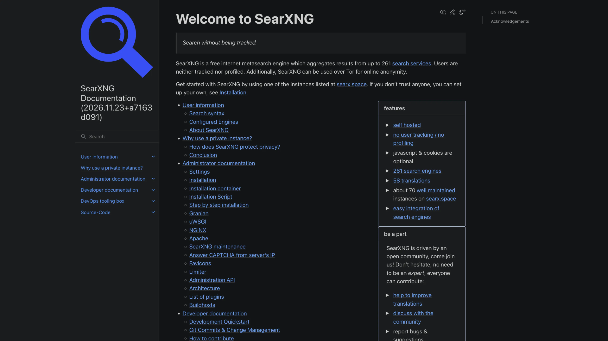

# Deploy and Host SearXNG on Sealos

SearXNG is a privacy-respecting metasearch engine that aggregates results from multiple sources and avoids building user profiles. This Sealos template runs SearXNG 2026.11.23 with a dedicated KubeBlocks Redis Cluster, persistent cache storage, and a public HTTPS search interface.



## About Hosting SearXNG

SearXNG sends queries to enabled search engines, merges the returned results, and presents them through one interface. Settings control engines, safe search, image proxying, request timeouts, and the public base URL.

This template runs one SearXNG StatefulSet with `searxng/searxng:2026.11.23-a7163d091` on port `8080`. A ConfigMap supplies `/etc/searxng/settings.yml`, and a 1Gi volume stores the cache at `/var/cache/searxng`. The template generates `SEARXNG_SECRET` and connects to Redis through the KubeBlocks secret.

The bundled configuration enables the `360search` engine and disables `google cse`, `duckduckgo`, `wikipedia`, `wikidata`, and `bing`. Request timeout is 6 seconds with a 12-second maximum. Enable additional engines that your workspace network can reach.

## Common Use Cases

- **Private Search Front End**: Give a team or family one search page without per-user tracking.
- **Metasearch Coverage**: Combine results from multiple engines and compare source coverage.
- **Internal Tooling**: Add a self-hosted search endpoint to dashboards and assistants.
- **Engine Evaluation**: Test which engines work from a specific network before rollout.
- **Privacy-Focused Browsing**: Use image proxying and a first-party search entry point.

## Dependencies for SearXNG Hosting

The template includes the SearXNG StatefulSet, a KubeBlocks Redis Cluster, cache storage, ConfigMaps, Services, an HTTPS Ingress, and the Sealos App entry. Redis is provisioned by the template.

SearXNG needs outbound HTTPS access to every enabled engine. The bundled configuration enables only `360search`; add engines after confirming that your workspace can reach them.

### Deployment Dependencies

- [SearXNG documentation](https://docs.searxng.org/) - Administration, settings, and engine references
- [SearXNG repository](https://github.com/searxng/searxng) - Source code and issue tracker
- [SearXNG container image](https://hub.docker.com/r/searxng/searxng) - Image used by this template
- [SearXNG settings reference](https://docs.searxng.org/admin/settings/) - `settings.yml` keys and engine configuration
- [KubeBlocks Redis](https://kubeblocks.io/docs/) - Redis Cluster behavior and operations

## Implementation Details

**Architecture Components:**

- **SearXNG StatefulSet**: Serves the search UI and engine aggregation on port `8080`.
- **KubeBlocks Redis Cluster**: One Redis replica and one sentinel, each with `50m/51Mi` requests and `500m/512Mi` limits.
- **Redis storage**: A 1Gi volume per Redis component using the `openebs-backup` storage class.
- **ConfigMap**: Holds `settings.yml`, engine states, timeouts, and instance metadata.
- **Service and Ingress**: Publish the search interface over public HTTPS.

The SearXNG container receives `SEARXNG_BASE_URL`, `SEARXNG_SECRET`, `REDIS_PASSWORD` from a Secret, and a `SEARXNG_VALKEY_URL` that points to the Redis service FQDN.

**Configuration:**

- **Image**: `searxng/searxng:2026.11.23-a7163d091`
- **Port**: `8080`
- **Base URL**: Generated Sealos HTTPS host
- **Secret**: `SEARXNG_SECRET`, generated with 64 random characters
- **Limiter**: Disabled in `settings.yml`
- **Image proxy**: Enabled
- **Safe search**: `0`
- **Outgoing timeout**: `6.0`, maximum `12.0`
- **Enabled engine**: `360search`
- **Disabled engines**: `google cse`, `duckduckgo`, `wikipedia`, `wikidata`, `bing`
- **Persistence**: 1Gi cache volume at `/var/cache/searxng`
- **Replicas**: `1`

**Resource Allocation:**

| Component | CPU Request | CPU Limit | Memory Request | Memory Limit | Storage |
| --- | ---: | ---: | ---: | ---: | ---: |
| SearXNG | 20m | 200m | 25Mi | 256Mi | 1Gi |
| Redis | 50m | 500m | 51Mi | 512Mi | 1Gi |
| Redis sentinel | 50m | 500m | 51Mi | 512Mi | 1Gi |

The profile passed a cold start, search page load, a query with live results, and a stability window with zero restarts.

## Why Deploy SearXNG on Sealos?

Sealos is an AI-assisted cloud operating system built on Kubernetes that unifies deployment, networking, storage, and operations. Deploying SearXNG on Sealos gives you:

- **One-Click Stack**: Provision SearXNG and its Redis dependency from one template.
- **Persistent Cache**: Keep cache data on a dedicated volume across Pod restarts.
- **Managed Redis**: Use a KubeBlocks Redis Cluster with generated credentials.
- **Canvas and AI Dialog**: Inspect the StatefulSet, Redis Cluster, Services, Ingress, and resource cards, and adjust the deployment through the Sealos AI dialog.
- **Pay-as-You-Go Resources**: Start with a compact web profile and scale Redis and SearXNG independently.
- **Kubernetes Reliability**: Use health probes, automated recovery, and declarative resource management.

## Deployment Guide

1. Open the [SearXNG template](https://sealos.io/products/app-store/searxng) and click **Deploy Now**.
2. Review the generated application name, confirm the resource plan, and start the deployment.
3. Wait for deployment to complete, typically in 2-3 minutes. Sealos opens the Canvas after the resources are created.
4. Open the public URL from the Canvas or the App Store entry.
5. Run a search query and confirm that results come from the enabled engine.
6. Open Canvas to review the SearXNG StatefulSet, Redis Cluster, Services, Ingress, and logs.

## Configuration

Edit the SearXNG ConfigMap to add engines or change behavior, then restart the StatefulSet. Keep the YAML structure used by `settings.yml`:

```yaml
engines:
  - name: 360search
    disabled: false
  - name: bing
    disabled: true
```

Enable an engine only after confirming that the Pod can reach it. The bundled settings disable the limiter because the template serves a small private deployment; enable the limiter when exposing a public multi-user instance, with Redis already available as its backing store.

Increase `outgoing.request_timeout` when engines respond slowly, and keep `max_request_timeout` above the per-request value. The cache volume persists search assets and temporary data.

## Scaling

Keep the SearXNG StatefulSet at one replica for the default single-cache topology. Increase CPU and memory limits when queries fan out to many engines or when image proxying adds load. The Redis Cluster scales independently through KubeBlocks. Expand the 1Gi cache volume from the StatefulSet resource card when cached assets grow.

## Troubleshooting

### A search returns no results

Open the SearXNG logs and check the engine error. Confirm that the Pod can reach the engine over HTTPS and that the engine is enabled in the ConfigMap. Start with `360search`, the engine enabled by the template.

### Search requests time out

The default outgoing timeout is 6 seconds with a 12-second maximum. Raise both values in the ConfigMap, restart the StatefulSet, and reduce the number of slow engines.

### Redis connection errors appear in the logs

Verify that the KubeBlocks Redis Cluster and sentinel are Ready, that the generated Secret exists, and that `SEARXNG_VALKEY_URL` points to the Redis service FQDN. Restart SearXNG after the Redis Cluster recovers.

### The instance returns HTTP 429

The limiter is disabled in the bundled settings, so a 429 usually comes from an upstream engine. Reduce request frequency, enable fewer engines, or add retry and backoff behavior upstream.

### Getting Help

- [SearXNG documentation](https://docs.searxng.org/)
- [SearXNG issues](https://github.com/searxng/searxng/issues)
- [Sealos documentation](https://sealos.io/docs)

## License

SearXNG is licensed under the [GNU Affero General Public License v3.0](https://github.com/searxng/searxng/blob/master/LICENSE). This Sealos template is distributed under the templates repository license.
