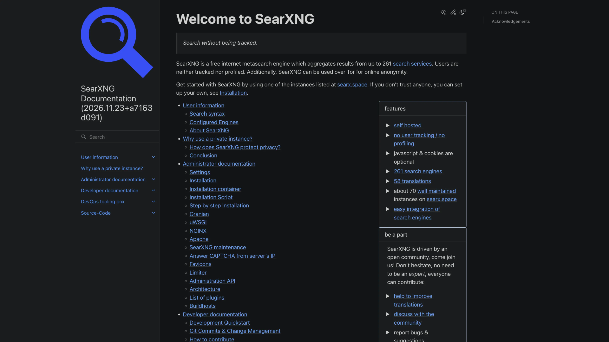

# 在 Sealos 上部署和托管 SearXNG

SearXNG 是注重隐私的元搜索引擎，可聚合多个来源的结果并避免构建用户画像。本 Sealos 模板运行 SearXNG 2026.11.23，配套 KubeBlocks Redis Cluster、持久化缓存和公网 HTTPS 搜索界面。



## 关于 SearXNG 托管

SearXNG 将查询发送到启用的搜索引擎，合并返回结果并通过统一界面展示。设置项控制引擎、安全搜索、图片代理、请求超时和公网基础地址。

本模板运行一个 SearXNG StatefulSet，使用 `searxng/searxng:2026.11.23-a7163d091` 镜像并监听 `8080` 端口。ConfigMap 提供 `/etc/searxng/settings.yml`，1Gi 卷在 `/var/cache/searxng` 保存缓存。模板自动生成 `SEARXNG_SECRET`，并通过 KubeBlocks Secret 连接 Redis。

内置配置启用 `360search`，关闭 `google cse`、`duckduckgo`、`wikipedia`、`wikidata` 和 `bing`。请求超时为 6 秒，最大 12 秒。添加其他引擎前，先确认工作空间网络可以访问。

## 常见使用场景

- **私有搜索入口**：为团队或家庭提供不追踪用户的统一搜索页。
- **元搜索覆盖**：聚合多个引擎结果并比较来源覆盖。
- **内部工具**：为仪表盘和助手增加自托管搜索端点。
- **引擎评估**：在推广前测试特定网络可用的引擎。
- **隐私浏览**：通过图片代理和第一方搜索入口减少第三方请求。

## SearXNG 托管依赖

模板包含 SearXNG StatefulSet、KubeBlocks Redis Cluster、缓存存储、ConfigMap、Service、HTTPS Ingress 和 Sealos App 入口。Redis 由模板自动创建。

SearXNG 需要到每个启用引擎的出站 HTTPS 访问。内置配置只启用 `360search`；确认工作空间网络可达后再添加其他引擎。

### 部署依赖

- [SearXNG 文档](https://docs.searxng.org/) - 管理、设置与引擎参考
- [SearXNG 仓库](https://github.com/searxng/searxng) - 源代码与 Issue
- [SearXNG 容器镜像](https://hub.docker.com/r/searxng/searxng) - 本模板使用的镜像
- [SearXNG 设置参考](https://docs.searxng.org/admin/settings/) - `settings.yml` 与引擎配置
- [KubeBlocks Redis](https://kubeblocks.io/docs/) - Redis Cluster 行为与运维

## 实现细节

**架构组件：**

- **SearXNG StatefulSet**：在 `8080` 端口提供搜索界面和引擎聚合。
- **KubeBlocks Redis Cluster**：一个 Redis 副本和一个 Sentinel，各自使用 `50m/51Mi` 请求和 `500m/512Mi` 限制。
- **Redis 存储**：每个 Redis 组件使用 `openebs-backup` 存储类的 1Gi 卷。
- **ConfigMap**：保存 `settings.yml`、引擎状态、超时和实例信息。
- **Service 与 Ingress**：通过公网 HTTPS 发布搜索界面。

SearXNG 容器接收 `SEARXNG_BASE_URL`、`SEARXNG_SECRET`、来自 Secret 的 `REDIS_PASSWORD`，以及指向 Redis 服务 FQDN 的 `SEARXNG_VALKEY_URL`。

**配置：**

- **镜像**：`searxng/searxng:2026.11.23-a7163d091`
- **端口**：`8080`
- **基础地址**：自动生成的 Sealos HTTPS 域名
- **密钥**：`SEARXNG_SECRET`，64 位随机字符
- **限流器**：`settings.yml` 中关闭
- **图片代理**：开启
- **安全搜索**：`0`
- **出站超时**：`6.0`，最大 `12.0`
- **启用引擎**：`360search`
- **关闭引擎**：`google cse`、`duckduckgo`、`wikipedia`、`wikidata`、`bing`
- **持久化**：1Gi 缓存卷，挂载到 `/var/cache/searxng`
- **副本数**：`1`

**资源分配：**

| 组件 | CPU 请求 | CPU 限制 | 内存请求 | 内存限制 | 存储 |
| --- | ---: | ---: | ---: | ---: | ---: |
| SearXNG | 20m | 200m | 25Mi | 256Mi | 1Gi |
| Redis | 50m | 500m | 51Mi | 512Mi | 1Gi |
| Redis Sentinel | 50m | 500m | 51Mi | 512Mi | 1Gi |

该规格通过了冷启动、搜索页面加载、实时结果查询和稳定性验证，Pod 重启次数为 0。

## 为什么在 Sealos 上部署 SearXNG？

Sealos 是构建在 Kubernetes 之上的 AI 辅助云操作系统，将部署、网络、存储和运维统一在一个界面中。在 Sealos 上部署 SearXNG 可以带来：

- **一键完整栈**：通过一个模板创建 SearXNG 及其 Redis 依赖。
- **缓存持久化**：在 Pod 重启后通过专用卷保留缓存数据。
- **托管 Redis**：使用带自动生成凭据的 KubeBlocks Redis Cluster。
- **Canvas 与 AI 对话**：在一个视图中查看 StatefulSet、Redis Cluster、Service、Ingress 和资源卡，并通过 Sealos AI 对话调整部署。
- **按量计费**：从紧凑 Web 规格起步，独立扩展 Redis 与 SearXNG。
- **Kubernetes 可靠性**：使用健康探针、自动恢复和声明式资源管理。

## 部署指南

1. 打开 [SearXNG 模板](https://sealos.io/products/app-store/searxng)，点击 **Deploy Now**。
2. 检查自动生成的应用名称，确认资源规格后开始部署。
3. 等待部署完成，通常需要 2-3 分钟。资源创建完成后 Sealos 会打开 Canvas。
4. 从 Canvas 或应用商店入口打开公网地址。
5. 执行一次搜索，确认结果来自已启用引擎。
6. 打开 Canvas 查看 SearXNG StatefulSet、Redis Cluster、Service、Ingress 和日志。

## 配置

编辑 SearXNG ConfigMap 以添加引擎或调整行为，然后重启 StatefulSet。保持 `settings.yml` 的 YAML 结构：

```yaml
engines:
  - name: 360search
    disabled: false
  - name: bing
    disabled: true
```

仅在确认 Pod 能访问某个引擎后启用它。模板面向小型私有部署，因此关闭限流器；公开多用户实例可开启限流器，Redis 已作为其后端存储。

引擎响应较慢时提高 `outgoing.request_timeout`，并确保 `max_request_timeout` 大于单次请求值。缓存卷保存搜索资源和临时数据。

## 扩缩容

默认单缓存拓扑下保持 SearXNG StatefulSet 单副本。查询扇出到多个引擎或图片代理增加负载时，提高 CPU 和内存限制。Redis Cluster 可通过 KubeBlocks 独立扩展。缓存资源增长时，从 StatefulSet 资源卡扩展 1Gi 缓存卷。

## 故障排查

### 搜索没有结果

查看 SearXNG 日志中的引擎错误，确认 Pod 能通过 HTTPS 访问该引擎，并确认 ConfigMap 中已启用。可从模板默认启用的 `360search` 开始验证。

### 搜索请求超时

默认出站超时为 6 秒，最大 12 秒。在 ConfigMap 中同时提高两个值、重启 StatefulSet，并减少慢速引擎数量。

### 日志出现 Redis 连接错误

确认 KubeBlocks Redis Cluster 与 Sentinel 已 Ready、生成的 Secret 存在，并确认 `SEARXNG_VALKEY_URL` 指向 Redis 服务 FQDN。Redis 恢复后重启 SearXNG。

### 实例返回 HTTP 429

内置设置已关闭限流，429 通常来自上游引擎。降低请求频率、减少启用引擎，或在上游增加重试与退避。

### 获取帮助

- [SearXNG 文档](https://docs.searxng.org/)
- [SearXNG Issues](https://github.com/searxng/searxng/issues)
- [Sealos 文档](https://sealos.io/docs)

## 许可证

SearXNG 使用 [GNU Affero General Public License v3.0](https://github.com/searxng/searxng/blob/master/LICENSE) 许可证。本 Sealos 模板遵循 templates 仓库许可证。
