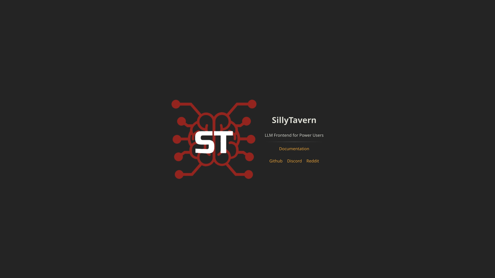

# Deploy and Host SillyTavern on Sealos

SillyTavern is a feature-rich frontend for LLM roleplay, character chats, prompt management, extensions, and multiple AI provider integrations. This template deploys the pinned SillyTavern 1.19.0 release as a persistent web service on Sealos Cloud.

## About Hosting SillyTavern

SillyTavern provides a browser workspace for creating characters, configuring prompts, connecting AI APIs, managing chats, and installing extensions. The template keeps configuration, user data, plugins, and third-party extensions on persistent volumes, so your workspace survives Pod restarts and upgrades.

This template follows the official single-service Docker topology and runs one StatefulSet replica. HTTP Basic Auth is enabled by default, which satisfies SillyTavern's public-access safety check and protects the generated HTTPS URL. The default resource tier uses 100m CPU and 512 MiB memory; the first boot needs extra time to compile frontend libraries and initialize the default user content.

## Common Use Cases

- **Character chat workspace**: Manage characters, lorebooks, personas, and chat histories.
- **Multi-provider LLM frontend**: Connect OpenAI-compatible, Anthropic, OpenRouter, Google, Kobold, and other providers from the UI.
- **Prompt engineering**: Tune prompts, presets, context templates, reasoning settings, and generation parameters.
- **Extension lab**: Install third-party UI extensions and server plugins in a persistent workspace.

## Dependencies for SillyTavern Hosting

The Sealos template provisions the SillyTavern application, four persistent volumes for configuration and user content, a public HTTPS Ingress, and an App launcher entry. An AI provider API key is optional at deployment time and can be added later in the SillyTavern UI.

### Deployment Dependencies

- [SillyTavern Documentation](https://docs.sillytavern.app/) - Official documentation
- [Docker Installation](https://docs.sillytavern.app/installation/docker/) - Upstream container deployment reference
- [Configuration Guide](https://docs.sillytavern.app/administration/config-yaml/) - Runtime configuration reference
- [GitHub Repository](https://github.com/SillyTavern/SillyTavern) - Source code and release notes

### Implementation Details

**Architecture Components:**

- **SillyTavern**: Main Node.js web server and browser UI.
- **Persistent Volumes**: `/home/node/app/config`, `/home/node/app/data`, `/home/node/app/plugins`, and `/home/node/app/public/scripts/extensions/third-party`.
- **Service and Ingress**: A ClusterIP Service exposes port 8000, and the Sealos-managed HTTPS Ingress publishes the App URL.

**Runtime Configuration:**

- `SILLYTAVERN_LISTEN=true` accepts ingress traffic.
- `SILLYTAVERN_WHITELISTMODE=false` allows access through the generated Sealos hostname.
- `SILLYTAVERN_BASICAUTHMODE`, `SILLYTAVERN_BASICAUTHUSER_USERNAME`, and `SILLYTAVERN_BASICAUTHUSER_PASSWORD` come from the deployment form.
- `SILLYTAVERN_HEARTBEATINTERVAL=30` enables the built-in heartbeat health check.

## Why Deploy SillyTavern on Sealos?

Sealos is an AI-assisted Cloud Operating System built on Kubernetes that unifies application development, deployment, and operations. Deploying SillyTavern on Sealos gives you:

- **One-click deployment**: Provision the application, persistent storage, HTTPS, and App launcher together.
- **Persistent user data**: Keep characters, chats, settings, plugins, and extensions across restarts.
- **Pay-as-you-go resources**: Start with a lightweight resource tier and increase CPU or memory from Canvas.
- **Instant public access**: Open SillyTavern through a managed HTTPS URL with Basic Auth protection.
- **Kubernetes operations without YAML work**: Use resource cards and the AI dialog to inspect or change the deployment.

## Deployment Guide

1. Open the [SillyTavern template](https://sealos.io/products/app-store/sillytavern) and click **Deploy Now**.
2. Review the Basic Auth fields. The default username is `user`; `basic_auth_password` is prefilled with a generated password and can be replaced with your own value before deployment.
3. Start the deployment. Resource provisioning typically takes 2-3 minutes. On the minimum 100m CPU tier, the first boot also compiles frontend libraries and can take several additional minutes before the health checks pass.
4. After deployment, Sealos opens the Canvas. Open the SillyTavern App URL from the application card.
5. Enter the Basic Auth username and password in the browser prompt. On first launch, complete the welcome dialog and save a Persona Name.
6. Open the AI response configuration, select a provider, and add its API key or endpoint. Characters, chats, presets, and extensions are ready from the main toolbar.

## Login and Account Setup

SillyTavern in this template uses HTTP Basic Auth. The initial username is the value of `basic_auth_username` and defaults to `user`. The initial password is the value shown in `basic_auth_password`; the deployment form prefills it with a generated password, and you can replace it before deployment.

There is no public sign-up page. Account creation happens in the deployment form, where one Basic Auth credential pair protects the entire SillyTavern workspace. After the browser prompt, SillyTavern opens its first-run welcome dialog. Save a Persona Name to finish setup, then open **User Settings** from the top toolbar to choose the interface language, theme, and chat preferences.

To change the login after deployment, open the StatefulSet resource card in Canvas and update both `SILLYTAVERN_BASICAUTHUSER_USERNAME` and `SILLYTAVERN_BASICAUTHUSER_PASSWORD`, then apply the rollout. Reopen the App URL and enter the new credentials. Keep the username and password together in a password manager before changing them.

## Configuration

Use any of these surfaces after deployment:

- **AI dialog**: Describe resource, authentication, environment, or storage changes and let the AI apply them.
- **Resource cards**: Open the StatefulSet, Service, Ingress, or persistent volume cards from Canvas.
- **SillyTavern UI**: Configure AI providers, connection profiles, characters, personas, prompts, extensions, and chat settings.
- **Persistent config**: Advanced configuration is stored under `/home/node/app/config`.

## Resource Sizing

This template is validated with `100m` CPU and `512Mi` memory. The first boot compiles frontend assets and initializes bundled presets, with observed memory use around 400 MiB. The minimum CPU tier prioritizes cost and can extend the initial startup; raise CPU temporarily if you want faster first-time compilation. A single replica matches SillyTavern's local-file persistence model and keeps chat data on one writable volume set.

## Troubleshooting

### The App URL Returns 401

Basic Auth is working and needs credentials. Enter the `basic_auth_username` and `basic_auth_password` configured during deployment. Reopen the URL or use a private browser window if a previous credential was cached.

### The App Is Still Starting

Check the StatefulSet logs for `Compiling frontend libraries...`. Wait for `webpack compiled successfully` and `SillyTavern is listening`, then refresh the App URL. The 100m CPU tier can take several minutes on the first boot.

### The App URL Returns 502 or 503

Confirm the Pod is Ready and the heartbeat file exists. Review the startup, readiness, and liveness probe messages in the Pod events, and inspect the StatefulSet logs for JavaScript heap errors.

### Data Is Missing After a Restart

Store configuration, characters, chats, plugins, and extensions in the mounted directories listed above. Data written outside those persistent paths is lost when the Pod is replaced.

## Additional Resources

- [SillyTavern Docker Guide](https://docs.sillytavern.app/installation/docker/)
- [SillyTavern Configuration](https://docs.sillytavern.app/administration/config-yaml/)
- [SillyTavern Extensions](https://docs.sillytavern.app/extensions/)
- [Sealos Documentation](https://sealos.io/docs)

## License

SillyTavern is licensed under the [GNU Affero General Public License v3.0](https://github.com/SillyTavern/SillyTavern/blob/1.19.0/LICENSE).
