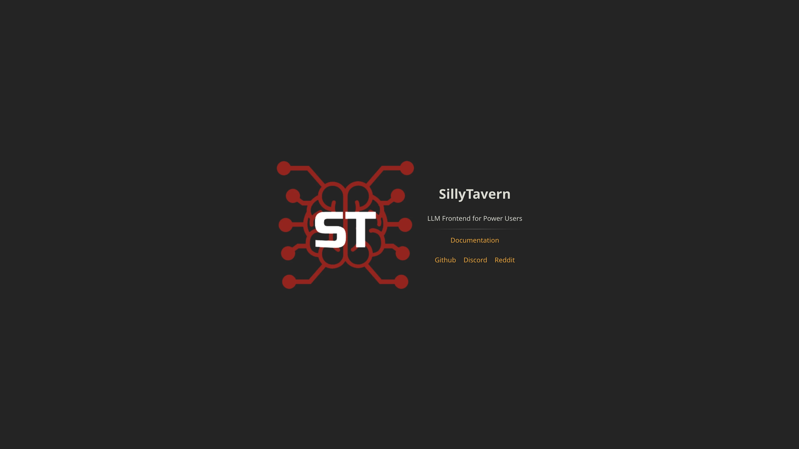

# 在 Sealos 上部署和托管 SillyTavern

SillyTavern 是功能丰富的 LLM 前端，支持角色扮演、角色聊天、提示词管理、扩展和多种 AI 服务集成。此模板在 Sealos Cloud 上将固定版本 SillyTavern 1.19.0 部署为持久化 Web 服务。

## 关于托管 SillyTavern

SillyTavern 提供浏览器工作区，用于创建角色、配置提示词、连接 AI API、管理聊天和安装扩展。模板将配置、用户数据、插件和第三方扩展保存到持久卷，工作区在 Pod 重启和升级后仍然保留。

此模板遵循官方单服务 Docker 拓扑，运行一个 StatefulSet 副本。HTTP Basic Auth 默认启用，用于通过 SillyTavern 的公网访问安全检查并保护生成的 HTTPS URL。默认资源档为 100m CPU 和 512 MiB 内存；首次启动需要额外时间编译前端库并初始化默认用户内容。

## 常见使用场景

- **角色聊天工作区**：管理角色、世界书、Persona 和聊天历史。
- **多 provider LLM 前端**：从界面连接 OpenAI 兼容、Anthropic、OpenRouter、Google、Kobold 等服务。
- **提示词工程**：调整提示词、预设、上下文模板、推理设置和生成参数。
- **扩展实验**：在持久化工作区中安装第三方 UI 扩展和服务器插件。

## SillyTavern 托管依赖

Sealos 模板会创建 SillyTavern 应用、四个用于配置和用户内容的持久卷、公开 HTTPS Ingress 以及 App 启动入口。部署时可以暂不填写 AI provider API key，部署后在 SillyTavern UI 中添加。

### 部署依赖

- [SillyTavern 文档](https://docs.sillytavern.app/) - 官方文档
- [Docker 安装](https://docs.sillytavern.app/installation/docker/) - 上游容器部署参考
- [配置指南](https://docs.sillytavern.app/administration/config-yaml/) - 运行时配置参考
- [GitHub 仓库](https://github.com/SillyTavern/SillyTavern) - 源码和发布说明

### 实现细节

**架构组件：**

- **SillyTavern**：Node.js Web 服务和浏览器 UI。
- **持久卷**：`/home/node/app/config`、`/home/node/app/data`、`/home/node/app/plugins` 和 `/home/node/app/public/scripts/extensions/third-party`。
- **Service 与 Ingress**：ClusterIP Service 暴露 8000 端口，Sealos HTTPS Ingress 发布 App URL。

**运行时配置：**

- `SILLYTAVERN_LISTEN=true` 允许服务接收 Ingress 流量。
- `SILLYTAVERN_WHITELISTMODE=false` 允许通过生成的 Sealos 域名访问。
- `SILLYTAVERN_BASICAUTHMODE`、`SILLYTAVERN_BASICAUTHUSER_USERNAME` 和 `SILLYTAVERN_BASICAUTHUSER_PASSWORD` 来自部署表单。
- `SILLYTAVERN_HEARTBEATINTERVAL=30` 启用内置 heartbeat 健康检查。

## 为什么在 Sealos 上部署 SillyTavern？

Sealos 是基于 Kubernetes 的 AI 云操作系统，统一应用的开发、部署和运维。在 Sealos 上部署 SillyTavern，你可以获得：

- **一键部署**：同时创建应用、持久存储、HTTPS 和 App 入口。
- **持久用户数据**：角色、聊天、设置、插件和扩展在重启后继续保留。
- **按需资源**：从轻量资源档开始，在 Canvas 中按需提高 CPU 或内存。
- **即时公网访问**：通过托管 HTTPS URL 打开 SillyTavern，并由 Basic Auth 保护。
- **无需手写 Kubernetes YAML**：通过资源卡片和 AI 对话框查看或调整部署。

## 部署指南

1. 打开 [SillyTavern 模板](https://sealos.io/products/app-store/sillytavern)，点击 **Deploy Now**。
2. 检查 Basic Auth 字段。默认用户名为 `user`；`basic_auth_password` 会预填随机密码，也可以在部署前替换为自己的密码。
3. 开始部署。资源创建通常需要 2-3 分钟。在最低 100m CPU 档位，首次启动还会编译前端库，健康检查通过前可能多等几分钟。
4. 部署完成后，Sealos 会打开 Canvas。从应用卡片打开 SillyTavern App URL。
5. 在浏览器弹窗中输入 Basic Auth 用户名和密码。首次启动时完成欢迎弹窗并保存 Persona Name。
6. 打开 AI response configuration，选择 provider 并填写 API key 或 endpoint。通过主工具栏使用角色、聊天、预设和扩展功能。

## 登录与账户设置

此模板中的 SillyTavern 使用 HTTP Basic Auth。初始用户名来自 `basic_auth_username`，默认值为 `user`。初始密码来自 `basic_auth_password`；部署表单会预填随机密码，你也可以在部署前替换。

SillyTavern 提供自己的首次启动设置页面，通过部署表单创建的一组 Basic Auth 凭据即可保护整个 SillyTavern 工作区。浏览器认证通过后，SillyTavern 会显示欢迎弹窗。保存 Persona Name 即完成首次设置，然后从顶部工具栏打开 **User Settings**，选择界面语言、主题和聊天偏好。

部署后如需修改登录凭据，在 Canvas 中打开 StatefulSet 资源卡片，同时更新 `SILLYTAVERN_BASICAUTHUSER_USERNAME` 和 `SILLYTAVERN_BASICAUTHUSER_PASSWORD`，然后应用滚动更新。重新打开 App URL 并输入新凭据。修改前请将用户名和密码一并保存到密码管理器。

## 配置

部署后可以使用以下入口：

- **AI 对话框**：描述资源、认证、环境变量或存储变更，由 AI 应用更新。
- **资源卡片**：从 Canvas 打开 StatefulSet、Service、Ingress 或持久卷卡片。
- **SillyTavern UI**：配置 AI provider、连接配置、角色、Persona、提示词、扩展和聊天设置。
- **持久配置**：高级配置保存在 `/home/node/app/config` 下。

## 资源配置

此模板使用 `100m` CPU 和 `512Mi` 内存完成验证。首次启动会编译前端资源并初始化内置预设，观测内存约 400 MiB。最低 CPU 档优先控制成本，首次启动时间会更长；如需更快完成首次编译，可以临时提高 CPU。单个副本符合 SillyTavern 的本地文件持久化模型，并让聊天数据集中在一组可写卷上。

## 故障排查

### App URL 返回 401

Basic Auth 正常工作并正在等待凭据。输入部署时设置的 `basic_auth_username` 和 `basic_auth_password`。如果浏览器缓存了旧凭据，请重新打开 URL 或使用隐私窗口。

### 应用仍在启动

查看 StatefulSet 日志中的 `Compiling frontend libraries...`。等待出现 `webpack compiled successfully` 和 `SillyTavern is listening`，然后刷新 App URL。100m CPU 档首次启动可能需要几分钟。

### App URL 返回 502 或 503

确认 Pod 已 Ready 且 heartbeat 文件存在。检查 Pod 事件中的 startup、readiness 和 liveness probe 信息，并在 StatefulSet 日志中检查 JavaScript heap 错误。

### 重启后数据缺失

将配置、角色、聊天、插件和扩展保存到上文的持久化挂载目录。写入这些目录之外的数据会在 Pod 被替换后丢失。

## 更多资源

- [SillyTavern Docker 指南](https://docs.sillytavern.app/installation/docker/)
- [SillyTavern 配置](https://docs.sillytavern.app/administration/config-yaml/)
- [SillyTavern 扩展](https://docs.sillytavern.app/extensions/)
- [Sealos 文档](https://sealos.io/docs)

## 许可证

SillyTavern 使用 [GNU Affero General Public License v3.0](https://github.com/SillyTavern/SillyTavern/blob/1.19.0/LICENSE) 许可证。
