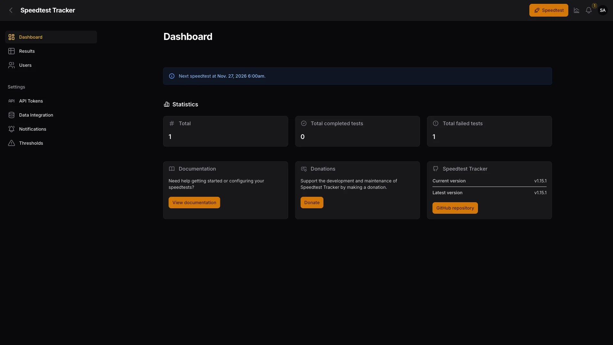

# Deploy and Host Speedtest Tracker on Sealos

Speedtest Tracker is a self-hosted internet performance monitor that schedules Ookla Speedtest runs, stores the results, and charts download, upload, latency, and packet loss over time. This template deploys Speedtest Tracker v1.15.1 as a single StatefulSet with SQLite and a 1Gi configuration volume.

## About Hosting Speedtest Tracker

Speedtest Tracker runs as one PHP application on port `80`. The LinuxServer image bundles the web UI, the scheduler, and the Ookla Speedtest CLI. The template stores the SQLite database, application key, logs, and settings on a 1Gi volume mounted at `/config`.

The deployment creates the first administrator from the `ADMIN_NAME`, `ADMIN_EMAIL`, and `ADMIN_PASSWORD` inputs, sets `APP_URL` to the generated HTTPS host, and schedules a speed test every six hours with `0 */6 * * *`. Results are kept indefinitely because `PRUNE_RESULTS_OLDER_THAN` is `0`.

Sealos provisions the StatefulSet, persistent volume, ClusterIP Service, Ingress, TLS certificate, and App card. Speedtest runs originate from the Pod, so the cluster must allow outbound access to Ookla servers for measurements to succeed.

## Common Use Cases

- **ISP performance monitoring**: Track whether the delivered bandwidth matches the subscribed plan.
- **Remote office checks**: Measure internet quality from a cloud region or branch office.
- **Incident evidence**: Keep timestamped download, upload, latency, and packet-loss records.
- **Scheduled reporting**: Compare performance across hours, days, and months with built-in charts.
- **Network change validation**: Measure before and after a router, DNS, or provider change.

## Dependencies for Speedtest Tracker Hosting

- A Sealos workspace with at least 512Mi of available memory and 1Gi of persistent storage.
- Outbound HTTPS access to Ookla Speedtest servers from the Pod.
- A browser for the dashboard and administrator login.
- An email address and password for the first administrator account.

### Deployment Dependencies

- [Speedtest Tracker website](https://speedtest-tracker.dev) - Product overview and feature list
- [Speedtest Tracker documentation](https://docs.speedtest-tracker.dev) - Installation, environment, and scheduling guides
- [Speedtest Tracker GitHub repository](https://github.com/alexjustesen/speedtest-tracker) - Source code and releases
- [LinuxServer image documentation](https://docs.linuxserver.io/images/docker-speedtest-tracker/) - Container parameters and paths
- [Ookla Speedtest CLI](https://www.speedtest.net/apps/cli) - Measurement client bundled in the image
- [Sealos documentation](https://sealos.io/docs) - Platform concepts and operations

## Implementation Details

**Architecture Components:**

- **Speedtest Tracker StatefulSet**: One replica running `ghcr.io/linuxserver/speedtest-tracker:v1.15.1-ls183` on port `80`.
- **Configuration volume**: A 1Gi volume mounted at `/config` for SQLite, the application key, logs, and settings.
- **Service**: ClusterIP port `80` forwarding to the web UI.
- **Ingress**: Sealos-managed HTTPS host with a 32Mi request body limit and 300-second proxy timeouts.
- **App entry**: Opens the Speedtest Tracker dashboard.

**Configuration:**

- **Image**: `ghcr.io/linuxserver/speedtest-tracker:v1.15.1-ls183`
- **HTTP port**: `80`
- **Data path**: `/config`
- **Database**: SQLite
- **Application key**: Generated `app_key`, passed as `APP_KEY`
- **Public URL**: `https://${{ defaults.app_host }}.${{ SEALOS_CLOUD_DOMAIN }}`, passed as `APP_URL`
- **Schedule**: `0 */6 * * *`, one test every six hours
- **Result retention**: `PRUNE_RESULTS_OLDER_THAN=0`, keep all results
- **Administrator name**: Required input `admin_name`, default `Admin`
- **Administrator email**: Required input `admin_email`, default `admin@example.com`
- **Administrator password**: Required input `admin_password`
- **Health probe**: `GET /`
- **Runtime user**: PUID `1000`, PGID `1000`, UMASK `022`, with the `RuntimeDefault` seccomp profile
- **Timezone**: `Asia/Shanghai`

**Resource Allocation:**

| Component | CPU Request | CPU Limit | Memory Request | Memory Limit | Storage |
| --- | ---: | ---: | ---: | ---: | ---: |
| Speedtest Tracker | 50m | 500m | 51Mi | 512Mi | 1Gi |

The live Sealos test signed in with the configured administrator account and loaded the dashboard. A manual speed test reached the Ookla CLI and failed with `Network unreachable`, which confirms that the test cluster blocked outbound access to the measurement servers. The Pod stayed ready with this profile, and the tested values are recorded in the workload annotation.

## Why Deploy Speedtest Tracker on Sealos?

Sealos is an AI-assisted cloud operating system built on Kubernetes. It supplies the compute, storage, networking, and operations layer for Speedtest Tracker through one interface:

- **One-click deployment**: Create the StatefulSet, configuration volume, Service, Ingress, and App card from one template.
- **Persistent history**: Keep measurements, settings, and the application key on a dedicated volume.
- **Managed HTTPS**: Receive a public domain and TLS certificate for the dashboard.
- **Scheduled measurements**: Run tests every six hours with a configuration that survives restarts.
- **Resource control**: Adjust CPU and memory from the resource card for frequent tests and large result sets.
- **Operational visibility**: Inspect Pods, logs, events, and resource usage from Canvas or the Sealos AI dialog.

## Deployment Guide

1. Open the [Speedtest Tracker template](https://sealos.io/products/app-store/speedtest-tracker) and click **Deploy Now**.
2. Set the administrator name, email, and password, save the credentials, and confirm the generated application name.
3. Submit the deployment and wait 2-3 minutes for the Pod to become ready and for the HTTPS certificate to be issued.
4. Open the App card and sign in with the administrator email and password.
5. Open **Settings → Speedtest** and confirm the schedule, server selection, and measurement options.
6. Run a manual test from the dashboard. A successful result confirms that the cluster can reach Ookla servers.
7. Review the chart after the first scheduled run and adjust the schedule in the Deployment environment when needed.

## Login and Access

The public URL opens the Speedtest Tracker login page. Sign in with the email address and password from the deployment inputs. The first administrator is created on the initial boot, and additional users can be managed from the admin area.

`APP_URL` must match the public HTTPS host. Password resets and session cookies rely on this value, and the `APP_KEY` must stay stable so encrypted settings remain readable.

## Scaling

Speedtest Tracker runs one replica because the template uses a single SQLite database. Scale vertically by raising the CPU and memory limits when you shorten the schedule, keep years of results, or run many manual tests.

The 1Gi volume holds the database, logs, and application key. Expand the PVC when results outgrow the volume, provided the storage class supports expansion. Horizontal scaling requires an external MySQL or PostgreSQL database and a shared application key, which this single-node template does not configure.

## Troubleshooting

### Speed tests fail with Network unreachable

- Cause: The cluster blocks outbound access to Ookla Speedtest servers.
- Solution: Allow HTTPS egress from the namespace to Ookla hosts, then rerun the test from the dashboard. The login and dashboard continue to work while measurements fail.

### The login page reloads or returns a 419 error

- Cause: `APP_URL` differs from the public HTTPS origin, so the session cookie and CSRF token do not match.
- Solution: Set `APP_URL` to the exact public URL, restart the StatefulSet, and sign in again.

### Scheduled tests never run

- Cause: The scheduler container is unhealthy, the cron expression is invalid, or the Pod timezone differs from the intended schedule.
- Solution: Check the Pod log, validate the five-field cron expression, and confirm `TZ` and `DISPLAY_TIMEZONE`.

### Results disappear after a redeploy

- Cause: The new Pod uses a different PVC, or `/config` is not writable by PUID `1000`.
- Solution: Confirm that the PVC is `Bound`, keep the same volume, and inspect the log for permission errors.

### The dashboard shows stale data

- Cause: The last scheduled run failed, or the browser is showing a cached page.
- Solution: Run a manual test, check the latest result in the results list, and reload the dashboard after the run completes.

### Getting Help

- [Speedtest Tracker documentation](https://docs.speedtest-tracker.dev)
- [Speedtest Tracker GitHub issues](https://github.com/alexjustesen/speedtest-tracker/issues)
- [LinuxServer image documentation](https://docs.linuxserver.io/images/docker-speedtest-tracker/)
- [Sealos documentation](https://sealos.io/docs)

## License

Speedtest Tracker is released under the [MIT License](https://github.com/alexjustesen/speedtest-tracker/blob/main/LICENSE). This Sealos template is an independent deployment definition and is distributed under the templates repository license.
