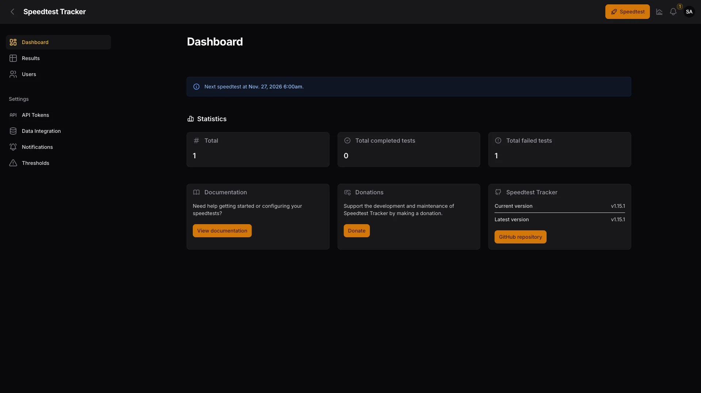

# 在 Sealos 上部署和托管 Speedtest Tracker

Speedtest Tracker 是一款自托管网络性能监控工具，定时运行 Ookla Speedtest，保存结果并绘制下载、上传、延迟和丢包的历史趋势。本模板将 Speedtest Tracker v1.15.1 部署为单个 StatefulSet，使用 SQLite 和 1Gi 配置卷。

## 关于托管 Speedtest Tracker

Speedtest Tracker 以单个 PHP 应用运行，监听 `80` 端口。LinuxServer 镜像包含 Web 界面、调度器和 Ookla Speedtest CLI。模板将 SQLite 数据库、应用密钥、日志和设置保存在挂载到 `/config` 的 1Gi 卷中。

部署使用 `ADMIN_NAME`、`ADMIN_EMAIL` 和 `ADMIN_PASSWORD` 输入创建首位管理员，将 `APP_URL` 设置为生成的 HTTPS 主机，并通过 `0 */6 * * *` 每六小时执行一次测速。`PRUNE_RESULTS_OLDER_THAN` 为 `0`，历史结果会一直保留。

Sealos 负责创建 StatefulSet、持久卷、ClusterIP Service、Ingress、TLS 证书和应用卡片。测速请求从 Pod 发出，集群需要允许访问 Ookla 服务器的出站连接，测量才能成功。

## 常见使用场景

- **宽带质量监控**：跟踪实际带宽是否达到订购套餐的水平。
- **远程办公点检查**：从云区域或分支机构测量互联网质量。
- **故障证据**：保留带时间戳的下载、上传、延迟和丢包记录。
- **定期报告**：通过内置图表比较不同小时、日期和月份的性能。
- **网络变更验证**：在更换路由器、DNS 或运营商前后进行对比测量。

## Speedtest Tracker 托管依赖

- 一个 Sealos 工作空间，至少提供 512Mi 可用内存和 1Gi 持久存储。
- Pod 到 Ookla Speedtest 服务器的出站 HTTPS 访问。
- 用于仪表盘和管理员登录的浏览器。
- 首位管理员使用的邮箱地址和密码。

### 部署依赖

- [Speedtest Tracker 官网](https://speedtest-tracker.dev) - 产品介绍和功能列表
- [Speedtest Tracker 文档](https://docs.speedtest-tracker.dev) - 安装、环境和调度指南
- [Speedtest Tracker GitHub 仓库](https://github.com/alexjustesen/speedtest-tracker) - 源码和版本发布
- [LinuxServer 镜像文档](https://docs.linuxserver.io/images/docker-speedtest-tracker/) - 容器参数和路径
- [Ookla Speedtest CLI](https://www.speedtest.net/apps/cli) - 镜像内置的测速客户端
- [Sealos 文档](https://sealos.io/docs) - 平台概念和操作说明

## 实现细节

**架构组件：**

- **Speedtest Tracker StatefulSet**：一个副本，运行 `ghcr.io/linuxserver/speedtest-tracker:v1.15.1-ls183`，监听 `80` 端口。
- **配置卷**：1Gi，挂载到 `/config`，保存 SQLite、应用密钥、日志和设置。
- **Service**：ClusterIP 端口 `80`，转发到 Web 界面。
- **Ingress**：Sealos 托管的 HTTPS 域名，请求体上限 32Mi，代理超时 300 秒。
- **应用入口**：打开 Speedtest Tracker 仪表盘。

**配置：**

- **镜像**：`ghcr.io/linuxserver/speedtest-tracker:v1.15.1-ls183`
- **HTTP 端口**：`80`
- **数据路径**：`/config`
- **数据库**：SQLite
- **应用密钥**：生成的 `app_key`，写入 `APP_KEY`
- **公网地址**：`https://${{ defaults.app_host }}.${{ SEALOS_CLOUD_DOMAIN }}`，写入 `APP_URL`
- **调度表达式**：`0 */6 * * *`，每六小时执行一次
- **结果保留**：`PRUNE_RESULTS_OLDER_THAN=0`，保留全部结果
- **管理员名称**：必填输入 `admin_name`，默认 `Admin`
- **管理员邮箱**：必填输入 `admin_email`，默认 `admin@example.com`
- **管理员密码**：必填输入 `admin_password`
- **健康检查**：`GET /`
- **运行用户**：PUID `1000`、PGID `1000`、UMASK `022`，启用 `RuntimeDefault` seccomp 配置
- **时区**：`Asia/Shanghai`

**资源分配：**

| 组件 | CPU 请求 | CPU 限制 | 内存请求 | 内存限制 | 存储 |
| --- | ---: | ---: | ---: | ---: | ---: |
| Speedtest Tracker | 50m | 500m | 51Mi | 512Mi | 1Gi |

Sealos 实测使用配置的管理员账号登录并加载仪表盘。手动测速调用 Ookla CLI 后返回 `Network unreachable`，确认测试集群阻止了到测量服务器的出站访问。Pod 使用该配置保持就绪，实测数值已写入工作负载注解。

## 为什么在 Sealos 上部署 Speedtest Tracker？

Sealos 是构建在 Kubernetes 上的 AI 辅助云操作系统，通过统一界面提供 Speedtest Tracker 所需的计算、存储、网络和运维能力：

- **一键部署**：用一个模板创建 StatefulSet、配置卷、Service、Ingress 和应用卡片。
- **历史持久化**：将测量结果、设置和应用密钥保存在独立持久卷中。
- **托管 HTTPS**：为仪表盘提供公网域名和 TLS 证书。
- **定时测量**：每六小时运行一次测速，配置跨重启保留。
- **资源可控**：高频测速和大量结果场景下，通过资源卡片调整 CPU 和内存。
- **运维可见**：在 Canvas 或 Sealos AI 对话框中查看 Pod、日志、事件和资源使用情况。

## 部署指南

1. 打开 [Speedtest Tracker 模板](https://sealos.io/products/app-store/speedtest-tracker)，点击 **Deploy Now**。
2. 设置管理员名称、邮箱和密码并保存凭据，确认自动生成的应用名称。
3. 提交部署，等待 2-3 分钟，Pod 进入就绪状态并完成 HTTPS 证书签发。
4. 打开应用卡片，使用管理员邮箱和密码登录。
5. 打开 **Settings → Speedtest**，确认调度、服务器选择和测量选项。
6. 在仪表盘执行一次手动测速，成功结果说明集群可以访问 Ookla 服务器。
7. 首次定时任务完成后查看图表，并按需在 Deployment 环境变量中调整调度。

## 登录与访问

公网地址打开 Speedtest Tracker 登录页。使用部署输入中的邮箱和密码登录。首位管理员在首次启动时创建，后续用户可以在管理区域维护。

`APP_URL` 必须与公网 HTTPS 主机一致。密码重置和会话 Cookie 依赖该值，`APP_KEY` 需要保持稳定，确保加密设置可以继续读取。

## 扩缩容

模板使用单个 SQLite 数据库，因此 Speedtest Tracker 运行一个副本。缩短调度间隔、保留多年结果或执行大量手动测速时，通过提高 CPU 和内存限制纵向扩容。

1Gi 卷保存数据库、日志和应用密钥。结果增长后可以扩展 PVC，前提是存储类支持扩容。水平扩容需要外部 MySQL 或 PostgreSQL 数据库和共享应用密钥，本单节点模板未配置这些组件。

## 故障排查

### 测速失败并提示 Network unreachable

- 原因：集群阻止了到 Ookla Speedtest 服务器的出站访问。
- 处理：允许命名空间向 Ookla 主机发起 HTTPS 出站连接，然后在仪表盘重新执行测速。测量失败期间登录和仪表盘仍可正常使用。

### 登录页反复刷新或返回 419 错误

- 原因：`APP_URL` 与公网 HTTPS 来源不一致，会话 Cookie 和 CSRF 令牌无法匹配。
- 处理：将 `APP_URL` 设置为完整公网地址，重启 StatefulSet 后重新登录。

### 定时测速从未执行

- 原因：调度器容器异常、cron 表达式无效，或者 Pod 时区与预期计划不一致。
- 处理：检查 Pod 日志，验证五段式 cron 表达式，并确认 `TZ` 和 `DISPLAY_TIMEZONE`。

### 重新部署后结果消失

- 原因：新 Pod 使用了不同的 PVC，或者 PUID `1000` 无法写入 `/config`。
- 处理：确认 PVC 处于 `Bound` 状态，保持同一个卷，并查看日志中的权限错误。

### 仪表盘显示过期数据

- 原因：最近一次定时任务失败，或者浏览器显示缓存页面。
- 处理：执行手动测速，在结果列表查看最新记录，并在任务完成后刷新仪表盘。

### 获取帮助

- [Speedtest Tracker 文档](https://docs.speedtest-tracker.dev)
- [Speedtest Tracker GitHub Issues](https://github.com/alexjustesen/speedtest-tracker/issues)
- [LinuxServer 镜像文档](https://docs.linuxserver.io/images/docker-speedtest-tracker/)
- [Sealos 文档](https://sealos.io/docs)

## 许可证

Speedtest Tracker 使用 [MIT License](https://github.com/alexjustesen/speedtest-tracker/blob/main/LICENSE) 发布。本 Sealos 模板是独立部署定义，遵循 templates 仓库许可证。
