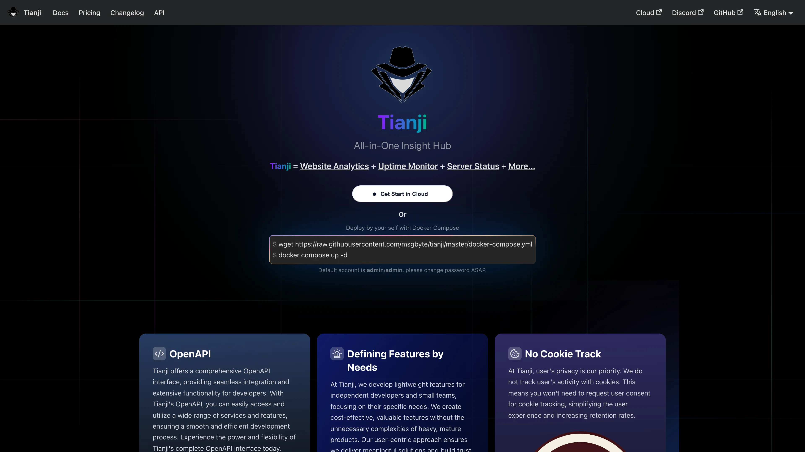

# Deploy and Host Tianji on Sealos

Tianji combines website analytics, uptime monitoring, and server status into one lightweight insight hub. This template deploys Tianji 1.34.0 on Sealos Cloud with managed PostgreSQL 16.4.

## About Hosting Tianji

Tianji runs as a Node.js web application that serves the dashboard, telemetry APIs, and background reporting from one container. PostgreSQL stores workspaces, websites, monitors, and audit data. Sealos provisions the database, creates the `tianji` database idempotently, and injects connection credentials through Kubernetes secrets.

Registration is enabled by default so the first visitor can create the owner account. After the first account exists, you can disable registration from the deployment inputs if you want a private instance.

## Common Use Cases

- **Website Analytics**: Track page views, sessions, and visitor trends without sending data to a third-party GA service.
- **Uptime Monitoring**: Watch HTTP endpoints and alert when services become unavailable.
- **Server Status**: Collect lightweight host metrics through Tianji reporters.
- **Product Telemetry**: Gather deployment and usage signals for self-hosted products.
- **Team Insight Hub**: Share one workspace for analytics, monitors, and status pages.

## Dependencies for Tianji Hosting

The Sealos template includes the Tianji application Deployment, Service, Ingress, a PostgreSQL 16.4 Cluster, and a one-shot init Job that creates the `tianji` database.

### Deployment Dependencies

- [Tianji Documentation](https://tianji.dev) - Official Tianji docs and guides
- [Tianji GitHub](https://github.com/msgbyte/tianji) - Source code and release notes
- [PostgreSQL Documentation](https://www.postgresql.org/docs/) - Database backend documentation

## Implementation Details

### Architecture Components

This template deploys these resources:

- **Tianji Deployment**: Runs `moonrailgun/tianji:1.34.0` and exposes port `12345`.
- **Service and Ingress**: Publishes the dashboard over HTTPS on the Sealos public domain.
- **PostgreSQL Cluster**: Stores application data with KubeBlocks PostgreSQL 16.4.0.
- **PostgreSQL Init Job**: Waits for PostgreSQL readiness and creates the `tianji` database if it does not exist.

### Resource Allocation

| Component | CPU Request | CPU Limit | Memory Request | Memory Limit | Storage |
|-----------|-------------|-----------|----------------|--------------|---------|
| Tianji | 50m | 500m | 102Mi | 1024Mi | - |
| PostgreSQL | 50m | 500m | 51Mi | 512Mi | 1Gi |
| PostgreSQL Init Job | 10m | 100m | 12Mi | 128Mi | - |

### Configuration

- **Tianji version**: 1.34.0
- **PostgreSQL version**: 16.4.0
- **Port**: 12345
- **JWT secret**: Generated automatically per deployment
- **ALLOW_REGISTER**: Defaults to `true` so the first user can sign up
- **ALLOW_OPENAPI**: Defaults to `true`
- **PUBLIC_URL**: Set to the Sealos HTTPS Ingress URL
- **Probe profile**: HTTP probes on `/` aligned with the official Helm chart

## Why Deploy Tianji on Sealos?

- **One-Click Deployment**: Open the template page, click **Deploy Now**, and launch Tianji without writing Kubernetes YAML.
- **Managed PostgreSQL**: Sealos creates and wires the database for you.
- **Automatic HTTPS Access**: The dashboard is available on a public Sealos domain with TLS.
- **Simple Operations**: Use the Canvas, AI dialog, and resource cards to inspect status or adjust resources.
- **Pay-as-You-Go Resources**: Start from the tested minimum profile and scale when traffic grows.

## Deployment Guide

1. Open the [Tianji template](https://sealos.io/products/app-store/tianji) and click **Deploy Now**.
2. Configure the parameters in the popup dialog:
   - **ALLOW_REGISTER**: Keep `true` for the first owner signup; set `false` later for a private instance.
   - **ALLOW_OPENAPI**: Enable or disable OpenAPI access.
3. Wait for deployment to complete, typically 2-3 minutes. After deployment, you will be redirected to the Canvas. For later changes, describe your requirements in the AI dialog or click the relevant resource cards to modify settings.
4. Open the public URL shown in the Canvas.

## Login and Registration

1. Open the Tianji URL and go to the register page (`/register`).
2. Create the first account with a username and password. The first registered user becomes the workspace owner.
3. Sign in on `/login` with the same username and password.

If registration is disabled (`ALLOW_REGISTER=false`) and no user exists yet, update the Deployment input to allow registration, create the owner account, then optionally disable registration again.

## Configuration

After deployment, configure Tianji through:

- **Tianji UI**: Create websites, monitors, status pages, and workspace settings.
- **AI Dialog**: Describe resource or environment changes and let Sealos apply updates.
- **Resource Cards**: Open the Deployment, Ingress, or PostgreSQL cards in Canvas for direct changes.

## Scaling

Start with the default `500m` CPU / `1024Mi` memory profile. Cold start runs Prisma migrations and the Node.js runtime; live smoke tests stayed around one quarter of the 1024Mi limit after login. Increase memory if lighthouse or Chromium-backed features run frequently, and increase PostgreSQL storage when analytics retention grows.

## Troubleshooting

### Cannot register an account

Confirm `ALLOW_REGISTER` is `true`. The first account must be created through the register page before you disable registration.

### Application stays Unavailable after deploy

Wait for PostgreSQL and the `pg-init` Job to finish creating the `tianji` database. Tianji also runs Prisma migrations on startup, which can take a few minutes on first boot.

### Login fails after registration

Use the username and password created on `/register`. Tianji authenticates with username/password, not email.

## Additional Resources

- [Tianji Documentation](https://tianji.dev)
- [Tianji GitHub Releases](https://github.com/msgbyte/tianji/releases)
- [Sealos Discord](https://discord.gg/wdUn538zVP)

## License

This Sealos template is provided under the repository license for Sealos templates. Tianji itself is distributed under the [Apache-2.0 license](https://github.com/msgbyte/tianji/blob/master/LICENSE).
