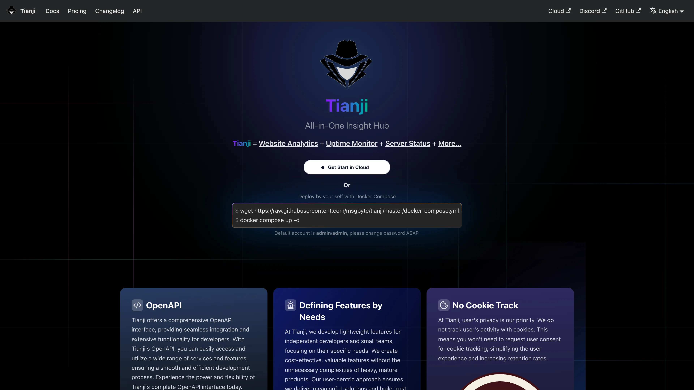

# 在 Sealos 上部署和托管 Tianji

Tianji 将网站分析、可用性监控和服务器状态整合到一个轻量洞察中心。本模板在 Sealos Cloud 上部署 Tianji 1.34.0，并附带托管 PostgreSQL 16.4。

## 关于 Tianji 托管

Tianji 以 Node.js Web 应用运行，同一个容器提供控制台、遥测 API 和后台上报能力。PostgreSQL 保存工作区、网站、监控和审计数据。Sealos 会自动创建数据库、幂等初始化 `tianji` 库，并通过 Kubernetes Secret 注入连接凭据。

默认开启注册，方便首次访问时创建所有者账号。首个账号创建后，如需私有化部署，可将注册开关关闭。

## 常见使用场景

- **网站分析**：统计页面访问、会话和访客趋势，无需把数据交给第三方 GA。
- **可用性监控**：检查 HTTP 端点，并在服务不可用时告警。
- **服务器状态**：通过 Tianji reporter 采集轻量主机指标。
- **产品遥测**：为可自托管产品收集部署与使用信号。
- **团队洞察中心**：在同一工作区共享分析、监控和状态页。

## Tianji 托管依赖

Sealos 模板包含 Tianji Deployment、Service、Ingress、PostgreSQL 16.4 Cluster，以及创建 `tianji` 数据库的一次性初始化 Job。

### 部署依赖

- [Tianji 文档](https://tianji.dev) - Tianji 官方文档
- [Tianji GitHub](https://github.com/msgbyte/tianji) - 源码与发布说明
- [PostgreSQL 文档](https://www.postgresql.org/docs/) - 数据库后端文档

## 实现细节

### 架构组件

本模板会部署以下资源：

- **Tianji Deployment**：运行 `moonrailgun/tianji:1.34.0`，暴露端口 `12345`。
- **Service 与 Ingress**：通过 Sealos 公网域名以 HTTPS 发布控制台。
- **PostgreSQL Cluster**：使用 KubeBlocks PostgreSQL 16.4.0 保存业务数据。
- **PostgreSQL Init Job**：等待数据库就绪后，按需创建 `tianji` 数据库。

### 资源分配

| 组件 | CPU Request | CPU Limit | Memory Request | Memory Limit | Storage |
|------|-------------|-----------|----------------|--------------|---------|
| Tianji | 50m | 500m | 102Mi | 1024Mi | - |
| PostgreSQL | 50m | 500m | 51Mi | 512Mi | 1Gi |
| PostgreSQL Init Job | 10m | 100m | 12Mi | 128Mi | - |

### 配置

- **Tianji 版本**：1.34.0
- **PostgreSQL 版本**：16.4.0
- **端口**：12345
- **JWT secret**：每次部署自动生成
- **ALLOW_REGISTER**：默认 `true`，便于首个用户注册
- **ALLOW_OPENAPI**：默认 `true`
- **PUBLIC_URL**：设置为 Sealos HTTPS Ingress 地址
- **探针**：HTTP `/`，与官方 Helm chart 对齐

## 为什么在 Sealos 上部署 Tianji？

- **一键部署**：打开模板页，点击 **Deploy Now**，无需手写 Kubernetes YAML。
- **托管 PostgreSQL**：Sealos 自动创建并完成数据库接线。
- **自动 HTTPS**：控制台通过 Sealos 公网域名和 TLS 访问。
- **运维简单**：可用 Canvas、AI 对话和资源卡片查看状态或调整资源。
- **按量计费**：从已验证的最小资源起步，按流量再扩容。

## 部署指南

1. 打开 [Tianji 模板](https://sealos.io/products/app-store/tianji) 并点击 **Deploy Now**。
2. 在弹窗中配置参数：
   - **ALLOW_REGISTER**：首次创建所有者账号时保持 `true`；私有实例可之后改为 `false`。
   - **ALLOW_OPENAPI**：开启或关闭 OpenAPI。
3. 等待部署完成，通常需要 2-3 分钟。部署后会进入 Canvas。后续如需调整，可在 AI 对话中描述需求，或点击相关资源卡片修改配置。
4. 打开 Canvas 中显示的公网 URL。

## 登录和注册

1. 打开 Tianji URL，进入注册页（`/register`）。
2. 使用用户名和密码创建第一个账号。首个注册用户会成为工作区所有者。
3. 在 `/login` 使用同一用户名和密码登录。

如果关闭了注册（`ALLOW_REGISTER=false`）且还没有用户，请先把部署参数改回允许注册，创建所有者后再按需关闭注册。

## 配置

部署完成后，可通过以下方式配置 Tianji：

- **Tianji UI**：创建网站、监控、状态页和工作区设置。
- **AI 对话**：描述资源或环境变量变更，由 Sealos 应用更新。
- **资源卡片**：在 Canvas 中打开 Deployment、Ingress 或 PostgreSQL 卡片直接调整。

## 扩缩容

默认使用 `500m` CPU / `1024Mi` 内存。冷启动会执行 Prisma 迁移；登录后的冒烟测试内存约占 1024Mi 限额的四分之一。若频繁使用 lighthouse 或 Chromium 相关功能，可提高内存；分析数据增长时再提高 PostgreSQL 存储。

## 故障排查

### 无法注册账号

确认 `ALLOW_REGISTER` 为 `true`。必须先通过注册页创建首个账号，再关闭注册。

### 部署后应用长期 Unavailable

等待 PostgreSQL 和 `pg-init` Job 完成 `tianji` 数据库创建。Tianji 首次启动还会执行 Prisma 迁移，可能需要几分钟。

### 注册后无法登录

使用 `/register` 时创建的用户名和密码。Tianji 使用用户名/密码登录，不是邮箱。

## 更多资源

- [Tianji 文档](https://tianji.dev)
- [Tianji GitHub Releases](https://github.com/msgbyte/tianji/releases)
- [Sealos Discord](https://discord.gg/wdUn538zVP)

## 许可证

本 Sealos 模板遵循 Sealos templates 仓库许可证。Tianji 本体采用 [Apache-2.0 许可证](https://github.com/msgbyte/tianji/blob/master/LICENSE)。
