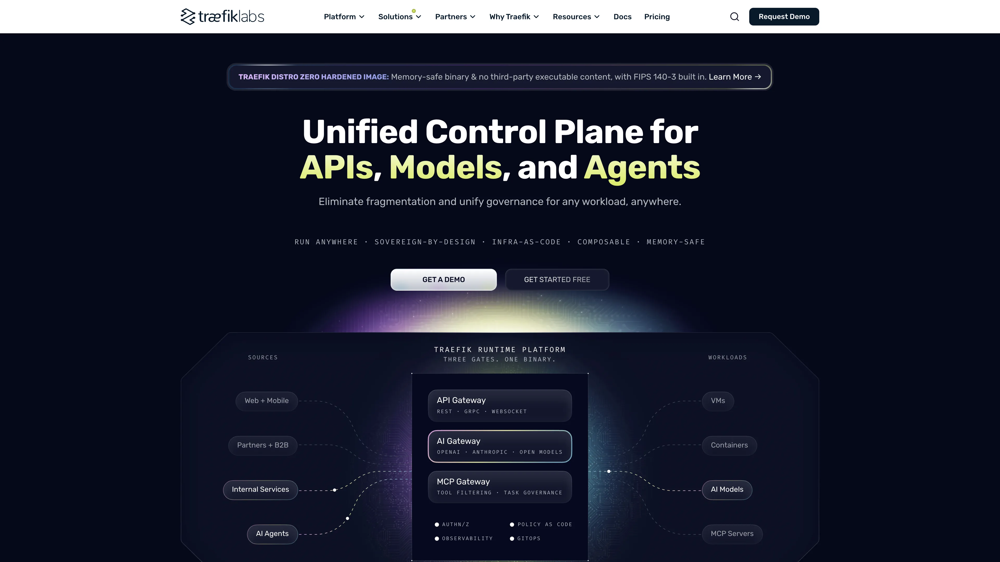

# Deploy and Host Traefik on Sealos

Traefik is a cloud-native HTTP reverse proxy and load balancer. It reads routing rules dynamically, exposes a live dashboard, and forwards traffic to services without restarting the proxy. This Sealos template runs Traefik 3.8 with a bundled whoami backend, a file provider, and a public dashboard.



## About Hosting Traefik

The template runs one Deployment with two containers. The `traefik` container listens on port `8080` for HTTP traffic and port `8082` for its internal API entrypoint. The `whoami` container answers on `127.0.0.1:8081` and returns request headers, so the root path demonstrates a working router, service, and load-balancer chain.

A ConfigMap supplies the file provider configuration. The `api` router sends `/api` and `/dashboard` to `api@internal`, while the `whoami` router sends every other path to the sidecar. Traefik chooses the longer rule for `/api` and `/dashboard`, so the dashboard and the demo backend coexist on one hostname.

Sealos Ingress terminates TLS and forwards HTTP to the Traefik Service. The dashboard reads live router, service, middleware, and entrypoint state from the running proxy. The App card opens `/dashboard/` directly.

## Common Use Cases

- **Routing Prototyping**: Validate path, host, and header rules against real HTTP traffic before applying them to production.
- **Reverse Proxy Evaluation**: Compare Traefik routing, middleware, and observability behavior with an existing gateway.
- **Internal Service Gateway**: Front a set of Kubernetes Services with one dynamic configuration file.
- **Header and Request Inspection**: Use the whoami backend to see exactly what the proxy forwards.
- **Dashboard Training**: Explore live routers, services, and entrypoints in a safe single-node deployment.

## Dependencies for Hosting Traefik

- A Sealos workspace with CPU and memory quota.
- A browser for the dashboard and an HTTP client for route checks.
- Upstream Services when you replace the bundled whoami backend.
- No database, Redis, or object storage is required.

### Deployment Dependencies

- [Traefik official site](https://traefik.io/) - Product overview and editions
- [Traefik documentation](https://doc.traefik.io/traefik/) - Routing, middleware, and provider guides
- [Traefik file provider](https://doc.traefik.io/traefik/providers/file/) - Dynamic configuration file format
- [Traefik dashboard guide](https://doc.traefik.io/traefik/operations/dashboard/) - Dashboard exposure options
- [Traefik repository](https://github.com/traefik/traefik) - Source code and release notes
- [Traefik container image](https://hub.docker.com/_/traefik) - Official image used by this template

## Implementation Details

**Architecture Components:**

- **Traefik container**: Runs `traefik:v3.8.0` with the `web` entrypoint on `8080` and the internal `traefik` entrypoint on `8082`.
- **whoami container**: Runs `traefik/whoami:v1.11.0` on `8081` and serves the root route.
- **ConfigMap**: Holds the file provider configuration with the `api` and `whoami` routers and the whoami service.
- **Service**: ClusterIP port `80` forwarding to the Traefik HTTP port.
- **Ingress**: Sealos-managed HTTPS host with a 32Mi request body limit and 300-second proxy timeouts.
- **App entry**: Opens the Traefik dashboard at `/dashboard/`.

**Configuration:**

- **Traefik image**: `traefik:v3.8.0`
- **whoami image**: `traefik/whoami:v1.11.0`
- **Web entrypoint**: `--entrypoints.web.address=:8080`
- **API entrypoint**: `--entrypoints.traefik.address=:8082`
- **Dashboard**: Enabled with `--api.dashboard=true`
- **Provider**: File provider at `/etc/traefik/dynamic/dynamic.yml`
- **Ping**: Enabled with `--ping=true`
- **Log level**: `INFO`
- **Runtime user**: UID and GID `65532`
- **Health checks**: Startup, readiness, and liveness probes request `GET /` on port `8080`
- **Security context**: Non-root execution, no privilege escalation, all capabilities dropped, `RuntimeDefault` seccomp profile

**Resource Allocation:**

| Component | CPU Request | CPU Limit | Memory Request | Memory Limit | Storage |
| --- | ---: | ---: | ---: | ---: | ---: |
| Traefik | 10m | 100m | 12Mi | 128Mi | None |
| whoami | 10m | 100m | 12Mi | 128Mi | None |

Both containers run at the lowest Sealos resource ladder tiers. A cold start, root request through Traefik, dashboard request, raw API request, and a 60-second stability window passed with zero restarts. Heavier routing tables and high connection counts benefit from a higher memory limit.

## Why Deploy Traefik on Sealos?

Sealos is an AI-assisted cloud operating system built on Kubernetes. It provides the runtime and networking layer around Traefik:

- **One-Click Deployment**: Create the Deployment, ConfigMap, Service, Ingress, and App entry from a single template.
- **Automatic HTTPS**: Terminate public TLS at the platform Ingress and keep Traefik focused on internal routing.
- **Dynamic Configuration**: Edit the ConfigMap and restart the Pod to load new routers and services.
- **Live Dashboard**: Inspect routers, services, middlewares, and entrypoints from the browser.
- **Small Footprint**: Run the proxy and demo backend at the minimum resource tier.
- **Operational Visibility**: Review logs, probes, and resource usage from Canvas or the Sealos AI dialog.

## Deployment Guide

1. Open the [Traefik template](https://sealos.io/products/app-store/traefik) and click **Deploy Now**.
2. Confirm the generated application name and host, then submit the deployment.
3. Wait 2-3 minutes for both containers to become ready and the certificate to be issued.
4. Open the App card to reach the dashboard at `/dashboard/`.
5. Open the root URL to see the whoami page, which confirms the router and backend chain.

## Routing Configuration

The ConfigMap key `vn-etcvn-traefikvn-dynamicvn-dynamicvn-yml` holds the file provider configuration. Replace the whoami service with your own upstream:

```yaml
http:
  routers:
    api:
      rule: "PathPrefix(`/api`) || PathPrefix(`/dashboard`)"
      service: api@internal
    app:
      rule: "PathPrefix(`/`)"
      service: app
  services:
    app:
      loadBalancer:
        servers:
          - url: "http://my-service.default.svc.cluster.local:8080"
```

Save the ConfigMap, then restart the Deployment from Canvas. Traefik validates the file on startup and reports syntax errors in the container log. Keep the `api` router when you want the dashboard to remain available.

The dashboard and raw API expose live routing data without authentication in this profile. Use a private workspace, add an authenticating middleware, or remove the `api` router when the deployment is reachable by untrusted users.

## Scaling

Traefik keeps routing state in memory and reads the same ConfigMap on every replica, so you can raise the Deployment replica count for availability. The bundled whoami backend runs as a sidecar; replace it with a scalable Service when you move to real upstreams.

Raise the CPU limit for TLS-adjacent processing, compression, and high request rates. Raise the memory limit when the routing table or connection pool grows. The dashboard reads from the local proxy instance, so each replica shows its own view.

## Troubleshooting

### The Pod fails with `listen tcp :8080: bind: address already in use`

The API entrypoint shares port `8080` when it uses the default address. This template assigns the API entrypoint to `8082` with `--entrypoints.traefik.address=:8082`; keep the web and API entrypoints on distinct ports.

### The dashboard returns 404

Confirm the `api` router exists in the file provider and that `--api.dashboard=true` is set. The router rule must include both `/api` and `/dashboard`, and the `api@internal` service must be referenced exactly.

### The root URL returns a Traefik 404

Check that the `whoami` router matches `/` and that its service points to `http://127.0.0.1:8081`. A missing or malformed dynamic configuration leaves the proxy running with no application routes.

### Requests return 502

The upstream URL is unreachable. Use the Kubernetes Service FQDN and the container port, confirm the upstream has ready endpoints, and check that no NetworkPolicy blocks traffic from the Traefik Pod.

### Configuration changes do not apply

The file provider reads the mounted file at startup. Restart the Deployment after editing the ConfigMap. Validate the YAML before restarting so the proxy does not fail on a syntax error.

### Getting Help

- [Traefik documentation](https://doc.traefik.io/traefik/)
- [Traefik community forum](https://community.traefik.io/)
- [Sealos documentation](https://sealos.io/docs)

## License

Traefik is released under the [MIT License](https://github.com/traefik/traefik/blob/master/LICENSE.md). This Sealos template is distributed under the templates repository license.
