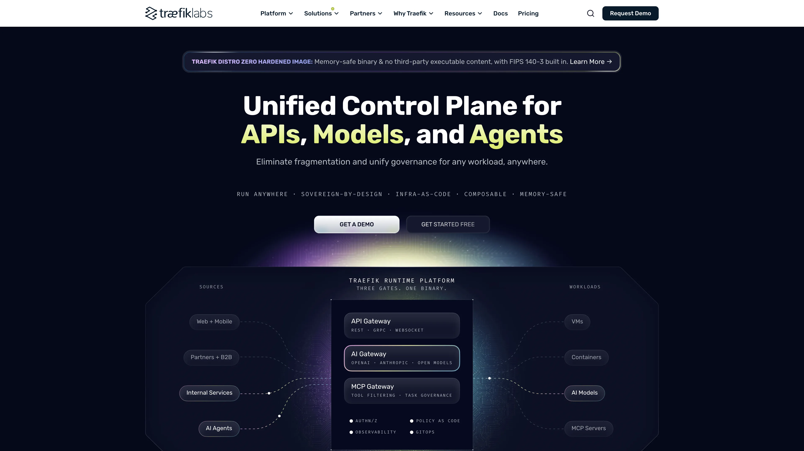

# 在 Sealos 上部署和托管 Traefik

Traefik 是云原生 HTTP 反向代理与负载均衡器。它动态读取路由规则，提供实时仪表盘，并在无需重启代理的情况下转发流量。本 Sealos 模板运行 Traefik 3.8，内置 whoami 后端、文件提供程序和公网仪表盘。



## Traefik 托管说明

模板使用单个 Deployment 运行两个容器。`traefik` 容器在 `8080` 端口处理 HTTP 流量，在 `8082` 端口提供内部 API 入口；`whoami` 容器监听 `127.0.0.1:8081` 并返回请求头，根路径由此展示完整的路由、服务和负载均衡链路。

ConfigMap 提供文件提供程序配置。`api` 路由将 `/api` 和 `/dashboard` 交给 `api@internal`，`whoami` 路由将其他路径交给 sidecar。Traefik 优先匹配更长的规则，因此仪表盘与演示后端可以共用同一域名。

Sealos Ingress 终止 TLS，并将 HTTP 请求转发到 Traefik Service。仪表盘从运行中的代理读取路由器、服务、中间件和入口点状态。App 卡片直接打开 `/dashboard/`。

## 常见使用场景

- **路由规则验证**：在应用到生产前，用真实 HTTP 流量验证路径、主机和请求头规则。
- **反向代理评估**：对比 Traefik 与现有网关在路由、中间件和可观测性方面的表现。
- **内部服务网关**：用一份动态配置文件统一代理一组 Kubernetes Service。
- **请求头检查**：使用 whoami 后端查看代理实际转发的请求内容。
- **仪表盘培训**：在安全的单节点部署中浏览实时路由器、服务和入口点。

## Traefik 托管依赖

- 具备 CPU 和内存配额的 Sealos 工作空间。
- 用于访问仪表盘的浏览器和用于路由检查的 HTTP 客户端。
- 替换 whoami 后端时需要的上游 Service。
- 本模板无需数据库、Redis 或对象存储。

### 部署依赖

- [Traefik 官网](https://traefik.io/) - 产品介绍与版本说明
- [Traefik 文档](https://doc.traefik.io/traefik/) - 路由、中间件与提供程序指南
- [Traefik 文件提供程序](https://doc.traefik.io/traefik/providers/file/) - 动态配置文件格式
- [Traefik 仪表盘指南](https://doc.traefik.io/traefik/operations/dashboard/) - 仪表盘暴露方式
- [Traefik 代码仓库](https://github.com/traefik/traefik) - 源码与版本说明
- [Traefik 容器镜像](https://hub.docker.com/_/traefik) - 本模板使用的官方镜像

## 实现细节

**架构组件：**

- **Traefik 容器**：运行 `traefik:v3.8.0`，`web` 入口点监听 `8080`，内部 `traefik` 入口点监听 `8082`。
- **whoami 容器**：运行 `traefik/whoami:v1.11.0`，在 `8081` 提供根路由内容。
- **ConfigMap**：保存文件提供程序配置，包含 `api` 和 `whoami` 路由器以及 whoami 服务。
- **Service**：ClusterIP 的 `80` 端口转发到 Traefik HTTP 端口。
- **Ingress**：Sealos 管理的 HTTPS 域名，请求体上限 32Mi，代理超时 300 秒。
- **App 入口**：打开 `/dashboard/` 的 Traefik 仪表盘。

**配置说明：**

- **Traefik 镜像**：`traefik:v3.8.0`
- **whoami 镜像**：`traefik/whoami:v1.11.0`
- **Web 入口点**：`--entrypoints.web.address=:8080`
- **API 入口点**：`--entrypoints.traefik.address=:8082`
- **仪表盘**：通过 `--api.dashboard=true` 启用
- **提供程序**：文件提供程序读取 `/etc/traefik/dynamic/dynamic.yml`
- **Ping**：通过 `--ping=true` 启用
- **日志级别**：`INFO`
- **运行用户**：UID 和 GID `65532`
- **健康检查**：启动、就绪和存活探针请求 `8080` 端口的 `GET /`
- **安全上下文**：非 root 运行，禁用权限提升，丢弃全部 capabilities，启用 `RuntimeDefault` seccomp 配置

**资源分配：**

| 组件 | CPU 请求 | CPU 上限 | 内存请求 | 内存上限 | 存储 |
| --- | ---: | ---: | ---: | ---: | ---: |
| Traefik | 10m | 100m | 12Mi | 128Mi | 无 |
| whoami | 10m | 100m | 12Mi | 128Mi | 无 |

两个容器均运行在 Sealos 资源阶梯的最低档位。冷启动、通过 Traefik 访问根路径、访问仪表盘、调用原始 API 以及 60 秒稳定性观察均已通过，重启次数为 0。更复杂的路由表和高连接数建议提高内存上限。

## 为什么在 Sealos 上部署 Traefik？

Sealos 是基于 Kubernetes 的 AI 辅助云操作系统，为 Traefik 提供运行时与网络能力：

- **一键部署**：通过一个模板创建 Deployment、ConfigMap、Service、Ingress 和 App 入口。
- **自动 HTTPS**：公网 TLS 由平台 Ingress 终止，Traefik 专注内部路由。
- **动态配置**：修改 ConfigMap 并重启 Pod，即可加载新的路由与服务。
- **实时仪表盘**：在浏览器中查看路由器、服务、中间件和入口点。
- **资源占用小**：代理与演示后端均运行在最低资源档位。
- **运维可视**：通过 Canvas 或 Sealos AI 对话查看日志、探针和资源使用情况。

## 部署指南

1. 打开 [Traefik 模板](https://sealos.io/products/app-store/traefik)，点击 **Deploy Now**。
2. 确认自动生成的应用名和域名后提交部署。
3. 等待 2-3 分钟，两个容器进入 Ready 且证书签发完成。
4. 打开 App 卡片，进入 `/dashboard/` 仪表盘。
5. 打开根路径查看 whoami 页面，确认路由与后端链路正常。

## 路由配置

ConfigMap 键 `vn-etcvn-traefikvn-dynamicvn-dynamicvn-yml` 保存文件提供程序配置。将 whoami 服务替换为自有上游：

```yaml
http:
  routers:
    api:
      rule: "PathPrefix(`/api`) || PathPrefix(`/dashboard`)"
      service: api@internal
    app:
      rule: "PathPrefix(`/`)"
      service: app
  services:
    app:
      loadBalancer:
        servers:
          - url: "http://my-service.default.svc.cluster.local:8080"
```

保存 ConfigMap 后，在 Canvas 中重启 Deployment。Traefik 在启动时校验文件，并在容器日志中报告语法错误。需要保留仪表盘时，同时保留 `api` 路由。

当前配置中的仪表盘与原始 API 未启用认证。建议使用私有工作空间，增加认证中间件，或在部署可被不受信任用户访问时移除 `api` 路由。

## 扩缩容

Traefik 将路由状态保存在内存中，所有副本读取同一 ConfigMap，因此可以提高 Deployment 副本数提升可用性。内置 whoami 后端以 sidecar 形式运行；接入真实上游后，应替换为可独立扩缩的 Service。

处理压缩和高请求速率时提高 CPU 上限，路由表或连接池增长时提高内存上限。仪表盘读取本地代理实例，每个副本展示各自视角。

## 故障排查

### Pod 报 `listen tcp :8080: bind: address already in use`

API 入口点使用默认地址时会与 `8080` 冲突。本模板通过 `--entrypoints.traefik.address=:8082` 将 API 入口点分配到独立端口，修改配置时保持 Web 与 API 入口点使用不同端口。

### 仪表盘返回 404

确认文件提供程序中存在 `api` 路由器，并确认已设置 `--api.dashboard=true`。路由规则需要同时包含 `/api` 和 `/dashboard`，并正确引用 `api@internal` 服务。

### 根路径返回 Traefik 404

检查 `whoami` 路由器是否匹配 `/`，服务是否指向 `http://127.0.0.1:8081`。动态配置缺失或格式错误时，代理会继续运行，同时没有可用的应用路由。

### 请求返回 502

上游地址不可达。使用 Kubernetes Service FQDN 和容器端口，确认上游存在 Ready 端点，并检查 NetworkPolicy 是否阻断 Traefik Pod 的请求。

### 配置修改未生效

文件提供程序在启动时读取挂载文件。修改 ConfigMap 后重启 Deployment，并在重启前校验 YAML，避免代理因语法错误无法启动。

### 获取帮助

- [Traefik 文档](https://doc.traefik.io/traefik/)
- [Traefik 社区论坛](https://community.traefik.io/)
- [Sealos 文档](https://sealos.io/docs)

## 许可证

Traefik 采用 [MIT License](https://github.com/traefik/traefik/blob/master/LICENSE.md)。本 Sealos 模板遵循 templates 仓库许可证。
