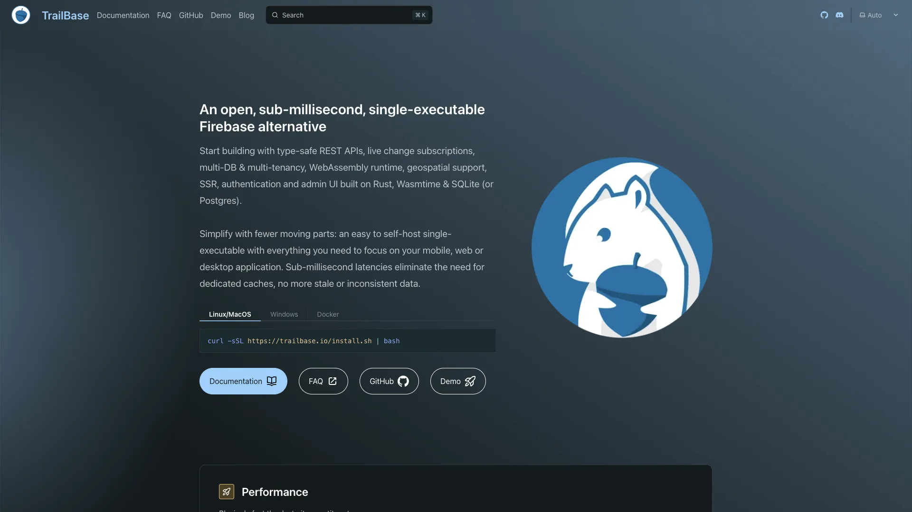

# Deploy and Host TrailBase on Sealos

TrailBase is a self-hosted, single-binary backend for web and mobile applications. It combines type-safe REST and realtime APIs, SQLite storage, authentication, file uploads, a WebAssembly runtime, and an admin dashboard in one Rust process. This Sealos template runs TrailBase 0.37.1 with a 1Gi persistent depot.

## About Hosting TrailBase

TrailBase runs as one StatefulSet with a single application container on port `4000`. The server initializes its SQLite databases, session store, log store, default configuration, and an administrator account on first boot. The admin dashboard and the generated REST API share the same process, so the deployment needs no separate database, cache, or reverse proxy.

The template mounts a 1Gi volume at `/data`. An init container copies the image's bundled depot, including the optional authentication UI component, into that volume before the server starts. The volume then keeps databases, sessions, uploaded files, configuration, and WASM components across Pod restarts and template updates.

On first boot TrailBase prints the generated administrator credentials to the container log. Copy the email and password from the `Created new admin user` entry, then sign in at `/_/admin/`. The tested profile uses `50m` CPU and `12Mi` memory as requests and `500m` CPU and `128Mi` memory as limits.

## Common Use Cases

- **Mobile and web backend**: Expose typed records, filters, pagination, and realtime subscriptions without writing a custom server.
- **Internal tools**: Build small admin tools and data-entry applications on a single SQLite-backed service.
- **Rapid prototyping**: Start with authentication, file storage, APIs, and an admin UI in one deployment.
- **Edge data collection**: Collect form submissions, telemetry, or device records through generated REST endpoints.
- **Extension hosting**: Run custom WASM components for server-side logic while keeping the core binary unchanged.
- **Private application data**: Keep records, accounts, and uploaded files on infrastructure you control.

## Dependencies for TrailBase Hosting

- A Sealos workspace with at least 128Mi of memory and 1Gi of persistent storage.
- A browser for the admin dashboard and API explorer.
- Optional outbound SMTP access for email verification, password recovery, and OTP sign-in.
- Optional OAuth provider credentials when social sign-in is enabled.
- Optional network access from client applications to the public HTTPS endpoint.

### Deployment Dependencies

- [TrailBase project](https://github.com/trailbaseio/trailbase) - Source code, releases, and issue tracker
- [TrailBase documentation](https://trailbase.io/docs) - Installation, configuration, API, and authentication guides
- [Docker installation guide](https://trailbase.io/getting-started/install/) - Official single-container command and depot layout
- [Container image](https://hub.docker.com/r/trailbase/trailbase) - Multi-architecture image used by this template
- [Release 0.37.1](https://github.com/trailbaseio/trailbase/releases/tag/v0.37.1) - Version used by this template
- [Configuration schema](https://github.com/trailbaseio/trailbase/blob/v0.37.1/crates/core/proto/config.proto) - Server, auth, database, and record API settings
- [Sealos documentation](https://sealos.io/docs) - Platform concepts and operations

## Implementation Details

**Architecture Components:**

- **TrailBase StatefulSet**: One replica running the Rust server, admin UI, REST API, and SQLite stores on port `4000`.
- **Depot initializer**: An init container copies `/app/traildepot` from the image into `/data` only when files are missing, preserving the bundled auth UI component.
- **Application volume**: A 1Gi volume at `/data` for SQLite databases, sessions, logs, uploads, config, and WASM components.
- **Service**: ClusterIP port `80` forwarding to the TrailBase HTTP port.
- **Ingress**: Sealos-managed HTTPS host with a 32Mi request body limit and 300-second proxy timeouts.
- **App entry**: Opens the admin dashboard at `/_/admin/`.

**Configuration:**

- **Image**: `trailbase/trailbase:0.37.1`
- **Process**: `tini -- /app/trail --depot /data run --address 0.0.0.0:4000`
- **HTTP port**: `4000`
- **Depot path**: `/data`
- **Admin dashboard**: `/_/admin/`
- **Health check**: `GET /api/healthcheck`
- **Initial administrator**: Generated on first boot and printed once in the container log
- **Default configuration**: `/data/config.textproto`, created with defaults on first boot
- **Public URL**: `https://${{ defaults.app_host }}.${{ SEALOS_CLOUD_DOMAIN }}/`
- **Security context**: Runs as UID `1000` and GID `1000`, drops all Linux capabilities, disables privilege escalation, and applies the `RuntimeDefault` seccomp profile

**Resource Allocation:**

| Component | CPU Request | CPU Limit | Memory Request | Memory Limit | Storage |
| --- | ---: | ---: | ---: | ---: | ---: |
| TrailBase | 50m | 500m | 12Mi | 128Mi | 1Gi |
| Depot initializer | 50m | 500m | 25Mi | 256Mi | Shared |

The values above are the live-tested profile. The Pod reached Ready with zero restarts, the generated administrator signed in, the Tables view and health endpoint responded, and a Pod restart preserved the account and session. Idle memory settled near 42Mi and CPU near 5m.

## Why Deploy TrailBase on Sealos?

Sealos is an AI-assisted cloud operating system built on Kubernetes. It provides the compute, storage, networking, and operations layer for TrailBase in one interface:

- **One-Click Deployment**: Create the StatefulSet, init container, volume, Service, Ingress, and App entry from one template.
- **Single-Process Backend**: Run APIs, authentication, SQLite, and the admin UI without a database cluster.
- **Automatic HTTPS**: Receive a managed public domain and TLS certificate for the API and dashboard.
- **Persistent Data**: Keep databases, sessions, uploads, and configuration on a dedicated volume.
- **Resource Control**: Adjust CPU and memory from the resource card as traffic grows.
- **Operational Visibility**: Inspect Pod logs, events, and resource usage from Canvas or the Sealos AI dialog.

## Deployment Guide

1. Open the [TrailBase template](https://sealos.io/products/app-store/trailbase) and click **Deploy Now**.
2. Confirm the generated application name and start the deployment.
3. Wait 2-3 minutes for the Pod to become ready and for the HTTPS certificate to be issued.
4. Open the App card, then open the **Logs** view for the TrailBase Pod. Find the `Created new admin user` entry and copy the generated email and password.
5. Visit `/_/admin/` and sign in with those credentials.
6. Open **Tables & Views** to inspect the default schemas and **Accounts** to create or manage users.
7. Use **Settings** to configure email, OAuth, or application options, and **OpenAPI** to explore the generated API.

### First Login

The administrator email is `admin@localhost` by default, and the password is random for each new deployment. TrailBase prints both values only on the first initialization of an empty depot. Store the password in a password manager after the first login, or create a named administrator from **Accounts** and use that account for daily operations.

### Connecting an Application

Client applications use the same public HTTPS origin as the admin UI. Record APIs appear under `/api/records/v1/<api-name>`, and the OpenAPI page lists the exact paths and authentication requirements. Keep the server URL in the client configuration as `https://<app-host>.sealos.app` and use the account tokens issued by TrailBase.

## Using TrailBase

The admin dashboard groups the main workflows into seven sections: **Tables & Views** for schema and record inspection, **SQL Editor** for direct queries, **ERD** for relationship visualization, **Accounts** for users and tenants, **WASM** for installed components, **Logs** for HTTP access records, and **OpenAPI** for endpoint discovery and testing.

The default depot contains the internal authentication and session schemas plus the public tables created by your migrations. New record APIs are declared in `config.textproto`, which can be edited from the Settings view. The server watches configuration changes and applies supported updates without a rebuild.

File upload endpoints, realtime subscriptions, and authentication flows are generated from the same schema. The optional authentication UI component is copied from the image into `/data/wasm` during initialization, so routes such as `/_/auth/login` remain available after a fresh volume is created.

## Data and Persistence

All state lives on the `/data` volume. The depot contains the main SQLite database, separate logs and session databases, uploaded files, `config.textproto`, and the WASM component directory. The init container copies bundled files with `cp -an`, which leaves existing files untouched and restores missing defaults after an image update.

Keep the volume bound for the lifetime of the deployment. Deleting the Instance removes the StatefulSet, Service, Ingress, and PVC, along with every account, record, and uploaded file. For a manual backup, stop the Pod and copy the complete `/data` directory, or use SQLite backup tooling against the depot databases.

## Scaling

TrailBase uses SQLite as its default store, so the template runs one replica with a single writer. Scale vertically by raising the memory limit for large datasets, many concurrent subscriptions, or heavy file uploads. The Rust server uses little idle memory; the main growth comes from SQLite page cache, request buffers, and realtime connection state.

Horizontal scaling requires an external database and a shared deployment model that TrailBase 0.37.1 does not provide out of the box. Keep one replica and increase the volume for larger datasets. Applications with read-heavy public traffic can place a CDN or cache in front of immutable endpoints while keeping writes on the single instance.

## Troubleshooting

### The login page rejects `admin@localhost`

The generated password appears only in the first-boot log entry. Search the Pod logs for `Created new admin user` and copy the exact value. If the log has rotated away, create a new administrator by restoring a backup or reset the depot, which removes all data.

### The admin dashboard returns 404

Open the exact path `/_/admin/`, including the trailing slash. The root path serves application APIs and may return a different response. Confirm that the Ingress host matches the App card URL and that the Service targets port `4000`.

### The Pod fails with `exec --data-dir failed`

This error means the container command replaced the image entrypoint without including the binary. The template runs `tini -- /app/trail` explicitly and passes `--depot /data` as arguments. Keep that command structure when customizing the template.

### The init container cannot copy the depot

The depot initializer runs as UID `1000` and writes to the volume mounted at `/data`. Confirm the PVC is `Bound` and that `fsGroup: 1000` is applied. A permission error indicates a volume created with an incompatible ownership policy.

### Email verification or password recovery does not send mail

TrailBase falls back to local sendmail when SMTP is not configured, and the container has no mail transfer agent. Configure an SMTP host, port, username, and password in `config.textproto` under the email section, then restart the Pod. The admin login itself does not depend on email delivery.

### Sessions expire after a redeploy

Session data and signing keys live in the `/data` depot. Replacing the volume creates a new depot and invalidates existing sessions. Keep the same PVC across template updates and take a backup before changing storage settings.

### The Pod uses more memory than expected

SQLite page cache, realtime subscriptions, and large uploads share the container limit. Raise the memory limit from the resource card for large datasets, and keep the depot within the 1Gi volume. A Pod that restarts with `OOMKilled` needs the next memory tier.

### Getting Help

- [TrailBase documentation](https://trailbase.io/docs)
- [TrailBase GitHub issues](https://github.com/trailbaseio/trailbase/issues)
- [TrailBase Discord](https://discord.gg/X8cWs7YC22)
- [Sealos documentation](https://sealos.io/docs)

## License

TrailBase is released under the [Open Software License 3.0](https://github.com/trailbaseio/trailbase/blob/v0.37.1/LICENSE). This template is an independent deployment definition and is not affiliated with or endorsed by the TrailBase project. This Sealos template is distributed under the templates repository license.
