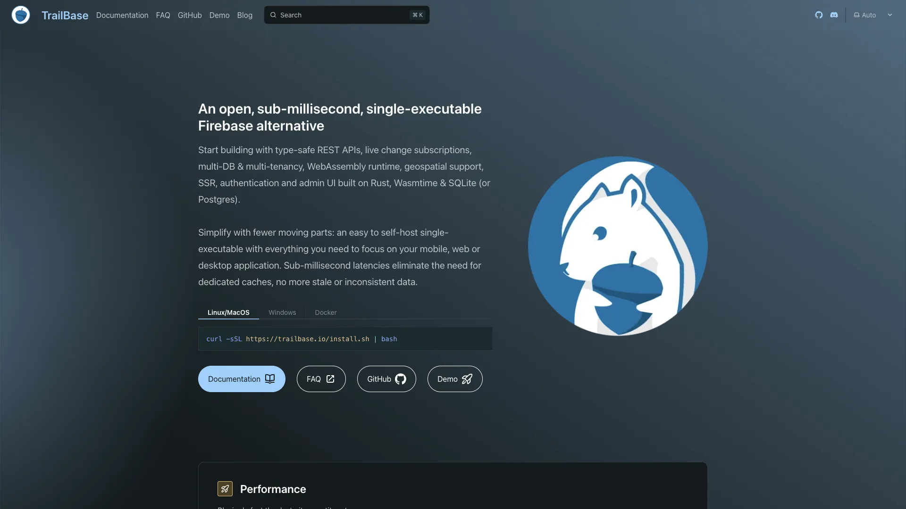

# 在 Sealos 上部署和托管 TrailBase

TrailBase 是自托管的单二进制后端，为 Web 和移动应用提供类型安全的 REST 与实时 API、SQLite 存储、认证、文件上传、WebAssembly 运行时和管理后台。本 Sealos 模板运行 TrailBase 0.37.1，并使用 1Gi 持久化 depot。

## 托管说明

TrailBase 以单个 StatefulSet 运行一个应用容器，监听 `4000` 端口。服务在首次启动时初始化 SQLite 数据库、会话存储、日志存储、默认配置和管理员账号。管理后台与自动生成的 REST API 共用同一进程，因此部署无需单独的数据库、缓存或反向代理。

模板将 1Gi 卷挂载到 `/data`。初始化容器先把镜像内置的 depot 复制到该卷，包括可选的认证 UI 组件，然后启动服务。该卷保存数据库、会话、上传文件、配置和 WASM 组件，在 Pod 重启和模板升级后仍然保留。

首次启动时，TrailBase 会把生成的管理员凭据打印到容器日志。复制 `Created new admin user` 条目中的邮箱和密码，然后在 `/_/admin/` 登录。实测配置以 `50m` CPU 和 `25Mi` 内存作为请求，以 `500m` CPU 和 `128Mi` 内存作为上限。

## 常见使用场景

- **移动端与 Web 后端**：直接获得类型化记录、筛选、分页和实时订阅，无需自建服务端。
- **内部工具**：用单个 SQLite 服务搭建数据录入、运营后台和小型管理应用。
- **快速原型**：一次部署同时获得认证、文件存储、API 和管理界面。
- **边缘数据收集**：通过生成的 REST 端点收集表单、遥测或设备记录。
- **扩展托管**：运行自定义 WASM 组件承载服务端逻辑，核心二进制保持不变。
- **私有应用数据**：把记录、账号和上传文件保存在自己掌控的基础设施中。

## 部署依赖

- 至少 128Mi 内存和 1Gi 持久化存储的 Sealos 工作区。
- 用于管理后台和 API 浏览器访问的浏览器。
- 可选的出网 SMTP 访问，用于邮箱验证、密码恢复和 OTP 登录。
- 启用社交登录时可选的 OAuth 提供商凭据。
- 客户端应用访问公网 HTTPS 地址所需的网络连通性。

### 部署相关链接

- [TrailBase 项目页](https://github.com/trailbaseio/trailbase)：源码、发布和问题跟踪
- [TrailBase 文档](https://trailbase.io/docs)：安装、配置、API 和认证指南
- [Docker 安装指南](https://trailbase.io/getting-started/install/)：官方单容器命令与 depot 结构
- [容器镜像](https://hub.docker.com/r/trailbase/trailbase)：本模板使用的多架构镜像
- [0.37.1 发布](https://github.com/trailbaseio/trailbase/releases/tag/v0.37.1)：本模板使用的版本
- [配置 Schema](https://github.com/trailbaseio/trailbase/blob/v0.37.1/crates/core/proto/config.proto)：服务、认证、数据库和记录 API 设置
- [Sealos 文档](https://sealos.io/docs)：平台概念与操作

## 实现细节

**架构组件：**

- **TrailBase StatefulSet**：单副本运行 Rust 服务、管理后台、REST API 和 SQLite 存储，监听 `4000` 端口。
- **Depot 初始化容器**：仅在文件缺失时把镜像内的 `/app/traildepot` 复制到 `/data`，保留内置认证 UI 组件。
- **应用卷**：挂载到 `/data` 的 1Gi 卷，保存 SQLite 数据库、会话、日志、上传文件、配置和 WASM 组件。
- **Service**：ClusterIP 端口 `80` 转发到 TrailBase HTTP 端口。
- **Ingress**：Sealos 管理的 HTTPS 域名，请求体上限 32Mi，代理超时 300 秒。
- **App 入口**：打开位于 `/_/admin/` 的管理后台。

**配置：**

- **镜像**：`trailbase/trailbase:0.37.1`
- **进程**：`tini -- /app/trail --depot /data run --address 0.0.0.0:4000`
- **HTTP 端口**：`4000`
- **Depot 路径**：`/data`
- **管理后台**：`/_/admin/`
- **健康检查**：`GET /api/healthcheck`
- **初始管理员**：首次启动时生成，并只在容器日志中打印一次
- **默认配置**：`/data/config.textproto`，首次启动时自动创建
- **公网地址**：`https://${{ defaults.app_host }}.${{ SEALOS_CLOUD_DOMAIN }}/`
- **安全上下文**：以 UID `1000` 和 GID `1000` 运行，丢弃全部 Linux capability，禁用权限提升，并应用 `RuntimeDefault` seccomp 配置

**资源分配：**

| 组件 | CPU 请求 | CPU 上限 | 内存请求 | 内存上限 | 存储 |
| --- | ---: | ---: | ---: | ---: | ---: |
| TrailBase | 50m | 500m | 25Mi | 128Mi | 1Gi |
| Depot 初始化容器 | 50m | 500m | 25Mi | 256Mi | 共享 |

以上为实测配置。Pod 达到 Ready 且零重启，生成的管理员成功登录，Tables 视图与健康检查正常，Pod 重启后账号和会话仍然保留。空闲内存约 42Mi，CPU 约 5m。

## 为什么在 Sealos 上部署 TrailBase？

Sealos 是基于 Kubernetes 的 AI 辅助云操作系统，在一个界面中提供 TrailBase 所需的计算、存储、网络和运维能力：

- **一键部署**：通过单个模板创建 StatefulSet、初始化容器、数据卷、Service、Ingress 和 App 入口。
- **单进程后端**：无需数据库集群即可运行 API、认证、SQLite 和管理后台。
- **自动 HTTPS**：获得托管的公网域名和 API、后台所需的 TLS 证书。
- **持久化数据**：数据库、会话、上传文件和配置保存在独立数据卷中。
- **资源控制**：在资源卡片中调整 CPU 和内存，适配流量增长。
- **运维可视性**：通过 Canvas 或 Sealos AI 对话框查看 Pod 日志、事件和资源使用情况。

## 部署指南

1. 打开 [TrailBase 模板](https://sealos.io/products/app-store/trailbase) 并点击 **Deploy Now**。
2. 确认自动生成的应用名称并提交部署。
3. 等待 2-3 分钟，直到 Pod 就绪并完成 HTTPS 证书签发。
4. 打开 App 卡片，进入 TrailBase Pod 的 **Logs** 视图。找到 `Created new admin user` 条目并复制生成的邮箱和密码。
5. 访问 `/_/admin/`，使用上述凭据登录。
6. 打开 **Tables & Views** 查看默认 Schema，打开 **Accounts** 创建或管理用户。
7. 在 **Settings** 中配置邮箱、OAuth 或应用选项，在 **OpenAPI** 中浏览生成的 API。

### 首次登录

管理员邮箱默认为 `admin@localhost`，密码在每次新部署时随机生成。TrailBase 只在空 depot 首次初始化时打印这两个值。首次登录后请把密码保存到密码管理器，或在 **Accounts** 中创建具名管理员作为日常账号。

### 接入应用

客户端应用使用与管理后台相同的公网 HTTPS 地址。记录 API 位于 `/api/records/v1/<api-name>`，OpenAPI 页面会列出准确路径和认证要求。客户端配置中的服务地址填写 `https://<app-host>.sealos.app`，认证使用 TrailBase 签发的账号令牌。

## 使用 TrailBase

管理后台把主要工作流分成七个区域：**Tables & Views** 用于查看 Schema 和记录，**SQL Editor** 用于直接查询，**ERD** 用于查看关系图，**Accounts** 管理用户和租户，**WASM** 管理已安装组件，**Logs** 查看 HTTP 访问记录，**OpenAPI** 用于端点发现和调试。

默认 depot 包含内部认证与会话 Schema，以及迁移创建的公共表。新的记录 API 在 `config.textproto` 中声明，可从 Settings 页面编辑。服务会监听配置变化，并应用受支持的更新，无需重新构建镜像。

文件上传端点、实时订阅和认证流程都由同一份 Schema 生成。可选的认证 UI 组件会在初始化时从镜像复制到 `/data/wasm`，因此新数据卷创建后 `/_/auth/login` 等路由仍然可用。

## 数据与持久化

所有状态保存在 `/data` 卷。Depot 包含主 SQLite 数据库、独立的日志与会话数据库、上传文件、`config.textproto` 和 WASM 组件目录。初始化容器使用 `cp -an` 复制内置文件，保留已有文件，并在镜像升级后补回缺失的默认文件。

部署生命周期内应保持该卷绑定。删除 Instance 会同时移除 StatefulSet、Service、Ingress 和 PVC，并清除全部账号、记录和上传文件。手动备份可在 Pod 停止后复制完整的 `/data` 目录，也可使用 SQLite 备份工具处理 depot 中的数据库。

## 扩展

TrailBase 默认使用 SQLite，因此模板运行单副本和单写入者。数据集变大、并发订阅增多或上传负载升高时，可提高内存上限。Rust 服务空闲内存很低，主要增长来自 SQLite 页缓存、请求缓冲和实时连接状态。

横向扩展需要外部数据库以及共享部署模型，TrailBase 0.37.1 未内置该模式。副本数保持为 1，并随数据集增长扩大数据卷。读多写少的公开端点可以在前面增加 CDN 或缓存，写入仍落在单实例。

## 故障排查

### 登录页拒绝 `admin@localhost`

生成的密码只出现在首次启动的日志条目中。在 Pod 日志中搜索 `Created new admin user` 并复制准确值。日志已轮转时，可通过备份恢复，或重置 depot，后者会删除全部数据。

### 管理后台返回 404

请打开完整路径 `/_/admin/`，包括末尾斜杠。根路径提供应用 API，返回内容可能不同。确认 Ingress 域名与 App 卡片地址一致，并确认 Service 指向 `4000` 端口。

### Pod 报错 `exec --data-dir failed`

该错误表示容器命令替换了镜像入口，却没有包含二进制路径。模板显式运行 `tini -- /app/trail`，并把 `--depot /data` 作为参数传入。自定义模板时请保留该命令结构。

### 初始化容器无法复制 depot

初始化容器以 UID `1000` 运行，并写入挂载到 `/data` 的卷。确认 PVC 状态为 `Bound`，且应用了 `fsGroup: 1000`。权限错误通常来自卷的属主策略不兼容。

### 邮箱验证或密码恢复没有发送邮件

未配置 SMTP 时，TrailBase 会回退到本地 sendmail，而容器内没有邮件传输代理。在 `config.textproto` 的 email 段配置 SMTP 主机、端口、用户名和密码，然后重启 Pod。管理员登录本身不依赖邮件发送。

### 重新部署后会话失效

会话数据和签名密钥保存在 `/data` depot。更换数据卷会创建新 depot，并使现有会话失效。模板升级时保留同一个 PVC，并在修改存储设置前做好备份。

### Pod 内存占用高于预期

SQLite 页缓存、实时订阅和大文件上传共享容器内存上限。数据集较大时可在资源卡片中提高内存上限，并把 depot 控制在 1Gi 卷范围内。出现 `OOMKilled` 重启时，应提升到下一档内存。

### 获取帮助

- [TrailBase 文档](https://trailbase.io/docs)
- [TrailBase GitHub Issues](https://github.com/trailbaseio/trailbase/issues)
- [TrailBase Discord](https://discord.gg/X8cWs7YC22)
- [Sealos 文档](https://sealos.io/docs)

## 许可证

TrailBase 采用 [Open Software License 3.0](https://github.com/trailbaseio/trailbase/blob/v0.37.1/LICENSE)。本模板是独立部署定义，与 TrailBase 项目无隶属或背书关系。本 Sealos 模板遵循 templates 仓库许可证。
