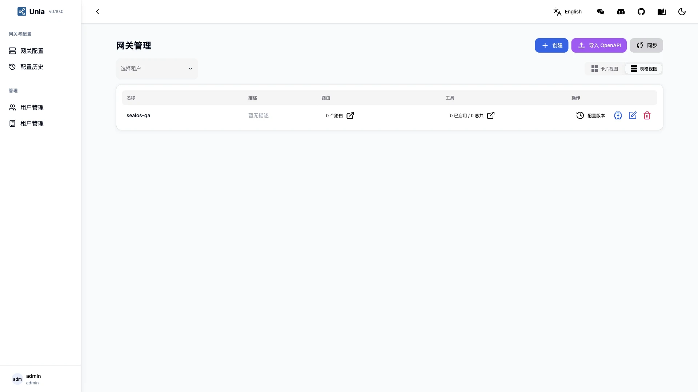

# Deploy and Host Unla on Sealos

Unla is a self-hosted MCP gateway that turns REST APIs and existing MCP servers into managed MCP endpoints through a web console. This template deploys the Unla all-in-one image v0.10.0 as a single StatefulSet with SQLite storage and a generated super administrator.

## About Hosting Unla

Unla runs as one all-in-one service on port `80`. The service contains the API server, the MCP gateway, the management console, and a SQLite database at `/app/data/unla.db`. The template mounts a 1Gi volume at `/app/data` so gateway configurations, MCP definitions, and administrator data survive restarts.

The Model Context Protocol (MCP) gives AI clients a standard way to discover tools and call them. Unla sits between those clients and your existing HTTP APIs: you describe an API in the console, Unla publishes an MCP endpoint, and an MCP client can list and invoke the exposed tools.

Sealos provisions the StatefulSet, persistent volume, ClusterIP Service, Ingress, TLS certificate, and App card. The super administrator username and password come from deployment inputs, and a generated JWT secret signs console sessions.

## Common Use Cases

- **REST API to MCP**: Publish existing HTTP APIs as MCP tools for AI agents and desktop clients.
- **MCP aggregation**: Manage multiple MCP servers behind one console and a consistent endpoint model.
- **Tool governance**: Centralize authentication, configuration, and visibility for agent-facing tools.
- **Internal AI assistants**: Connect company APIs to an assistant without rewriting each integration.
- **Prototyping agent workflows**: Create and test MCP configurations before promoting them to production.

## Dependencies for Unla Hosting

- A Sealos workspace with at least 1Gi of available memory and 1Gi of persistent storage.
- A browser for the Unla management console.
- Network access from the Pod to every upstream API or MCP server you register.
- An MCP client for testing published endpoints.

### Deployment Dependencies

- [Unla website](https://unla.amoylab.com) - Product overview
- [Unla documentation](https://docs.unla.amoylab.com) - Installation, gateway, and MCP configuration guides
- [Unla GitHub repository](https://github.com/amoylab/unla) - Source code and releases
- [Unla container image](https://github.com/amoylab/unla/pkgs/container/unla) - Image used by this template
- [Model Context Protocol](https://modelcontextprotocol.io) - MCP specification and client ecosystem
- [Sealos documentation](https://sealos.io/docs) - Platform concepts and operations

## Implementation Details

**Architecture Components:**

- **Unla StatefulSet**: One replica running `ghcr.io/amoylab/unla/allinone:v0.10.0` on port `80`.
- **Data volume**: A 1Gi volume mounted at `/app/data` for the SQLite database and gateway state.
- **Service**: ClusterIP port `80` forwarding to the Unla HTTP port.
- **Ingress**: Sealos-managed HTTPS host with a 32Mi request body limit and 300-second proxy timeouts.
- **App entry**: Opens the Unla management console.

**Configuration:**

- **Image**: `ghcr.io/amoylab/unla/allinone:v0.10.0`
- **HTTP port**: `80`
- **Environment**: `ENV=production`
- **API database**: SQLite at `/app/data/unla.db`
- **Gateway storage**: Database-backed, SQLite at `/app/data/unla.db`
- **JWT secret**: Generated `jwt_secret`, passed as `APISERVER_JWT_SECRET_KEY`
- **Super administrator username**: Required input `admin_username`, default `admin`
- **Super administrator password**: Required input `admin_password`
- **Public URL**: `https://${{ defaults.app_host }}.${{ SEALOS_CLOUD_DOMAIN }}/`
- **Health probe**: `GET /`
- **Runtime security**: `RuntimeDefault` seccomp profile and disabled service account token mounting
- **Timezone**: `Asia/Shanghai`

**Resource Allocation:**

| Component | CPU Request | CPU Limit | Memory Request | Memory Limit | Storage |
| --- | ---: | ---: | ---: | ---: | ---: |
| Unla | 100m | 1 | 102Mi | 1024Mi | 1Gi |

The live Sealos test signed in as the super administrator, created the `sealos-qa` MCP configuration, and recovered the configuration and account after a Pod restart. The Pod stayed ready with this profile, and the tested values are recorded in the workload annotation.

## Why Deploy Unla on Sealos?

Sealos is an AI-assisted cloud operating system built on Kubernetes. It supplies the compute, storage, networking, and operations layer for Unla through one interface:

- **One-click deployment**: Create the StatefulSet, data volume, Service, Ingress, and App card from one template.
- **Persistent gateway state**: Keep MCP configurations and administrator data on a dedicated volume.
- **Managed HTTPS**: Receive a public domain and TLS certificate for the console and published endpoints.
- **Central console**: Manage REST-to-MCP mappings and MCP server definitions in one place.
- **Resource control**: Adjust CPU and memory from the resource card as gateway traffic grows.
- **Operational visibility**: Inspect Pods, logs, events, and resource usage from Canvas or the Sealos AI dialog.

## Deployment Guide

1. Open the [Unla template](https://sealos.io/products/app-store/unla) and click **Deploy Now**.
2. Set the super administrator username and password, save the password, and confirm the generated application name.
3. Submit the deployment and wait 2-3 minutes for the Pod to become ready and for the HTTPS certificate to be issued.
4. Open the App card and sign in to the Unla console.
5. Create an MCP configuration for a test REST API, including the upstream URL and authentication.
6. Publish the configuration and copy the generated MCP endpoint into an MCP client.
7. List the available tools from the client and invoke one to confirm the gateway path.

## Login and Access

The public URL opens the Unla console. Sign in with the super administrator username and password from the deployment inputs. The account is seeded on the first boot, and later password changes can be made from the console.

The JWT secret signs console sessions. Changing `APISERVER_JWT_SECRET_KEY` ends existing sessions and requires a new sign-in. Keep the secret stable across redeploys so browser sessions and integrations remain valid.

## Using Unla

The console organizes work around MCP configurations. A configuration defines the upstream API or MCP server, the tools to expose, and the authentication used for the upstream call. Once published, the console shows the MCP endpoint that a client should use.

An MCP client connects to that endpoint, lists the available tools, and invokes them with JSON arguments. Unla translates each invocation into the configured upstream request and returns the response to the client. Use the console logs and request history to verify the mapping while you build a configuration.

## Scaling

Unla runs one replica because the all-in-one image uses a single SQLite database on a ReadWriteOnce volume. Scale vertically by raising the CPU and memory limits for many published tools, large request payloads, and higher gateway concurrency.

The 1Gi volume holds gateway configurations, administrator data, and SQLite state. Expand the PVC when the database or logs outgrow the volume, provided the storage class supports expansion. Horizontal scaling needs the split API server and gateway deployment with an external database, which this all-in-one template does not configure.

## Troubleshooting

### The administrator login is rejected

- Cause: The console still uses credentials from an earlier deployment, or the Pod has not restarted after an environment change.
- Solution: Compare `SUPER_ADMIN_USERNAME` and `SUPER_ADMIN_PASSWORD` with the saved values, update them, and restart the StatefulSet.

### Existing sessions end after a redeploy

- Cause: A new `APISERVER_JWT_SECRET_KEY` invalidates tokens signed with the previous secret.
- Solution: Keep the same secret across updates and sign in again after the change.

### A published tool cannot reach the upstream API

- Cause: The upstream host is unreachable from the Pod, the URL is wrong, or the upstream credentials are invalid.
- Solution: Test the upstream URL from a Pod in the namespace, confirm cluster egress, and review the authentication fields in the MCP configuration.

### MCP clients receive an empty tool list

- Cause: The configuration is unpublished, the endpoint path is wrong, or the client is not sending the expected authentication.
- Solution: Publish the configuration, copy the endpoint from the console, and compare the client request with the console request log.

### The console returns 502 after deployment

- Cause: Unla is still starting, or the readiness probe has not passed.
- Solution: Wait for the startup probe to finish, then inspect Pod events and logs for database or migration errors.

### Getting Help

- [Unla documentation](https://docs.unla.amoylab.com)
- [Unla GitHub issues](https://github.com/amoylab/unla/issues)
- [Model Context Protocol](https://modelcontextprotocol.io)
- [Sealos documentation](https://sealos.io/docs)

## License

Unla is released under the [MIT License](https://github.com/amoylab/unla/blob/main/LICENSE). This Sealos template is an independent deployment definition and is distributed under the templates repository license.
